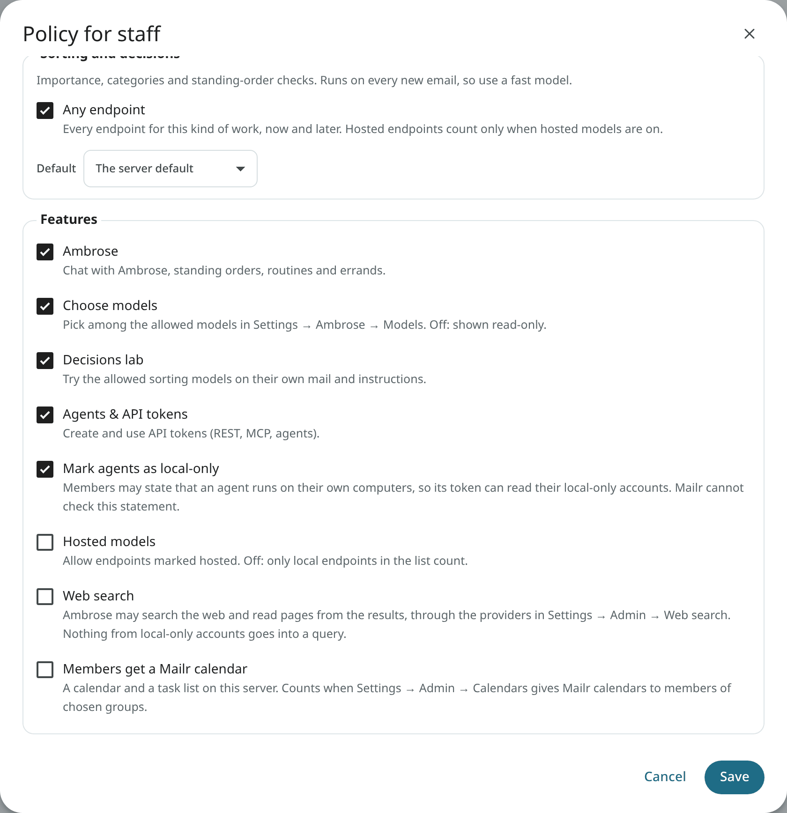

# Access policies

An access policy sets which models a user may use and which assistant features are available to
them. One policy is written for each group at the identity provider. Mailr has no group memberships of its
own: who is in which group comes from the identity provider and is read at every sign-in.

Policies do not apply to admins. Mail is outside every policy: reading, writing, search,
filters, labels, the spam filter and the learned label models are available to every user.

## Group membership from the identity provider

With single sign-on (OIDC), the `groups` claim of the ID token is read at every sign-in, on
the web and in the Android app. Add `groups` to the scopes (`MAILR_OIDC_SCOPES=openid email profile
groups`) and make sure your provider puts the groups in the ID token. Pocket ID, Authentik,
Keycloak and most other providers can do so.

- The claim is read as a set of group names. A single name counts as one group.
- When someone joins or leaves a group at the provider, the change is picked up at their next sign-in.
- When the ID token has no `groups` claim at all, the stored groups stay as they are.
- Every group name seen so far is listed under **Settings → Admin → Access policies → Groups seen**, with the
  number of users in it and whether it has a policy.

The groups are stored with the account (when, and from which source). Other sources could be added to
the same record later: a SAML attribute or a SCIM group push would then be the source in place of
the OIDC claim, and policies would not change.

### Accounts without single sign-on

For an account with password sign-in only, an admin assigns its groups
under **Settings → Admin → Users**: choose **access** in the user's row, type the groups (separated by commas) under
**Assigned groups**, then choose **Save groups**. Assigned groups count only while
no groups have ever been received from the provider for the account. For an account with sign-in through the
provider, the groups are taken from the provider and cannot be changed by hand in the app.

## Policy contents

Open **Settings → Admin → Access policies** and add a policy for a group name, such as `family` or `staff`.

| Part | Description |
|---|---|
| **Allowed models** | Per task, the endpoints and models members may use, or **Any endpoint**. "Ambrose and writing" (with the assistant's name) covers chat, summaries, briefs, translation, drafting help and recording follow-ups. "Sorting and decisions" covers importance, categories, triage signals, the questions of standing orders and the decisions lab. |
| **Default** | Per task, the model used for members who have not chosen one. It must be one of the allowed models. |
| **Ambrose** (the assistant's name) | Chat with Ambrose, standing orders, routines and errands. |
| **Choose models** | Members pick among the allowed models in Settings → Ambrose → Models. Off: members see the model read-only on the page, with "Set by your administrator". |
| **Decisions lab** | Members can try their own instructions and labels on the allowed sorting models. Other endpoints are never offered to them in the lab. |
| **Agents & API tokens** | Members can create and use API tokens, for the REST API, MCP and agents. Off: their existing tokens stop working too. |
| **Mark agents as local-only** | Members may state that an agent runs on their own computers, so its token can read their local-only accounts. See [Local-only agents](#local-only-agents). |
| **Hosted models** | Allows endpoints marked **Hosted** in the list. Off: only local endpoints in the list count. |
| **Web search** | Ambrose may search the web and read pages from the results, through the providers in [Web search](web-search.md). Off by default. |
| **Members get a Mailr calendar** | Members get a calendar and a task list on this server. It counts only when [Built-in calendars](calendars.md) are on for **Members of chosen groups**. A member who leaves keeps the calendar on the server, hidden until they are back. |

The search index (embeddings) is not part of a policy. It has one model for the whole server, and
only an admin can rebuild it.

## Local-only agents

Each user marks their own mail accounts local-only, under **Settings → Mail → Mail accounts**. Mail from those
accounts is never sent to a hosted model. It is visible to an agent token only when the token is marked
**This agent uses local models only**.

The mark is the user's own statement that the agent's model runs on their own computers or
servers. It cannot be checked. Who may make the statement is set with the switch **Mark agents as
local-only**:

- Off (the default): members cannot mark a token local-only. In the Create token dialog they see a short
  note in place of the box, and the API request is refused with 403.
- On: members see the box in the Create token dialog, if they have a local-only account.
- When you turn the switch off later, tokens already marked keep working as ordinary tokens. They can no
  longer read local-only accounts. They are not revoked, and when you turn the switch on again, they are
  restored.

An admin cannot see or choose a user's accounts or categories. Local-only remains each user's own
setting on their own accounts. **Settings → Admin → Users** lists each user's local-only tokens: the name,
when each was created and last used, and "(off)" when it is no longer allowed under the policy. No
mail is shown there. Every read through a token is in that user's audit log.

## Users in several groups

A user in several groups with policies is allowed everything that any of them allows: all their models, and
each switch turned on in any of them. The hosted-models switch applies inside each policy first, so
one group's hosted models never end up in another group's list. The default is taken from the first
group, in alphabetical order, with a default the user may use.

## Users in no group: the Everyone policy

A user whose groups have no policy is under the built-in **Everyone** policy. It is at the top of
**Settings → Admin → Access policies**, marked **Built in**. On a new server, it has:

- Ambrose, the built-in assistant, which acts with that person's own permissions and no more;
- any local endpoint that has a server default, for writing and for sorting;
- no hosted models, no model choice, no decisions lab, no API tokens and no web search.

Members therefore have Ambrose from the first day, without groups or policies. To allow more, for
example hosted models, choose **edit**. To allow less, turn its switches off and allow no
models: the assistant is then off with the message "Your administrator hasn't given you access to
Ambrose yet", and mail works as usual. The Everyone policy cannot be deleted or renamed.

A user in a group with a policy of its own is under that group's policy only, not the Everyone policy.

## Policy enforcement

The policy is checked on the server, on every path with a model call:

- Ambrose, standing orders, routines and errands;
- summaries, briefs, translation, reply suggestions, drafting help and recording follow-ups;
- triage, categories, importance and the questions of standing orders;
- the decisions lab;
- the agent tools over REST and MCP.

When a request is for a model not allowed in the policy, the group's default is used. When no model is
allowed, the request is refused with a plain message. Each refusal is written to the audit log
(`access.refused`). API tokens have their owner's rights, and the owner's policy applies to them.

## An example

Two groups at the provider, `staff` and `family`:

| | `staff` | `family` |
|---|---|---|
| Ambrose and writing | Any endpoint | `llm.example.com` · its chat model |
| Sorting and decisions | Any endpoint | the local decision model |
| Ambrose | on | on |
| Choose models | on | off |
| Decisions lab | on | on |
| Agents & API tokens | on | off |
| Mark agents as local-only | off | off |
| Hosted models | on | off |

A new Mailr installation has no group policies, only **Everyone**. Policies like the two above are
added under **Settings → Admin → Access policies**.

## Per user

**Settings → Admin → Users** lists each user's groups and their source. Open a user to see
their effective access: the policies that apply, the switches, and the models they may use.

## API

Admins only, from a signed-in session:

| Route | Description |
|---|---|
| `GET /api/v1/admin/access` | Policies, groups seen, the switches and the models a policy can allow. |
| `POST /api/v1/admin/access/policies` | Add a policy for a group. |
| `PUT /api/v1/admin/access/policies/{pid}` | Change a policy. |
| `DELETE /api/v1/admin/access/policies/{pid}` | Delete a policy. |
| `GET /api/v1/admin/users/{uid}/access` | A user's groups and effective access. |
| `PUT /api/v1/admin/users/{uid}/groups` | Assign groups to an account without single sign-on. |

Every user sees their own effective access in `GET /api/v1/me` (`access`).
