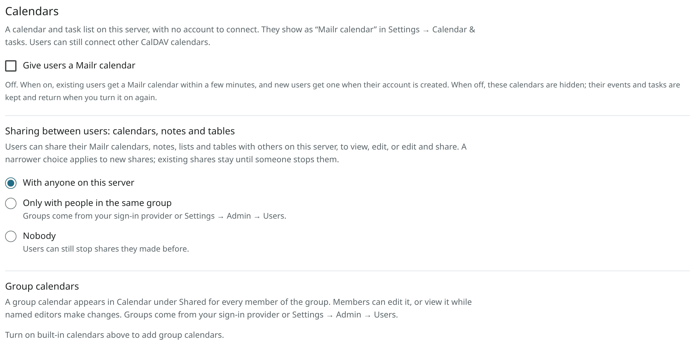
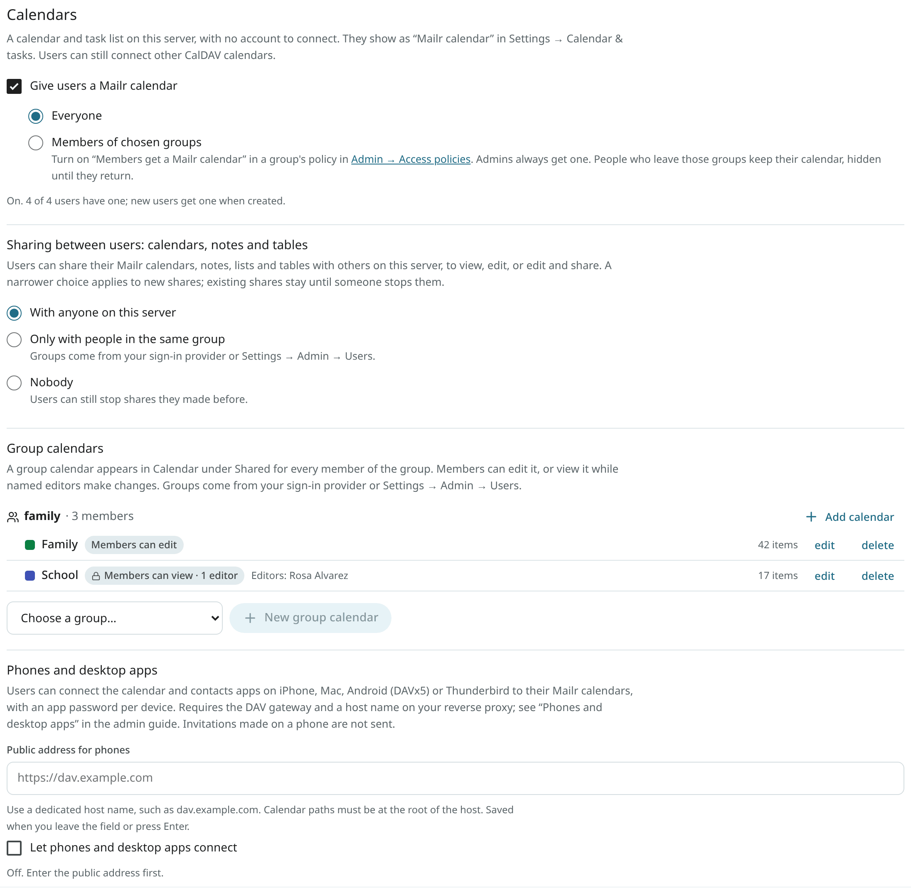
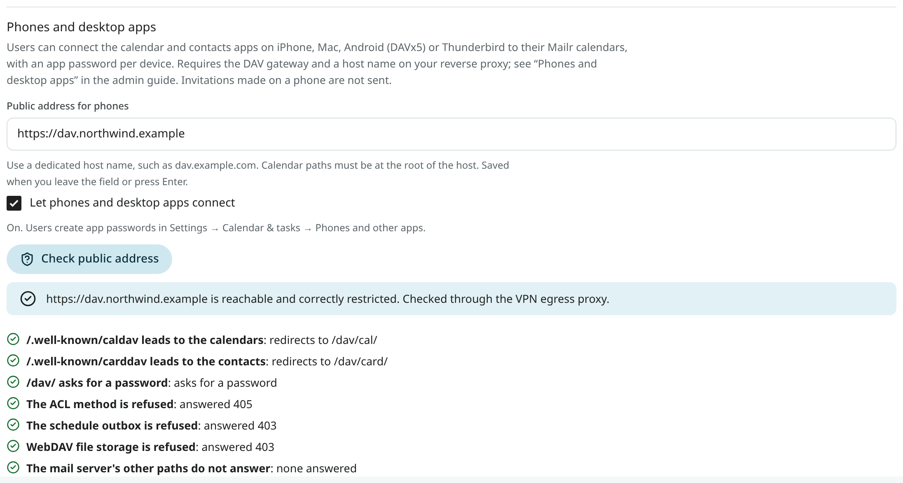

# Built-in calendars

With built-in calendars, each user has a calendar and a task list on Mailr's own server, with no
account to connect. They are stored on the bundled mail server (Stalwart), next to each user's mail,
and appear as **Mailr calendar** under **Settings → Calendar & tasks**, and in the Calendar and Tasks apps on
the web and on Android.

Built-in calendars are off by default. Calendars that users connected themselves (Nextcloud, Fastmail, iCloud, a self-hosted CalDAV
server) keep working either way.



## Turn them on

Open **Settings → Admin → Calendars** and tick **Give users a Mailr calendar**. Then choose who
gets one:

- **Everyone**, the default.
- **Members of chosen groups**. Only admins and the members of groups whose access policy has
  **Members get a Mailr calendar** turned on get one. The switch is set per group in
  [Settings → Admin → Access policies](access.md).

With **Everyone**:

- Every existing user gets a Mailr calendar within a minute or two.
- New users get one when their account is made.
- At first, each user's Mailr calendar holds a calendar named **Calendar** and a task list named
  **Tasks**. They become the user's default calendar and default task list, unless the user
  already uses another calendar for events or tasks. In that case the other calendar stays the
  default for that kind. **Calendar** is used for events only and is not listed among the task
  lists. A **Calendar** that already holds tasks from an earlier setup stays a task list too.

The settings are the instance settings `calendars.builtin` and `calendars.builtin_who`. The API is
`GET /admin/calendars`, with both settings and the number of users with a Mailr calendar in its answer, and
`PUT /admin/calendars` with `{"builtin": true}` or `{"builtin": false}`, and optionally
`"who": "everyone"` or `"who": "groups"`. Both are for admins only.
<!-- covers: settings.builtin_calendars -->

### Members who leave the groups

With **Members of chosen groups**, a user who leaves every group with a Mailr calendar
keeps it on the server. It is hidden from their settings, Calendar and Tasks and no longer synced,
as if the whole feature were off for them. Nothing is deleted. When they join such a group
again, they get the same calendar back with everything in it. A user who never had one gets it within
a minute or two of joining.

## User permissions

- A user cannot remove the Mailr calendar or change its address or sign-in. Sign-in to it
  is done with Mailr's own service account, so users have no password to manage.
- A user can hide it under **Settings → Calendar & tasks**, with the switch on its card, and show
  it again the same way. Its events and tasks are kept while it is hidden.
- Users can rename, recolour and add calendars and task lists inside it, as with any other
  calendar.

## Group calendars

A group calendar belongs to a group. Every member sees it in Calendar under **Shared**, with the
group's name. Groups come from the sign-in provider, or are assigned under
**Settings → Admin → Users** to accounts without a provider (see [Access](access.md)).



To add one, open **Settings → Admin → Calendars**, choose a group under **Group calendars** and
click **New group calendar**. Give it a name and a colour, and choose what members may do:

- **Can edit.** Every member can add and change events. A shared team or family calendar is the usual example.
- **Can view.** Members see the events, and only the ticked editors can change them. A school or
  club calendar that one or two people keep up to date is the usual example. Editors are chosen
  from the group's members.

A group calendar holds events. Member access is set when the calendar is made. To change
the access, download the calendar, make a new one with the other setting and import the file into it.

You can rename a group calendar, change its colour and, for a **Can view** calendar, its editors.
Members see the change at their next sync. With **Delete**, the calendar and everything in it are removed
for every member; in the dialog you can first download the whole calendar as an .ics file.

Visible to an admin: each group calendar's name, colour, access, editors and number of items. A
user's own calendars and their events are not visible to an admin.

Members can:

- Hide a group calendar, like any calendar, and show it again.
- Give it a colour of their own. The admin's colour stays for everyone else.
- Add and change events, in a **Can edit** calendar or as an editor. Elsewhere the write is refused,
  with a note that the calendar is read-only for them. The same rule applies to Ambrose.

Members cannot rename or delete a group calendar.

Membership is taken from the groups. Someone who joins the group sees its calendars within a minute or
two. Someone who leaves it, or whose account is disabled, loses them in the same time. Their own
calendars are not touched.

The API, for admins only:

- `GET /admin/calendars/groups`: every group known to Mailr, with its members and its calendars.
- `POST /admin/calendars/groups` with `group`, `name`, `color` (`#RRGGBB`), `access` (`write` or
  `read`) and `editors` (user ids, for `read`).
- `PATCH /admin/calendars/groups/{cid}` with `name`, `color` or `editors`.
- `GET /admin/calendars/groups/{cid}/export`: the calendar as one .ics file.
- `DELETE /admin/calendars/groups/{cid}?confirm=<name>`.
<!-- covers: settings.group_calendars -->

## Sharing between users

Sharing between users is set by one setting, for calendars, notes, lists and tables alike. Notes
and tables are shared from the Notes app ([Share a note](../user-guide/notes.md#share-a-note)); the
setting is in **Settings → Admin → Calendars** even while built-in calendars are off.

Users can share their own Mailr calendars with other people on this server, from the **Share…**
item in Calendar or the share button in **Settings → Calendar & tasks**. They pick people from
Mailr's own list of users, never from the mail server's directory. Each person gets one of three
levels: **View**, **Edit**, or **Edit and share** (edit, and share it further).

Under **Settings → Admin → Calendars → Sharing between users: calendars, notes and tables**, choose
who users can share with:

- **With anyone on this server**, the default. Every active user (for calendars: who has a Mailr
  calendar).
- **Only with people in the same group**. People who share at least one group with the person
  sharing. Groups come from the sign-in provider or from **Settings → Admin → Users**.
- **Nobody**. Users can still stop shares they made before.

A narrower choice applies to new shares and to level changes. Shares that already exist stay
until the owner or someone with **Edit and share** stops them.

- A disabled user is never offered. Their existing shares stay, without effect while the account
  is disabled, and take effect again when you enable it.
- When you delete a user, they are removed from every calendar shared with them. Calendars they owned are
  removed from everyone else's list.
- No "free/busy only" level is offered. Such a grant can be stored on the mail server, but the other person
  then sees nothing.
- A calendar can be shared with at most 50 people.
- API tokens and Ambrose cannot share calendars, notes or tables. Users share them while signed in.
- Notes and tables can also be shared with a group the user is in, and moved into a group. When you
  delete a user, their note and table shares are removed too.

The setting is the instance setting `calendars.sharing` (`anyone`, `groups` or `nobody`).
It is in the answer of `GET /admin/calendars`, and `"sharing"` can be sent to `PUT /admin/calendars` next to
`"builtin"`.

The [Group calendars](#group-calendars) screenshot shows this choice above the group calendars.
<!-- covers: settings.calendar_sharing -->

## Move from another calendar server

Users who keep their calendars on another CalDAV server (Davis, Nextcloud, Radicale, a hosted
one) can copy them into their Mailr calendar. They connect that account first, then click **Copy
into my Mailr calendar…** on its card in **Settings → Calendar & tasks** (see the
[user guide](../user-guide/calendar-sharing.md#move-your-calendars-into-the-mailr-calendar)). You can do
the same for a user from the command line:

```sh
docker compose exec app mailr calendars migrate --user rosa@northwind.example            # lists the accounts
docker compose exec app mailr calendars migrate --user rosa@northwind.example --from-connector 12 --dry-run
docker compose exec app mailr calendars migrate --user rosa@northwind.example --from-connector 12
```

`--from-connector` is the id of the connected account. Without it, the user's accounts are
listed. Options:

- With `--dry-run`, both servers are read and the counts are printed. Nothing is written.
- With `--collections Work,Chores`, only these calendars, task lists or address books are copied (names or
  the last part of their address).
- With `--overwrite`, the other server's version of items that differ is taken. Without it, the version in
  the Mailr calendar stays and the item is reported as a conflict.
- With `--make-default` and `--hide-copied`, the switch-over is done afterwards, like the user's own choices (below).

### Items copied

- Every calendar, task list and journal the user owns on that account, and every address book.
  A collection whose name matches one of the user's Mailr calendars is copied into it. Others become
  new collections with the same name, colour and kinds of item. The same targets are reused in a
  later run.
- Each item as it is: its UID, its name on the server when that name is plain, repeating series
  with their changed dates and time zones, reminders, guests, attachment links, subtasks. Address
  books are read as vCard 4.0, the form kept on the mail server.
- Nothing is deleted on either side. The user's account on the other server stays connected and
  unchanged.

The report has, per collection, how many items were copied, how many were already there, how
many differ (conflicts) and how many failed, with the reason. An item larger than 512 KiB
(attachments included) does not fit into the Mailr calendar. It fails and is named in the report.

"Already there" means the same item. Differences made by servers on their own do not count:
`DTSTAMP`, `PRODID`, `VERSION`, `SCHEDULE-*` parameters, line folding, the order of lines and of
the parts of a repeat rule, quoting, and a contact photo written the vCard 3 or the vCard 4 way.
<!-- covers: calendar.migrate -->

### Large accounts and interruptions

Items are read and written in pages of 100, with at most three writes at a time for each user.
The user sees a progress bar. The copy can be run again from where it stopped: whatever is
already in the Mailr calendar is skipped. A copy that stops in the worker is retried. Only one copy of
an account is run at a time.

When a listing from the other server is cut short, it is completed from Mailr's own copy of that account,
and the collection is marked as listed only in part. Run the copy again after the next sync of that
account.

### Manual setup after a copy

The report lists what cannot be carried over in a copy, with what to do:

| On the other server | In Mailr |
|---|---|
| A calendar shared with other people | Share the copy again with the same people. |
| A delegate or assistant (Davis "Delegates", Apple's calendar-proxy) | Share the user's calendars with that person in Mailr (**Share…**, level **Edit**), or give Ambrose a Mailr account if they have none. |
| A calendar someone else shared with the user | The owner shares it in Mailr. A copy of it is made only on request (`--collections`). |
| A subscription to a calendar link | Keep the old account connected for it, or import the calendar's file. |
| Invitations waiting in the server's scheduling inbox | The user answers them on the old server first. |

### Switch over

After a copy the user sees each event twice, once from each account. To avoid the duplicates, the user can
choose one or both of these. Both are off by default, and both apply to Mailr only:

- the copies become the default calendar and the default task list;
- the old account's copied calendars are hidden in Calendar.

The old account stays connected until the user disconnects it.
<!-- covers: calendar.migrate_cutover -->

The API, for the signed-in user (not for API tokens):

- `POST /connectors/{cid}/migration` with `dry_run`, `overwrite` and `collections`: a run is started, and
  the answer has its job.
- `GET /connectors/{cid}/migration`: the newest run of that account, and `last_copy`.
- `GET /connectors/{cid}/migration/{job_id}`: one run, with `status`, `done`, `total`, and the
  report in `result` once it has finished.
- `POST /connectors/{cid}/migration/cutover` with `make_default` and `hide_copied`.

## Invitations on connected calendar servers

Invitations, updates, cancellations and replies from Mailr are sent through the user's own mail
account. Some CalDAV servers (Davis, Nextcloud and other SabreDAV servers) are set up to send
scheduling mail of their own, which would duplicate that mail. On such a server, each copy written
from Mailr is marked with `SCHEDULE-AGENT=CLIENT` (RFC 6638): on the organiser of an event that
someone else organises, and on each guest of an event that the user organises. No scheduling mail
is then sent from the server for these events. Without the mark, a write to a server that has no
mail settings fails as a whole (HTTP 500 from Davis), and the event is not saved.

Events written by phone and desktop apps are not affected by the marks. For invitations made in
those apps to be sent, the calendar server needs its own mail settings (for Davis, `MAILER_DSN`
and `INVITE_FROM_ADDRESS`). With `INVITE_FROM_ADDRESS` empty, no invitation mail is sent from Davis.

## Phones and desktop apps

Users can connect the calendar and contacts apps of their iPhone, iPad, Mac, Android phone (with
DAVx5) or Thunderbird directly to their Mailr calendars, task lists and contacts. Each device has
its own app password, which a user makes under **Settings → Calendar & tasks → Phones and other
apps** (see [Your Mailr calendar on iPhone, Mac, Android and Thunderbird](../user-guide/phone-calendar.md)).

Phone access is off by default and works only while built-in calendars are on. Turning it on requires
three steps: a host name, the DAV gateway, and a forward on the reverse proxy.



### Invitations made on a phone are not sent

The mail server's own scheduling stays off. When a user adds guests to an event in a phone or
desktop calendar app, the event is saved, and nobody is invited. No warning is shown in the apps,
because invitation handling is still announced to them. Mailr's own invitations are not
affected: for events with guests made in Mailr (web or Android), invitations are still sent through the
usual approval step. On the user's settings page, in the setup dialog and in the iPhone profile, users are told
to invite people from Mailr.

### App password access

With an app password, CalDAV and CardDAV are open for its own user, with these limits:

- No mail: it is refused for IMAP and for JMAP, and no sending is offered to it.
- No sharing: the WebDAV `ACL` method is refused. Users share calendars in Mailr, where
  the sharing policy and the order of the grants are kept.
- No free/busy lookups of other people (the schedule outbox): from them, anyone could learn whether an address
  has an account here.
- No file storage, no directory searches.

A user may have up to 20. The password is shown once and never stored. The last use of a password
is not recorded on the mail server, so the list has the date it was made.

Every app password is paused while phone access is off, while the user is disabled, and while
the user has no Mailr calendar (built-in calendars off, or they are outside the group choice). A
paused password stops working at once and works again, unchanged, when all three hold again.

When you disable a user, their mail server password is also replaced until you enable them again, so their
IMAP apps stop working too. When you delete a user, their app passwords are removed first.

<!-- covers: settings.phone_access -->

### 1. Choose a host name

Give the calendar server a host name of its own, for example `dav.example.com`, with a DNS record
and a certificate on your reverse proxy. It works under Mailr's own host name as well (below),
but a separate name is better:

- Nothing sent by the mail server is run in Mailr's web origin, and Mailr's sign-in cookies are never
  sent to the mail server.
- It can be switched off, limited by address or rate-limited on its own, and its logs stay apart.
- The calendar paths cannot collide with Mailr's own pages.

The calendar paths must sit at the root of the host (`/dav/…`, `/.well-known/caldav`,
`/.well-known/carddav`): the links from the mail server are absolute, so a path prefix such as
`/calendars/dav/` cannot work.

### 2. Start the DAV gateway

Calendar requests to the bundled mail server go to its internal HTTP port, the same port as
its mail API and its admin interface. That port is never published. The DAV gateway is a
small nginx container through which only the paths required by calendar and contacts apps are published. Add the `phones`
profile in `.env` and start it:

```sh
# .env
COMPOSE_PROFILES=phones            # or vpn,phones
MAILR_DAV_BIND=127.0.0.1           # this host's LAN address if the reverse proxy runs elsewhere
MAILR_DAV_PORT=8026
MAILR_DAV_TRUSTED_PROXY=10.253.54.1   # your reverse proxy's address, as the gateway sees it
```

```sh
docker compose up -d dav-gateway
```

Request handling at the gateway:

| Request | Answer |
|---|---|
| `/.well-known/caldav`, `/.well-known/carddav` | redirect to `/dav/cal/` and `/dav/card/` |
| `/dav/…` with the methods calendar apps use (`PROPFIND`, `REPORT`, `GET`, `PUT`, `DELETE`, `MKCALENDAR`, …) | passed to the mail server |
| the `ACL` method, `POST` and other methods | 405 |
| the schedule outbox `/dav/itip/<user>/outbox/` and file storage `/dav/file/` | 403 |
| every other path (`/jmap`, `/api`, `/auth`, `/admin`, `/.well-known/oauth-*`, …) | 404 |
| a body over 10 MB | 413 |

Apps are also offered password sign-in only (OAuth sign-in on the mail server has its
paths blocked), cookies are stripped, and the device's address is passed on (below). The gateway's configuration
is `deploy/dav-gateway/default.conf.template`.

### 3. Forward the host on your reverse proxy

Forward everything on the phone host to the gateway's port. Keep the HTTPS settings you use for
Mailr itself.

**Nginx Proxy Manager.** Add a proxy host:

- **Domain names:** `dav.example.com`
- **Scheme:** `http`, **Forward hostname / IP:** the Mailr host (its LAN address if Nginx Proxy
  Manager runs on another machine, with `MAILR_DAV_BIND` set to that address), **Forward port:**
  `8026`
- **Block common exploits:** on. **Websockets support:** off. No access list: phones can be
  anywhere.
- **SSL:** your certificate, **Force SSL** and **HTTP/2** on. HSTS is fine.
- **Advanced:** nothing needed. The body size is limited at the gateway.

Then set `MAILR_DAV_TRUSTED_PROXY` to the source address of Nginx Proxy Manager's connections.

**Under Mailr's own host name instead** (not recommended, see above): in Mailr's proxy host, add
three **Custom locations**, each forwarded with scheme `http` to the Mailr host on port `8026`:
`/dav`, `/.well-known/caldav` and `/.well-known/carddav`. Users then enter Mailr's own address as
the server.

**nginx:**

```nginx
server {
    listen 443 ssl;
    http2 on;
    server_name dav.example.com;
    ssl_certificate     /etc/ssl/dav.example.com/fullchain.pem;
    ssl_certificate_key /etc/ssl/dav.example.com/privkey.pem;
    client_max_body_size 10m;

    location / {
        proxy_pass http://127.0.0.1:8026;
        proxy_set_header Host $host;
        proxy_set_header X-Forwarded-For $remote_addr;
        proxy_set_header X-Forwarded-Proto https;
        proxy_read_timeout 120s;
    }
}
```

**Caddy:**

```caddyfile
dav.example.com {
    request_body {
        max_size 10MB
    }
    reverse_proxy 127.0.0.1:8026
}
```

With Caddy, `X-Forwarded-For` is set to the client's address and a value the client sent is dropped, unless you
configure `trusted_proxies`.

**Without the gateway.** If your reverse proxy is inside Mailr's Docker network and
`stalwart:8080` is reachable from it, you can use the gateway's configuration file directly in that nginx:
replace `${MAILR_DAV_UPSTREAM}` by `stalwart:8080` and `${MAILR_DAV_TRUSTED_PROXY}` by the
addresses from which forwarded addresses are accepted. Never forward the whole port 8080.

### 4. Turn on phone access and check it

Open **Settings → Admin → Calendars**. Under **Phones and desktop apps**, enter the public address
(`https://dav.example.com`, host only) and click **Save**, then tick **Let phones and desktop
apps connect**.

Click **Check public address**. The address is sent the requests a phone and an attacker would
send, without a password: are the two `/.well-known` addresses redirected, is a password required at
`/dav/`, are `ACL`, the schedule outbox and file storage refused before they reach the mail
server, and is there no answer from the mail server's other paths. Each answer is shown on its own line.

The address is fetched the same way as remote content from mail: through the
VPN egress proxy when you set one up, never directly while `MAILR_REQUIRE_EGRESS` is on, and only
to a public address. When the fetch is not allowed under those rules (no working egress proxy, or the name
points to an address inside the local network on this server), the check is not run. The reason is
shown instead, with `curl` commands and the expected answers. Run them from outside your network, for
example from a phone with Wi-Fi off.

<!-- covers: settings.phone_access_check -->

### Real client addresses

An address is locked out of the mail server after repeated failed sign-ins. Behind a proxy, every phone
would seem to come from the proxy, and one attacker could lock out everyone. With phone access on,
the mail server is set to take the client's address from `X-Forwarded-For`; with phone access off,
this setting is turned back off.

That header is trusted from anyone who reaches the mail server. So the mail server's HTTP port may
be reached from outside only through the gateway, and the header is set at the gateway. The
device's address is taken from your reverse proxy's `X-Forwarded-For`, and only from the address in
`MAILR_DAV_TRUSTED_PROXY`. Set that variable correctly: when it is wrong, your proxy's address is
passed on for every phone, and a lock-out affects everyone. The gateway is not on the mail
server's list of addresses that are never locked out.

### Group calendars and address books on phones

Members of a group see the group's calendars on their devices too, with the same rights as in
Mailr. On the mail server, every group would also get an empty calendar and address book of its own,
writable by every member. They are kept out of the way: each group has a calendar named **Not used**,
which holds free/busy data only, so it is left out of calendar apps, and while phone access is on, no
address books are made on the mail server on its own (each user's **Contacts** book comes from Mailr).

### Turn phone access off

Untick **Let phones and desktop apps connect**. Every app password is paused at once. Then stop
the gateway (`docker compose stop dav-gateway`, and remove `phones` from `COMPOSE_PROFILES`) and
remove the proxy host. Users' passwords work again if you turn phone access back on.

The settings are the instance settings `calendars.phone_access` and `calendars.phone_url`.
Both are in the answer of `GET /admin/calendars`, and `"phone_access"` and `"phone_url"` can be sent
to `PUT /admin/calendars` next to `"builtin"`. The check is run with `POST /admin/calendars/phone-check`. Users' app
passwords: `GET /me/dav`, `POST /me/dav/app-passwords` with `{"name": "…"}`, and
`DELETE /me/dav/app-passwords/{pid}`, for the signed-in user only (API tokens cannot use them).

## Turn them off

Untick **Give users a Mailr calendar**. The Mailr calendars are removed from every user's
settings, Calendar and Tasks, and they are no longer synced. Nothing is deleted: the events and tasks
stay on the mail server. When you turn the setting on again, every user gets the same calendar
back with everything in it.

## Backups

The events, tasks and contacts of the Mailr calendars are stored by the mail server, in the
Stalwart data volume. They are in two backups:

- **A nightly snapshot of the Stalwart volume.** You set up this job on the host; see
  [Snapshot the Stalwart volume](backups.md#snapshot-the-stalwart-volume) for a command and a schedule.
- **The daily calendar export.** Every user's calendars, task lists and address books, and every
  group calendar once, as `.ics` and `.vcf` files under `/data/exports/calendars/` and on the
  backup target. See [Calendars and contacts](backups.md#calendars-and-contacts).

To put an export back, run `mailr calendars restore`. After restoring the Stalwart volume, run
`mailr calendars resync --all`, so that every calendar is compared in full. Both are described in
[Restore calendars and contacts](backups.md#restore-calendars-and-contacts).

## Ownership, invitations and devices

- Each user's calendar belongs to their mail server account. Someone who can read a calendar
  shared with them sees the owner's display name, never their address in Mailr or their user
  number.
- No invitations or reminder emails are ever sent by the mail server on its own; invitations
  are sent from Mailr through its usual approval step.
- Phones and desktop calendar apps can be connected to the Mailr calendar once
  [phone access](#phones-and-desktop-apps) is on. In the Mailr Android app it appears like any other
  calendar either way.
