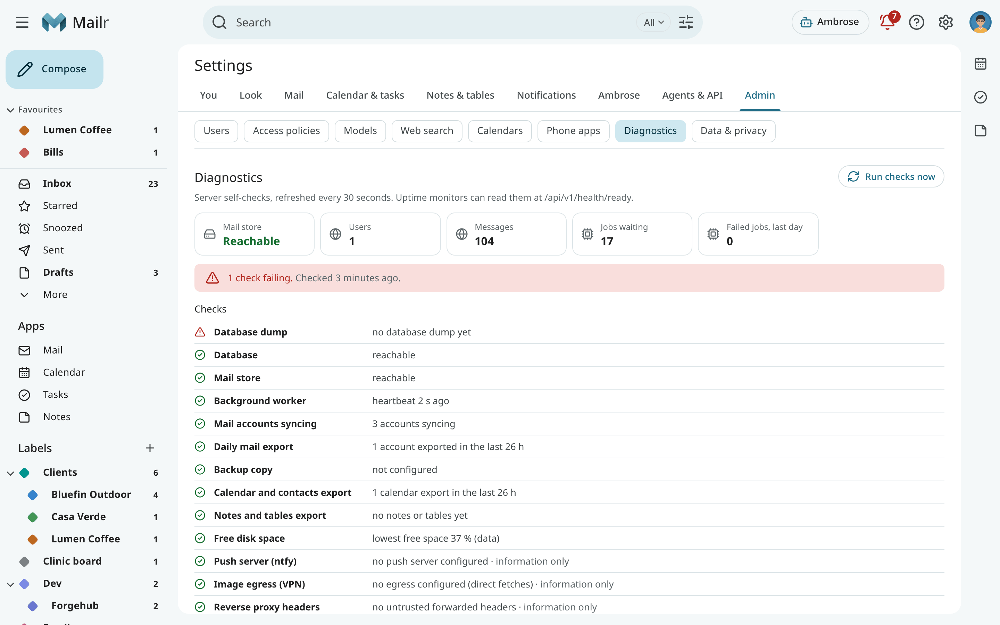

# Admin guide

This guide covers the administration of a Mailr server: installing, configuring, securing, backing up and upgrading the stack, and the admin screens inside the app.

An admin manages users, model endpoints and instance policies. Every user, admin or not, manages only their own mail accounts, labels, rules and tokens. No user can see another user's mail.

## Install and run

| Page | Topics |
|---|---|
| [Deployment](deployment.md) | The services, ports, volumes and resources of the stack. |
| [Scaling](scaling.md) | How the work is shared between users, model call limits, more workers and sizes of server. |
| [Configuration](configuration.md) | Every setting in `.env`, grouped by topic. |
| [Reverse proxy](reverse-proxy.md) | HTTPS in front of Mailr, with Caddy, nginx and Traefik examples. |
| [Upgrades](upgrades.md) | New versions, migrations and pinned images. |
| [Backups](backups.md) | The parts to back up, the daily export, the backup target and restores. |

## Users and sign-in

| Page | Topics |
|---|---|
| [Sign-in and OIDC](sign-in.md) | Passwords, single sign-on, the phone app's sign-in and sessions. |
| [Users](users.md) | Adding, disabling and removing users, and instance policies. |
| [Organisations and small businesses](organisations.md) | Running Mailr for a business, a club or an office. |
| [Access policies](access.md) | The models and assistant features available to each user. |

## Mail

| Page | Topics |
|---|---|
| [The mail server](mail-server.md) | The bundled Stalwart server, IMAP, TLS and spam checks. |
| [Account modes](store-and-mirror.md) | Keep in sync, Mailr keeps the mail and Copy once, and turning on deletion at the provider. |
| [Image proxy and VPN egress](image-proxy.md) | Remote images in mail, trackers and an optional VPN exit. |

## Features

| Page | Topics |
|---|---|
| [Models](models.md) | Model endpoints, models per task, local-only mail and embeddings. |
| [Web search](web-search.md) | Search providers, page readers and the browser in the stack. |
| [Built-in calendars](calendars.md) | A calendar and a task list for every user on Mailr's own server, and access from phones and computers. |
| [Phone apps](phone-apps.md) | Publishing the Android apps' APKs, which are downloaded to phones from the server. |
| [Push notifications](push.md) | ntfy and UnifiedPush for phones, Web Push for browsers. |
| [Dictation server](dictation.md) | A self-hosted speech-to-text server for dictation. |
| [Languages](languages.md) | The languages of the app and of this guide, and adding a translation. |

## Operations

| Page | Topics |
|---|---|
| [Security and permissions](security.md) | Encryption, sessions, tokens, approvals and network controls. |
| [Monitoring](monitoring.md) | The health endpoints, their checks, heartbeats and example uptime monitors. |
| [Troubleshooting](troubleshooting.md) | Diagnostics, logs and common problems. |
