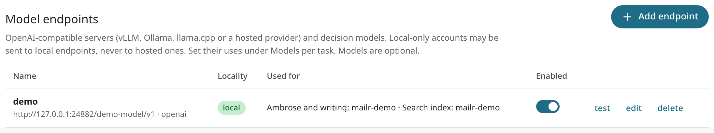
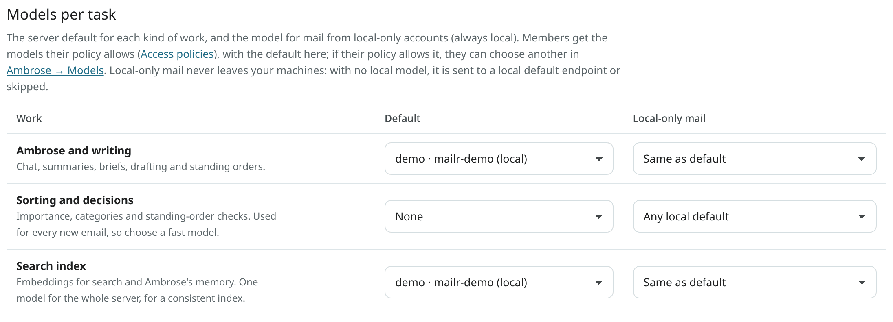
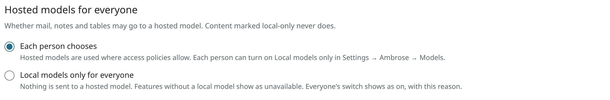

# Models

Mailr can be run with no models at all. Keyword search, threading, filters, the spam filter and the learned classifier work without them.

With models, the following are also available:

- meaning-based search and the citations in Ambrose's answers;
- conversation summaries, briefs and translation;
- reply suggestions and drafting help;
- model-based importance, categories and triage signals;
- Ambrose and the background work of standing orders;
- dictation through the server (speech to text).

No model is ever run inside Mailr's own containers. Every model is an endpoint on an external server: vLLM, Ollama, llama.cpp, LM Studio, or a hosted provider. Any server with the OpenAI-compatible API (`/chat/completions`, `/embeddings`, `/audio/transcriptions`, `/models`) works.

## Add an endpoint

Open **Settings → Admin → Models → Model endpoints** and click **Add endpoint**.



| Field | Value |
|---|---|
| **Name** | A label, such as "Local vLLM". |
| **API** | **OpenAI-compatible** for most servers. The other choice is a [decision model](#decision-models), which is used only for sorting and yes/no decisions. |
| **Base URL** | The server's API root, such as `http://llm.local:8000/v1`. |
| **API key** | Optional. It is stored encrypted. |
| **Locality** | **Local**: on hardware you control, and allowed to receive local-only accounts, notes and tables. Every address of its host must be private or loopback. **Hosted**: a third-party service; it never receives local-only mail, notes or tables. |
| **Models** | The model names offered by the server. With **Discover**, the server is asked for its list. |

Turn **Enabled** off to stop using an endpoint without deleting it.

### How a local endpoint is checked

The addresses of a local endpoint are checked when it is saved and again each time a connection to it is
made. Each connection goes only to an address that passed the check. When the host resolves to a public
address at that moment, the connection is refused and the call fails; it is never sent on to the public
address. The endpoint list shows each endpoint as **local (checked)**, as **local (check failed: …)** with
the reason, or as **hosted**.

In `MAILR_OUTBOUND_ALLOW`, only IP addresses and networks (CIDRs, such as `10.20.0.0/16`) count as local.
A host name listed there is still allowed as a connection target, but it counts as local only when every
address it resolves to is private or loopback.

## Test an endpoint

Click **test** in an endpoint's row. One tiny request is sent: a five-word chat, a one-word
embedding for an endpoint used only for the search index, one yes/no decision for a decision
model, or, for an endpoint used only for speech to text, a request for its model list (no audio is
sent). The row then shows the time the answer took, or what went wrong in plain words, such as
"The API key was refused." or "The address is wrong: the server has no such path (404)."

Without a test, the row shows the endpoint's last success and last error from real use.
**Models per task** shows the same for each kind of work, so a model that stopped working is
visible before anyone reports missing features.
<!-- covers: settings.model_test -->

## Models per task

**Models per task** holds, for each task, one server default and one model for local-only mail.

| Task | Used for |
|---|---|
| **Ambrose and writing** | Chat, summaries, briefs, drafting help and the background work of standing orders. |
| **Sorting and decisions** | Importance, categories and the yes/no questions of standing orders. This model is used on every new email, so pick a fast one. |
| **Search index** | Embeddings for search and Ambrose's recall. One model for the whole server, so the index stays consistent. |
| **Speech to text** | Dictation: a spoken clip from the web app or the Android app is turned into text. See [Speech to text](#speech-to-text). |

A chat model alone is enough to start: pick it for **Ambrose and writing** and **Sorting and decisions**, and leave **Search index** at **None** when the server has no embedding model. Search and Ambrose then match by words only; matching by meaning ("the thread about the budget overrun") starts once an embedding model is set here and the index is built.

A model chosen for **Search index** is checked first with one short embedding request. A chat
model fails this check, and the choice is refused with "This model does not make search embeddings.
Choose an embedding model, or leave Search index at None." under the task. The previous choice
stays. The **Search index** list shows the models that passed the check and the current choice;
models that failed it are greyed out under **Does not make embeddings**, and the others are listed
under **Not checked yet**, where choosing one runs the check. Changing an
endpoint's address clears its checks. **Ambrose and writing** and **Sorting and decisions** are
not checked this way.



Users can pick a different model for **Ambrose and writing**, **Sorting and decisions** and **Speech to text** under **Settings → Ambrose → Models**, from the models allowed in their [access policy](access.md). The same page shows, for each task, which model local-only items use, or that none is available. The search index is the same for everyone, and only an admin can rebuild it.

## Decision models

A decision model is optional. Mailr works the same without one: the chat model chosen for
**Sorting and decisions** answers those questions with a short JSON reply.

A decision model answers classification questions only, with a probability for each answer instead
of free text. It speaks the System One protocol of TypeSafe: `POST <base URL>/systemone` with the
email as structured data and one or more questions, each a yes/no question or a choice between named
options. The answer is the probability of yes, or the chosen option with the probability of each.
TypeSafe offers it as a hosted service (base URL `https://api.typesafe.ai/v1`, with an API key), and
any local server that implements the same request can be added as a **Local** endpoint.

To add one, choose **Decision model** under **API** when you add the endpoint, and pick it for
**Sorting and decisions** under [Models per task](#models-per-task). It is then used for:

- importance, the inbox category, deadlines and the main link of new mail;
- the yes/no and choice questions of standing orders ("Is this a job alert?", "Which project is
  this about?");
- the check of Ambrose's memories against a request, when the endpoint is **Local**
  (`MAILR_MEMORY_CHECK_ENDPOINT`, [Configuration](configuration.md)). A hosted decision model is
  never used for this check, because a memory can come from local-only mail.

A decision model cannot chat, write or make embeddings, so a chat model is still needed for Ambrose
and writing. The rules for local-only mail apply to it as to any endpoint: a hosted decision model
never receives local-only mail.

## Thinking models

The reasoning of a thinking model is never shown in the chat or stored with the answer, whether the server sends it in its own field (`reasoning_content`) or inside `<think>` tags. A server that sends its reasoning as plain text, with no marker, cannot be told apart from the answer: turn on its reasoning parser (llama.cpp `--reasoning-format auto`, vLLM `--reasoning-parser`) or turn thinking off for that model.

## Speech to text

Dictation is the task **Speech to text**. Any endpoint with the OpenAI transcription API
(`POST <base URL>/audio/transcriptions` with a `file` and a `model`) can do it: a WhisperX or
faster-whisper server on your network, or a hosted service such as OpenAI or Groq. Choose its model
under **Models per task** like the other tasks.

`MAILR_ASR_URL` adds a built-in local endpoint, **Speech server (server)**, with `MAILR_ASR_MODEL` as the
task's default (see [Dictation server](dictation.md)). Its address, locality and API are set by the
environment and cannot be changed or deleted in the endpoint list. Its models, its task defaults and
**Enabled** can be changed.

Each dictation request names what the clip is spoken into: a chat, a draft, a note, a task, or nothing.
A clip spoken into a chat that has read local-only items, a draft of a local-only account, a local-only
note or a task in a local-only calendar is sent only to a local endpoint. Without one, "Not available
with local models only" is shown. A request from an older app that names nothing is treated the same
way. Other clips may go to a hosted speech service.

## Local-only mail

The content of a mail account marked local-only, by its user or by a [data policy](users.md#instance-policies), is sent only to endpoints marked **Local**, with no override. When a task has no local model, the features that depend on it stay off for that mail; no hosted model is used as a fallback. With a hosted search-index model, local-only mail is not embedded at all and stays keyword-searchable.

The rule also follows what a request or a background job has read. When a request or a job reads a
local-only email, note, table, memory, recording or calendar item, every later model call in it is
treated as local-only, even when its own content is not. A background job that works through many items
checks each item on its own, so one local-only email does not keep the rest of a batch local.

This covers what is written from such an account as well. With **Help me write**, a draft saved on a local-only account or sent from one is written by a local model. In Ambrose's chat, the signature of a local-only account is given to the model only when the chat already stays local. A meeting follow-up that Ambrose writes after reading local-only mail is written by a local model too.

## Hosted models for everyone

**Settings → Admin → Models → Hosted models for everyone** sets whether mail, notes and tables may be sent
to a hosted model. Content marked local-only is never sent to one, whatever the choice.



| Choice | Effect |
|---|---|
| **Each person chooses** (the default) | Hosted models are used where the access policies allow them. Each person can turn on **Local models only for me** in Settings → Ambrose → Models. The switch is off at first. |
| **Local models only for everyone** | Every model call, for every user and for the server's own jobs, is sent to a local endpoint. For a feature with no local model, "Not available with local models only" is shown. Everyone's switch is shown as on and locked, with the reason. |

A person's switch cannot be locked off. A person can always set a stricter rule for themselves.

The rule is checked in one place, where the model for every call is chosen, and again when the
request is sent. A call counts as local-only when the rule for everyone or the person's switch is set
that way, when the mail, note or table is marked local-only, or when the request or job has read
local-only content. The rule for everyone and the person's switch also apply to Speakr's own models. With a hosted search-index model, the content of a person with local
models only is not embedded and stays keyword-searchable.

Each Ambrose answer is labelled with the model it came from and whether it was local, and each person has a
**Model use** table for the last 30 days. The API routes are `GET /admin/models/local-policy` and
`PUT /admin/models/local-policy` (the rule for everyone), `GET /me/local-models` and `PUT /me/local-models`
(the person's switch) and `GET /me/model-use`.

<!-- covers: settings.local_models_household -->

## Seed endpoints from `.env`

With `MAILR_SEED_MODEL_ENDPOINTS`, endpoints are added to the registry on the first start. Its value is a JSON list:

```ini
MAILR_SEED_MODEL_ENDPOINTS=[{"name":"local-llm","base_url":"http://llm.local:8000/v1","locality":"local","models":["my-chat-model","my-embed-model"],"defaults":{"chat":"my-chat-model","classify":"my-chat-model","embed":"my-embed-model"}}]
```

| Key | Meaning |
|---|---|
| `name` | The label shown in the app. |
| `base_url` | The API root. |
| `api_key` | Optional. |
| `locality` | `local` or `hosted`. |
| `models` | The model names served. |
| `defaults` | Task to model: `chat`, `classify`, `embed`. |

After the first start, manage endpoints in the app.

## Embeddings

Each message is split into paragraph-sized passages, without signatures and quoted history, and the passages are embedded in the background. For search, these vectors are combined with full-text search in Postgres.

- 512-dimension vectors are requested. Models with adjustable dimensions (Matryoshka models such as Qwen3-Embedding or OpenAI's `text-embedding-3` models) fit well; longer vectors are shortened.
- Identical text is embedded once. When an endpoint fails, embedding is paused for a few minutes while mail keeps flowing; the backlog is cleared later.
- When you change the search index model, everything is re-embedded in the background, and only vectors from the current model are used for search.

To start re-embedding at once:

```sh
docker compose exec app mailr reembed                       # every user, queued for the worker
docker compose exec app mailr reembed alex@northwind.example  # one user
docker compose exec app mailr reembed alex@northwind.example --inline  # run in this process
```

## Calls stay off the request path

Model work is done in the worker, in batches, and is cached. Page loads are never held for a model call; the exceptions are Ambrose and requested drafting help. When a model is down, mail keeps working and model jobs are held in the queue.
