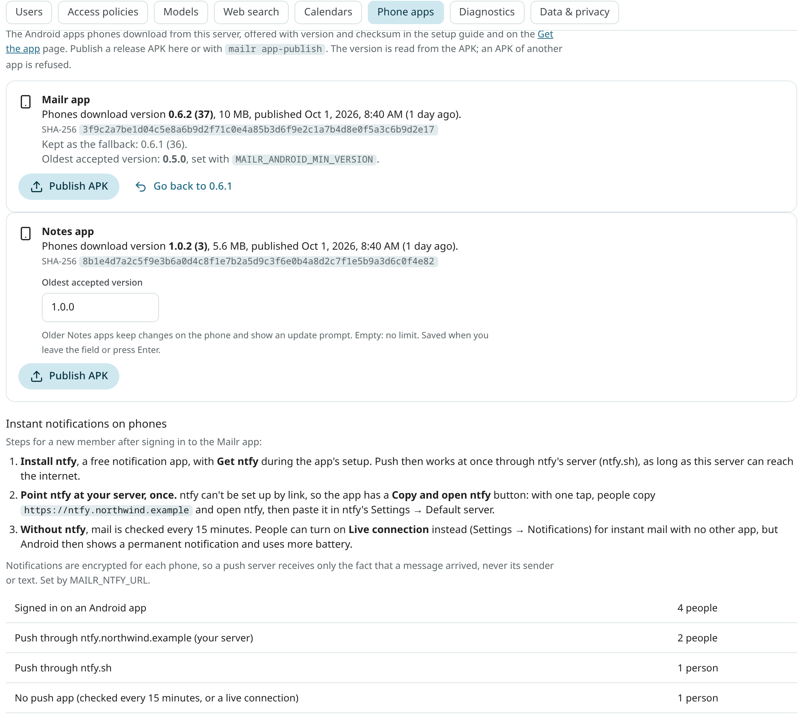

# Phone apps

The two Android apps, **Mailr** and the **Notes** app, are served from the Mailr server itself. The setup
guide's phone step and the **Get the app** page (`/get-app`) have links to the APKs on the server,
with each app's version, size and SHA-256 checksum. A new release is published once and is then
offered to every new phone.

| App | Downloaded from |
|---|---|
| Mailr | `/api/v1/app/mailr.apk` |
| Notes | `/api/v1/app/notes.apk` |

No sign-in is required for the downloads and `GET /api/v1/app/releases` (the versions). On a phone, the
link from the setup guide's code is opened before sign-in, and an APK holds no secrets.

While the server holds no APK of an app, phones are sent to the latest
[GitHub release](https://github.com/murtaza-nasir/mailr/releases/latest).
With `MAILR_ANDROID_APK_URL`, phones are sent to another address for the Mailr app. No version is then
shown for it.

## Publish a release

**From the command line.** Pipe the APK into the running app container:

```sh
docker compose exec -T app mailr app-publish --app mailr < app-release.apk
docker compose exec -T app mailr app-publish --app notes < notes-release.apk
```

With plain Docker, use `docker exec -i <app container> mailr app-publish --app notes < notes-release.apk`.

**From the web.** Open **Settings → Admin → Phone apps** and choose **Publish APK** beside the app.



<!-- covers: settings.phone_apps -->
Either way:

1. the file is checked to be a signed APK;
2. the package, `versionName` and `versionCode` are read from the APK's manifest;
3. an APK is refused when its package is not the one for that app, for example the Notes APK sent as
   `--app mailr`, or when it is a debug build (its package ends in `.debug`);
4. a lower `versionCode` than the one served is refused, unless you pass `--allow-older`;
5. the replaced version is kept as the **previous** version, and the SHA-256 is computed.

Publishing the same file again changes nothing. Each publish is in the audit log as
`admin.app_publish`, with the version and checksum. A publish from the command line is logged in
the first admin's log, with the actor `cli`.

## The oldest version phones may run

Old versions of the apps can be refused. On phones with an older version, a banner is shown with a
request to update. Their changes stay on the phone and are sent after the update. The release list and
the APK downloads stay open to them, so they can still fetch the new version.

- **Mailr app:** the limit is the environment variable `MAILR_ANDROID_MIN_VERSION` (default `0.5.0`). It is
  shown in the admin section but can be changed only in the server's environment.
- **Notes app:** the limit is set in **Settings → Admin → Phone apps**, in the field **Oldest accepted
  version** under the Notes app. Type a version such as `1.1.0` and press Enter, or leave the field.
  Undo is offered in the toast. Empty means no limit, which is the default.

<!-- covers: settings.notes_min_version -->
Publish the new version before you raise the limit, so that phones can download it. Each change is in
the audit log as `admin.app_min_version`. On a server with several app processes, the new
limit takes effect within 30 seconds.

## Instant notifications on phones

Below the apps, the steps a new member takes to get instant notifications on Android are listed, with the number of people's phones that push through each server. See [Member setup](push.md#member-setup).

## Go back to the previous version

The current and the previous version are swapped with `mailr app-publish --app notes --rollback` or
**Go back to …** in the admin section. The previous version is then downloaded to phones again. When the current file
is missing, the previous one is served.

## File locations

The APKs are in the data volume, in `<data dir>/app/<app>/`: `current.apk` and `previous.apk`, each
with a `.json` file that holds its version, size, checksum, publish time and who published it. A
`mailr.apk` that was copied into `<data dir>/app/` by hand is still served until the first publish,
when it is kept as the previous version.

## Custom builds

For a build with another applicationId, set the package each app must have in
`MAILR_ANDROID_PACKAGE_MAILR` and `MAILR_ANDROID_PACKAGE_NOTES`.

To build both release APKs from source and publish them in one step, use `tools/android-release` from
a checkout of the repository:

```sh
tools/android-release                          # build both release APKs
tools/android-release --publish my-docker-host # build, then publish both to the app container there
```

Give `--publish` an SSH host. The container is found by its Compose labels (project
`mailr`, service `app`), and each APK is piped into `mailr app-publish`. With `--no-build`, the APKs
that are already built are published. The release signing settings are described in
[Build a release from the source](#build-a-release-from-the-source) below.

## Build a release from the source

From a checkout of the repository, the release APKs of both apps are built with `tools/android-release` (through `android/build.sh`), and with `tools/android-release --publish <ssh-host>` they are also handed to the Mailr server on that host. They are then downloaded to phones from that server. Release builds are signed with the key in `android/keystore.properties` (`storeFile`, `storePassword`, `keyAlias`, `keyPassword`; keep a backup, because updates must be signed with the same key). Without that file the APKs are unsigned, and they cannot be published. See the sections above for publishing an APK you already have.

## The Notes app sign-in

Sign-in to the Notes app goes through the same OIDC client as the Mailr app, but the sign-in comes back to its
own address, `io.github.murtazanasir.mailr.notes:/oauth2redirect`. Add that redirect URI to the client in your
identity provider (in Pocket ID, for example, the client's callback URLs). To change it, for a build with another
application id, set `MAILR_OIDC_NATIVE_NOTES_REDIRECT`.

The web links that open in the app are taken from `android/deploy.properties` when you build it
(`appLinkHosts`, the same setting as the Mailr app's), and the server field's first value from
`defaultServer`. Build both apps with `android/build.sh assembleRelease`; the Notes APK is
`android/notes/build/outputs/apk/release/notes-release.apk`.

## Notes and tables on phones

A copy of each user's notes, lists and tables is kept in the Android app, and only what changed is read
(`GET /api/v1/notes/sync` and `GET /api/v1/tables/sync`). No setup is required on the server.
Changes made offline are sent when the phone is back online, each one once.

Note reminders ring from the separate Notes app when it is installed on the phone, and otherwise
from the Mailr app. With both apps on a phone, a reminder rings once.
