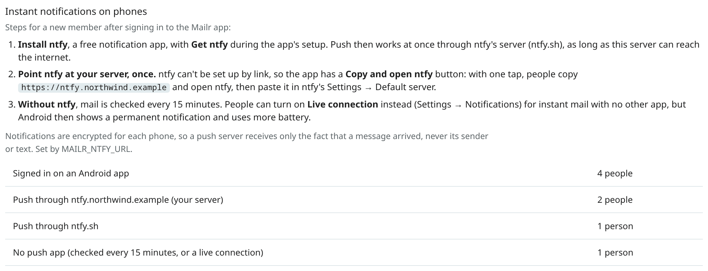

# Push notifications

People are notified in three ways:

- **Open web app tabs** get live updates over the event stream. No setup is needed.
- **Browsers** get reminders through Web Push, even with no Mailr tab open.
- **UnifiedPush targets**, such as an ntfy topic, get new mail, approvals and other events.

## Notification contents

Notifications hold as little as possible. For most mail they have the sender's name, never the message body. For mail from a local-only account, the text is only "New message".

Events include new mail, important new mail, an agent's send waiting for approval, a failed send, an assistant result and reminders. The events notified to each device are set by the user, per device.

## Member setup

<!-- covers: admin.push_setup -->

**Settings → Admin → Phone apps → Instant notifications on phones** lists the steps below for this server, and how many people are signed in on an Android app, how many push through which server, and how many have no push app. Only counts are shown.



1. **Install ntfy**, with **Get ntfy** in the app's first setup. Nothing is typed: push works at once through ntfy's own server, ntfy.sh. Every message is encrypted for the phone, so only the arrival of a message is visible to ntfy.sh.
2. **With a self-hosted ntfy server** (`MAILR_NTFY_URL`), one paste: **Copy and open ntfy**, then **Settings → Default server** in ntfy.
3. **Without ntfy**, the server is checked every 15 minutes. A person can turn on **Live connection** (Settings → Notifications): the server's event stream is kept open in the background, so mail arrives at once with no other app. A permanent notification is shown for it, and battery use is higher than with ntfy, where one connection is shared among every app on the phone. The live connection is off by default and is not used while push through a push app works.

Push methods not used:

- **Google's push (FCM).** The only ready-made way to push without a push app goes through Google's servers, and nothing is sent from Mailr through Google.
- **ntfy accounts made by Mailr.** A link cannot carry an ntfy user or token into the ntfy app, so per-person ntfy accounts would add typing. Let anyone read and write `up*` topics on the ntfy server instead (below).

## UnifiedPush and ntfy

Events are pushed to every UnifiedPush endpoint a user registers with `POST /api/v1/push/targets`, for example a topic on an ntfy server. A test notification is sent with `POST /api/v1/push/targets/{tid}/test`.

The Android app is registered on its own: when the phone has a UnifiedPush app (a distributor, such as the ntfy app), its endpoint is posted to `POST /api/v1/push/targets` with the phone's Web Push keys, and that target is replaced or deleted when the endpoint changes or the user signs out. New mail, approvals, failed sends and assistant results then arrive within seconds; as a fallback, the server is checked once an hour. Without a distributor, it is checked about every 15 minutes. See [Instant notifications](../android/mail.md#instant-notifications-push) and [Notifications](../user-guide/notifications.md).

### Push message contents

Each UnifiedPush message is a small JSON document of at most 3,800 bytes (the limit in ntfy and the UnifiedPush specification is 4,096):

| Event | Fields |
|---|---|
| New mail, important new mail | `title` (the sender's name, or "Mailr" for a local-only account), `body` ("New message"), `conversation_id`, `message_id`, `click`, `type` |
| Approval | `title`, `body` (the request in one line), `pending_id` (the approval's id, public with `MAILR_PUBLIC_IDS`) and `action`, or `outbox_id`; `click`, `type` |
| Failed send | `title`, `body` (the recipients and the error), `outbox_id`, `click`, `type` |
| Test | `title`, `body`, `type` |

No subject or message text is sent. When Web Push keys were registered for the phone (as with current Android app versions), the document is encrypted for that phone (RFC 8291, aes128gcm), so only ciphertext reaches the ntfy server.

When the endpoint was also registered with Mailr's server key (`vapid: true`; the key is `vapid_public_key` in `GET /api/v1/push/targets`), every message has a signed `Authorization: vapid` header (RFC 8292), and only messages signed with that key get through the push server.

Notifications about a local-only account (a follow-up nudge, an assistant or standing-order message, an approval or a failed send) have fixed text such as "No reply yet" or "Open Mailr to read it", with no name, subject or recording title, on every kind of target.

### Self-hosted ntfy server

On each phone, the server set in its ntfy app is used. To use a self-hosted one, set `MAILR_NTFY_URL` to it. The address is read from the Mailr server into the Mailr app (it is `server` and `push_server` in `GET /api/v1/push/targets` and `/api/v1/auth/native-config`), and it is shown in the app's first setup and under **Settings → Notifications → Your server's ntfy**, with **Copy and open ntfy**: with one tap, the address is copied and ntfy is opened. ntfy's default server cannot be set from another app, by link or setting, so each person pastes it once into ntfy's **Settings → Default server**; a note about this stays in the app until push goes through that server. Until then, push works through ntfy.sh, encrypted. The server must:

- be reachable from the phone (from outside the local network, if the phone leaves it);
- let anyone publish to UnifiedPush topics: under the standard ntfy UnifiedPush rule, anonymous writes to `up*` topics are allowed. No account is needed for them;
- let phones read their `up*` topics without signing in. Otherwise each person has to add an ntfy user in the ntfy app, which is more typing. The topic names are random, and Mailr's messages are encrypted for each phone.

Every push endpoint is checked against Mailr's [outbound guard](configuration.md) before a connection is made. An ntfy server whose name resolves to a private (LAN) address is allowed for admin users (`MAILR_ALLOW_PRIVATE_HOSTS=admins`, the default). For other users, or with `MAILR_ALLOW_PRIVATE_HOSTS=none`, add the ntfy server's host name to `MAILR_OUTBOUND_ALLOW` (for example `MAILR_OUTBOUND_ALLOW=ntfy.example.com`); only that host is let through, and loopback and link-local addresses stay refused. For a refused endpoint, "Mailr does not connect to this endpoint" is shown after **Send test** in the app.

If a target is on a self-hosted ntfy server and that server requires authentication, give Mailr a token that may publish to it:

```ini
MAILR_NTFY_URL=https://ntfy.example.com
MAILR_NTFY_TOKEN=tk_...
```

The token is sent only to that exact server.

Reminders for the Android app are planned and fired on the phone itself, so it is never notified about the same reminder twice.

## Browsers: Web Push

Each user turns this on under **Settings → Notifications → Push to this browser** (in the section **On this computer**). Permission is requested once in the browser. The Web Push keys are created on first use, and the private key is kept encrypted. No `.env` setting is needed.

Web Push works only over HTTPS (or `localhost`) and in a browser that supports it.

## Push targets end with the sign-in

Each push target (a phone's UnifiedPush endpoint, an ntfy topic, a browser's Web Push subscription) belongs to the sign-in that registered it. When that sign-in ends, the target is removed: signing out, signing a device out under **Settings → You → Password & devices**, or the session expiring. When you sign out in a browser, its Web Push subscription is ended as well. After the next sign-in, the Android app's endpoint is registered again; in a browser, turn push on again under **Settings → Notifications**.

**Sign out everywhere** and a password change remove the targets of every other device. An admin's password reset and disabling an account remove all of the account's targets, and a disabled account gets no notifications. Open web pages and phone apps of a signed-out device stop getting live updates within a minute.

## Desktop notifications for new mail

Users choose which new mail they are notified about under **Settings → Notifications**: **All new mail**, **Important and Primary**, **Important mail**, **VIP senders only** or **Off**. The choice holds for every device.

See [Notifications](../user-guide/notifications.md) in the User guide for each user's choices.
