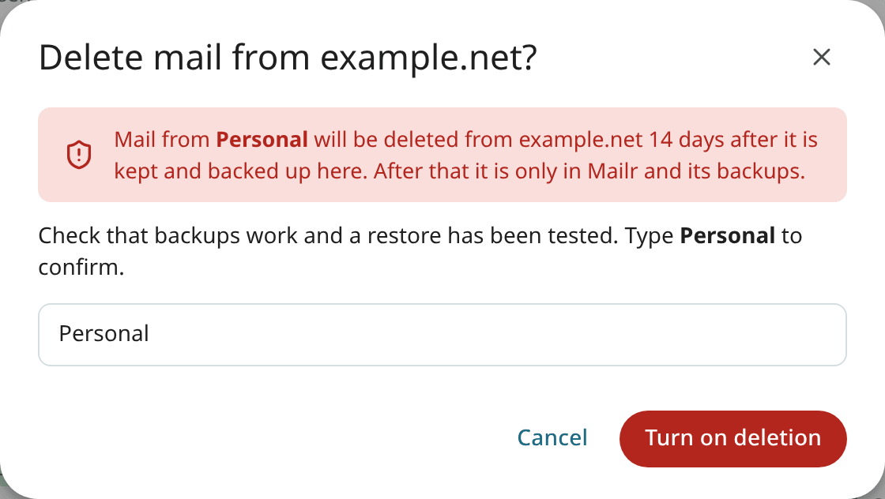

# Account modes: Keep in sync, Mailr keeps the mail, Copy once

Every mail account in Mailr is in one of three modes. The user picks the mode in the [Add account wizard](../getting-started/connect-accounts.md#3-mode).

| Mode (API value) | Source of truth | New mail | User actions | Mail at the provider |
|---|---|---|---|---|
| **Keep in sync** (`mirror`) | the provider | collected within seconds | labels, read state and moves go back to the provider | stays |
| **Mailr keeps the mail** (`store`) | Mailr | collected within seconds | stay in Mailr | stays, unless deletion at the provider is turned on; then it is deleted after the delay |
| **Copy once** (`import`) | Mailr | none after the copy | stay in Mailr | stays |

In every mode, each account's provider remains the receiving server for its addresses and the relay for their outgoing mail. Mail is never sent from Mailr directly to the internet.

## Keep in sync

This mode (`mirror`) suits accounts under someone else's control, such as work or school mail. The provider stays authoritative. A two-way copy is kept in Mailr: when a conversation is labelled, read, moved or deleted in Mailr, the change is applied at the provider, and changes made in other apps come back to Mailr.

### Sent mail at the provider

Mail is sent through the account's own SMTP server. Most providers do not keep a copy of mail submitted that way: a mail app such as Thunderbird or Roundcube puts the copy in the provider's Sent folder itself. A copy is added in the same way for an IMAP account that is kept in sync. After a message is sent, a copy of it is added to the provider's Sent folder, marked as read, so the provider's webmail and other mail apps show it too.

- The provider's Sent folder is found as during sync: the folder the server marks as Sent, else the folder with the provider's or a usual name (Sent, Sent Items, Sent Messages and others). A Sent folder is created when there is none.
- The copy is the message exactly as it was sent, with its `Message-ID`. A message with that `Message-ID` already in the folder is never added a second time.
- The copy is linked to the message in Mailr when it is added, as messages are linked during sync, so the next sync does not import it again. From then on it is kept in sync like any other message: when the message is deleted or moved in Mailr, the copy is deleted or moved at the provider, and the reverse.
- Sending is never delayed by the copy. When the provider cannot be reached, the copy is tried again for about two and a half days, with growing pauses. After that, the account in **Settings → Mail → Mail accounts** says how many sent messages could not be saved in the provider's Sent folder, with **Retry**.
- Gmail and Microsoft (Outlook.com, Hotmail, Live and Microsoft 365) save mail sent through their servers themselves. For these, no copy is added unless the setting below is **On**. The provider is recognised by the account's IMAP server name.
- Accounts where Mailr keeps the mail, and accounts that are copied once, never get a copy at the provider.

Mail sent to one of the account's own addresses has two copies at the provider: the copy in Sent and the delivered copy in the Inbox. Both belong to one message in Mailr, marked as read. Archive and label changes never remove either copy: archiving moves the delivered copy to the provider's Archive folder (or leaves it in a label's folder), and the Sent copy stays in Sent. **Move to Trash** moves the delivered copy to the provider's Trash; **Delete forever** moves the Sent copy there too. A message that a provider filter put in two folders is treated the same way: one of its copies is deleted at the provider only when the message is deleted, or when another copy outside Sent and Drafts remains.

The setting is **Save sent mail at the provider** in the account's edit form (**Settings → Mail → Mail accounts → Edit**):

| Choice | Effect |
|---|---|
| **Automatic** (the default) | A copy is added, except at Gmail and Microsoft. |
| **On** | A copy is added at every provider. A provider's own copy is still found by its `Message-ID`, so no second copy is added. |
| **Off** | Mail sent from Mailr stays in Mailr's **Sent** only. |

Mail sent from Mailr before the account saved sent mail at the provider can be copied there afterwards with **Copy past sent mail to** the provider in the same form, or with [`mailr sent-backfill`](../reference/cli.md). Only messages sent through that account, from one of its sending addresses, are copied, never mail sent through another account. Messages already in the provider's Sent folder are skipped and linked, a stopped copy continues where it ended when it is started again, and nothing is deleted.

## Mailr keeps the mail

In this mode (`store`), Mailr is the main store of the account's mail. New mail keeps arriving and is kept in Mailr. Changes made in Mailr stay in Mailr. The provider is the receiving server and a buffer: if Mailr is down, new mail is held at the provider. The mail also stays at the provider, unless deletion at the provider is turned on for the account (see [Turn on deletion at the provider](#turn-on-deletion-at-the-provider)).

This mode needs the [daily mail export](backups.md#the-daily-export). While it is turned off (`MAILR_MAIL_EXPORT=false`), this mode cannot be chosen and nothing is deleted at the provider, unless the backup check is turned off too (see [Deletion without a backup check](#deletion-without-a-backup-check)).

### Delay before deletion

Each account where Mailr keeps the mail has a **Delete from the provider after (days)** setting. When deletion at the provider is on, a message is deleted there only after it has been stored in Mailr, is in the [daily export](backups.md#the-daily-export) (and on the backup target, when one is set), and is older than this many days. New accounts start with `MAILR_DEFAULT_RETENTION_DAYS` (14). Users change it per account under **Settings → Mail → Mail accounts → Edit**.

The account card then reads "Deleted from <provider> N days after it is backed up here". The rules for each message, with the backup check on (the default) and off:

| Rule | `MAILR_STORE_BACKUP_CHECK=true` | `MAILR_STORE_BACKUP_CHECK=false` |
|---|---|---|
| Deletion at the provider is turned on for the account | required | required |
| The message is older than the delay, counted from when Mailr stored it | required | required |
| The message is in Mailr's mail store (its copy there exists, with the same content) | required | required |
| The message is in the daily mail export | required | not checked |
| The message is on the backup target, when one is set | required | not checked |
| The mail export is on (`MAILR_MAIL_EXPORT=true`) | required | not needed |

A message deleted with **Delete forever** is not handled by this delay: its provider copy is deleted at once instead, also inside the delay and also while deletion at the provider is off (see [Delete forever](../user-guide/inbox.md#delete-forever)). Only that action deletes such a copy. A message that disappears from Mailr's mail store in any other way (another mail app, the store's Trash cleanup, a store that lost its data) is never deleted at the provider for that reason.

### Deletion without a backup check

With `MAILR_STORE_BACKUP_CHECK=false`, the daily mail export is not consulted before mail is deleted at the provider. Use it when you back up the mail store (the `stalwart-data` volume) another way and do not want the Maildir export.

- The mode where Mailr keeps the mail can be chosen even with `MAILR_MAIL_EXPORT=false`.
- A message older than the delay is deleted at the provider once its copy is in Mailr's mail store. A message whose copy is not there stays at the provider.
- Turning on deletion skips the backup checks (2 and 5 below). The confirmation says that mail is deleted at the provider without a backup check and that backups are the administrator's responsibility.
- The account shows "On this server, mail is deleted from the provider without checking a backup first.", and so does **Admin → Diagnostics** under **Backup**. The "Deletion at the provider paused" warning does not appear.
- [`mailr check-config`](../reference/cli.md) warns while an account where Mailr keeps the mail has deletion at the provider turned on. This is a reminder, not an error.

!!! warning
    Without the backup check, the provider copy is deleted after the delay whether or not any backup of it exists. Make sure your own backups of the mail store work, and test a restore.

### Turn on deletion at the provider

Deletion at the provider stays **off** when an account is added. The account card reads "Mail also stays at <provider> · Delete it from <provider> after N days…", where the provider is, for example, Gmail, Fastmail or the server's domain. To turn deletion on, open the account under **Settings → Mail → Mail accounts**, choose the button, and confirm in the dialog "Delete mail from <provider>?" with **Turn on deletion**. The account name is typed to confirm. These checks are then made:

1. The account is in the mode where Mailr keeps the mail.
2. A backup export exists (not checked with `MAILR_STORE_BACKUP_CHECK=false`).
3. The first sync has finished.
4. New mail has arrived through this account since its first sync, so new mail is known to reach the mailbox read by Mailr, for example after you change forwarding rules at the provider. If none has, send yourself a test message.
5. The restore check passes: a random sample of exported files is identical to the store when read back (not checked with `MAILR_STORE_BACKUP_CHECK=false`).

If any check fails, deletion stays off and the reason is shown.

Deletion can be turned off at any time. It is also turned off when the account's server changes.

!!! warning
    When deletion at the provider is on, mail is deleted there. Set up [backups](backups.md) with an off-host backup target, and test a restore, before you turn on deletion.

## Copy once

In this mode (`import`), the existing mail is copied once. The old account is not changed, and new mail does not arrive. Use it to bring an old account's history into Mailr before you close it. Mailbox file imports are always in this mode.

## Pause, resume, resync and remove

Each account in **Settings → Mail → Mail accounts** has these controls:

| Control | Description |
|---|---|
| **Sync now** | New mail is fetched at once. |
| **Pause** / **Resume** | Syncing is stopped and restarted. Mail already in Mailr stays. |
| **Resync from scratch** (circular arrow icon) | The sync position is forgotten and the provider is scanned again. Messages already in Mailr are recognised and skipped. |
| **Remove account** (bin icon) | The account is removed from Mailr. Type its name to confirm. The mail already delivered from it stays in Mailr. |

## Duplicates

The same message is recognised by its `Message-ID` across all of a user's accounts and imports, so a message forwarded from one account to another, or imported twice, is stored once. Two copies count as the same message only when their content and their From, Reply-To, To and Cc agree; a copy whose content was only re-encoded in transit counts too. A different message with a reused `Message-ID` is stored on its own.

A sent message's copy in the Sent folder of an account that is kept in sync ([above](#sent-mail-at-the-provider)) is linked to the message when it is added, so it is never imported as a second message, even when the provider changed its bytes.

When mail is deleted at the provider, a copy is removed only when that copy is known to be the stored message. Copies recorded by older versions are read back from the provider and compared before they are deleted. For an account that is kept in sync, a copy already in the destination folder is reused only when its `Message-ID`, size and content match; otherwise the message is copied again.
