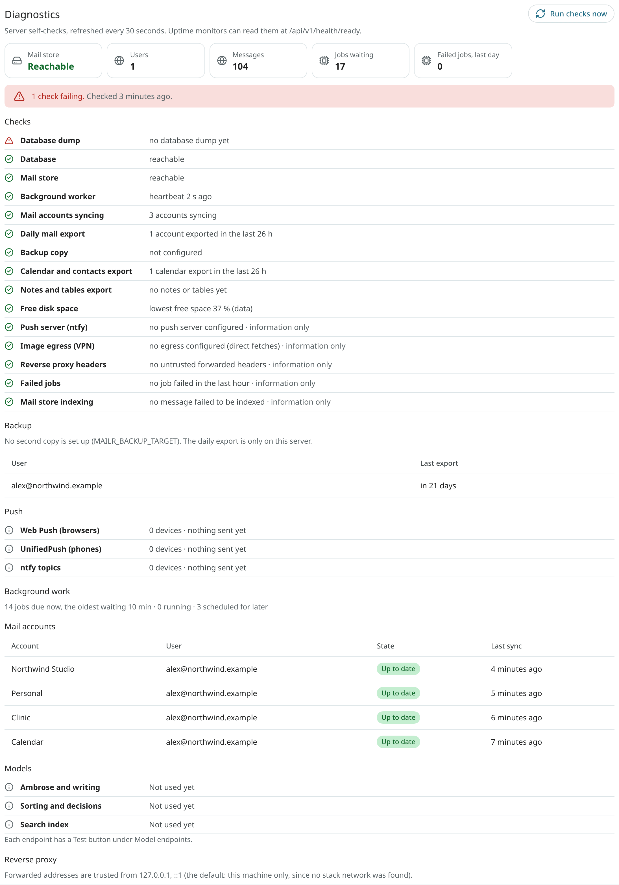

# Troubleshooting

## Diagnostics

**Settings → Admin → Diagnostics** lists the results of the server's checks on itself. The page is refreshed every 30 seconds, and every check can be run again at once with **Run checks now**. The page has:

- the mail store, the number of users and messages, jobs waiting and jobs failed in the last day;
- every [readiness check](monitoring.md#the-checks) with a plain name and its result, the failing ones first. Checks marked "information only" never count against the server's health;
- **Backup**: whether a second copy is set up, and when each user's mail was last exported and copied. A share that is not mounted is shown as a failure, with the marker file to look for. It is also logged, at most once an hour;
- **Push**: for Web Push, UnifiedPush and ntfy, the number of devices, and when a notification last went out or last failed;
- **Background work**: jobs due now and how long the oldest has waited, jobs running and jobs scheduled for later, and the most recent failed jobs with their error text;
- **Mail accounts**: every account with its owner, its state in plain words ("Password required", "Not synced for 3 hours") and its last sync;
- **Models**: for each kind of work, the last success and the last error. Each endpoint has a **Test** button; see [Models](models.md#test-an-endpoint);
- **Reverse proxy**: the addresses from which forwarded headers are trusted, and a warning when such headers came from another address. See [Reverse proxy](reverse-proxy.md).


<!-- covers: settings.admin_diagnostics, settings.account_health -->

Members see their own accounts' state in **Settings → Mail → Mail accounts**, and get one notification when the password of an account must be entered again.

## The running version

The version of the server is shown in three places. Give it with every report of a problem.

- In the web app, at the bottom of the **Support (?)** menu in the top bar, for example "Mailr 0.40.17". Choosing it opens the source code on GitHub.
- In the Android app, at the foot of **Settings**: the app's own version, then the server's ("Mailr 0.40.16 · server 0.40.16").
- In the API, as `version` in the answer of `GET /api/v1/me`, and as `info.version` in the [OpenAPI document](../agents/rest-api.md#interactive-reference).

For a server built from source, the version is that of the checkout; for a published image, it is the release the image was built from.

## Health checks

The answer of `GET /api/v1/health` is `{"ok":true}` when the app is up. `GET /api/v1/health/live` also checks the database and the mail store; it is the app container's healthcheck. With `GET /api/v1/health/ready`, the database, the mail store, the worker, account sync and the daily export are also checked, and the answer is `503` when one fails. Point the uptime monitor at `https://mail.example.com/api/v1/health/ready`. See [Monitoring](monitoring.md) for each check, the heartbeats and example monitors.

## Check the configuration

`mailr check-config` prints one line per configuration problem, each naming its environment variable, and never a value. The same checks are run when `mailr serve` and `mailr worker` start, and they stop on an error. See [Configuration](configuration.md).

## Logs

```sh
cd deploy
docker compose logs -f app worker
docker compose logs stalwart
```

Set `MAILR_LOG_LEVEL=DEBUG` in `.env` and run `docker compose up -d` for more detail. Set it back to `INFO` afterwards.

### Slow requests

An API request that takes longer than 2 seconds is logged as one warning line:

```text
slow request: GET /api/v1/conversations 200 in 3120 ms; db 2950 ms in 6 queries; pool wait 0 ms
```

The line shows the route (without ids or search terms), the status, the total time, the time
spent in the database and the number of queries, and how long the request waited for a database
connection. When most of the time is spent in the database, a query is slow. A long pool wait
means that every connection was busy: the pool is too small for the load, or connections are held
too long by other requests. A `db pool timeout` line means that no connection was free within the
pool's timeout, and the request failed. Find these lines with `docker compose logs app | grep -E "slow request|db pool timeout"`.
Change the threshold with `MAILR_SLOW_REQUEST_MS` (in milliseconds; with `0`, the log is off).

## Common problems

??? question "The sign-in page loops, or cookies do not stick"
    `MAILR_BASE_URL` must match the address in the browser exactly, including `https://`. Check that `X-Forwarded-Proto` is sent from the proxy and that its address is in `MAILR_TRUSTED_PROXIES`.

??? question "New mail appears only after a reload"
    The live event stream is buffered. Turn response buffering off for `/api/v1/events` in the proxy. See [Reverse proxy](reverse-proxy.md).

??? question "An account has an error"
    Open **Settings → Mail → Mail accounts**. The failure is shown in the status line. Wrong passwords and disabled IMAP access at the provider are the usual causes. An app password is required by many providers. Fix the cause in the account, then click **Sync now**.

??? question "A calendar is marked as listed only in part"
    An answer from the calendar server holds at most a set number of items, and this calendar has more. Nothing is then removed, and the listing is tried again later. Raise the server's limit. On Stalwart it is `maxResults` of the `x:WebDav` setting; it is set to 50,000 on Mailr's own Stalwart. Radicale and most hosted servers have no such limit.

??? question "A calendar, model or mail server on my network is unreachable from Mailr"
    By default only admin users may connect Mailr to private network addresses (`MAILR_ALLOW_PRIVATE_HOSTS=admins`). For another user, add the server's host name or address to `MAILR_OUTBOUND_ALLOW`, or set `MAILR_ALLOW_PRIVATE_HOSTS=all`. For a server on the same host, add its address to `MAILR_OUTBOUND_ALLOW`.

??? question "Jobs pile up"
    `MAILR_WORKER_CONCURRENCY` jobs run at once in the worker's main lane (4). Raise it on a bigger host. Imported mail is sorted in a lane of its own, a batch at a time, so a large import does not fill the main lane. Check the worker logs for a failing model endpoint: model jobs wait while an endpoint is down, and mail keeps flowing.

??? question "The IMAP certificate is rejected in mail apps"
    At first Stalwart has a self-signed certificate. Install a real one. See [The mail server](mail-server.md#a-real-tls-certificate-for-imap).

??? question "Spam blocklist checks do not work"
    The bundled resolver must be running: `docker compose ps resolver`. If you changed `MAILR_DNS_SUBNET`, keep `MAILR_RESOLVER_IP` inside it and restart Stalwart.

??? question "Remote images do not load"
    With an egress proxy set, image fetches fail when the proxy is down. The last egress check is shown under **Settings → Admin → Data & privacy → Image proxy**. Check the `egress` container's logs, or clear `MAILR_IMAGE_PROXY_EGRESS`. With `MAILR_REQUIRE_EGRESS=true`, readers see "Images are not displayed" and the reason until the egress works again; when you clear the proxy, images are then paused, not fetched directly.

??? question "Deletion at the provider will not turn on"
    The failed check is shown. Usually the first export has not run yet (it runs daily), or no new mail has arrived since the first sync. See [Account modes](store-and-mirror.md#turn-on-deletion-at-the-provider).

??? question "Only keyword search works, not search by meaning"
    A search index model is required for meaning-based search. Set one under **Settings → Admin → Models → Models per task**, then run `mailr reembed`. See [Models](models.md).

??? question "Threads are split or merged wrongly after an import"
    Run `mailr rethread <email>` to rebuild that user's conversations. Users can also split and merge conversations themselves.
