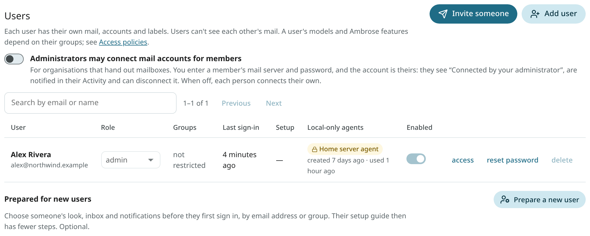
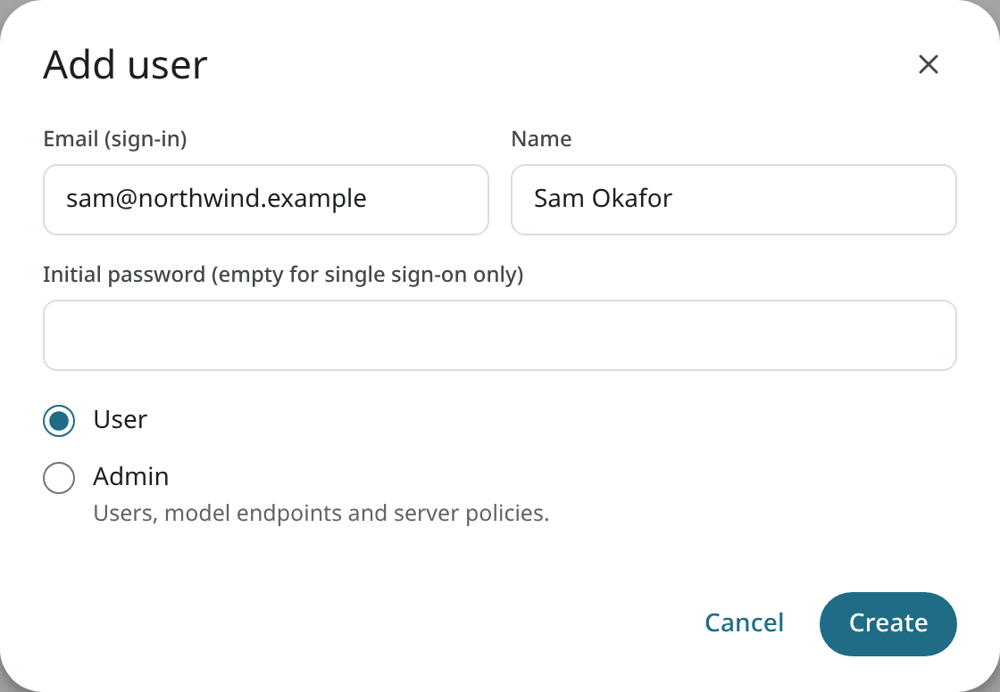
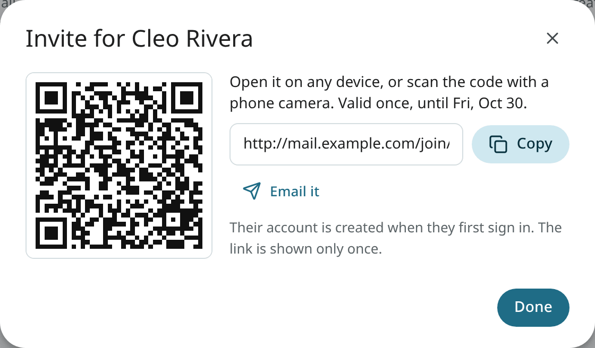
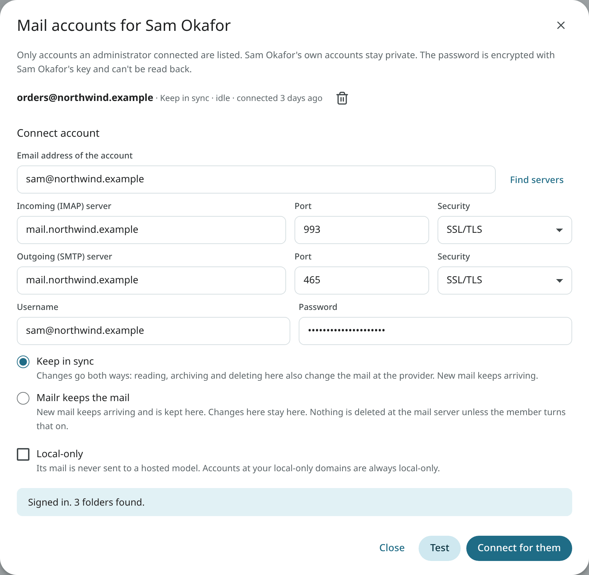
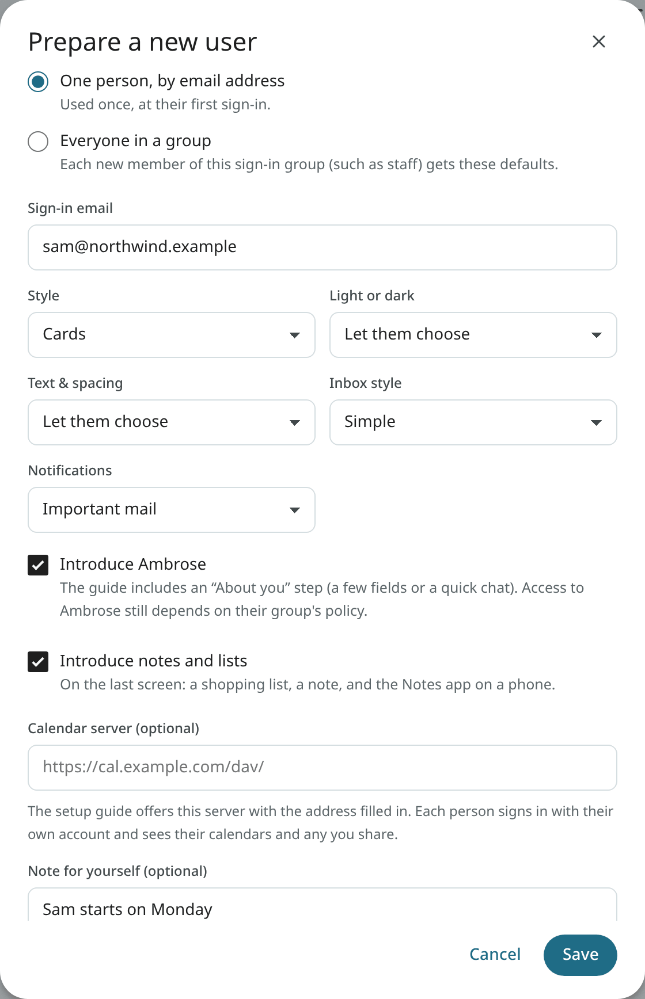
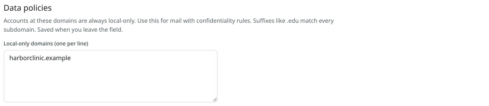

# Users

Every user has their own mail store, mail accounts, labels, filters, model choices and API tokens. No user can see another user's mail, and one user's mail is never mixed with another's in Ambrose or the sorting models.

## Manage users in the app

Open **Settings → Admin → Users**. The list shows each user's role, last sign-in and whether they can sign in. Search by email or name.



- **Add user**: enter the sign-in email, a name, and an initial password. Leave the password empty for an account with single sign-on only. Choose **User** or **Admin**.
- **Role**: switch a user between User and Admin.
- **Enabled**: turn sign-in off for a user without deleting anything. A disabled user's IMAP apps and calendar app passwords stop working too, and work again when you enable them. A disabled user is also signed out, their API tokens are revoked and their push notification targets are removed; they get no notifications.
- **Reset password**: set a new password (at least 10 characters). The user's sessions end, their API tokens are revoked, their IMAP password is replaced by one nobody is shown, and their calendar apps' app passwords are deleted. They make new ones for their mail and calendar apps.
- **Delete**: remove the user, their mail store, accounts and tokens. Type the user's email to confirm. This cannot be undone.

An admin cannot demote, disable or delete their own account.

Admins also see the BIMI check under **Settings → You → Profile → Your picture**, for sending domains that are not shared mailbox providers such as gmail.com. Other users see only the picture steps for their own addresses. See [Publish your picture](../user-guide/appearance.md#publish-your-picture).



**Local-only agents** lists each user's tokens marked local-only: the name, when each was created and last used. "(off)" means that local-only agents are no longer allowed under the user's policy, so the token cannot read local-only accounts. No mail, accounts or categories are shown in the list. See [Local-only agents](access.md#local-only-agents).

**Setup** shows how far each person got in the setup guide: Not started, In progress (with the steps done), Closed or Finished. For accounts from before the guide, a dash is shown.

Every new account gets the [setup guide](../getting-started/your-first-sign-in.md) at its first sign-in: one an admin adds here, one made through an invite or single sign-on, or a sign-up.

### Invite someone

<!-- covers: household.invite household.invite_revoke -->

A one-time link and a QR code for one person are made with **Invite someone**. An invite is the simplest way in for someone who does not run servers.



1. Enter their name and the email address they sign in with.
2. Choose when the link expires (**Expires after**: 1 to 30 days; 7 by default).
3. Optional: **Setup defaults**, with the same choices as [Prepare a new user](#prepare-a-new-user).
4. Click **Create link**. Copy it, use **Email it** (a draft in Mailr to them, with the link and its last day, which you send), or let them scan the code with their phone's camera. The link is shown only now; only a fingerprint of it is kept.

When they open it:

- **With single sign-on**, they sign in with the identity provider. If they have no Mailr account yet, one is made through the invite, even with `MAILR_OIDC_AUTO_CREATE` off, as long as that same address is verified at the provider. Accounts at the provider are never created or changed from Mailr: add them there first.
- **With password sign-in**, they choose their own password on the invite page. The initial password of an account added by an admin is then replaced, as long as nobody has signed in to it yet. For an account that has been signed in to, the password stays; they sign in as usual and the invite then applies.

On acceptance, the prepared defaults are applied, their setup guide starts, and the link is used up. On an Android phone, the page also has **Open in the Mailr app**, for opening the app with the server and the invite filled in. The server must be confirmed in the app first. The app link does not carry the invite itself, only a phone form of it, which works only together with a sign-in to the invited address (single sign-on in the app, or the app's sign-in with a password they already have). To choose a password, they use the invite page in the browser.

**Invites**, below the users, lists each waiting invite with its end date, and recent ones (joined, withdrawn or expired). A link is stopped at once with **Withdraw**. When a new invite is made for the same address, the older link is withdrawn.

#### Hand-off checklist

Before you send invites, check these once (see also [Set up the server's first admin](../getting-started/first-admin.md)):

- Built-in calendars are on ([Built-in calendars](calendars.md)), so nobody needs a calendar address.
- Their group has an [access policy](access.md), or they get Ambrose from the built-in one.
- Push works: `MAILR_NTFY_URL` is set to the ntfy server ([Push notifications](push.md)). The address is passed to phones from Mailr.
- The phone apps are published ([Phone apps](phone-apps.md)).

The member connects their own mail account in the setup guide. For an organisation that hands out mailboxes, an admin can also connect it for them: see [Connect a member's mail account](#connect-a-members-mail-account).

### Connect a member's mail account

<!-- covers: admin.managed_accounts_setting admin.managed_account_list admin.managed_account_test admin.managed_account_connect admin.managed_account_remove -->

The setting is off by default, and each person connects their own mail accounts. For an organisation that hands out mailboxes (see [Organisations and small businesses](organisations.md)), turn on **Administrators may connect mail accounts for members** at the top of **Settings → Admin → Users**.



1. In a person's row, choose **mail accounts**.
2. Enter the account's address. With **Find servers**, the IMAP and SMTP servers are filled in where possible; check them.
3. Enter the username (usually the address) and the password.
4. Choose **Keep in sync** (changes go both ways, and the mail server stays the source of truth; the usual choice for an organisation's own server), **Mailr keeps the mail** or **Copy once**. Tick **Local-only** for mail that must never reach a hosted model. Accounts at the [local-only domains](#instance-policies) are local-only anyway.
5. With **Test**, a sign-in to the servers is tried as for the member's account, under the member's network rules. Then click **Connect for them**.

After the connection:

- The account belongs to the member. The password is encrypted with the member's own key, exactly as if they had typed it, and nobody can read it back.
- The member sees **Connected by your administrator** on it, and a line in their Activity. They can change it or disconnect it.
- When they disconnect it, the dialog lists it under "disconnected", and to connect the same mailbox again, they must choose **Connect it again anyway**. They are told again.
- Admins see only the accounts an administrator connected, never the member's own accounts or their mail.
- An account an administrator connected is removed with the trash icon. The mail already fetched from it stays with the member, and they are told.
- Each step is in the admin's own audit log and in the member's Activity.

With the switch off, no new connections can be made. Accounts already connected stay with their members.

A mail server on the local network (a private address) is reached only under the member's network rules: with the default `MAILR_ALLOW_PRIVATE_HOSTS=admins`, add its host name to `MAILR_OUTBOUND_ALLOW`.

### Prepare a new user

With **Prepare a new user**, defaults are set for a person before their first sign-in, and the setup guide then has fewer choices for them.



- **One person, by email address**: the address they sign in with. Used once, at their first sign-in.
- **Everyone in a group**: each new member of this sign-in group (for example `staff`) gets the defaults.
- **Style**, **Light or dark**, **Text & spacing**, **Inbox style** (Simple, Important first or Categories) and **Notifications**: set at the first sign-in. With "Let them choose", the guide's question stays in place.
- **Introduce Ambrose**: they see *About you* in the guide. Whether they can use Ambrose still depends on their group's [access policy](access.md).
- **Introduce notes and lists**: on the guide's last screen, they can start a shopping list or a note, and get the Notes app on a phone. On by default.
- **Connect a mail account for them** (one person by email address, with the switch above on): the account is connected at their first sign-in, as long as the address is proved to be theirs at sign-in (single sign-on with a verified address, or an account added by an admin). Until then the password is kept encrypted for this preset only, and it is removed from the preset once used. The list then shows whether it was connected, or why not.
- **Calendar server**: for people with an account on an existing calendar server. They see **Use our calendar server** in the guide with this address filled in; they sign in with their own username and password. They see their own calendars plus any shared with them on the server, and can still connect other calendars.

The list shows what is prepared, and when an email preset was used or how many new users got a group preset. Defaults apply only to an account that has not started the guide; existing accounts are never changed.

## Manage users from the command line

```sh
# A user with a password (mailr asks for it)
docker compose exec app mailr create-user sam@northwind.example --name "Sam Okafor"

# An admin
docker compose exec app mailr create-user alex@northwind.example --name "Alex Rivera" --admin

# A single sign-on only account, with no password
docker compose exec app mailr create-user lee@northwind.example --no-password

# Set or reset a password
docker compose exec app mailr set-password sam@northwind.example
```

With single sign-on and `MAILR_OIDC_AUTO_CREATE=true` (off by default), an account is made at each person's first sign-in, so no account needs to be created beforehand. See [Sign-in and OIDC](sign-in.md).

## Instance policies

**Settings → Admin → Data & privacy → Data policies** holds rules for every user.

**Local-only domains**: accounts at these domains are always local-only, whatever the user chooses. Their mail is never sent to a hosted model or to an agent token with a hosted model. Enter one domain per line. A suffix such as `.edu` matches every subdomain. Use it for work and school mail with confidentiality rules.



## Admin access

Admins see the **Admin** group in Settings: Users, Access policies, Models (Models per task, Hosted models for everyone, Model endpoints), Web search, Calendars, Phone apps, Diagnostics, and Data & privacy. Admins do not see other users' mail. A signed-in session is required for admin changes; they cannot be made with an API token. The one exception is the IMAP certificate push, with a token that has the `tls` scope ([The mail server](mail-server.md#a-real-tls-certificate-for-imap)).

### Admin changes in the member's activity

When an admin changes a member's name, role, password or whether their account is on, assigns their
groups, changes or removes the access rules of a group they are in, or makes one of their accounts
local-only through a data policy, the change is recorded in that member's own activity, in a plain
sentence such as "Your administrator reset your password." The admin's own audit entry stays in the
admin's log.
