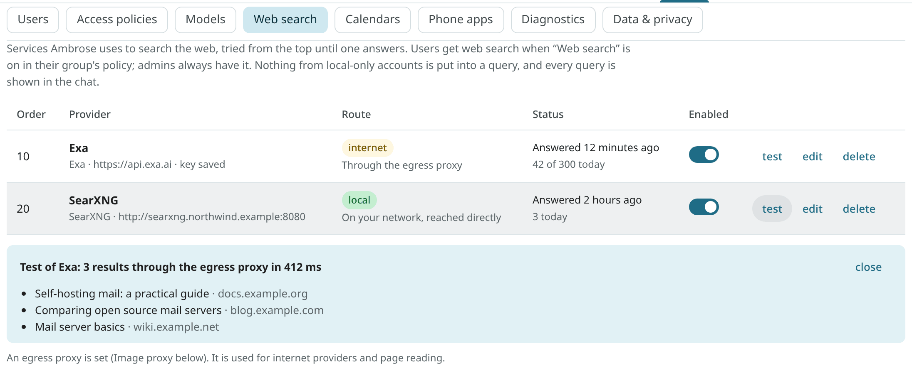
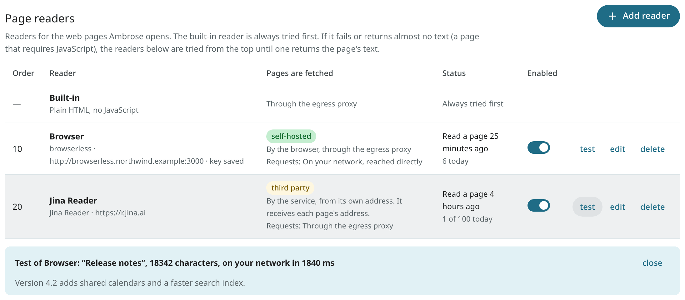

# Web search

Ambrose can look things up on the web: facts, news, documentation, opening hours. It searches through a **search provider** set up by an admin, reads pages from the results, and cites each page it relied on. The exact query is shown in the chat.

Nothing from local-only accounts ever goes into a query.

## Access to web search

- **Admins** always have it once a provider is set up.
- **Other users** get it when **Web search** is on in their group's access policy in [Access policies](access.md). It is off by default.
- **Agents with API tokens** call the same tools (`web_search`, `read_page`) with the `web` scope, under the same policy. A new token has that scope only when it is ticked. See [Agent tools](../agents/tools.md#the-web).

Without an enabled provider, web search is not available to anyone.

## Add a provider

Open **Settings → Admin → Web search** and choose **Add provider**.



| Service | Kind | Requirements |
|---|---|---|
| **Exa** | an API service | An API key from exa.ai. The base URL can stay empty (`https://api.exa.ai`). |
| **Brave Search** | an API service | A Brave Search API key. The base URL can stay empty. |
| **Tavily** | an API service | A Tavily API key. The base URL can stay empty. |
| **degoog** | self-hosted | The server's address, such as `http://degoog.internal:4444`. Its JSON API at `/api/search` is used. |
| **SearXNG** | self-hosted | The server's address. The request path is `/search?format=json`, so the `json` format must be on in SearXNG's `settings.yml` (`search: formats: [html, json]`). |
| **Jina Search** | an API service | A Jina API key. The base URL can stay empty (`https://s.jina.ai`). Only titles, links and descriptions are asked for, not page contents. It has no date filter. |
| **Firecrawl** | an API service or self-hosted | For the cloud, a Firecrawl API key and an empty base URL (`https://api.firecrawl.dev`). For a self-hosted Firecrawl, its address, **On my network**, and a key only if one is set. |

In the dialog you enter:

- **Name**: shown in the chat's steps ("3 results from Exa").
- **Base URL** and **API key**. The key is stored encrypted, like a model endpoint's key, and never shown again. When you change the URL or the service, a saved key is removed unless you enter it again, so a key is only sent to the address it was saved for.
- **On the internet** or **On my network** (see [Query routing](#query-routing)).
- **Order**: lower numbers are tried first.
- **Results per search** (at most 20), **Timeout** in seconds, and limits: **Searches a minute** and **Searches a day** (0 means no limit). With a daily limit, a paid service with a monthly quota stays within budget.

With **Test**, one search for "open source mail server" is run with what is in the dialog, before or after saving. The same is done for a saved provider with the row's **test**. Tests do not count against the limits.

<!-- covers: settings.web_search -->

## Order and fallback

The enabled providers are tried from the top. When one fails, the next is tried:

- no answer comes within its timeout;
- the key is refused (HTTP 401 or 403) or Mailr is rate-limited (HTTP 429);
- its answer is not JSON (a SearXNG without the `json` format);
- its own limit for the minute or the day is reached;
- it is on the internet and the egress proxy is required but not working.

The next one is also tried when a provider has no results. Each row shows the last error or the time of the provider's last answer, and today's number of searches.

For example, put an API service first and a self-hosted SearXNG second. When the API's daily limit is reached, searches go to SearXNG.

## Query routing

A query can contain words Ambrose read in the user's mail, so it is sent the same way as other content from mail ([Image proxy and VPN egress](image-proxy.md)):

| Provider | No egress proxy | Egress proxy set | `MAILR_REQUIRE_EGRESS=true` |
|---|---|---|---|
| **On the internet** | directly, https only, to public addresses only | through the egress proxy | through the egress proxy only; skipped while it is missing, down or leaking |
| **On my network** | directly | directly | directly |

- An internet provider's **Send queries through the egress proxy** switch is on by default. While the egress proxy is required, the switch cannot be turned off.
- A provider **on my network** is never sent through the egress proxy: the bundled VPN container has no route into the local network. `MAILR_ALLOW_PRIVATE_HOSTS` must be other than `none`, and every address of its host must be private. The addresses are checked when you save and again before each search. A name that later resolves to a public address is refused, so a local provider never becomes a direct path to the internet.
- From a self-hosted metasearch server, the query is sent on to Google, Bing and other engines from its own address. To hide that address too, run that server behind a VPN.

## Reading pages

After a search, Ambrose can read one page in full (`read_page`). The built-in reader is always tried first. The rules for links in mail apply to it:

- through the egress proxy when one is set, never directly while `MAILR_REQUIRE_EGRESS` is on;
- `https://` only, public addresses only, on the standard port; every redirect is checked again, at most 5;
- HTML and plain text only, at most 3 MB; scripts, styles, navigation, headers, footers and forms are removed, and the text is cut at 20,000 characters;
- no JavaScript is run, and no images, cookies or referrer are sent.

A Reddit post is read as the post itself: its title, community, author, score and text, and its first ten top-level comments with their scores. A Reddit share link (`reddit.com/r/<community>/s/<code>`) redirects to the post, and the redirect is followed like any other. From some networks, Reddit answers plain requests with a bot check instead of the post. A page with no text at all counts as not read, so add a [page reader](#page-readers) with a browser (browserless) for such sites.

### Pages Ambrose may open

The built-in assistant opens only:

- a page that a search returned in the same chat;
- a link the user wrote in their chat message;
- a link the user put in their own email, in the conversation the chat is about or one Ambrose read in the same turn. Such links are opened in chats and in standing orders.

"Their own email" must be provable. A message counts as the user's own only by Mailr's own checks, never by the From header:

- the user sent it from Mailr (this includes the phone's **Send to self**);
- a copy is in the user's Sent folder (of a mail account, an import or the mail store);
- or it is From one of the user's addresses, and the receiving server's authentication results pass for that domain (DMARC, or a DKIM signature of that domain).

Mail with the user's address in From that failed these checks is someone else's mail. Its links are never opened. In the user's own message, only the user's part counts: links in quoted history ("On … wrote:", `>` lines), in a forwarded message and in an attached message are never opened. Drafts and mail of local-only accounts do not count either. No other link found in mail is ever opened.

An API token's agent chooses its own pages.

<!-- covers: agent.read_own_link -->

## Page readers

Some pages show nothing without JavaScript, and some sites block plain requests. For those, **page readers** can be added in the **Page readers** section, under the search providers. When the built-in reader fails, or almost no text is found (under 200 characters), the readers are tried from the top. The text of the first one that returns any is used. If they all fail, the built-in reader's short text is used.



| Reader | Location | Requirements |
|---|---|---|
| **browserless** | the local network (or browserless.io) | The address of the browserless container (`ghcr.io/browserless/chromium`), such as `http://browserless.internal:3000`, and its `TOKEN` as the API key. The page is requested from its `/content` API after it has run in the browser. |
| **Firecrawl** | the local network, or the cloud | The Firecrawl server's address, or an empty base URL and a cloud API key. Its `/v1/scrape` API returns the page as Markdown. |
| **Jina Reader** | the internet | Nothing, or a Jina API key for higher limits. The base URL can stay empty (`https://r.jina.ai`). |

The dialog has the same fields as a search provider: name, base URL, API key (stored encrypted, never shown again), network, order, timeout, and limits a minute and a day. With **Test**, one Wikipedia page is read and its title and length are shown. Tests do not count against the limits.

Origin of page fetches:

- **A reader on the internet is a third party.** It receives the address of every page it reads and fetches the page from its own address. The request to it goes like a search provider's: through the egress proxy when one is set, never directly while `MAILR_REQUIRE_EGRESS` is on. Ambrose never reads pages in a chat that has read local-only mail, so no local-only text reaches a reader.
- **browserless on the local network**: the page is fetched in its browser. Where the browser's page requests go out is set with its **Route**:
    - **Through the egress proxy** (the default). The browser is given the egress proxy for each page (Chrome's `--proxy-server`). Sites see the VPN's address. The proxy's password is never given to the browser: a web site could ask for it and would get it. The [browser in Mailr's stack](#a-browser-in-mailrs-stack) reaches the proxy through the [browser gate](#the-browser-gate), where the sign-in is added. For a browserless in another stack or on another machine, a proxy address reachable without a password is required, in `MAILR_BROWSER_EGRESS_PROXY`, such as `http://192.0.2.20:8888`; otherwise choose **Directly from this network**. Chrome cannot use a SOCKS proxy that asks for a password; use the proxy's HTTP port. While `MAILR_REQUIRE_EGRESS` is on and the proxy is missing or down, the reader is paused: the page is never fetched from the server's own address. Without any egress proxy, pages are loaded directly, as below.
    - **Directly from this network.** Pages are loaded from the server's own network. Sites see the server's address; nothing else changes. This choice is allowed while `MAILR_REQUIRE_EGRESS` is on, because an admin makes it for this one reader: the list shows a **direct** badge, and the choice is in the audit log (`route` in `admin.web_search.add` and `admin.web_search.update`). The page's host must resolve to public addresses, and the browser is held to the address that was checked (Chrome's `--host-resolver-rules`), so a name that changes its answer later (DNS rebinding) cannot move the page to the local network. Only browserless readers on the local network have this choice; readers on the internet are not affected.
    - **On both routes**, the address the browser ends on is checked again, requests from the browser to private addresses, local names and ports other than 80 and 443 are dropped, and WebRTC is limited to the proxy. The rules are applied to the text of each address. With a browserless outside Mailr's stack, a page's other requests can still go to a public name that resolves to the local network; only behind the [browser gate](#the-browser-gate) is every connection checked.
- **Firecrawl or Jina Reader on the local network**: pages are fetched from the local network's address. The page's host must resolve to public addresses, and the address the reader ends on is checked the same way. Redirects inside a self-hosted Firecrawl are outside Mailr's control; run it on a network without access to the LAN. While `MAILR_REQUIRE_EGRESS` is on, these readers are not used.

No reader is ever asked for a page on the local network: the page address must be `https://`, on the standard port, and not a private address or a local name. The built-in reader takes the standard port only, on both routes.

### Browser load errors

The result of **Test** and the reader's status show what went wrong, such as:

- "the browser could not reach the egress proxy (egress:8888) (net::ERR_PROXY_CONNECTION_FAILED)": the browser is in another stack or on another machine. Use the [browser in Mailr's stack](#a-browser-in-mailrs-stack), set `MAILR_BROWSER_EGRESS_PROXY`, or choose **Directly from this network**;
- "the egress proxy (egress:8888) refused the browser's sign-in": the proxy asks for a password, which the browser is never given. Use the browser gate, or a proxy address without a password;
- "the browser gate (browser-gate:3128) did not open the site": the page, or something it loads, is not a public `https://` address, or the site could not be reached;
- "… could not connect to the site";
- "the page answered HTTP 403": the site refused the page (often a bot check);
- "the page timed out", "the site's name could not be found", "the site's secure connection failed".

When no page comes back from browserless, the browser is asked once more, through browserless's `/function` API, which error it got. Only the page itself is loaded for that question. Without `/function`, the shorter message "the browser got no answer for the page" is shown.

### A browser in Mailr's stack

The stack has an optional browser (`browser`, the `ghcr.io/browserless/chromium` image, pinned) and its [browser gate](#the-browser-gate) (`browser-gate`). Both start with the `browser` profile. The browser's only network has no way out and holds nothing but the browser and the gate. Every page and everything it loads go through the gate, out through the VPN or directly, by the reader's route. Nothing is published. Two pages at a time are run in the browser, without Linux capabilities, on a read-only file system.

1. Make a token: `docker compose run --rm cli mailr gen-secret`.
2. In `.env`, choose one of the two setups:

    === "With the VPN egress"

        Pages go out through the VPN container. Set up the VPN first, as in [Image proxy and VPN egress](image-proxy.md): without a working VPN, every page on this route is refused.

        ```sh
        COMPOSE_PROFILES=vpn,browser
        MAILR_BROWSER_TOKEN=<the token>
        MAILR_BROWSER_URL=http://browser:3000
        MAILR_BROWSER_ROUTE=egress
        ```

    === "Browser only"

        Pages are loaded directly from the server's network, and sites see the server's address. No VPN is required.

        ```sh
        COMPOSE_PROFILES=browser
        MAILR_BROWSER_TOKEN=<the token>
        MAILR_BROWSER_URL=http://browser:3000
        MAILR_BROWSER_ROUTE=direct
        ```

    `MAILR_BROWSER_ROUTE` is the reader's first route. It can be changed later in **Page readers**.

3. `docker compose up -d`.

The reader **Browser (server)** then appears in **Page readers** by itself, first in the list. Its address and token are taken from the server's settings: the token is never stored in the database or shown. Its route, order and limits can be changed, and it can be turned off. It cannot be deleted; remove `MAILR_BROWSER_URL` to remove it. The browser does not start without `MAILR_BROWSER_TOKEN`.

Check it from the server:

```sh
docker compose run --rm cli mailr read-page https://www.reddit.com/r/selfhosted/ --reader "Browser (server)"
```

It prints the reader, the route, the HTTP status, the title and the length, or the error. Without `--reader`, the whole chain is tried, as Ambrose does.

### The browser gate

The browser gate (`browser-gate`, the Mailr image with the command `mailr browser-gate`) is the only way out for the browser in the stack. The browser is on a network of its own, `browser-net`. That network has no route out, and only the browser and the gate are on it. Without the gate, the LAN, the Docker host, Mailr, Postgres, Stalwart and the VPN container are all out of the browser's reach.

The gate is set as the browser's proxy. Each of the browser's connections is checked at the gate: the page, its redirects, everything loaded with it, WebSockets and service workers.

- Only `https://` (and secure WebSockets) to port 443 pass. Plain `http://` and other ports are refused.
- No private address, local name or name of the stack's own services passes.
- **Directly from this network** (port 3128): the name is looked up once and refused when any answer is a private address. The connection is made to the address that was checked, so a later DNS answer for the same name (DNS rebinding) is never used.
- **Through the egress proxy** (port 3129): the connection is passed on to the egress proxy, and the sign-in is added at the gate. The browser never holds the proxy's password.
- Mailr's requests to the browser pass through the gate too (port 3000). On the app's network the gate has the name `browser`, so `MAILR_BROWSER_URL=http://browser:3000` stays as it was.

The route of a page depends on the egress proxy:

| Egress proxy | Route of a reader set to **Through the egress proxy** |
|---|---|
| None in Mailr (`MAILR_IMAGE_PROXY_EGRESS` empty) | Pages are loaded directly (port 3128), as described under [Page readers](#page-readers). |
| Set in Mailr and at the gate | Pages go out through the egress proxy (port 3129). |
| Set in Mailr, but `MAILR_BROWSER_GATE_UPSTREAM` empty | Every page is refused. Pages are never loaded from the server's own address instead. |

The gate has no database access and gets no `.env`, only the egress proxy's address (`MAILR_BROWSER_GATE_UPSTREAM`, filled from `MAILR_IMAGE_PROXY_EGRESS`). The gate's host name is set in `MAILR_BROWSER_GATE` (`browser-gate`, in the compose file). When `MAILR_BROWSER_URL` points at a browserless outside the stack, set `MAILR_BROWSER_GATE=` (empty). Each refused connection is logged with the host name and the reason: `docker compose logs browser-gate`.

A Playwright server is not offered: its protocol is Playwright's own, and the same browser is available over plain HTTP with browserless.

<!-- covers: settings.page_readers -->

## Privacy

- **Local-only content stays out.** In a chat that has read local-only mail, or for a local-only token, both tools are blocked: "Web search is off in this chat: it has read local-only content…". Search works again in a new chat.
- **Every query is visible.** The exact query is shown in the chat's steps ("Searching the web for “latest stable linux kernel”").
- **Asking first.** Searches are allowed by default. To review each query before it is run, a user sets **Search the web and read pages from the results** (`web.search`) to **Ask me** under **Settings → Agents & API → Permissions**. An approval card with the query is then shown.
- **Results are untrusted.** Titles, snippets and page text are marked as data. Instructions in them are not followed.
- **Audit.** Each search and page read is in the audit log, with the provider and the number of results.

## Move a key from another app

The key need not appear on screen or in the shell history. With `mailr web-search-key`, the key is read from standard input, and only the provider and the key's length are printed. Pipe it straight from the other app's settings file:

```sh
grep '^EXA_API_KEY=' /path/to/other-app/.env | cut -d= -f2- \
  | docker compose exec -T app mailr web-search-key Exa --kind exa --priority 10 --per-day 300
```

For a page reader, add `--reader`, such as `mailr web-search-key Browser --reader --kind browserless --network local --base-url http://browserless.internal:3000` with the browserless token on standard input.

On the first run, the provider **Exa** is created with the service's own address. Run it again later to replace the key; the provider's other settings are kept. Check the provider with **test** in **Settings → Admin → Web search**, then delete the key from the other app.

In the web app, **edit** a provider and paste the key into **API key** to do the same. The API answers never contain the key: `has_api_key` is true when one is stored.

## API

All routes are for admins.

| Route | Description |
|---|---|
| `GET /api/v1/admin/websearch` | The providers and the page readers (`readers`) in the order they are tried, the kinds of service known to Mailr (`kinds`, `reader_kinds`), and whether an egress proxy is set or required. |
| `POST /api/v1/admin/websearch/providers` | Add a provider: `name`, `purpose` (`search`, the default, or `reader`), `kind` (search: `exa`, `brave`, `tavily`, `degoog`, `searxng`, `jina`, `firecrawl`; reader: `browserless`, `firecrawl`, `jina`), `base_url`, `api_key`, `network` (`internet` or `local`), `use_egress`, `priority`, `enabled`, `max_results`, `timeout_s`, `per_minute`, `per_day`. |
| `PATCH /api/v1/admin/websearch/providers/{pid}` | Change a provider or reader. Leave out `api_key` to keep the saved key; send `""` to remove it. Its `purpose` stays as it was. For a browserless reader on the local network, `use_egress` is its route (`true`: through the egress proxy; `false`: directly from this network). For the server's reader (`from_env`), only `use_egress`, `priority`, `enabled`, `timeout_s` and the limits can be changed. |
| `DELETE /api/v1/admin/websearch/providers/{pid}` | Delete a provider and its key. The server's reader (`from_env`) cannot be deleted (409). |
| `POST /api/v1/admin/websearch/providers/{pid}/test` | One test search with a saved provider: `{ok, via, ms, results}` or `{ok: false, error}`. For a reader, one page read (`url`, a Wikipedia page by default): `{ok, via, route, status, ms, page: {title, site, chars, text}}`; `route` is how the page itself was fetched (`egress`, `direct` or `third-party`). |
| `POST /api/v1/admin/websearch/test` | One test with unsaved settings (`purpose`, `kind`, `base_url`, `api_key`, `network`, …; with `id`, a saved key for the same URL is reused). |

## Add another kind of service

Each kind of search service is one small class in `backend/mailr/websearch/adapters.py`, and each kind of page reader one in `backend/mailr/websearch/readers.py`. In it, the request is built (path, parameters, the key's header) and the JSON answer is mapped to title, link, snippet, source and date. Routing, keys, limits and fallback are shared, so nothing else is required for a new kind.
