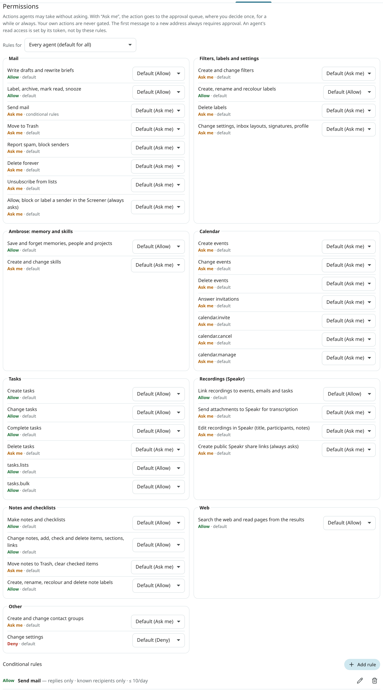

# Approvals for agents

Every action an agent takes is checked by one permission engine. The same checks apply to the built-in assistant and to every API token. Actions taken directly by the signed-in user are not gated.

One of three effects is chosen for each action:

- **Allow**: the action is carried out now.
- **Ask**: the action is stored, an approval card is shown, and the action is carried out only after approval.
- **Deny**: the action is refused with an error.

## Order of checks

1. **Scope.** The token must hold the scope for the action, or the action is denied. The built-in assistant acts with your rights.
2. **Deny rules.** Any matching **Deny** rule takes precedence.
3. **Allow and ask rules.** A matching rule is looked for from the most specific subject to the least: one token or one chat, then Ambrose, then every agent. At the first level with a match, **Ask** takes precedence over **Allow**.
4. **Defaults.** Without a matching rule, the built-in default applies (table below).
5. **Hard rules.** In a few cases approval is always required, whatever the rules allow.

## Hard rules

- **The first message to a new address is always held for approval.** This covers emails, invitation answers to an organiser you have never written to, and invitations to new guests. A contact group is expanded first, so each member counts on its own.
- **A public recording link is always held for approval.** Such a link is a send to anyone who has it.
- **A bulk review card is always held for approval.** A review of a whole list or search (`review_mail`, `/sweep`) ends in one card, also when it was started by a routine.
- **A token's action on a whole list is always held for approval.** `archive` or `modify_conversations` with a `scope` (a view or a search) from an API token waits for a click, as only explicit ids are accepted from tokens by the REST API. After approval, the action is applied as that token: messages on accounts the token cannot see, and local-only messages when the token is not local-only, are left as they were.
- **Memories Ambrose writes after reading mail** become suggestions or are held for approval, so no instructions can be planted in memory through an email.
- **Text an agent writes after reading mail is held for approval.** Once a turn of Ambrose has read email, including subjects, briefs, other text on your screen and the names of correspondents that match a name in your request, creating a task, changing a task's title or notes, and rewriting a brief are all held for approval. The same holds for every API token. When a rule allows the class for that agent, the action still goes through. A card of Ambrose's held this way, or because it hides mail after reading mail, is decided once: it has no **Allow for this chat** or **Always allow**, and a grant on another card does not decide it. A rule you add under **Permissions** still applies to later requests.
- **Hiding mail after reading mail is held for approval.** In such a turn, archiving, marking read, muting, snoozing, marking not important, removing a system label such as Inbox (`apply_label` with `remove`), and moving mail to another tab (`show_in_tab`) are held for approval, so Ambrose cannot be told by an email to hide another one, such as a security alert.
- **Drafts.** Your rules for `mail.draft` apply to Ambrose and to tokens. A change to the recipients of a saved draft is always held for approval. After reading mail, or through a token, a draft to anyone outside the conversation it is a reply to, or with a Bcc, is held for approval. A meeting follow-up draft (`draft_follow_up`) is held the same way when its recipients include anyone who was not a guest of the meeting.
- **Notes.** Text an agent writes into a note after reading other people's text is held for approval: a new note, a new item, an item's new text, a body, a section name, or a task made from an item. Checking and unchecking are never held. In such a turn, archiving a note and deleting items are held for approval too. Any read of a note counts, your own notes included, because a note can hold pasted mail. Writing from an errand of a standing order to a note other people share is always held for approval.
- **Local-only content stays local-only.** In a chat that has read local-only mail, the notes, lists and tables Ambrose makes are marked local-only. A new task, a task's new title or notes, a skill, a rewritten brief, and a draft that is not saved on a local-only account or as a reply to local-only mail are always held for approval, even when a rule allows them.
- **Nothing is sent from background errands.** Mail from an errand of a standing order is held for approval, even when a rule allows Ambrose to send.
- **No remote images in agent text.** Images in task notes, briefs, drafts, signatures and event descriptions that an agent writes are removed, and Ambrose keeps only links it found in the mail it read. In task notes, summaries and recording notes, images are shown as links and never loaded. In a draft an agent writes, a link whose text is not its own address gets the address beside it, for example "your bank portal (https://login.example.net/)", so you see where each link goes before you send.

## Defaults

| Action class | Covers | Default |
|---|---|---|
| `mail.draft` | Create, change and delete drafts; rewrite a brief | allow |
| `mail.label` | Labels, archive, read, star, important, snooze, mute, category | allow |
| `mail.send` | Send a message or release a scheduled send | ask |
| `mail.trash` | Move to Trash, or out of it | ask |
| `mail.spam` | Report spam or not spam, block or unblock a sender | ask |
| `mail.delete` | Delete forever | ask |
| `mail.unsubscribe` | Unsubscribe from a list | ask |
| `mail.screener` | Allow, block or label a sender in the [Screener](../user-guide/screener.md) | always ask |
| `rules.write` | Create, change, delete and apply filters | ask |
| `labels.write` | Create, rename, nest and recolour labels | ask (assistant: allow) |
| `labels.delete` | Delete labels | ask |
| `prefs.write` | Settings, inbox layouts, signatures and Ambrose profile | ask |
| `orders.write` | Create, change and delete standing orders and routines | ask |
| `agent.forwarded_instructions` | Act on a note you forward from one of your [trusted addresses](../user-guide/forwarded-notes.md) (Ambrose only). Set on the standing order **Follow my forwarded notes**, not on the Permissions page | ask |
| `memory.write` | Save and forget memories, create and change people and things | ask (assistant: allow) |
| `skills.write` | Create and change skills | ask |
| `calendar.create` | Create events | ask |
| `calendar.update` | Edit and move events | ask |
| `calendar.delete` | Delete events | ask |
| `calendar.rsvp` | Answer an invitation | ask |
| `calendar.invite` | Event changes that email guests | ask |
| `calendar.cancel` | Cancel or delete a meeting you organise that has guests | ask |
| `calendar.manage` | Create, rename, recolour and delete calendars | ask |
| `tasks.create` | Create tasks | allow |
| `tasks.update` | Edit and move tasks | allow |
| `tasks.complete` | Complete and reopen tasks | allow |
| `tasks.delete` | Delete tasks | ask |
| `tasks.lists` | Create and reorder task lists; renaming and deleting ask | allow |
| `tasks.bulk` | Bulk task actions and tag changes; bulk delete and tag delete ask | allow |
| `contacts.write` | Create, rename and delete contact groups, and change their members | ask |
| `speakr.link` | Link a recording to an event, conversation or task; map a speaker to a person | allow |
| `speakr.upload` | Send an email attachment to Speakr | ask |
| `speakr.write` | Change a recording's title, participants, tags or notes in Speakr | ask |
| `speakr.share` | Create a public recording link | always ask |
| `web.search` | Search the web and read a page from the results (`web_search`, `read_page`) | allow |
| `notes.create` | Make notes and checklists | allow |
| `notes.edit` | Change a note: title, text, colour, pin, archive, labels, kind, links, a restored version; add, check, uncheck, edit, move and delete items; sections | allow |
| `notes.delete` | Move a note to Trash; clear a list's checked items | ask |
| `notes.labels` | Create, rename and recolour note labels; deleting one asks | ask (assistant: allow) |
| `tables.rows` | Add and change table rows | allow |
| `tables.rows_delete` | Delete table rows | ask |
| `tables.schema` | Create tables, add columns and save views; other column and view changes and a restore to a point in time ask | allow |
| `settings.write` | Accounts, identities, tokens and other account settings | deny |

Reading is not rule-gated. What an agent can read depends on its token's scopes, its accounts and the local-only flag.

## Permission rules

Open **Settings → Agents & API → Permissions** to see the effect of every class and to add rules.



A rule has a **subject** (every agent, Ambrose, one chat, or one token), an **action class** (or a wildcard such as `mail.*`), an **effect** and optional **constraints**. A rule applies only when all its constraints match, and it can expire. A wildcard rule (`*` or `agent.*`) never sets the standing order **Follow my forwarded notes** to Allow: only a rule that names `agent.forwarded_instructions` does. A broad Deny rule still stops it.

| Constraint | Applies to | Matches when |
|---|---|---|
| Replies only | `mail.send` | the message is a reply inside an existing conversation, to its participants |
| Known recipients only | `mail.send` | every recipient has written with you before |
| Domains | `mail.send` | Allow: every recipient is in a listed domain. Deny or ask: any recipient is. |
| Recipients | `mail.send` | Allow: every recipient is listed. Deny or ask: any is. |
| Identities | `mail.send` | the From address is one of these |
| Max per hour, max per day | `mail.send` | fewer sends than the limit so far |
| Accounts | `mail.*` | the messages come from these accounts |
| Labels | `mail.label` | only these labels change |
| Calendars | `calendar.*` | the event is in one of these calendars |
| Lists | `tasks.*` | the task is in one of these lists |
| Speakr account, tags | `speakr.*` | the recording belongs to this account or has these tags |
| Notes | `notes.*` | the note written is one of these |
| Labels | `notes.*` | Allow: every one of your labels on the note is listed. Deny or ask: any is. |

**Always allow…** on an approval card creates a rule narrowed to the calendar, list, note, recipients' domain or labels of that request.

A token's **send policy** (see [Tokens and scopes](tokens.md#send-policy)) works as an **Allow** rule for `mail.send` at that token's level. Rules still apply: a **Deny** takes precedence, and the first message is still held for approval.

## The send gate

Every email an agent sends is checked at the send gate:

1. The `send` scope is required. Without it, `send_draft` is refused and the draft is kept.
2. The permission rules are applied. By default every send is held for approval.
3. The first message to a new address is always held for approval. Only mail you wrote or approved counts as having written to an address; automatic replies, invitation answers and unsubscribe messages do not.
4. An allowed send is held for a window before it is sent, 60 seconds by default (`MAILR_AGENT_SEND_HOLD_SECONDS`), and can be cancelled during that time.
5. A notification is shown on the web and on the phone when a message is waiting for approval.

Each recipient must be a plain address (`name@example.com`). An address with a display name, a comment, angle brackets or more than one `@` is refused with HTTP 400; put the name in the recipient's `name` field. Addresses are matched and sent in lower case, with international domain names in their ASCII form.

A send may name a `draft_id` only to send that draft: when an agent's message differs from the stored draft, the draft is kept and not replaced.

## Response to a gated call

A gated call returns **HTTP 202** (or, from a tool, a `pending_approval` result):

```json
{
  "status": "pending_approval",
  "approval_id": 6158241357902263,
  "approval_url": "https://mail.example.com/approvals/aSChI8VY0d"
}
```

The `approval_url` leads to the approvals panel in Mailr, with that request outlined for a decision. After the decision, the outcome is shown there instead. Push notifications for approvals open the same link.

With public ids on (`MAILR_PUBLIC_IDS=true`), approval ids are opaque, like conversation and message ids: `approval_id` is a 16-digit number and the link has its short form (`a…`). Use the ids exactly as they are returned. Either form is accepted by `GET /api/v1/approvals/{aid}`. An old numeric id from before the switch is still accepted while that approval is pending. See [Security](../admin/security.md).

Nothing has happened yet, so the agent should report this to the user and check back later:

- `get_approval_status` (or `GET /api/v1/approvals/{aid}`) returns `pending`, `approved`, `executing`, `executed`, `denied`, `expired` or `failed`, with the result once the action ran.
- `get_outbox_status` returns a sent message's state: `queued`, `awaiting_approval`, `sent`, `cancelled`, `rejected`, `failed` or `uncertain`. `uncertain` means the connection to the mail server dropped after the message was handed over, so it may have gone out; it is never sent again on its own, and the user decides. An agent should say a message was sent only once its state is `sent`.

An agent must never retry a call to get around an approval. Approved actions are carried out once, with the requesting token's limits.

Pending approvals expire after 24 hours by default (`MAILR_APPROVAL_TTL_HOURS`).

An approval card shows everything that will be carried out: the whole text of an email, a note, a skill, a signature or a standing order's instructions, and every recipient and guest. Long text is folded behind **Show more**. Invitation mail is sent only to the guests listed on the card; a guest added to the event elsewhere in the meantime is sent no mail from that change.

## Deciding

Only the signed-in user can decide. Use the card in the chat, the bell at the top of every page, **Settings → Agents & API → Approvals**, or the notification on your phone. See [Approvals](../user-guide/approvals.md) for the choices on a card.

A grant on one card (`"scope": "session"` or `"always"`) also decides the other waiting requests its new rule covers. They are the same agent's requests of the same class, with the rule's constraints met and no hard rule that asks. A card that always asks, or one of Ambrose's held by a hard rule, takes no grant: `session` and `always` on it are refused with 400, and its `grants` field is `false`. Each is given the same decision, `decided_by` `rule:<id>`, and is carried out on its own. `rule_id` and `also_decided` (`{"ids": [...], "count": n}`) are added to the decide response. With `POST /api/v1/approvals/grants/{rule_id}/undo`, the rule is removed and the requests decided by the rule that have not started are put back to `pending`; they are listed in the response under `reverted`, and those already running or done under `kept`. On each card, `also_covers` is the number of other waiting requests each grant would decide: `session`, `always` and `always_derived` (narrowed to the request).

A review card or a cleanup plan can be approved with some conversations left out: add `except_ids` (conversation ids) to an `approve` decision. Only those conversations are removed from what the card showed; nothing else is added. The card's preview then has `left_out`, the number left out.

A review card can also be approved with your own move for some conversations: add `changes`, an object from conversation id to a move, to an `approve` decision, for example `{"changes": {"4503599627370497": "trash", "4503599627370498": "label:12", "4503599627370499": "keep"}}`. A move is `trash`, `archive`, `read`, `keep` (the same as `except_ids`) or `label:<label id>` with one of your own labels. Only conversations the card showed can be changed: those in a group of the plan (`review.groups[].senders[].conversations`), and the rows in `review.kept` and `review.unsure`. Any other id, another move or a label that is not yours is refused with 400, and the card stays waiting. The plan and the card are rebuilt from the card and your changes; the preview then has `changed` (the number of conversations you moved) and a line "N changed by you", and the conversations you kept are in `review.kept` with `by_you`.

Each sender on a review card lists its conversations under `conversations` (`conversation_id`, `subject`, `date`), and `review.labels` lists the labels the review could add (`id`, `name`).

A filter or a standing order for new mail that an agent creates or changes (`manage_filter`, `manage_order`) is checked against the user's mail of the last 6 months before it asks. The card's preview has `match` (`count`, `capped`, `days`, `newest_subject`, `newest_date`) and the display a **Matches now** field. The tool result has `matches_existing` (`emails`, `period`, `newest_date`, without the subject) and, when nothing matches, `check_search`: the agent checks the search with the user before they approve.

`POST /api/v1/approvals/decide-many` with `{"ids": [...], "decision": "approve"}` decides several waiting requests from one requester (one chat, one token, or Ambrose) at once. The web app's **Allow all** button is this call. Each request is decided as if its own card had been tapped once: no rule is stored, and nothing else is covered. Requests from different requesters are refused with 400. A request that is no longer waiting is skipped. In the response, the decided cards are listed under `decided`, the skipped ones under `skipped` (`{"id", "status"}`), with `count`. As for every decision, a signed-in session is required; an agent token is refused with 403.
