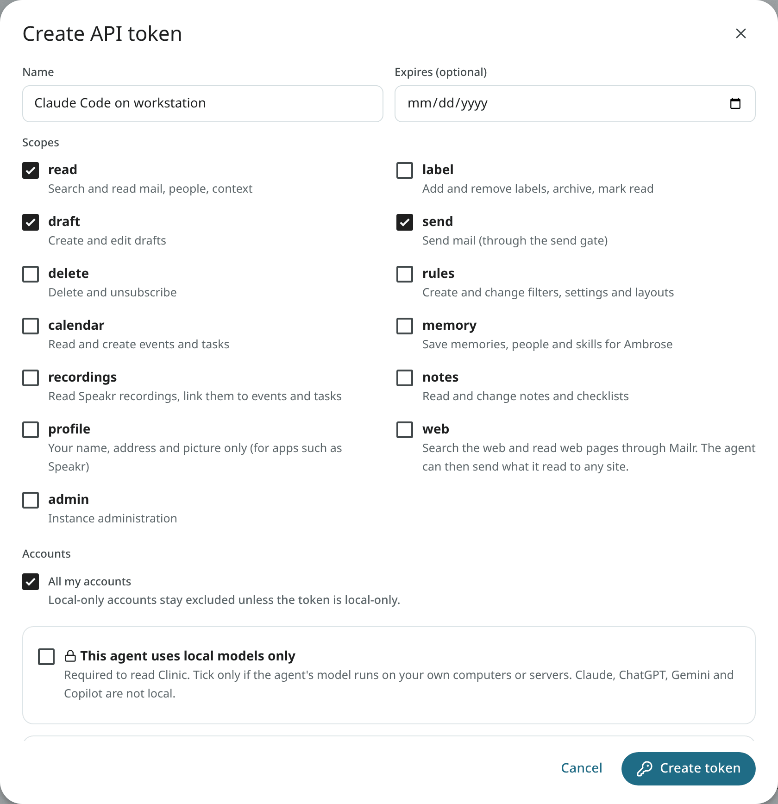
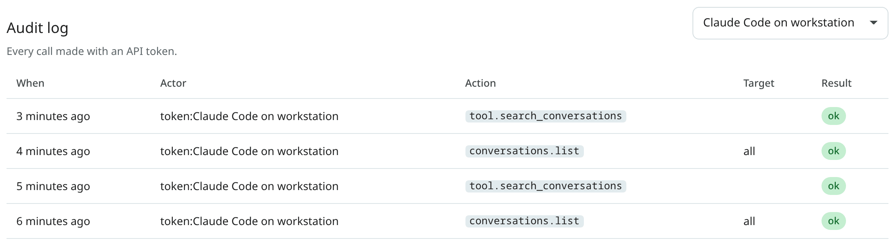

# Tokens and scopes

An agent acts in Mailr on a user's behalf through an API token. Each token has its own scopes, accounts, send policy and expiry, and it can be revoked at any time.

## Create a token

1. Open **Settings → Agents & API** and click **Create token** under **API tokens**.
2. Give it a **Name** for where it runs, for example "Claude Code on workstation".
3. Optionally set **Expires**. The token expires at the end of that day.
4. Tick the required **Scopes**. Start small: `read` and `draft` cover research and writing.
5. Choose the **Accounts** it may see, or keep **All my accounts**.
6. If you have a local-only account, tick **This agent uses local models only** only when the agent's model runs on your own computers or servers. Claude, ChatGPT, Gemini and Copilot are not local.
7. With the `send` scope, choose a send policy (see below).
8. Click **Create token** and copy the token. It is shown only once.



Tokens start with `mlr_`. Send one in the `Authorization` header:

```http
Authorization: Bearer mlr_...
```

## Scopes

| Scope | Permitted actions |
|---|---|
| `read` | Search and read mail, people and context. |
| `label` | Add and remove labels, archive, mark read, star, snooze. |
| `draft` | Create and edit drafts. |
| `send` | Send mail, answer invitations, mail event guests and unsubscribe, through the send gate. |
| `delete` | Delete forever. |
| `rules` | Create and change filters, settings and layouts. |
| `calendar` | Read and create events and tasks. |
| `memory` | Save memories, people and skills for Ambrose. |
| `recordings` | Read Speakr recordings and link them to events and tasks. |
| `notes` | Read and change notes, checklists and tables. Text from a token is written into a note or a table only after approval, unless a rule allows it. Local-only notes are hidden from a token that is not local-only. |
| `profile` | Only your name, address and account picture (`GET /api/v1/me`, `GET /api/v1/users/me/avatar`). Intended for apps such as Speakr, in which the account picture is shown. |
| `web` | Search the web and read web pages through Mailr (`web_search`, `read_page`). The agent picks its own pages, so it can also send what it read to any site in a page address. A new token has this scope only when it is ticked. |
| `admin` | Only for an admin's older certificate tokens. Instance administration needs a signed-in admin and is refused for every token. |
| `tls` | Install the mail server's TLS certificate. Only for an admin's token, created on the command line (see [Mail server](../admin/mail-server.md)). |

A scope is the outer limit. Inside it, each action is allowed, held for approval or denied according to the [permission rules](approvals.md#permission-rules).

## Accounts and local-only tokens

A token can be limited to some of the user's mail accounts. Mail from other accounts is left out of the token's searches, reads, drafts, calendars and summaries.

An account marked **local-only** stays hidden from every token that is not local-only, even with **All my accounts**. Its mail can be read with a local-only token. Give that flag only to an agent whose model runs on your own computers or servers, because an agent sends whatever it reads to its model. Whether a model is local cannot be checked in Mailr. Claude, ChatGPT, Gemini and Copilot run on their makers' servers, so they are not local.

The box is shown only when a local-only account exists. Accounts are marked local-only by their owner, under **Settings → Mail → Mail accounts**; administrators cannot see or set this mark.

Permission to mark agents local-only is set by the administrator (the access-policy switch **Mark agents as local-only**). Without that permission, a short note is shown in the dialog instead of the box. If the switch is turned off later, existing local-only tokens still work, but local-only accounts can no longer be read with them, and the token list shows **local only (off)**.

Administrators can see the names of local-only tokens and when they were created and last used. No mail is shown through this list.

Text Ambrose wrote about the user's mail is also never given to a token limited to some accounts, or to one that is not local-only. This text includes briefs, the results of standing orders and routines, and the reasons behind smart labels. Such a token cannot be used to create or change standing orders either, because an order is run over all of the user's mail.

## Model use

Requests of a token that involve a model call (Ambrose's chat, Help me write, summaries, translations, search by meaning, order tests) are limited per token: 20 a minute and 300 an hour by default (`MAILR_TOKEN_MODEL_CALLS_PER_MINUTE`, `MAILR_TOKEN_MODEL_CALLS_PER_HOUR`). Past a limit, HTTP 429 is returned. Use in Mailr itself is not limited.

## Send policy

With the `send` scope, choose how sends work:

- **Every message waits for my approval** (recommended). Each send is held for approval.
- **Send automatically within a policy.** Sends inside the policy are sent after the hold time. Sends outside the policy are held for approval. A policy can require:
    - **Only replies inside an existing conversation**;
    - **Only to people I have emailed before**;
    - **Only to these domains**, for example `example.com, partner.example`;
    - a **Max per hour** and **Max per day**.

The first message to a new address is always held for approval, under any policy.

## Create a token from the command line

An admin can create a token on the server:

```sh
docker compose exec app mailr create-token alex@northwind.example --name "nightly script" --scopes read,draft
```

Add `--local-only` for a local-only token. The flag has effect only while local-only agents are allowed by the user's policy. The command prints the token once. Without `--scopes`, the token is given `read` and `draft`.

## Revoke a token

Click the revoke button next to a token under **API tokens** and confirm with **Revoke**. Agents using it are cut off at once.

All of a user's tokens are revoked when the password is changed or reset by an administrator. New tokens must be created afterwards.

## The audit log

Every call made with a token is listed under **Settings → Agents & API → Audit log**, with the time, the token, the action, its inputs and the result. You can filter the log by token. Calls by the built-in assistant are listed there too.


