# Ask, dictation and sharing

## Ambrose tab

The **Assistant** tab is the same assistant as on the web. Type or dictate a question, read the answer with citations, and open what it cites: an email opens in the Mail tab, an event in Calendar, a task in Tasks and a note in Notes. Go back to return to the chat. Approval cards are shown in the chat, with the same choices as on the web.

<!-- covers: android:assistant -->

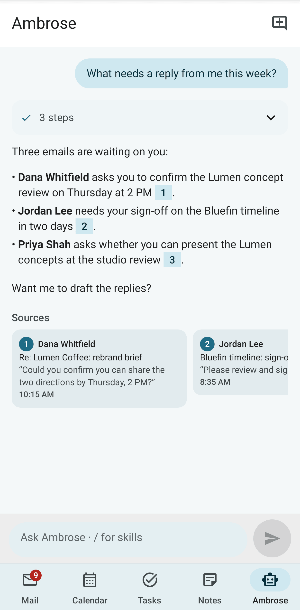

## Chats

Earlier chats with Ambrose are under **Chats**, the clock button at the top of the Ambrose tab. Each chat shows its title, when it last changed and the start of the latest answer. A new chat is given a short title of a few words while its first answer is written, by the chat's own model; when none can be made, the first question is the title. Tap a chat to open it with its answers, sources, approval cards, **Used memories** and person chips, and write to go on with it. Tap **New chat** for a fresh one. To delete a chat, open its **⋮** menu and tap **Delete**; you can undo this while the message is shown. A deleted chat is gone for good. On a phone the list fills the screen. On an unfolded Fold or a tablet it is opened beside the chat.

To search your chats, tap the search icon at the top of the list and type. Ambrose's answers, your questions and the chat titles are searched, and the newest match is listed first. Under each chat, the words around the match are shown, with the match marked. Tap the back arrow to close the search.

To rename a chat, open its **⋮** menu and tap **Rename**. Type the name and tap **Save**. Tap **Undo** in the message to restore the old name. A given name is kept when the chat continues. Leave it empty to show the short title again (or the first question when the chat has none).

The title of the open chat is shown under **Ambrose** at the top of the tab, cut short when it is long. A new chat has no title until you ask your first question. Tap the title, or **⋮** → **Rename**, to rename the open chat in the same way.

If the connection drops while Ambrose answers (you change networks, the app goes to the background, or the server restarts), the answer is not lost. **Reconnecting…** is shown on the turn, and the answer continues from where it stopped. Reconnecting is tried for about a minute, so a server restart for an update is waited out. If the answer cannot continue, the chat is shown as stored on the server: the finished answer, or **Interrupted** when the answer never finished. If the server cannot be reached at all, the turn is marked **Connection lost.** Waiting approval cards are kept in the chat.

A last turn that ended **Interrupted** or **Connection lost.** has a **Retry** button under it. Tap it to ask the same question again in the same chat. The message is not added a second time. If the answer finished while you were offline, it is shown when you tap Retry. If you are still offline, nothing is sent and the button is kept. **Retry** is removed once you use it or send a new message.

<!-- covers: agent.chat_list agent.chat_open agent.chat_delete agent.chat_search agent.chat_rename agent.stream_resume agent.rerun -->

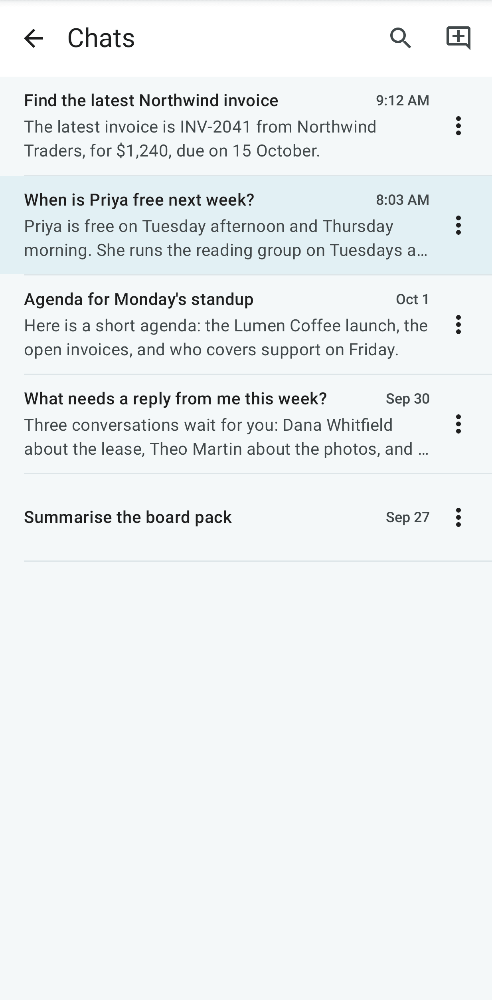

## Commands

Type `/` at the start of a message to see the chat's [commands](../user-guide/assistant.md#commands), then your skills, under **This chat**, **Add**, **Ask** and **Skills**. The list narrows as you type the name. Tap one to put it in the box, then add its text; a command that needs nothing more, typed in full, is sent at once. Press Back or delete the `/` to close the list. The commands are the same as on the web: `/new`, `/chats`, `/rename`, `/retitle`, `/delete` (with **Undo**), `/retry`, `/copy`, `/note`, `/local` and `/help` are run by the app, and the others are sent to Ambrose. `/note` saves the last answer to a new text note, linked to the emails, events, tasks and recordings it cites; **Open** in the message at the bottom shows the note in Notes. A skill you make or change in the chat appears in the list the next time you type `/`.

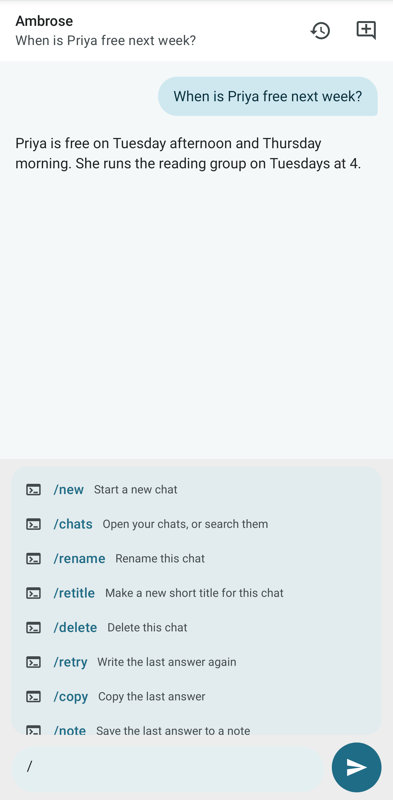

<!-- covers: agent.commands note.from_answer -->

## Clean up a whole view

Ask "clean up this view" or type `/sweep`, as on the web (see [Clean up a whole view](../user-guide/assistant.md#clean-up-a-whole-view)). A progress line on the answer names the scope and its size as soon as the review starts, for example "Reviewing Inbox (all tabs): 143 conversations", with how many are checked so far. If the scope is wrong, tap **Stop** at once; **Continue** picks up where it stopped. The line stays up to date while the chat is on screen, also when you reopen the chat later.

The review ends in one card in the chat. The proposed moves are grouped by sender, followed by what was kept without asking and why. The rows kept as still useful, and those Ambrose was not sure about, are folded under their counts.

Each sender has a move menu, for example **Move to Trash ▾**. Tap it and choose another move to send all of that sender's mail in the group there: **Move to Trash**, **Archive**, **Mark read**, **Label** with each label the review could add, or **Keep** to leave the mail where it is. The sender moves to that group and the counts change. A sender with more than one conversation has an arrow: tap it to see each conversation with its date and its own move menu. The kept and unsure rows have the same menu. What you keep is listed under **kept: you chose Keep**.

Tap **Apply** to carry out the plan with your changes; beside it, the card says how many you changed ("4 changed by you"). **Discard** drops the whole plan. Nothing changes before you apply. A review card in **Waiting for you** has the same menus. When three or more of one sender's conversations get the same move, the sender also has **Always …** (for example **Always move to Trash**): it makes a filter that does the same to their future mail. The button then says **Filter made**, and the message at the bottom offers **Undo**.

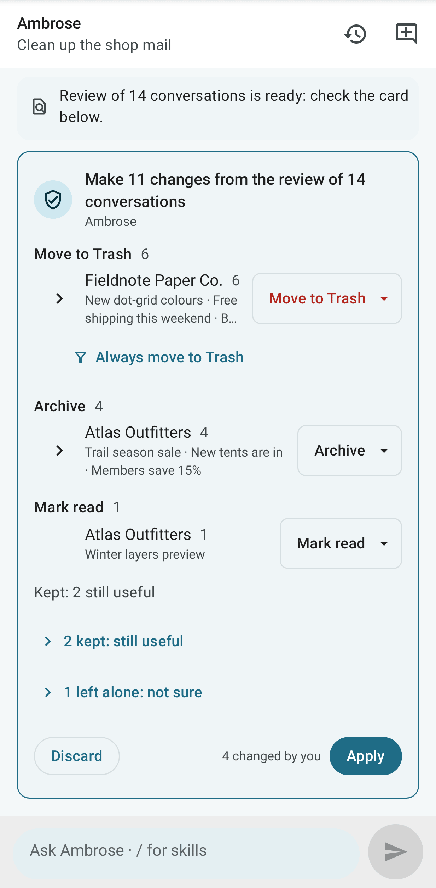

<!-- covers: agent.review_mail agent.review_filter agent.review_move -->

## Memory and person cards

Ambrose's memory is on its own page on the phone too. Open it from the **⋮** menu at the top of the Ambrose tab (**Memory**), or from **Settings → Ambrose → Memory**. It has the same sections as on the web: **To review** (**Keep**, **Dismiss**, **Keep all**), **About you**, **People** and **Topics**, with the time Ambrose last learned and **Learn now**. One search box and the kind chips apply to every section; on a narrow phone the chips are on one line, scrolled sideways by swiping. Long-press a chip to see its example. A memory marked **From a chat** links to that chat in the Ambrose tab, at the message it came from. Tap a memory to edit it. Its **⋮** menu has **Pin**, **Delete memory** (with **Undo**) and, for a commitment, **Create task**. To add a memory, tap **Add memory** and enter what to remember, its kind (each with an example) and who it is about. See [About you and memory](../user-guide/assistant.md#about-you-and-memory).

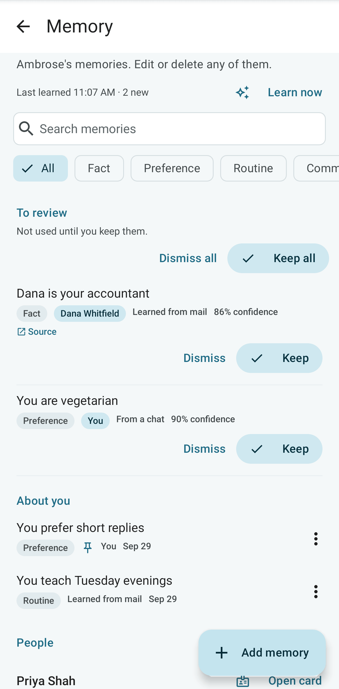

A person's card shows what is known about them: their address, title, organisation, phone numbers, groups, a **VIP** mark and how much mail you exchange. Under **Ambrose's memory** are the memories about them, to edit, delete or add to. Someone in Ambrose's memory who has never written to you is marked **No mail**. You can open the card:

- on the Memory page, from **Open card** beside a person;
- in a conversation, from the sender's picture, or the message's **⋮** menu (**Open card**);
- under an answer in which Ambrose looked someone up (**Card:** and their address).

On a phone the card slides up from the bottom. On an unfolded Fold or a tablet, it is shown beside the list on the Memory page. A topic has no card on the phone: edit its memories on the page, and its name, other names and domains on the web.

Under an answer, the memories used for it are listed under **Used memories**. The line is still there when you reopen a chat after Android closed the app.

<!-- covers: memory.learning_status memory.learn_now memory.accept_suggestion memory.dismiss_suggestion memory.add memory.make_task memory.open_chat person.card person.memories memory.used -->

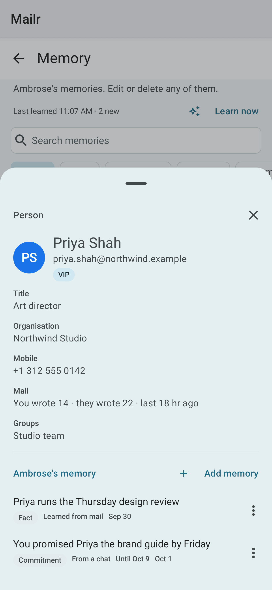

## Waiting for you

The bell in the inbox search bar shows the waiting items, as the bell on the web does. Its count is the sum of
the waiting approvals, the messages that could not be sent, and the reminders showing on this phone. The
count is red while an approval or an unsent message is waiting, and grey when only missed reminders are left.
The bell is hidden when nothing is waiting. The Ambrose tab also shows the number of approvals.

Tap the bell, or **Waiting for you** in the mail drawer, to open **Waiting for you**. It has up to three sections, and only the ones with something in
them are shown:

| Section | Contents |
|---|---|
| **Approvals** | Actions requested by Ambrose or an agent, each with its approval card (below). |
| **Not sent** | Messages not accepted by the mail server, with the reason in plain words and **Retry**. Tap **Open Outbox** to see the [Outbox](mail.md#the-outbox) in the mail drawer. |
| **Reminders** | Reminders that fired, then the **Missed** ones. Tap one to open its sheet, with the same actions as the notification: snooze, done, dismiss and the others. Tap **Review all** to go through them one by one. |

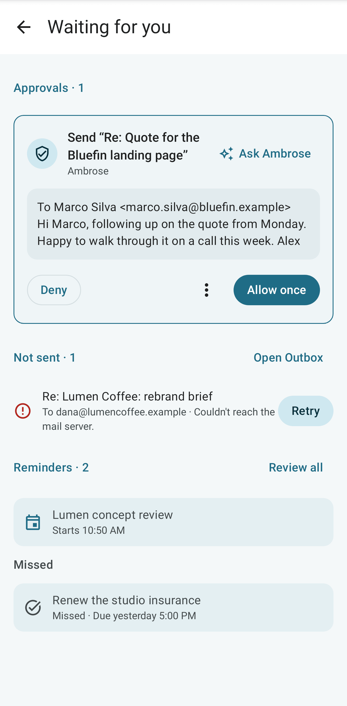

### Approvals

- Pending actions come first, each with **Allow once**, **Deny** and ⋮ (**More ways to allow**). Under ⋮ are **Allow for 12 hours** (**Allow for this chat** for Ambrose) and **Always allow**. Each is listed with what it covers and how many other waiting requests of the same kind are approved with it.
- After such a grant, a message is shown with the number of others approved, with **Undo** for those not yet carried out.
- When one chat or one agent has several requests waiting, a line about it is shown: "3 requests from claude-code". Tap **Allow all 3** to list them first; tap **Allow all 3** in that list to allow each of them once. No rule is created.
- The last ones are listed under **Recent decisions** with their outcome.
- Tap **Ask** on a card to ask Ambrose to explain the action before you decide.

<!-- covers: android:approvals -->

When the app is in the background, each pending approval is posted as a notification with **Allow once** and **Deny**. The phone must be unlocked for both. The notifications are grouped, with a summary line showing the count. A notification is removed as soon as its request is answered anywhere (on the web, in the app, on another device, or by **Allow all**) or expires. With a push app this happens within seconds; without one, at the next check. Turn these off with **Agent approvals** in [App settings](settings.md).

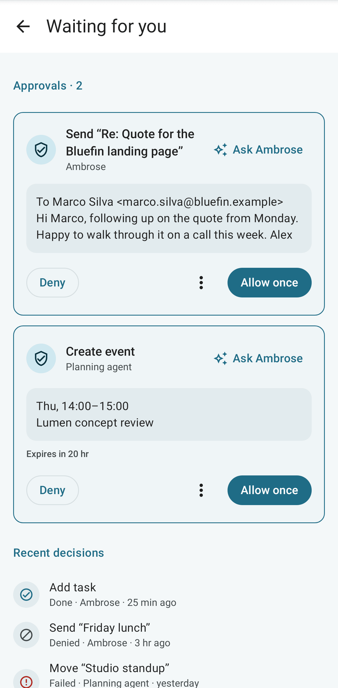

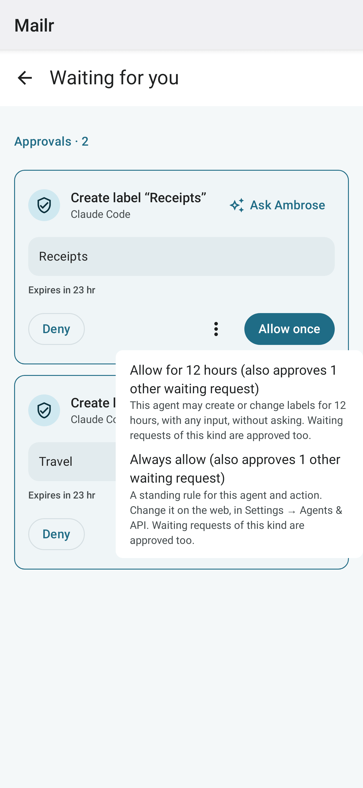

## Ask outside the app

You can give Ambrose an instruction without opening the app:

| Where | How |
|---|---|
| **Home-screen widgets** | Add the **Talk to Ambrose** widget (1×1), the **Today** widget or the **Agenda** widget. Tap the microphone to open Ambrose already listening. |
| **Quick Settings tiles** | Add the **Talk to Ambrose** tile to the Quick Settings panel and tap it to open Ambrose listening. Tap the **New task** tile to open an empty task. |
| **Launcher shortcuts** | Long-press the Mailr icon and choose **Ask Ambrose** (type) or **Dictate** (speak). |
| **Reminders** | With **Ask button on reminders** on, reminders carry an **Ask** button for telling Ambrose what to do with that event or task. |

<!-- covers: android:widget android:launcher android:widget:ask android:tile:ask android:shortcut:ask android:shortcut:dictate android:tile:new_task -->

The **Talk to Ambrose** widget is a round microphone at 1×1. Made wider, it has the words as well. An Ask widget placed before this change now has the microphone. To type, tap the text box in the Ask box once it is open.

The ask box is opened over the current screen. The words are sent to Ambrose as a new chat, with the event, task, recording, conversation or approval attached when Ask was started from one. For Ask from a reminder, the phone must be unlocked.

<!-- covers: android:ask -->

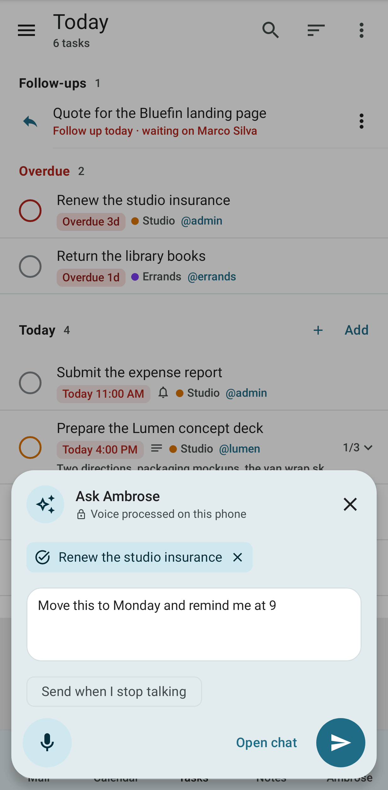

## Dictation

You can dictate in the Ask box, Ambrose tab and the composer. Under **Dictation** in [App settings](settings.md), set where speech is recognised:

- **Phone first, then server**: the phone's own recogniser, when it has one; otherwise the Mailr server.
- **Always server**: the clip is passed to the server's speech-to-text model and is not kept.

Under **Audio processing**, the processing that applies on the phone is listed. The phone's own recogniser is used only in its on-device form, and it is asked to work offline. The phone's default speech service is never used, since with it audio can be sent to the phone's maker. A clip sent to the server may go to a hosted speech service in an ordinary chat. In a chat that has read local-only items, the clip goes only to a local speech server; without one, "Not available with local models only" is shown. With **Local models only**, every clip sent to the server stays local. When the phone has no on-device recogniser and the server has no speech server, the reason is shown in the Ask box, and the request has to be typed.

With **Start listening right away**, the microphone is on when you tap an Ask button. With **Send when I stop talking**, the words are sent to Ambrose after a short pause, without pressing Send.

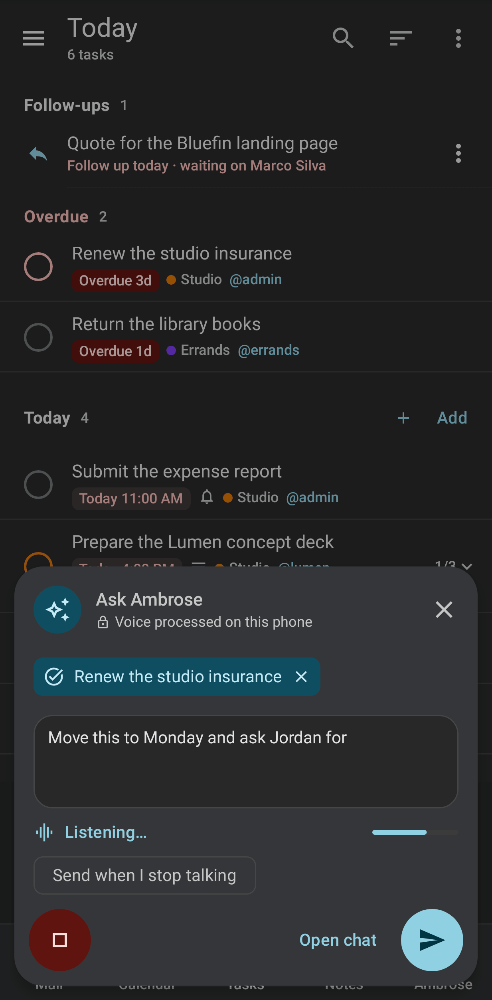

## Share to Mailr

Three Mailr targets are added to Android's share sheet:

| Target | Result |
|---|---|
| **New email** | The composer opens with what you shared: text, a link, files or images. After Send you return to the app you shared from. |
| **Send to self** | The shared item is emailed to you without a composer. A card shows what you are sending, with a subject, a note and labels; tap **Send**. Nothing is sent if you close the card without a tap. After **Send**, Undo is offered on the card. Offline, it is sent later. |
| **New task** | A task is created from the shared text or link. |

<!-- covers: android:share -->

### The Send to self card

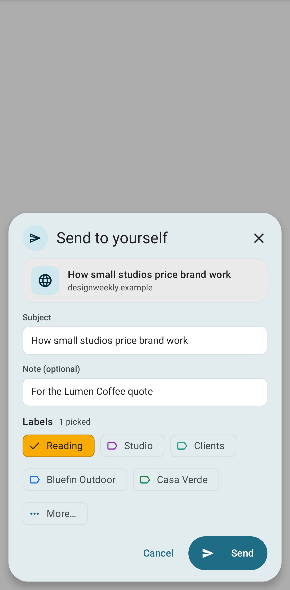

- **What you are sending** is at the top: a link's title and site, the text, thumbnails of images, or file names with their sizes.
- **Subject** is filled with the shared title, the first line of the text, or the file name. It can be changed. For a bare link, the page's title is used when it is sent, unless you typed your own.
- **Note** is optional. It is placed above the shared item in the email. After **Send**, the card shows your note. **Add a note** is offered there only when you sent without one.
- Under **Labels**, recent and most used labels are shown as chips. Tap a chip to add or remove it. Tap **More…** to open all labels with a filter. Several can be picked.
- The labels you picked last time on this phone are picked at the start. Before your first pick, none are picked.
- Filters still apply. With a `from:me to:me` filter, the note is also filed in **Later**. The picked labels are added on top.

<!-- covers: mail.send_to_self mail.send_to_self_labels -->

**Send to self** is also available as a direct-share contact ("Me") and as a launcher shortcut for a quick note to yourself.

Mail sent with **Send to self** is marked as shared from another app. It is filed like any note to yourself: it is in **Sent**, it is found by `from:me`, and filters apply to it, so it is caught by a `from:me to:me` filter. Its text is treated by Ambrose like mail from someone else: it is never taken as the user's own words or instructions, and it is not used to learn about the user or to copy the user's writing style.
