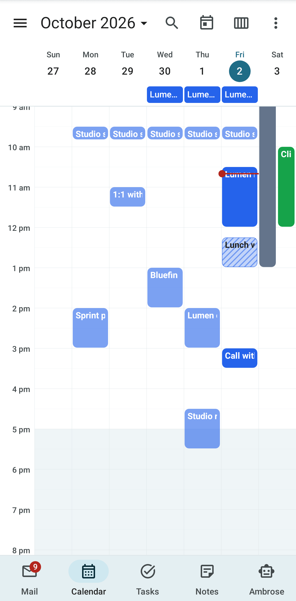
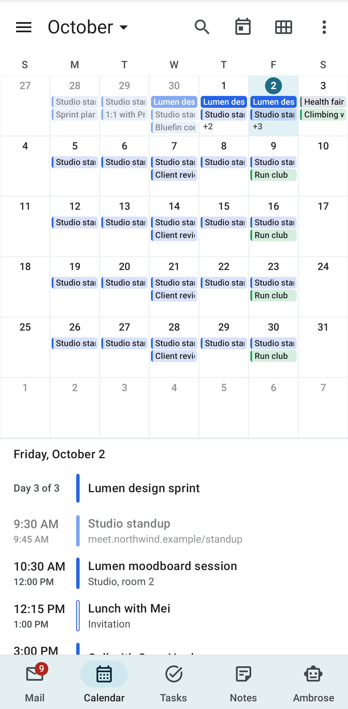
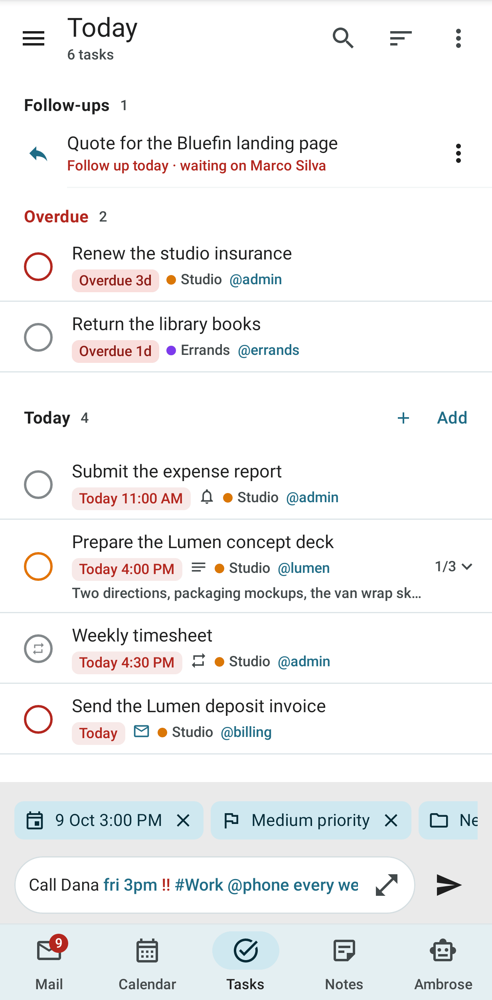
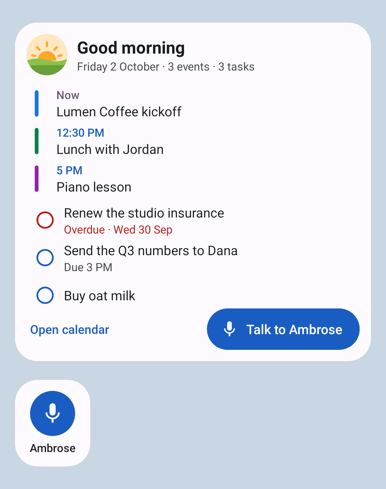
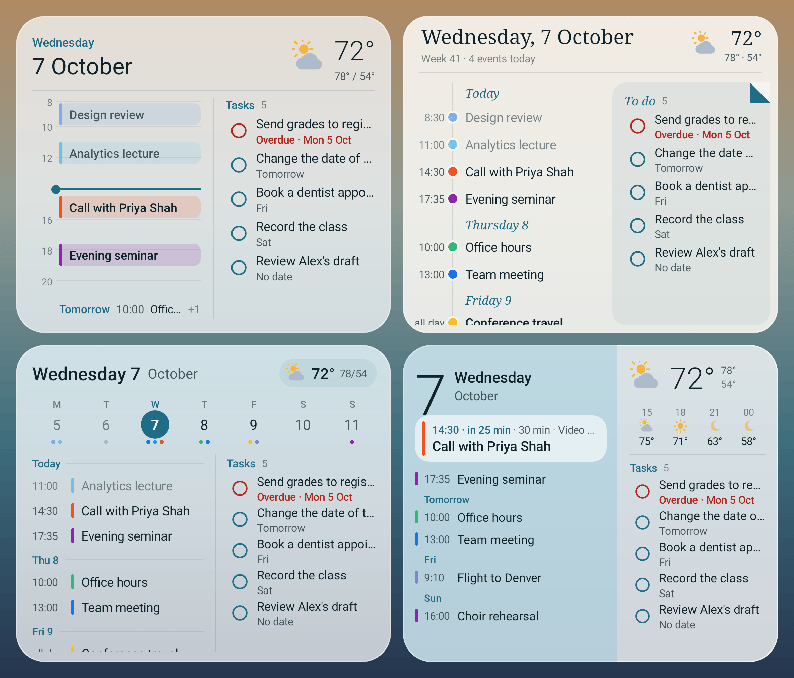
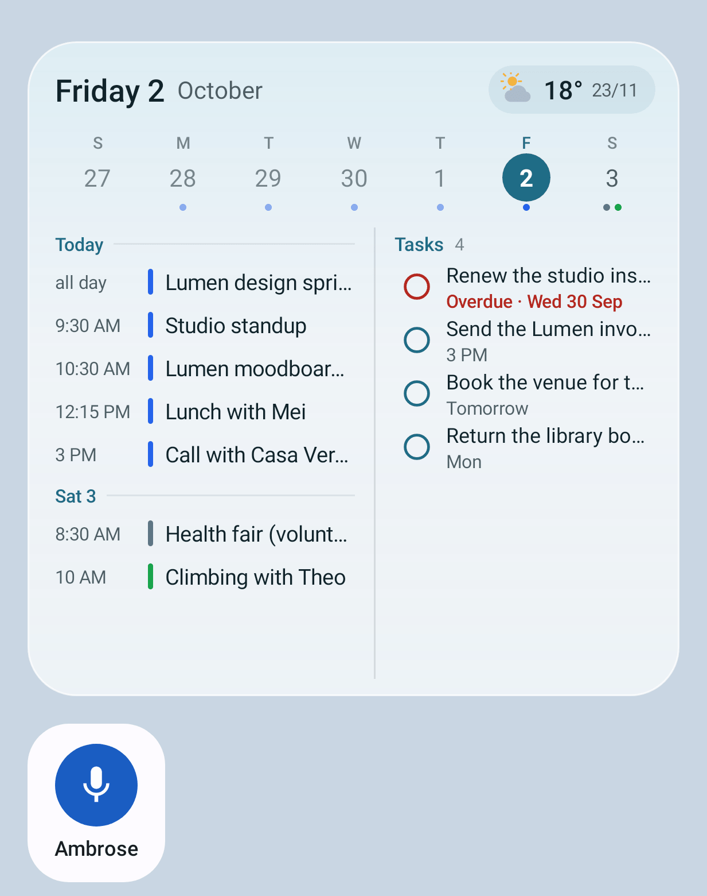
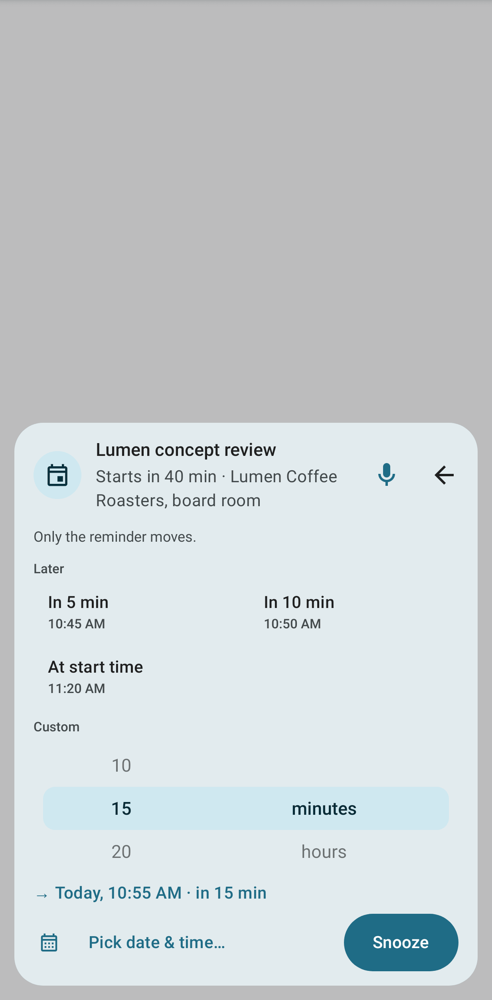
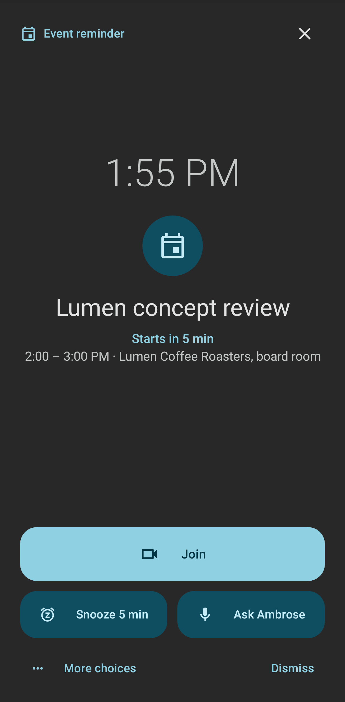

# Calendar, tasks and reminders

## Calendar

The Calendar tab has schedule, day, three-day, work week, week and month views. Swipe sideways to change the period. Tap an empty slot to create an event there. The calendars are listed in the drawer, where each one can be shown or hidden.

From an event you can edit it, move it to another calendar, invite guests, find a free time, answer an invitation and join its video call. On an unfolded foldable or a tablet, event details and the editor are opened in a side pane. The **Join** button is shown for Google Meet, Zoom, Microsoft Teams, Jitsi, Whereby, Webex, BlueJeans and GoTo Meeting links on those services' own addresses; any other https link in the event's URL is shown as **Join on** followed by its address.

When a calendar account stops syncing, a banner above the calendar names it. If the calendar server no longer accepts the account's password, the banner says so, and **Open on web** opens **Settings → Calendar & tasks** in the browser, where you enter the password again. For any other sync problem, **Retry** tries again. **Details** shows the server's own message.

### Month view

On a phone, the month shows the titles of each day's events in small chips. An all-day event is a filled chip in its calendar's colour; a timed event is a tinted chip with a bar of that colour. When a day has more events than its cell holds, the last line is **+n**. Today has a filled circle; the picked day is shaded.

Tap a day to see its events under the month: the start and end times, the calendar's colour bar, the title and the place. Tap the picked day again, or double-tap any day, to open it in the day view. Long-press a chip and drag it to another day to move the event; its time stays the same.

### Meeting prep

An upcoming event with guests has a **Meeting prep** card in its details. Tap it to see the last recording of the meeting and its open action items, open questions and threads waiting on the guests, recent threads, related tasks, memories Ambrose keeps and recent files. Tap **Summarise** to ask the assistant model for a short paragraph. See [Meeting prep](../user-guide/calendar.md#meeting-prep).

### Phone calendars

The calendars that Android keeps on the phone, such as an Exchange account added through the Gmail app, can be shown in Mailr's calendar. Open **Settings → Calendar & tasks → Phone calendars** and turn on **Show phone calendars**. You are then asked to allow calendar access. If you do not allow it, the switch stays off. After **Don't ask again**, **Open app settings** is shown on the page; calendar access can be allowed there later.

Each calendar on the phone is listed under **Calendars on this phone** with its account and colour, and is set to one of four choices. All are **Off** at first.

| Choice | Effect |
|---|---|
| **Off** | The calendar is not shown in Mailr. |
| **Show on this phone** | Its events are shown in the schedule, day, week and month views on this phone, in the calendar's colour, marked **On this phone**. Nothing is sent to the server. |
| **Show and send busy times** | As **Show on this phone**, and the calendar's busy times are sent to the server, where they are shown on the web and given to Ambrose. |
| **Show and send details** | As **Show and send busy times**, and each event's title and place are sent with its times, so they are shown on the web and given to Ambrose. Guests and descriptions are not sent. |

Events from a phone calendar are read-only in Mailr. They cannot be dragged, edited, deleted or answered, and no Mailr reminders are set for them; the reminders of the phone's calendar app still apply. Tap one to see its time, place and calendar, and tap **Open in Calendar** to open it in the phone's calendar app, where it can be changed.

Nothing is sent from the phone for calendars set to **Off** or **Show on this phone**. For calendars set to **Show and send busy times**, the start, the end and whether it lasts all day are sent for each event marked busy or tentative, and not declined or cancelled, for the 30 days before today and the 180 days after. For calendars set to **Show and send details**, the same events are sent with their titles and places as well, each cut to 300 characters. Guests, descriptions, notes and the organizer are never sent. The busy times are sent again when the phone's calendar changes and every 30 minutes, when they differ from the last copy sent. Setting a calendar from **Show and send details** back to **Show and send busy times** sends its busy times again at once without titles, and the titles and places are removed from the server. Setting a calendar back to **Show on this phone** or **Off**, or turning **Show phone calendars** off, removes its busy times from the server. See [Phone calendars](../user-guide/calendar.md#phone-calendars) for how they are shown on the web.

A phone event that is also in Mailr's calendar, at the same time and with the same title, is shown and counted once, from Mailr's calendar. A meeting declined or cancelled in Mailr is therefore not shown or sent from the phone, even when it is still marked busy in the phone's calendar. An event whose title starts with **Canceled:** is not shown or sent either.
<!-- covers: calendar.phone_sync -->

## Tasks

On the Tasks tab, tasks are grouped by due date, from Overdue to Completed, with subtasks under their parent. Smart lists (Today, Upcoming, All) and custom lists are in the drawer.

- Tap the circle to complete a task. Swipe a task to act on it; the actions are set under **Task swipe actions** in [App settings](settings.md): Complete, Reschedule, Delete or Move to list.
- Long-press to select several tasks and complete, reschedule, move, tag or delete them together.
- In a list in manual order, drag a task by its handle to move it, or drag it to the side to make it a subtask of the task above or a task of its own again. Tap **Undo** in the message to put it back where it was. **Undo** is also offered when you untick a done task or subtask.
- Type a whole task in one line with [quick add](../user-guide/quick-add.md): `Call Dana fri 3pm !! #Work @phone every week`. The quick-add bar is at the bottom of the list, above the tab bar, as in Notes and Ambrose. Its chips, such as **Today ×**, are shown above the line.

### Undo and redo in the task editor

<!-- covers: task.undo_edit task.redo_edit -->

The top of the task editor has **Undo** and **Redo** next to **Save**. Touch and hold one to see its
name. Changes are undone one at a time and redone in the same steps:

- Typing in the title or the notes is undone a word at a time, as in a note. After an undo or redo
  the cursor is in that field, right after the text that came back or went in.
- A due date, a time, a start date, the priority, the list, a tag, a reminder and the repeat are one
  step each. So is adding or ticking a subtask.
- An undo is saved like any change. A change someone else made to another field meanwhile is kept.
- With a keyboard attached, undo is `Ctrl + Z` and redo is `Ctrl + Shift + Z` or `Ctrl + Y`.

After you leave the editor, tap **Undo** on the **Task changes saved** message to put the whole task
back as it was when you opened it.

Events and tasks can be created and edited offline. The changes are sent when the phone is back online.

## The Today widget

The **Today** widget shows the day on the home screen without opening the app:

- A greeting for the time of day, with a small picture: a sunrise, the sun, a sunset or the moon.
- Today's events that are still ahead. An event under way is marked **Now**. Tap one to open it.
- Tasks due today or overdue, overdue first. Tap the circle to complete a task. **Undo** is shown at the top for a few seconds.
- **Talk to Ambrose** in the bottom right corner. Tap it to open Ambrose already listening.

The widget can be resized. At its smallest it holds the greeting, the next event or task, and the microphone. At larger sizes, more is listed; tap **n more** to see the rest in the calendar or Tasks. Tap the greeting to open the calendar.

The widget is drawn from the copy of the calendar and tasks kept on the phone, so it works offline. A task completed there is sent when the phone is back online. The widget is redrawn as soon as an event or task changes on the phone, and every 30 minutes.

<!-- covers: android:widget:today -->

## The Agenda widget

The **Agenda** widget shows the next few days on the home screen. It is translucent, so the wallpaper shows through, and it matches the phone's light or dark mode.

Pick one of four styles for each Agenda widget you place:

- **Glass timeline**: today's hours as a timeline, with a line at the current time and the next day's first event under it. Events that overlap are placed side by side. Tasks are in a column on the right.
- **Paper & rail**: a paper card with the date in a serif type and the week number. The days are listed down a thin rail, with a dot in each event's calendar colour. Tasks are on a sheet with a turned corner.
- **Week strip** (the default): this week across the top, starting on the phone's first day of the week, with dots for each day's events. Today's agenda and the next day's are below, with tasks beside them.
- **Numeral duotone**: a large date and the next event on a card, with **in 25 min** when it starts within the hour, its length and its place. A long title takes two lines on the card. The events after it are listed by time, with each later day's name above its first event. The other half has the weather hour by hour and the tasks.

Events and tasks on a later day are labelled **Today**, **Tomorrow**, the weekday for the rest of the coming week (**Mon**), and the weekday with the date from a week ahead (**Mon 19 Oct**), so this Monday and next Monday look different.

Tap targets:

- **The date**: Ambrose opens, already listening. The widget has no separate button for Ambrose.
- **An event**: the event opens.
- **A circle**: the task is completed. **Undo** is shown at the top for a few seconds.
- **A task's title**: the task opens.
- **A day heading**, or a day in the week strip: that day opens in the calendar.
- **The weather**: the weather app opens.

Resize the widget to see more or less, down to four cells by two or three by two. The top part stays the same size at every height: the date, the weather (with the hours in numeral duotone), the next event card (one line taller for a two-line title) and the week strip. The lists below it take the rest of the height. When a list has more items than fit, swipe up and down on it to scroll. Where events and tasks are side by side, each list is scrolled separately. With only a few items, the lists end after the last one. In the glass timeline, as many hours are shown as fit at full size, and the tasks scroll. In the week strip three cells wide, the tasks follow the days in the same list.

The widget's settings open when it is placed, and later from the widget's long-press menu (Android 12 and later). The settings are:

- **Style**: one of the four styles, for this widget only. A widget placed before styles existed shows the week strip.
- **Line up days and times**: on by default. The day, the time and the title of each event are lined up in columns, so every title starts at the same place. The columns are as wide as the longest day name and the longest time on the phone's clock (12 or 24 hour). For today's events, the day column is empty. Numeral duotone has no day column: each later day has a small label above its first event, and the times form the column. Turn it off to let the day and time run into the title. In paper and rail the times always form a column, because the rail runs beside them. In the glass timeline, the columns are used for the next day's line under the timeline when its title still has room.
- **Days to list**: from 3 to 14. The widget shows as many of them as fit.
- **Weather**: on or off.
- **Weather for**: this phone's approximate location, or a city you search for. When this phone's location is chosen, permission for approximate location is requested as the settings open. If it is refused, the city search opens, and you are not asked again unless you tap **Approximate location**.
- **Units**: automatic (by region), °C or °F.
- **Weather app**: the app that opens when you tap the weather. Weather apps on the phone are suggested; with **Choose any app**, every app is listed. With **Let Android choose**, the default weather app is opened, or you are asked to choose one.

While the weather has no place yet, the widget shows **Set weather** where the weather goes. Tap it to open the settings.

The forecast is fetched from [Open-Meteo](https://open-meteo.com) by the phone itself, with no account. Only the location, rounded to about 10 km, or the city name is sent to Open-Meteo. Weather is never sent through the Mailr server or a language model. The forecast is fetched at most once an hour, and only while an Agenda widget is on the home screen.

The events and tasks come from the copy kept on the phone, so the widget works offline. The last forecast is shown for up to six hours. The glass timeline and numeral duotone styles are redrawn while the phone is in use, so the time line and the countdown stay right; the phone is never woken for it. The **Today** widget is unchanged for people who placed it.

<!-- covers: android:widget:agenda -->

## Reminders

Event and task reminders are shown on the phone at the right minute, even without a network. Each reminder notification has buttons:

- events: **Snooze 5 min**, **Snooze…** and **Dismiss**;
- tasks: **Done**, **Snooze…** and **Dismiss**.

For an event with guests, **Prep** is shown in place of **Dismiss** (a swipe still dismisses), unless the event is about to start and has a video link; then **Join** is shown. Tap **Prep** to open the event with its meeting prep. The reminder sheet has a **Prep** button too.

On the lock screen, a reminder shows no details, and the phone must be unlocked before its sheet opens. Tap **Snooze…** to open a small sheet of choices that fit the reminder: for an event that has not started, in 5 or 10 minutes or when it starts; for a task, later today, the same time tomorrow or next week, tomorrow morning or next Monday; or a date and time you pick. Tap a reminder to open its event or task.

When several reminders wait, tap **Review** to go through them one by one. After each action, the next card is shown. Reminders handled on the phone are also cleared on the web, and the other way round.

Reminders that came due while the phone was off are shown as **Missed** after it is restarted, as long as they still matter.

### Full-screen alerts

With **Full-screen alerts** on, an event about to start or a task due now is shown full screen, and the screen is switched on. While the phone is locked, the alert shows only the time and "Task reminder" or "Event reminder", with **Unlock**: the title, the details and the buttons appear after the phone is unlocked. You can then mark it done, snooze it, join the call, dismiss it or ask Ambrose about it. Full-screen alerts are never shown while Do Not Disturb is on, and never for missed reminders or all-day items. You are asked for the **Full-screen permission** the first time.

<!-- covers: reminder.full_screen android:fullscreen -->

### Morning agenda

With **Morning agenda** on, one quiet notification is posted at the set morning hour with today's events and the tasks that are due or overdue.

<!-- covers: reminder.agenda -->

### Remind again

With **Remind again**, a reminder is repeated with sound every 5, 10, 15 or 30 minutes until it is acted on. The setting also applies on the web.

All reminder settings are on [App settings](settings.md#calendar-tasks).
