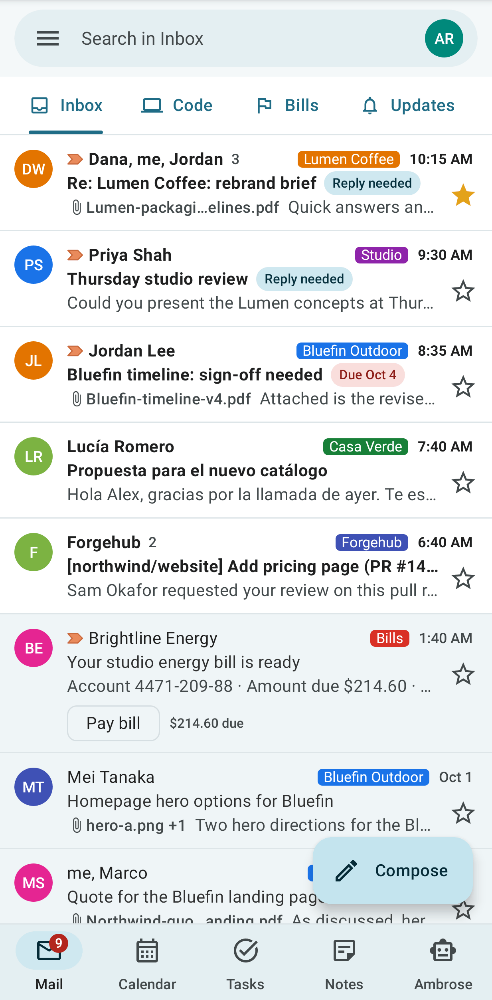
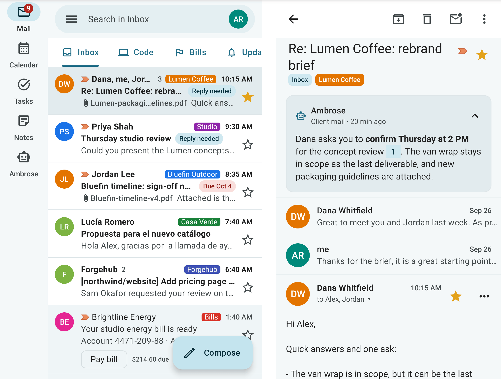

# Android app

The Mailr Android app is a native client for a Mailr server. It covers mail, calendar, tasks, reminders, notes, recordings and Ambrose. The app and the web app are connected to the same server, so a change made in one is shown in the other.

## Install and sign in

Open `/get-app` on your Mailr server with your phone (for example `https://mail.example.com/get-app`), download the app and sign in. When the server holds no APK, the page links to [GitHub Releases](https://github.com/murtaza-nasir/mailr/releases). Android 10 or later is required. The steps are in [Install the phone app](../getting-started/phone.md).

## Areas of the app

| Area | Features |
|---|---|
| [Mail](mail.md) | Read, search, reply and act on conversations; swipe actions; favourites and labels in the drawer; briefs and meeting recordings in the reader. |
| [Calendar, tasks and reminders](calendar-and-reminders.md) | Schedule, day, week and month views; tasks with subtasks and quick add; reminders that fire on time, even offline; the Today and Agenda widgets. |
| [Notes, lists and tables](notes.md) | Keep-style notes and checklists with sections and quantities, tables as cards with a row form, sharing, history and reminders, all usable offline. |
| [The separate Notes app](notes-app.md) | A second app for notes, lists and tables only: widgets with checks in place, quick capture, launcher shortcuts, a Quick Settings tile and a share target. |
| [Ask, dictation and sharing](assistant-and-sharing.md) | Ambrose tab, approvals, the Ask widget, tile and shortcuts, dictation, and share targets. |
| [App settings](settings.md) | Style, swipes, notifications, reminders, dictation and signed-in devices. |

## Phones, foldables and tablets

On a phone, Mail, Calendar, Tasks, Notes and Ambrose are reached from a bottom bar, in the same order as the web app, with Ambrose at the right. On a tablet or an unfolded foldable, a side rail is used instead of the bar, and the list and the open conversation are shown side by side. In book posture the split is aligned with the hinge.

## Offline use

Recent mail, events and tasks are kept on the phone. Offline, you can still read, archive, star, label, snooze, create or edit events and tasks, and check, add and edit notes, list items and table rows. Each change is queued and sent when the phone is back online. A retried change is not applied twice.

## Updates

The server can be set to refuse an old version of the app. A banner is then shown at the top of every screen: **Update Mailr to keep syncing**. Until the app is updated, nothing is sent to the server, and changes are kept in the queue on the phone.

Tap **Update**. The new version is downloaded in the browser, from the server (`/api/v1/app/mailr.apk`). Open the downloaded file and allow the install. The new version is installed over the old one; the account and the mail on the phone are kept. When the updated app is opened, the waiting changes are sent and the banner is removed.

When the server has a newer version, **Update available** is shown at the top of **Settings**, with the same **Update** button. The list of versions is read from the server at most once a day. No prompt is shown.

## Signing out

On sign-out, the mail and files cached on the phone are removed; the mail remains on the server. You can also sign a lost phone out from the web app under **Settings → You → Password & devices**, in the list of signed-in devices.
