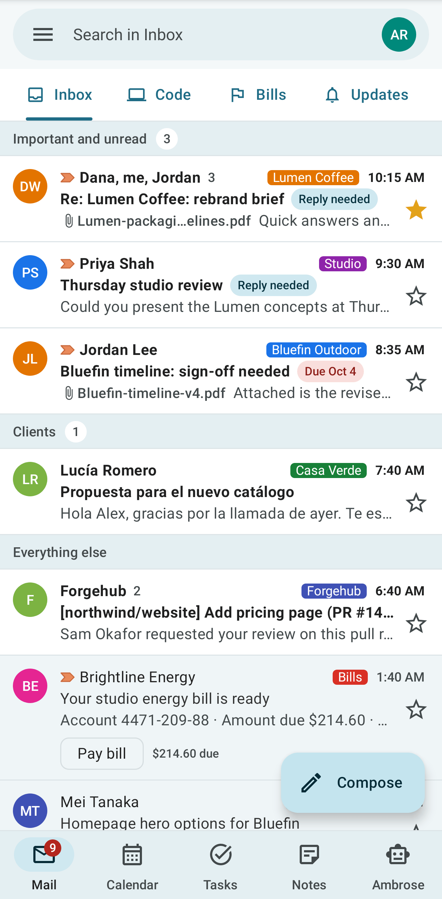
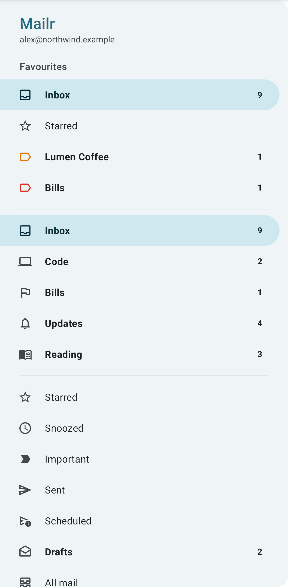
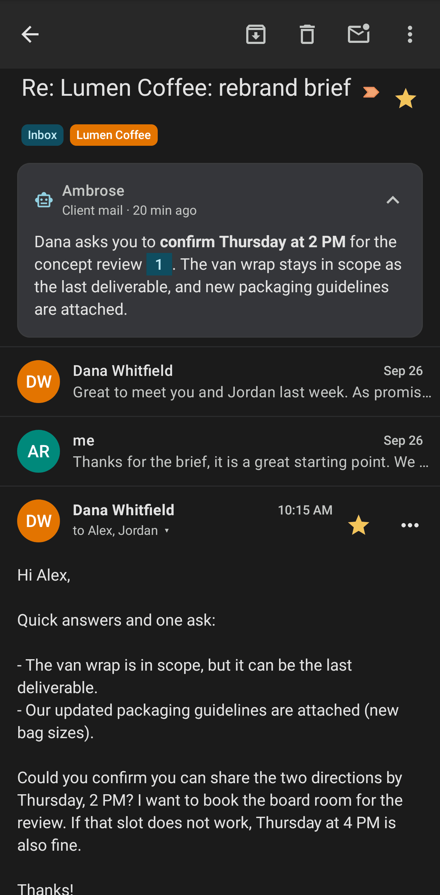
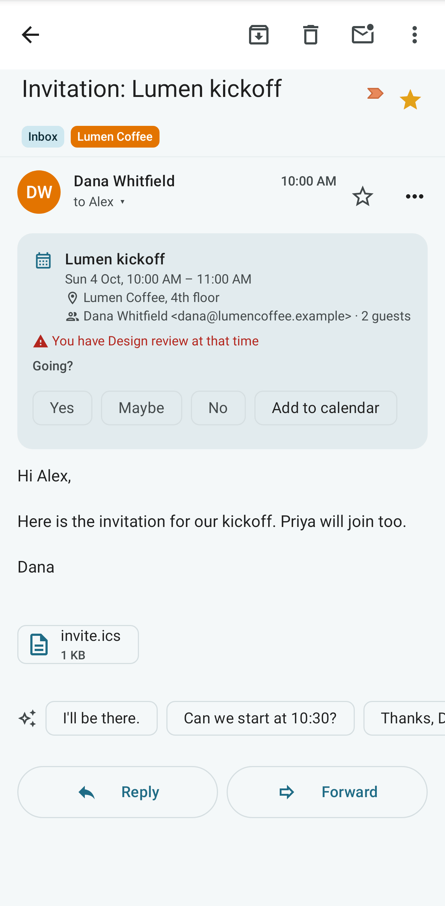
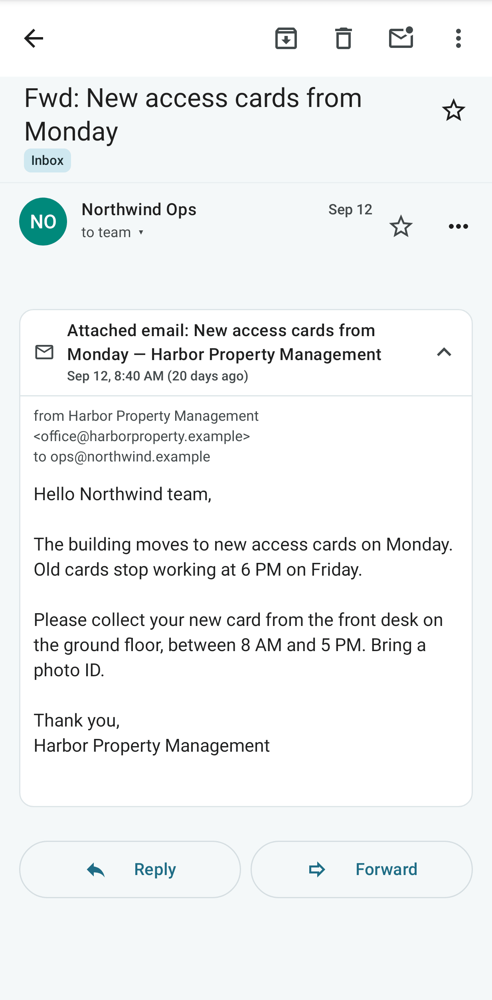
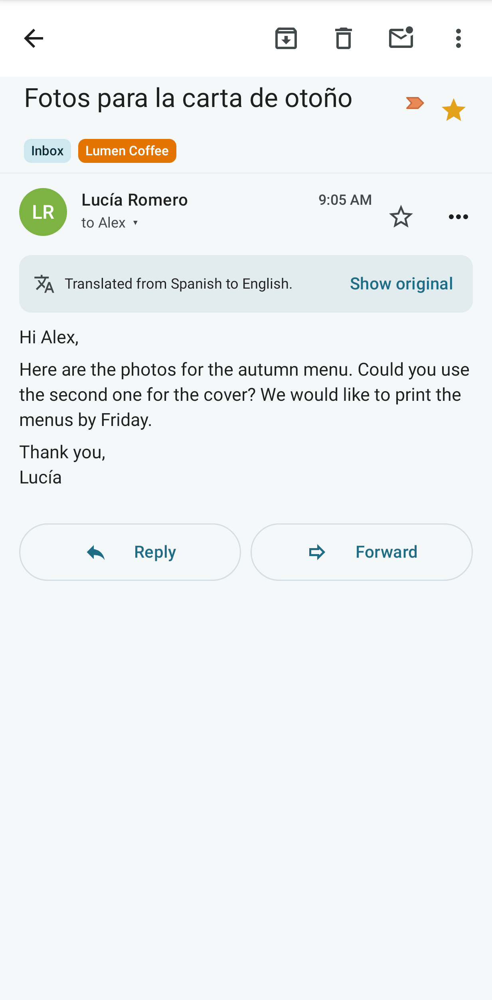
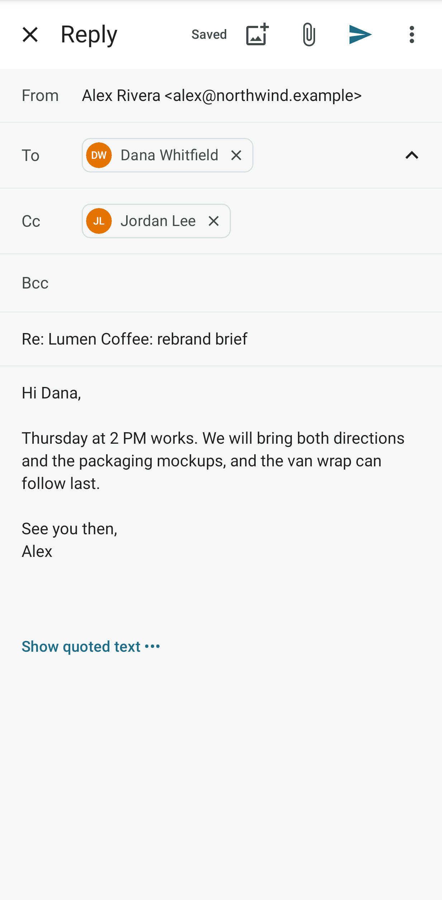

# Mail on the phone

The Android app shows the same inbox, tabs, labels and conversations as the web app.

## The list

The inbox is shown in the active layout, including custom inbox sections. Pull down to refresh. Tap a conversation to open it.

- **Sections.** A section with no conversations is left out. Under a section with more conversations than it shows, **Show N more** adds rows in place, **Show fewer** goes back to the top rows, and **Show all N** shows the section alone. The expand button at the end of a section's heading also shows it alone. To see all the sections again, tap the arrow and the name on its heading (**Back to all sections**), press Back, tap the tab again, or choose **Inbox** in the drawer. See [Tabs and layouts](../user-guide/tabs-and-layouts.md).

- **Swipe** a row to act on it. The actions are set under **Swipe right** and **Swipe left** in [App settings](settings.md): Archive, Delete, Mark read/unread, Snooze, Star or None.
- **Long-press** a row to select it, then tap more rows. The selection bar is shown in place of the search bar, at the same height, so the tabs and the list stay where they are. Tap the back arrow to clear the selection.
- The one-tap action of a message (pay a bill, track a package, copy a sign-in code) is shown on the row.
- In **Spam**, tap **Not spam** to move a conversation back to the Inbox. In **Trash**, tap **Restore**, or **Delete forever** (you are asked first). The same actions are on the selection bar and in the reader.

<!-- covers: mail.untrash mail.delete_forever -->

### Search

Tap the search bar to search all mail. Type words, or use operators such as `from:alice`,
`has:attachment` or `is:unread`; the chips under the search box add the common ones. Without a
network, the search looks through the mail already on the phone (every folder and search opened
before) and the list is headed **Offline results: mail on this phone only**. Offline, the words,
`from:`, `to:`, `is:unread`, `is:read`, `is:starred` and `has:attachment` are used; other operators are
left out. The full search runs again when the phone is back online.

## The drawer

Swipe from the left edge, or tap the menu button, to open the drawer. **Favourites** are at the top, then the inbox tabs, folders and labels. Long-press an entry to add it to Favourites, remove it, or move it.

While **Show each account separately** is on (set on the web), each account has its own group in the
drawer, with its pinned folders and **More folders**. Tap **⋮** next to an account's address, or
long-press the address, and choose **New folder** to make a folder in that account. Long-press a folder
of the group to pin it, unpin it, move it, or make a folder inside it with **New folder inside**. See
[Folders inside an account](../user-guide/inbox.md#folders-inside-an-account).

<!-- covers: android:drawer -->

### The Outbox

While a message is on its way or could not be sent, an **Outbox** entry is shown in the drawer with
the number, in red when something was not sent. Tap it to open a list with each message's state,
**Retry** for one that was not sent, and **Open** for its conversation. The entry is removed again
once everything is sent.

<!-- covers: draft.outbox draft.retry_send -->

## The Screener

While the [Screener](../user-guide/screener.md) is on, a **Screener** entry is shown in the drawer under
the Inbox, with the number of first-time senders waiting. Tap it to open a list of their cards: the
sender's name and address, who a decision covers, the authentication hint, and the latest subject
and preview. Tap the preview to read the conversation. With **Allow**, their mail is moved to the Inbox;
with **Block**, it is moved to Spam. Labels, Block and delete, and the Screener settings are on the web.

<!-- covers: screener.review screener.allow screener.block -->

## Reading

The reader shows the whole conversation. From its toolbar and menu you can:

- archive, delete, report spam, snooze, or label the conversation;
- ask to be reminded when nobody replies;
- reply, reply all or forward;
- move it with **Move to…**: to Archive, Spam, Trash or a label, with a search box for labels;
- make something from it with **Create from email** in the ⋮ menu: a **Task**, an **Event**, a
  **Meeting with these people** (the event editor with everyone in the thread as guests, linked to
  the conversation), a **Note** or a **Checklist** (linked to the conversation; **Open** shows it in
  Notes), or **Link to a note…** for an existing note;
- tap a suggested reply under the newest message: the reply is opened with that text, ready to edit;
- show remote images (they are loaded through Mailr, so senders cannot tell when you open the email);
- add an `.ics` attachment to the calendar;
- tap an attachment to open it, or long-press it for **Share** (to another app) and **Save to
  Downloads**;
- read Ambrose's brief and open linked meeting recordings.

<!-- covers: mail.attachment_share mail.attachment_save -->

The ⋮ menu is shown as a sheet from the bottom of the screen. The common actions come first (Summarise,
Ask Ambrose, Snooze, Mark important), then three groups: **Create from email**, **Organise** (Move
to, Label as, Show in tab, Category) and **More** (Mute, Report spam). Scroll the sheet to reach the
last rows on a small screen. The ⋮ menu of a selection in the list is a sheet of the same kind.

<!-- covers: mail.move note.from_email note.link mail.schedule_meeting mail.reply_suggestions -->

### Invitations

For an invitation, a card is shown above the message, as on the web: the title, when and where, the
organiser and the number of guests. Tap **Yes**, **Maybe** or **No** to answer the organiser; the chosen
answer stays marked. With **Add to calendar**, the event is put in the calendar as Maybe, and the
organiser is not told. The card also shows when the time clashes with something in the calendar ("You have
Team sync at that time"), what an update changed ("Time changed: was Tue 6 Oct, 3:00 PM"), what a
guest answered, and when the organiser cancelled (**Remove from calendar**). A guest's proposed new
time has **Accept** and **Decline**. A change kept back because its sender could not be verified
has **Apply anyway**. The organiser's address is shown beside their name.

When the calendar's copy of the event was made another way, tap **Link to this invitation** to give it
the invitation's identity, as on the web (see
[Invitations](../user-guide/invitations.md)).

<!-- covers: invite.view event.rsvp invite.apply_update invite.apply_cancel invite.apply_reply invite.apply_unverified invite.counter event.accept_proposal event.decline_proposal -->

### Attached emails

An email attached to a message, such as a **Forward as attachment** from another mail app, is shown as a
card under the message, as on the web (see [Attached emails](../user-guide/reading.md#attached-emails)).
The card shows **Attached email:**, the subject, the sender, the date and the first words. Tap it to
open the attached email's sender, recipients, body and files; tap it again to close it. Its images
are blocked like any other message's until you show them. For a message with no text of its own,
the first card is opened. When the search words are found only inside an attached email, the row in the list
is marked **In an attached email**.

### Translate a message

Tap **⋯** on a message and choose **Translate…**. Pick a language and tap **Translate**. The language
picked last is at the top of the list and already chosen. The first time, the phone's language is
chosen. When a message is detected as being in a language you do not read, **This message may be in
another language** is shown above it, with **Translate…**.

The translation is shown in place of the message, under "Translated from Spanish to English." Tap
**Show original** to see the message again, and **Show translation** to go back. A long message is
translated only in part, as noted in that line.

The translation is done on the server with a language model. Mail from a local-only account is sent only to a
local model. When no such model is set up, or no model at all, "No language model
is available for this message." is shown. See [Translate a message](../user-guide/reading.md#translate-a-message)
for the web.

<!-- covers: mail.translate -->

### Not sent

A draft that could not be sent is marked **Not sent** in the thread, with the reason in plain words and
**Retry**. A message whose connection dropped after it was handed to the mail server is marked
**May have been sent** instead: check the Sent folder at your provider before you choose **Retry**.

### Before setup

While no mail account is connected, **Finish setup on the web** is shown in the inbox,
with the server's setup address and **Open setup guide**. A similar notice is shown
in the calendar and the task lists when those are not set up.

## Writing

The composer has To, Cc and Bcc with address suggestions, send-as identities and signatures, attachments and inline images. Templates are listed under **Insert template…** in its ⋮ menu (they are made on the web, under **Settings → Mail → Writing**); tap one to insert its text where the cursor is, with the recipient's name filled in.

<!-- covers: template.insert --> Drafts are saved as you type and are shown on the web too. After you send, **Undo** is offered for a few seconds.

An email link opens the composer with its recipients, Cc, Bcc, subject and text filled in: a link in a message, and links from other apps once Mailr is the default email app. To make it the default, open the phone's **Settings → Apps → Default apps** and choose Mailr for email, or tap an email link and choose **Mailr** with **Always**. Nothing is sent until you tap Send.
<!-- covers: compose.deeplink -->

Without a connection, typed text is kept on the phone and synced when the phone is back online; until then, **Saved on this phone. Waiting to sync.** is shown in the composer. Offline changes (archive, read, labels) are held in **Pending changes**, opened from the offline banner, with **Retry** and **Discard** for any that fail. When the list cannot be refreshed, the mail already on the phone stays in view under **Can't reach the server · showing the mail on this phone**; tap the banner to try again.

## New mail notifications

Choose which new mail triggers a notification under **Notifications → New mail**: **Important mail**, **VIP senders only**, **Important and Primary**, **All new mail** or **Off**. With a push app on the phone (see below), new mail, approvals and failed sends arrive within seconds. Without one, new mail is checked for in the background about every 15 minutes, and at once while the app is open. The text of an email is never shown in a notification, and for mail from a local-only account only "New message" is shown.

New-mail notifications have **Archive**, **Mark read** and **Reply** buttons. A notification is removed once the conversation is read or archived, on this phone or anywhere else. With two or more, they are grouped under one summary, "3 new conversations", with a line for each.

### Instant notifications (push)

Mailr is built on [UnifiedPush](https://unifiedpush.org/), so no Google service is involved. A free notification app is required; [ntfy](https://ntfy.sh/) is the usual one.

1. Install ntfy (F-Droid or Google Play). By default ntfy's own server, ntfy.sh, is used, and the messages are encrypted for this phone. When the Mailr server has its own ntfy, it is listed under **Settings → Notifications → Your server's ntfy** (and in the first setup). The card there lists three steps: tap **Copy and open ntfy** (the address is copied and ntfy opens), open **Settings → Default server** in ntfy, and paste the address. ntfy's server cannot be set from a link, so this paste is the one manual step. When you come back, the card is gone and the status says **Instant mail is working**.
2. In ntfy, allow notifications and turn off battery optimisation for it when you are asked.
3. Open Mailr. ntfy is found and set up automatically; **Instant mail is working, through ntfy** is then shown under **Settings → Notifications → Push**. With several push apps installed, tap **Choose** and pick one.
4. Tap **Send test**. A "Test notification · push works" notification arrives within seconds.

A quiet notification from ntfy is shown while its connection is kept open; that channel can be hidden in ntfy's notification settings. Mailr's own notifications have the same buttons as before: **Allow once** and **Deny** on approvals, and the conversation is opened with a tap.

#### Without ntfy: the live connection

<!-- covers: notification.live_connection -->

Without a notification app, mail is checked every 15 minutes. For mail at once without another app, turn on **Settings → Notifications → Live connection** (the first setup offers it too). A connection to the server is then kept open. The costs are:

- A permanent notification, "Live connection", is shown while the setting is on. That channel can be hidden in Android's notification settings for Mailr.
- More battery is used than with ntfy, where one connection is shared among all apps. The amount depends on the phone and the network.

While push through a notification app works, the live connection is on standby and is used only if push stops working. Turn it off at any time with the same switch.

A push message holds the sender's name (or only "Mailr" for a local-only account), the conversation's id and the kind of event. The rest is then read from the server. Messages are encrypted for this phone, so they cannot be read on the push server. While push works, mail is still checked once an hour in case a message was lost; when push stops working, the 15-minute check is turned back on automatically.

