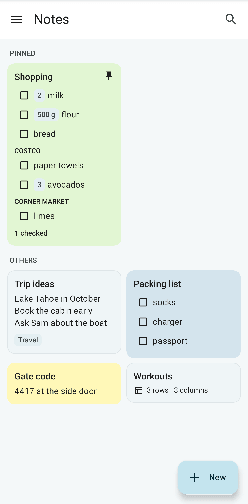
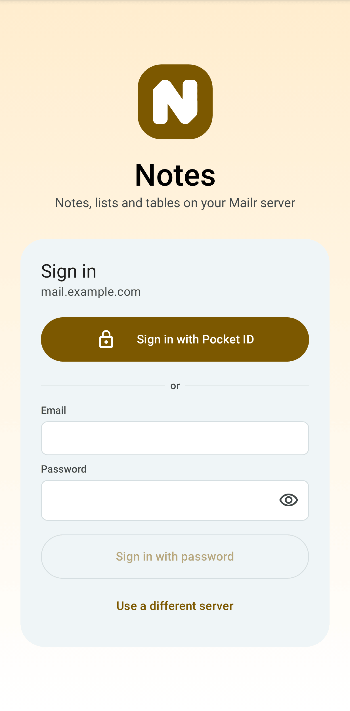
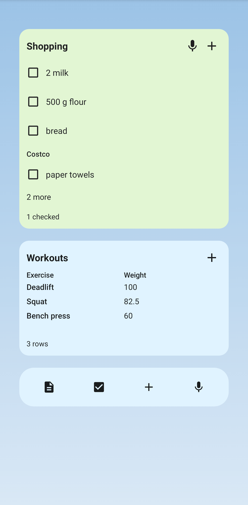
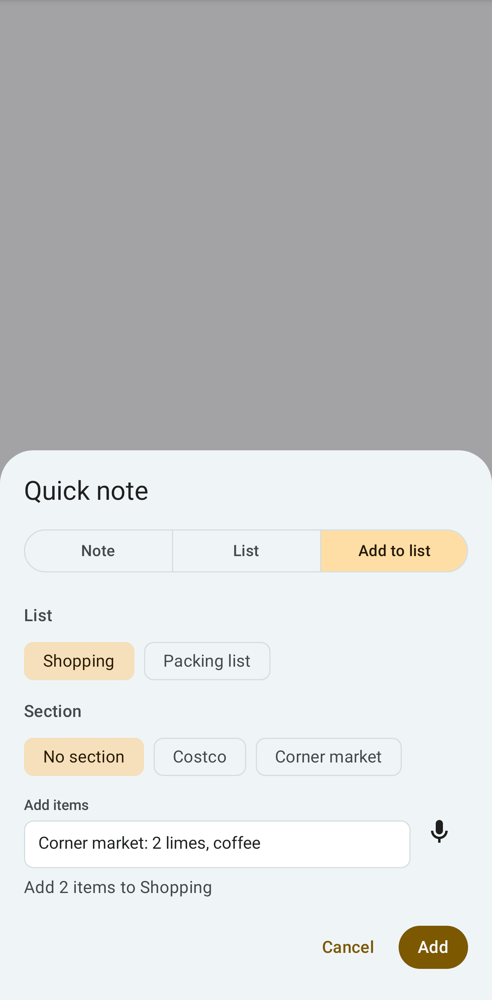
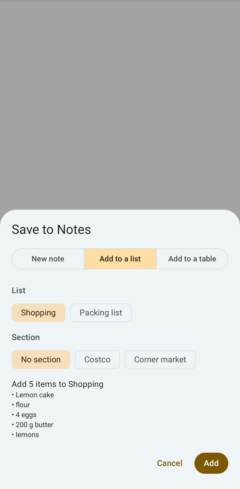

# The Notes app

**Notes** is a second Android app for notes, lists and tables only, in the style of Google
Keep. It opens directly on the notes, even with no network, and it has home-screen
widgets, launcher shortcuts, a Quick Settings tile and a share target. It is connected to the same
Mailr server and has the same notes and the same sync as the Notes tab of the Mailr app. Both apps can be installed on one
phone.
<!-- covers: android:notesapp -->

## Install and sign in

Download the Notes APK from the server's **Get the app** page (`/get-app`), below the Mailr app,
or from the same release page as the Mailr app, and install it. Android 10 or later is required. On the first start, enter your server address and sign in with single sign-on
or with your email and password, as in the Mailr app. The Notes app has a session of its own: it is
listed in the web app with the phone's name, for example "Notes on Pixel 9", under **Settings → You → Password & devices**, and it can be signed out
there.

With a setup link (`mailr-notes://setup?server=https%3A%2F%2Fmail.example.com`), the app shows
**Use this server?** with the full address from the link, and the server is filled in only after you
tap **Use this server**. While you are signed in, a setup link for another server is not used.

Notes, lists and tables work as in the Mailr app: see [Notes, lists and tables](notes.md) for the
grid, the list editor, sections and quantities, tables and the row form, sharing, history and work
without a network. The Notes app also has the following.

- **Open in Mailr** in a note's ⋮ menu, when the Mailr app is on the phone.
- **Settings** at the foot of the menu: the account, **Sign out**, the theme (as the phone, light
  or dark), **Colours from the wallpaper** (Android 12 and later) and **Hide in Recents and
  screenshots** (off by default: every Notes screen is a blank card in Recents, and screenshots and
  screen recordings stay empty, as with the Mailr app's setting of the same name). The Notes app has the web style
  of the Mailr app, with amber as its colour. On sign-out, the notes are
  removed from the phone; they stay on the server.

## Widgets

Long-press the home screen, tap **Widgets** and find **Notes**. When you place a widget, pick the
list, note or table for it. Long-press it later to pick another.

| Widget | Contents | Actions |
|---|---|---|
| **Checklist** | One list: its unchecked items in order, with section names and quantities, then "2 checked · Usual (3)" | Tap an item to check it. **Undo** is shown in the header for 7 seconds. Tap **+** to add items to this list. Tap the title to open the list |
| **Note** | One note's title and text | Tap it to open the note |
| **Table** | One table: the first column and one or two chosen columns, the first rows, and the row count or a total | Tap **+** to open a new row. Tap a row to open it |
| **Quick capture** | New note, New list, Add to a list, Dictate | Tap any button to open quick capture |
<!-- covers: android:noteswidget android:notes:widget:ChecklistWidget android:notes:widget:NoteWidget android:notes:widget:TableWidget android:notes:widget:CaptureWidget -->

<!-- covers: checkitem.usual_add checkitem.voice_add -->

**Usual items on the widget.** When a list has usual items to suggest, they are shown on the
Checklist widget as chips under the items: "Usual + coffee + eggs + bananas". Tap one to add it. The row is hidden when
there are none.

**Add by voice.** With the microphone on the Checklist widget, and with **Dictate** on Quick capture, speech is
recognised with the phone's own on-device speech recognition; nothing is sent to a speech service. Say "add milk
and eggs to shopping", "put bread on the Costco list" or "shopping: milk". The words are read by
fixed rules, with no model. For a list name that matches no list, "No list called
“groceries”" is shown instead of a guess. On the Checklist widget, words without a list are added to that
list. If the phone has no on-device recogniser, a notice is shown in the app.

Items on a widget can be checked without a network. The checks are kept on the phone and sent to
the server when the network is back. Widgets are updated with every change: one made in the app, on the web, or on another
phone.

## Quick capture

Quick capture is opened over whatever is on the screen. Choose **Note**, **List** or **Add to list**.

- **Note**: a title and the text.
- **List**: a title and the items, one per line.
- **Add to list**: pick the list and, if it has sections, a section. Type items as in a list's add
  line, for example `2 limes, coffee`. Start with `#` and a list's name to pick another list:
  `#packing socks, charger`. With a `#name` that matches no list, a new list with that name is started.
- In **Note**, text that starts with `#` and a list's name is added to that list as items, as on the web:
  `#Shopping Costco: milk`. Anything else stays a note.
<!-- covers: note.quick -->

Tap the microphone to dictate into the text through the phone's speech recogniser.

## Launcher shortcuts and the tile

Long-press the Notes icon for **New note**, **New list** and the last three notes, lists or tables
opened. A note's ⋮ menu (or a card's long-press menu, or a table's ⋮ menu) has **Add to home
screen**: a shortcut with the note's icon and colour. When the note is moved to Trash, its shortcut is
greyed out with "Note is in Trash"; when the note is restored, the shortcut is active again.
<!-- covers: note.add_to_home android:noteslauncher android:notes:shortcut:new_note android:notes:shortcut:new_list -->

Add the **New note** tile to Quick Settings: pull down the shade twice, tap the pencil, and drag
**New note** into place. Tap it to open quick capture.
<!-- covers: android:notes:tile -->

## Share to Notes

In any app, tap **Share** and choose **Notes**. On the sheet, the shared content can be saved
in three ways.

- **New note** (the default). For text with several lines, the first line is the title. A shared
  link is saved as a note with the page's title and the address; nothing is fetched.
- **Add to a list**. Recent lists come first. Each line or comma piece is added as an item, read
  as in a list's add line. Pick a section if the list has some.
- **Add to a table**. Tab- or comma-separated text is added as rows, in the table's column order. The
  rows are shown on the sheet first. A first line with the column names is skipped.

Images can't be saved to Notes yet.
<!-- covers: android:notesshare android:notes:share -->

## Links

Links to a note or a table are opened in the Notes app: `mailr-notes://note/<id>`,
`mailr-notes://table/<id>` and `mailr-notes://table/<id>/row/<row>`. Web links to `/notes/n/<id>`
and `/tables/t/<id>` are opened there too when the server's address was set when the app was built (see
below). For a link to a note the account can't see, "Not available to" and the account's address are shown.

## Reminders

Reminders on notes are posted by the Notes app, on the **Note reminders** notification channel, with
**Snooze 1 h** and **Dismiss**. While the Notes app is installed, note reminders are not shown in the
Mailr app, so only one notification is posted. A snooze or dismissal on the phone is applied on
the web and on the other devices too.

## Updates

An administrator can set the oldest version of the Notes app that the server accepts (see
[Phone apps](../admin/phone-apps.md#the-oldest-version-phones-may-run)). When the installed version is refused by the server, **Update Mailr Notes to keep syncing** is shown at the top of the app, and changes are kept on the phone until the app is updated. Tap **Update** to download the new version from the server (`/api/v1/app/notes.apk`) in the browser, then open the file to install it. When the server has a newer version, **Update available** is shown at the top of **Settings**. See [Updates](index.md#updates) for the Mailr app, which works the same way.

Administrators: the sign-in address and build settings of the Notes app are on [Phone apps](../admin/phone-apps.md#the-notes-app-sign-in).
