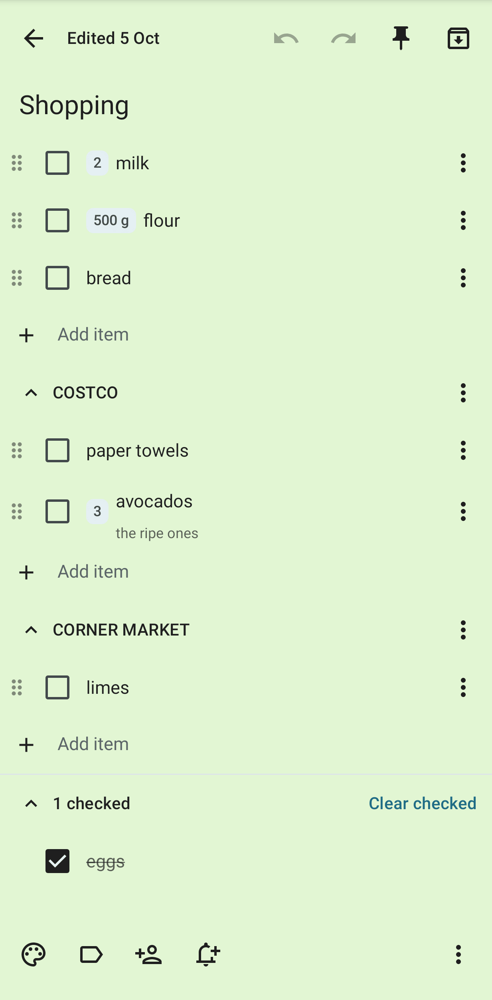

# Notes, lists and tables

The **Notes** tab holds the same notes, checklists and tables as the web app. Open
the menu at the top left for Notes, Lists, Tables, labels, Shared with me, Archive and Trash.
Tap **Edit** next to Labels to rename, recolour, reorder or delete labels.

## The grid

- Pinned notes come first. A list card shows its first unchecked items with their quantities,
  and an item can be checked on the card.
- Long-press a card for Pin, Archive, Colour, Labels, Move earlier, Move later, Make a copy and
  Delete. With TalkBack, Pin, Move earlier and Move later are offered as actions on the card.
- Tap **New** for a new note, a new list, a new table, or one made from a template.
- Pull down to sync now. Tap the search icon to search titles, text, items and table rows.

## Lists

- Tap a box to check an item. Swipe an item right to check it, or left to delete it.
- Type in **Add item** and press the keyboard's Enter. `2 cans of tomatoes, bread` becomes two
  items, the first with the quantity 2 cans. A line that is only `Costco:` becomes a section. See
  [Notes and checklists](../user-guide/notes.md) for the whole grammar.
- Tap an item's text to edit it. Tap a quantity to change it with − and +.
- Long-press the handle at the left of an item and drag it to another place or section. Each item's
  ⋮ menu has Move up, Move down, Move to section, Make it a task and Delete.
- Tap a section's name to fold it. Its ⋮ menu has Rename, the order of its items (learned or by
  hand), Move up, Move down and Delete.
- Checked items are folded into **n checked** at the bottom. Tap **Clear checked** to remove them.
- With **Suggest usual items** on, regularly bought items are shown under the add line. Tap one to
  add it; tap its × to hide it for now or for good.

The bottom bar has Colour, Labels, Share and **Remind me**. The ⋮ menu has the switch between note and list;
it also has the shopping switches, Uncheck all, Make a copy, Version history, Ask Ambrose and
Delete. When the separate [Notes app](notes-app.md) is on the phone, the menu also has **Open in
Notes app**. Widgets, recent-note shortcuts and sharing to notes are in the Notes app.
<!-- covers: note.open_app -->

- Tap **Export** to send the note as Markdown to another app.
- Tap **Save as template** to keep the note as a template. Under **New → From a template**, saved
  templates have a delete button; the starters stay.
- Tap **Add to home screen** to put the note on the home screen. Tap it there to open the note in
  Mailr.
<!-- covers: note.export note.save_template note.delete_template note.add_to_home -->

### Repeating lists, Local models only and list presence

<!-- covers: note.repeat note.local_only table.local_only note.presence table.presence -->

- With **Repeat…** in a list's ⋮ menu, a list is set to start over weekly on a day or every few days:
  the checked items are unchecked at 4 in the morning, and the history is kept. The list is then marked "Repeats weekly on Sunday ·
  next Sun 11 Oct". See [Repeating lists](../user-guide/notes.md#repeating-lists).
- With **Local models only** in the ⋮ menu of a note, a list or a table, it is kept away from hosted models.
  Only the owner can turn it off; for anyone else, the setting is shown on and locked, with the reason.
- While someone else has a shared list open, "Dana is in this list" is shown, and her checks are shown
  with her name for a moment.

## Reminders on notes

Under **Remind me** are Later today, Tomorrow and Next week. A reminder belongs only to the person who set it, also on a
shared note. It is shown on the phone and on the web, and a reminder dismissed in one place is dismissed
everywhere. When the Notes app is installed, note reminders are shown only in the Notes app, so only
one notification is posted.

## Sharing

**Share** lists who has the note and at what level: View, Edit, or Edit and share. Add people and
groups from the server, change a level, or remove someone. On a note someone shared with you,
tap **Remove from my notes** to take it off your list. See
[Notes and checklists](../user-guide/notes.md#share-a-note).

## History

Earlier versions of the note are listed under ⋮ → **Version history**. Open one and tap **Restore
this version**. After every change on the phone, a short message with **Undo** is shown.

## Undo and redo

<!-- covers: note.undo_edit note.redo_edit -->

The top bar of an open note has **Undo** and **Redo**. Touch and hold one to see its name. Changes are
undone one at a time and redone in the same steps:

- Typing is undone a word at a time, or up to a pause of about a second. A paste, a spelling
  correction or a dictated phrase is one step.
- On a list, a tick, an added or deleted item, a move, a section change, **Clear checked**, a colour
  and labels are one step each.
- An undo is saved like any edit. Without a network it is queued with the other changes and sent
  when the phone is back online.
- After an undo, nothing can be redone once you make a new change.
- After an undo or redo of text, the cursor is in that field, right after the text that came back or
  went in, so the place of the change is visible.

When one change removes more than three lines, or clears the note, a **Text removed** message is shown
with **Undo**. With a keyboard attached, undo is `Ctrl + Z` and redo is `Ctrl + Shift + Z` or
`Ctrl + Y`. The Notes app has the same buttons.

## Tables

A table is a list of cards: the first column in bold and one or two more columns under it. Views
are switched with view chips, and the active filters are shown as chips; tap a filter's × to see the
rows without it. The view's totals are in the bar at the bottom.

- Tap a row to open its form. Each field is saved when you leave it, with **Undo**. Dates can be
  typed as words such as `today`, `fri` or `12 oct`.
- The row's changes are listed under **History** in the form. Restore the row to an earlier point, or put one
  value back.
- Tap **+** for a new row. With **Save and add another**, the form stays open.
- Swipe a row left to delete it. Long-press rows to select several and delete them together.
- The table's ⋮ menu has **Export CSV** (the view, sent to another app), **Make a copy** and **Add
  to home screen**.
<!-- covers: table.export_csv table.duplicate -->

Columns, views and restoring a whole table to a point in time are on the web.

## Offline use

Notes, lists and tables stay on the phone. Items can be checked, added and edited, and rows added,
while offline. **Offline · 3 changes waiting** is shown in a banner, and cards with unsent changes have a
dashed edge. Inside a list, the line **Offline · 2 changes waiting** is shown, and the last-seen usual items
stay there to tap. The changes are sent in order when the network is back. The time of each check
is kept. If someone changed the same item meanwhile, **Keep theirs**, **Use mine**
and **Keep both** are shown on the item.
