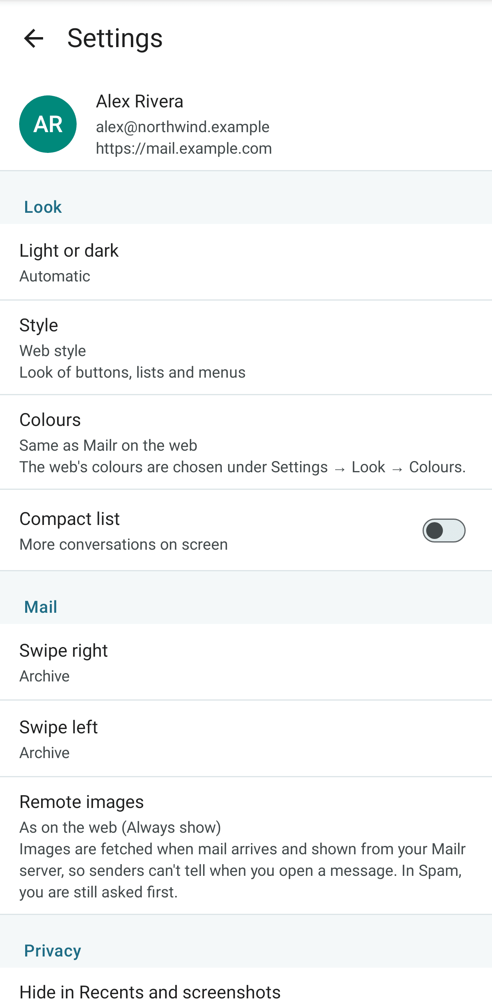
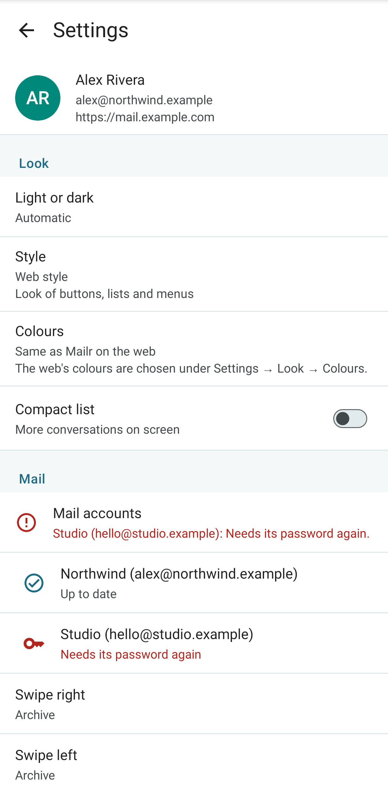
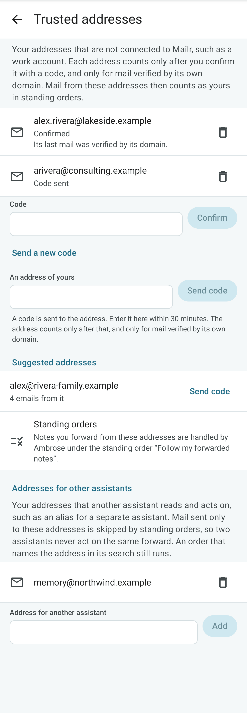
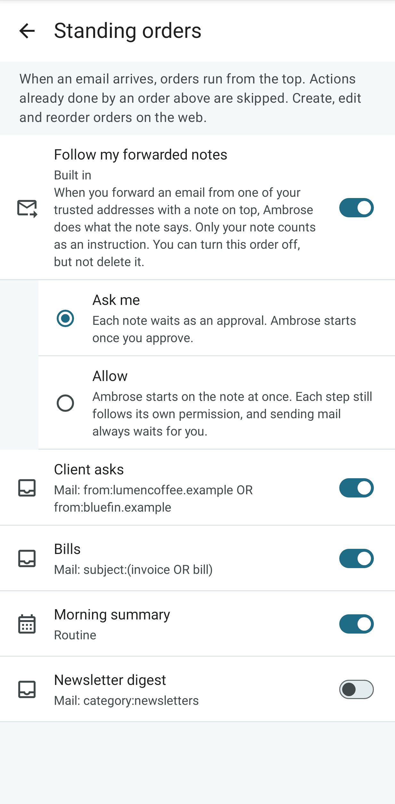
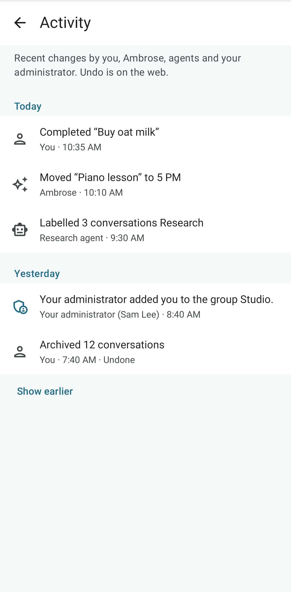

# App settings

Open **Settings** at the bottom of the mail drawer. The settings are in the same groups as on the web: **You**, **Look**, **Mail**, **Privacy**, **Notifications**, **Calendar & tasks**, **Dictation**, **Ambrose** and **Signed-in devices**. Most apply to this phone only. **New mail**, **Waiting for you** and the web's image choice apply to the account and are the same on every device. Region, labels, filters, adding accounts, most of Ambrose and agents are set up in the web app (see [Settings](../user-guide/settings.md)).

## You

**Your picture** shows the account picture, which is shown next to the account's name in Mailr and, for other people on the server, next to mail from its sending addresses. It is the same picture as under **Settings → You → Profile → Your picture** on the web.

- Under **Change** (**Add picture** while there is none) are **Choose from gallery**, for Android's photo picker, and **Take photo**, for the camera. No storage or camera permission is required for either.
- With **Remove**, the initials are shown again.
- **Use my sign-in picture** is shown when a picture came from the sign-in provider and another one is in use.

A reduced copy is sent from the phone, at most 1024 pixels on its longer side, saved again as a JPEG without the photo's location or camera data. A 256-pixel copy is kept on the server.

<!-- covers: settings.picture_upload settings.picture_remove settings.picture_use_sign_in -->

### Language

Both apps are shown in the language of the account (**Settings → You → Region → Language** on the web). With **Automatic** there, the phone's language is used. On Android 13 and later you can also choose a language for each app in the phone's settings (**Settings → System → Languages → App languages**). That choice is kept until the language of the account changes again. Notifications from the server, such as new mail and approvals, and invitations sent on the account's behalf are in the language of the account; with **Automatic** they are in English.

The languages are English, Deutsch, Español, Français, Português (Brasil), Русский and 中文（简体）. On a phone in any other language, including Traditional Chinese, the apps are in English. See [Languages](../admin/languages.md).

## Look

<!-- covers: settings.colours_follow_web, settings.android_style -->

| Setting | Effect |
|---|---|
| **Light or dark** | Automatic, Light or Dark. With **Automatic**, the phone's setting is used. |
| **Style** | **Web style** (the default) or **Android (Material)**. With **Web style**, the app looks like Mailr in the browser: its buttons, list rows, fields, menus, choices, messages and bottom bar. Dates and times are typed, as on the web: type a date such as Nov 3 or 11/3, or tap a day in the month under the field; type a time such as 930 or 4:15 pm, or tap the clock button for Android's clock. With **Android (Material)**, the app looks like Google's own apps. The change is applied at once. |
| **Colours** | **Same as Mailr on the web** (the default with **Web style**), **Colours from your wallpaper** (the default with **Android (Material)**, Android 12 and later) or **Mailr's colours**. With **Same as Mailr on the web**, the colours set under **Settings → Look → Colours** on the web are used (see [Styles and appearance](../user-guide/appearance.md#colours)). A copy is kept on the phone, so they also apply offline. Colours picked here are kept when **Style** changes. |
| **Compact list** | More conversations fit on screen. |

## Mail

**Mail accounts**, at the top of **Mail**, shows whether the mail accounts sync. The first line is a
summary, as on the web: "All 2 accounts are syncing. Last synced 5 min ago.", or the first account with a
problem, for example "Work: Password required." Below it, each account has its state in plain
words: **Up to date**, **Syncing**, **Paused**, **Password required**, **Not synced for 3 hours** or
**Sync failed**. Tap the line or an account to open **Settings → Mail → Mail accounts** on the web, where
a new password can be entered or the account fixed.

<!-- covers: settings.account_health -->

| Setting | Effect |
|---|---|
| **Swipe right** | The action for a swipe to the right on a conversation: Archive, Delete, Mark read/unread, Snooze, Star or None. |
| **Swipe left** | The action for a swipe to the left, from the same choices. |
| **Remote images** | With **As on the web** (the default), the choice in Settings → Mail → Reading on the web is used. **Always show here** and **Ask first here** apply to this phone only. Images are fetched when mail arrives and shown from the Mailr server, so senders cannot tell when a message is opened. For spam, a prompt is always shown. |
| **Recordings (Speakr)** | Meeting recordings are shown in events, mail and Ambrose. Off: nothing is loaded from Speakr. Shown when the account has a Speakr connection. |

## Privacy

| Setting | Effect |
|---|---|
| **Hide in Recents and screenshots** | Every Mailr screen is shown as a blank card in Recents, and screenshots and screen recordings of Mailr stay empty. Off by default. |
| **Hide approvals and local-only recordings** | Only **Waiting for you** and recordings marked Local only stay out of Recents and screenshots. On by default. Shown while the setting above is off. |

## Notifications

| Setting | Effect |
|---|---|
| **New mail** | Which new mail triggers a notification: **Important mail**, **VIP senders only**, **Important and Primary**, **All new mail** or **Off**. |
| **Waiting for you** | An agent's request awaits approval, or a message could not be sent. One choice for every device, as **New mail**. |
| **Mail on this phone** | Off: no mail notifications on this phone. The web and other devices are not affected. |
| **Push** | Whether new mail and approvals reach this phone at once, through ntfy, a free notification app (see [Instant notifications](mail.md#instant-notifications-push)). The status is **Instant mail is working** through the app, **No notification app** with **Get ntfy**, **Choose** when several are installed, or **Registration failed** with **Retry**. |
| **Your server's ntfy** | Shown when the server has its own ntfy and this phone is not yet set up to use it. Three numbered steps: tap **Copy and open ntfy** (the address is copied and ntfy opens), open **Settings → Default server** in ntfy, and paste the address. The row goes away once push runs through the server's ntfy. |
| **Live connection** | Shown when no notification app works, or while it is on. Mail arrives at once without another app, through a connection to the server. A permanent notification is shown for it, and more battery is used than with ntfy. See [Without ntfy: the live connection](mail.md#without-ntfy-the-live-connection). |
| **Test push** | Shown while push is connected. With **Send test**, a notification is sent from the server to this phone, and the result is shown. |
| **Delivered by push** | New mail (as chosen under **New mail**), agent approvals, messages that could not be sent, and a notice when the password of a mail account must be entered again. Reminders are set on the phone itself, so they are never delivered twice. |

## Calendar & tasks

| Setting | Effect |
|---|---|
| **Task swipe actions** | The actions for swiping a task left and right: Complete, Reschedule, Delete or Move to list. |
| **Event reminders** | Notifications before calendar events start. |
| **Events without a reminder** | The reminder a timed event gets when it has none: None, At start, or 5, 10, 15, 30 or 60 minutes before. |
| **Task reminders** | Notifications when tasks are due. |
| **Morning reminders at** | The hour for reminders of date-only tasks and "tomorrow morning" snoozes, from 6 to 11 am. |
| **Full-screen alerts** | An event about to start, or a task due now, is shown full screen, also on the lock screen. Not while Do Not Disturb is on. |
| **Full-screen permission** | Whether full-screen alerts are allowed in Android. Tap it to allow them. Without the permission, reminders are shown at the top. |
| **Remind again** | A reminder is repeated every 5, 10, 15 or 30 minutes until it is acted on. Off by default. Also applies on the web. |
| **Ask button on reminders** | Reminders carry an **Ask** button, to tell Ambrose what to do with them. **Snooze…** and **Remind before…** stay in the reminder's sheet. |
| **Morning agenda** | A quiet notification at the morning hour with today's events and the tasks that are due. |
| **Exact timing** | Whether reminders arrive on the minute. Tap it to allow exact alarms when they are turned off in Android. |
| **Sound and vibration** | A link to Android's notification settings. Event, task and missed reminders each have their own channel. |

<!-- covers: reminder.repeat -->

## Dictation

| Setting | Effect |
|---|---|
| **Speech to text** | **Phone first, then server**, or **Always server** (the Mailr server). |
| **Audio processing** | An explanation of what applies on this phone. The server may use a hosted speech service for ordinary chats; clips from a chat that has read local-only items go to a local speech server only. |
| **Start listening right away** | The microphone is on when you tap an Ask button. From the widgets and the Talk to Ambrose tile, Ambrose always opens listening. |
| **Send when I stop talking** | After a short pause, the words are sent to Ambrose without pressing Send. |

## Ambrose

Under the assistant's name, tap **Memory** to open the page of Ambrose's memories about the user and the people they write to. See [Memory and person cards](assistant-and-sharing.md#memory-and-person-cards).

**Trusted addresses** lists the user's own addresses that may give Ambrose a note by forwarding, such as a work address. As on the web, an address is added by typing the code sent to it; a new code can be sent, and an address removed. Below them, **Addresses for other assistants** lists the user's addresses that another assistant handles; mail sent only to them is left alone by standing orders. See [Trusted addresses](../user-guide/forwarded-notes.md).

**Standing orders** lists the orders, top first, each with its switch. The built-in order **Follow my forwarded notes** also has its permission: **Ask me** or **Allow**. It is turned off with its switch. Create, edit and move orders on the web. See [Standing orders](../user-guide/standing-orders.md#follow-my-forwarded-notes).

**Sweep** holds the user's rules for every bulk review, in a field with **Save**, as on the web. Below it, **What each move means** shows the built-in meaning of Move to Trash, Archive, Mark read, Keep and Not sure, which the rules adjust. **Your past choices** lists the moves remembered from review cards, one per sender, with the move and when it was chosen; each can be removed, and **Clear all** removes them all after a confirmation. See [Clean up a whole view](../user-guide/assistant.md#clean-up-a-whole-view).

## Activity

**Activity** lists recent changes in the account, newest first and grouped by day: changes by the user, by Ambrose and the user's agents, and by an administrator where they affect the user. Each row shows who made the change and when. A change that was undone is marked **Undone**. The list is read-only on the phone; to undo a change, open Activity on the web.

## Signed-in devices

Every browser and phone signed in to the account is listed under **Signed-in devices**. Tap the delete button next to a device to sign it out. This phone is marked "this device".

Tap **More settings on the web** to open the web app's settings: Region, labels and filters, mail accounts, Ambrose, and Agents & API. On **Sign out**, the mail cached on the phone, opened attachments, shares waiting to send, unsent recordings, recent searches and Mailr's notifications are removed; the mail stays on the server. After a sign-out without a connection, the session on the server is ended once the phone is back online.
