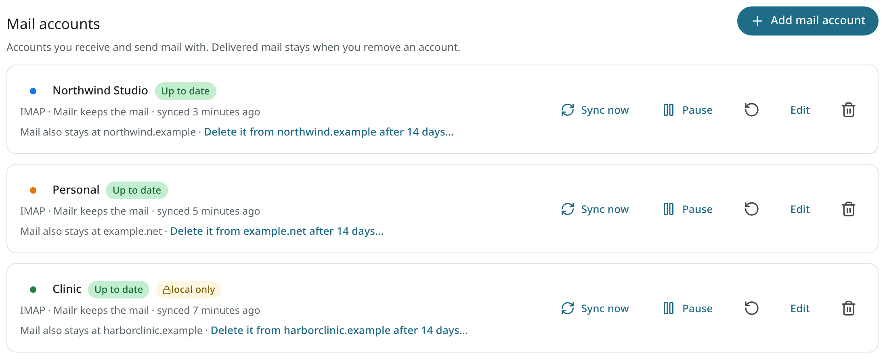
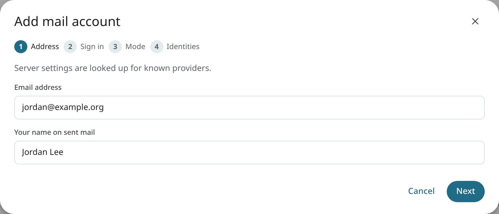
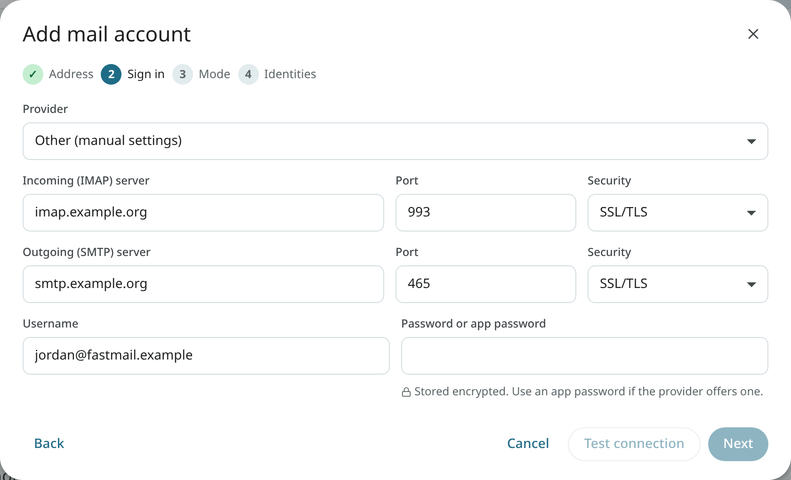
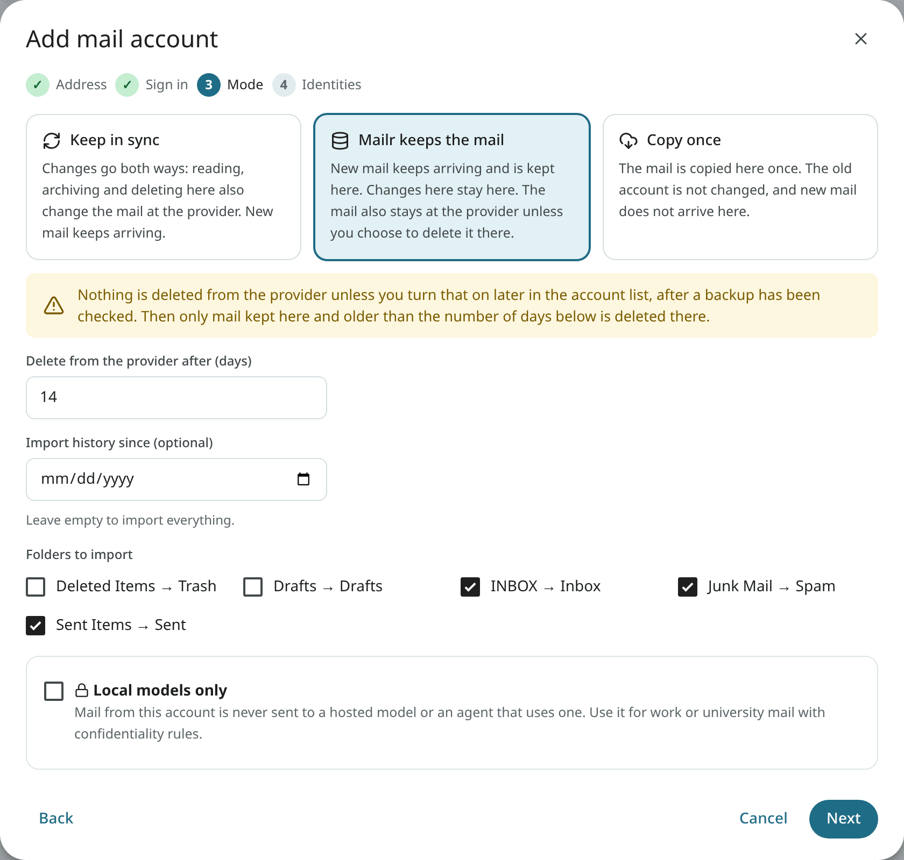
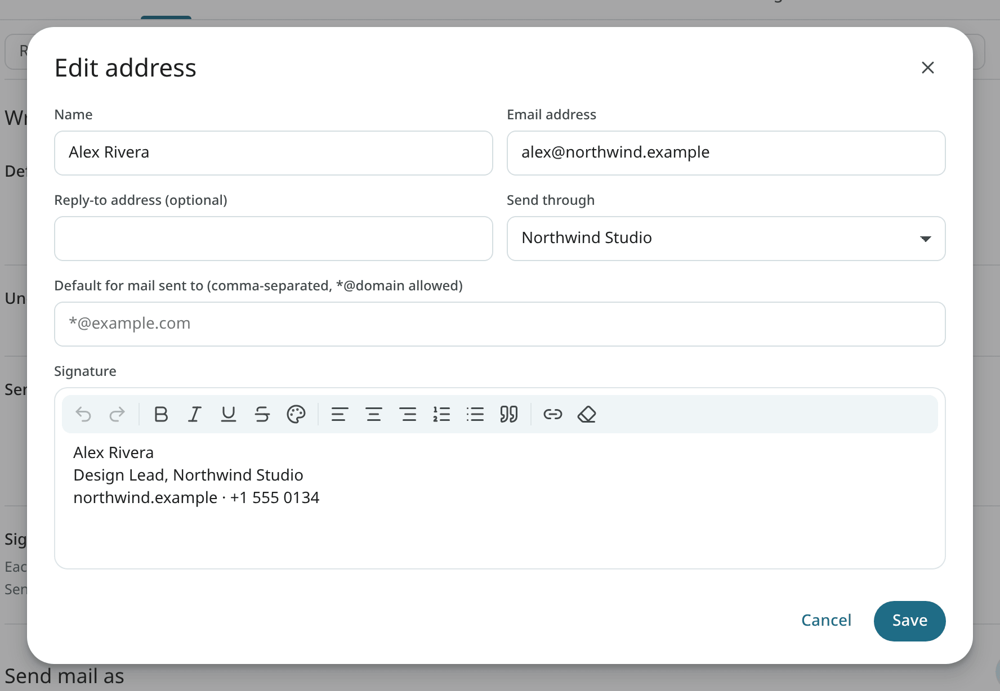
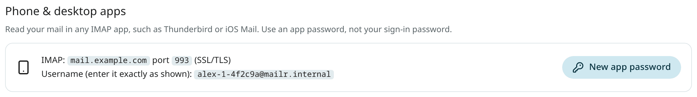

# Connect your accounts

Mail is read from the existing providers. Each added mail account is a *connector*: mail comes in and replies go out through the same provider, so SPF, DKIM and DMARC stay aligned.

Open **Settings → Mail → Mail accounts** to see the accounts, their status and the last sync.



## Add a mail account

Click **Add mail account**. A user with no mail account and an empty inbox sees "No mail account connected yet" with **Connect an email account**, which opens **Settings → Mail → Mail accounts** with the wizard. The wizard has four steps.

### 1. Address

Enter your email address and your name for outgoing mail. The server settings are looked up. Common providers are known (Fastmail, Migadu, mailbox.org, Proton Mail through Bridge, iCloud Mail, Yahoo Mail, Gmail, Zoho Mail, Posteo and others). For any other provider, Thunderbird's autoconfig database, DNS SRV records and the provider's `autoconfig.` host are tried.



!!! warning "Outlook, Hotmail, Live, MSN and Microsoft 365"
    These accounts cannot connect yet. Microsoft blocks password sign-in for other apps, and the Microsoft 365 connector is not built yet. A notice is shown in the wizard when such an address is typed.

### 2. Sign in

Check the found settings, or pick **Other (manual settings)** and enter the IMAP and SMTP servers by hand. Enter the password or an app password, then test the connection. The provider's notes are shown here when the provider has special requirements.



!!! tip "App passwords"
    Many providers require an app password for IMAP instead of the normal password, especially with two-step verification on. Create one in your provider's security settings and paste it here.

### 3. Mode

Choose how this account is handled.

| Mode | Effect |
|---|---|
| **Keep in sync** (`mirror`) | Changes go both ways. The provider stays the source of truth. A two-way copy is kept in Mailr. Reading, labelling, archiving, moving and deleting in Mailr are applied at the provider too. Mail sent from Mailr is kept in Mailr's **Sent**, and a copy is put in the provider's Sent folder, so the provider's webmail and other apps show it too (Gmail and Microsoft save that copy themselves). Use this mode for work or school accounts. |
| **Mailr keeps the mail** (`store`) | New mail keeps arriving and is kept in Mailr. Changes in Mailr stay in Mailr. The mail also stays at the provider, unless you turn on deletion there. |
| **Copy once** (`import`) | The existing mail is copied once. The old account is not changed, and new mail does not arrive. Use this mode to retire an old account. |

"Mailr keeps the mail" is unavailable when the administrator has turned off the [daily mail export](../admin/backups.md#turn-the-mail-export-off), unless the administrator has also set `MAILR_STORE_BACKUP_CHECK=false` ([Backups](../admin/backups.md#turn-the-mail-export-off)).



You can limit the history to mail since a date, and choose which folders to import. Where Mailr keeps the mail, you also set **Delete from the provider after (days)**. Deletion at the provider stays off until you turn it on later. The checks are explained in [Account modes](../admin/store-and-mirror.md).

With **Local models only**, the account is marked *local-only*. Its mail is never sent to a hosted model or to an agent token with a hosted model. Turn the setting on for work or university mail with confidentiality rules. An admin can require it for whole domains.

### 4. Identities

Pick the addresses you send from through this account, review the summary and finish. The first sync is started at once. New mail then arrives within seconds.

## Import from Gmail

Gmail works through IMAP with an app password (Google Account → Security → App passwords; two-step verification is required for app passwords). All Mail is imported once, with its labels and Gmail's own threads.

Under **Mail to import** you choose:

- **Spam**: also used to train Mailr's spam filter on what the user considers spam.
- **Trash**: recently deleted mail.
- Labels to skip, for archives not needed here, such as old SMS or call-log backups.

To bring your Gmail filters along, export them from Gmail (Settings → Mail → Filters & blocking → Export) and open **Settings → Mail → Filters & blocking → Import Gmail filters** in Mailr. Missing labels are created.

## Import mbox or Maildir files { #import-mailbox-files }

An `.mbox` file, or a `.zip` of Maildir folders or mbox files, is imported through the API. The web app has no button for it yet. The steps require password sign-in (`curl` and a shell on any computer that reaches the server):

1. Sign in and keep the session cookie. The answer contains a `csrf` value; copy it.

    ```sh
    curl -c mailr.cookies -H 'Content-Type: application/json' \
      -d '{"email":"alex@northwind.example","password":"your-password"}' \
      https://mail.example.com/api/v1/auth/login
    ```

2. Upload the file. The answer contains a `path`; copy it.

    ```sh
    curl -b mailr.cookies -H 'X-CSRF-Token: <csrf>' \
      -F file=@old-mail.mbox \
      https://mail.example.com/api/v1/connectors/uploads
    ```

3. Create an account of kind `file` with that path. The import starts at once.

    ```sh
    curl -b mailr.cookies -H 'X-CSRF-Token: <csrf>' -H 'Content-Type: application/json' \
      -d '{"kind":"file","name":"Old mail","config":{"path":"<path>"}}' \
      https://mail.example.com/api/v1/connectors
    ```

The new account is listed under **Settings → Mail → Mail accounts**. The largest accepted file is set by `MAILR_MAX_IMPORT_BYTES` (20 GB by default). Messages that are already in Mailr are recognised and skipped. Imported mail is filed under its own folders and labels, not in the Inbox: search for it or open **All Mail**.

Limits on imports:

- a message larger than 75 MB is skipped and counted in the import summary;
- a `.zip` may unpack to at most four times `MAILR_MAX_IMPORT_BYTES`, and a file inside it that unpacks to more than 100 times its packed size is skipped;
- uploads that have not finished importing may hold at most twice `MAILR_MAX_IMPORT_BYTES` per user;
- one person may upload at most `MAILR_IMPORT_BYTES_PER_DAY` (40 GB) in 24 hours, refused uploads included; a further upload is refused with 429 until the oldest one is a day old;
- at most `MAILR_MAX_CONCURRENT_IMPORTS` (2) file imports of one person run at once; another one is refused with 429 until one has finished;
- an upload is stopped (507) when it would leave less than `MAILR_DISK_FAIL_PERCENT` (5 %) of the server's data disk free;
- the uploaded file is removed once its import has finished.

## Send mail as

Under **Settings → Mail → Writing → Send mail as** are the sending addresses. For each one you can set:

- **Send through**: the account it is sent through.
- **Reply-to address (optional)**.
- **Signature**.
- **Default for mail sent to**: this address is picked for replies to mail sent to these addresses (comma separated, `*@domain` allowed).



## Manage an account

Each account card shows its status (such as "Up to date") once, with the buttons **Sync now**, **Pause** (**Resume** while paused) and **Edit**, and two icon buttons: the circular arrow, **Resync from scratch**, and the bin, **Remove account**. Their names are shown when the pointer rests on them. **Edit** changes the password, the days before deletion at the provider, mode details or the **Local models only** switch.

Where Mailr keeps the mail, the card reads "Mail also stays at <provider> · Delete it from <provider> after N days…", with a button. The provider is named, for example Gmail or Fastmail, or the server's domain. The dialog "Delete mail from <provider>?" has **Turn on deletion**; typing the account name still confirms. Once deletion is on, the card reads "Deleted from <provider> N days after it is backed up here". It can be turned off again from the card. See [Turn on deletion at the provider](../admin/store-and-mirror.md#turn-on-deletion-at-the-provider).

### Sent mail at the provider

<!-- covers: settings.account_save_sent settings.account_sent_backfill settings.account_sent_retry -->

For an IMAP account that is kept in sync, the edit form (**Edit** next to the account) has **Save sent mail at the provider**:

- **Automatic** (the default): a copy of each message sent from Mailr is put in the provider's Sent folder, except at Gmail and Microsoft, which save it themselves.
- **On**: a copy is put there at every provider. A copy the provider already has is recognised, so none is added twice.
- **Off**: sent mail stays in Mailr's **Sent** only.

The line under the setting says what the choice does for this account. The setting is not shown for accounts where Mailr keeps the mail or that are copied once: they never get a copy at the provider.

To copy mail sent before the setting was on:

1. Open the account's edit form and click **Copy past sent mail to** the provider.
2. Optionally pick a date in **Sent since**. Leave it empty to include all sent mail.
3. Click **Count**. The number of messages missing in the provider's Sent folder is shown. Nothing is changed by the count.
4. Click **Copy N messages**. The progress is shown; the dialog can be closed, and the copy goes on in the background.

Only messages sent through this account are copied. Messages already in the provider's Sent folder are skipped, and nothing is deleted. A copy that stopped is continued by starting it again.

When a copy cannot be saved at the provider after about two and a half days of tries, the account in the list says how many sent messages could not be saved in the provider's Sent folder. Click **Retry** to try them again. Sending is never affected. The details are in [Account modes](../admin/store-and-mirror.md#sent-mail-at-the-provider).

### Remove an account

To delete a mail account from Mailr, choose **Remove account** in the account list. The mail already delivered from it is kept in Mailr, and the account at the provider is not changed. A Mailr user account can be deleted only by an administrator (see [Users](../admin/users.md)).

### Accounts connected by an administrator

On some servers, such as a small business's, an administrator connects a user's work mailbox. Such an account is marked **Connected by your administrator**, and a line about it is added to the user's [Activity](../user-guide/activity.md). It can be changed like any other account and disconnected with **Remove account** (the button is then labelled **Disconnect**). The mail already delivered is kept, and the administrator is notified. The account is added again only if an administrator reconnects it deliberately, and the user is notified of that too. Administrators see only the accounts an administrator connected, never the user's own accounts, and never the user's mail.

## IMAP access from other apps

The Mailr store can be read from any IMAP app (Thunderbird, iOS Mail, FairEmail). Open **Settings → Mail → Mail accounts → Phone & desktop apps**. The server name, port and user name are listed there, and an app password can be created. Use that app password, not the sign-in password.



Out of the box the mail server uses a self-signed certificate, so mail apps ask you to accept it once. To give IMAP a certificate that apps trust, see [A real TLS certificate for IMAP](../admin/mail-server.md#a-real-tls-certificate-for-imap).

IMAP is only for reading Mailr's store from mail apps. Mail is still sent through each account's provider, so send from Mailr or set up the provider's SMTP server in the other app.

## Calendars and contacts

Mailr has its own calendars and task lists. An administrator turns them on for everyone under **Settings → Admin → Calendars → Give users a Mailr calendar**; until then, Calendar and Tasks show "No calendar connected yet" with **Connect a calendar**, which opens **Settings → Calendar & tasks** with the connect form (Calendar also has **Subscribe to a calendar link…**). Under it, an admin sees "Built-in calendars are off…" with **Turn on built-in calendars**. A member sees "No calendar of your own yet? Ask whoever runs this Mailr server to turn on built-in calendars…". An existing calendar server can be connected as well, under **Settings → Calendar & tasks → Connect a calendar**. See [Calendar](../user-guide/calendar.md) and [Calendars](../admin/calendars.md).

## Next

[Install the phone app](phone.md).
