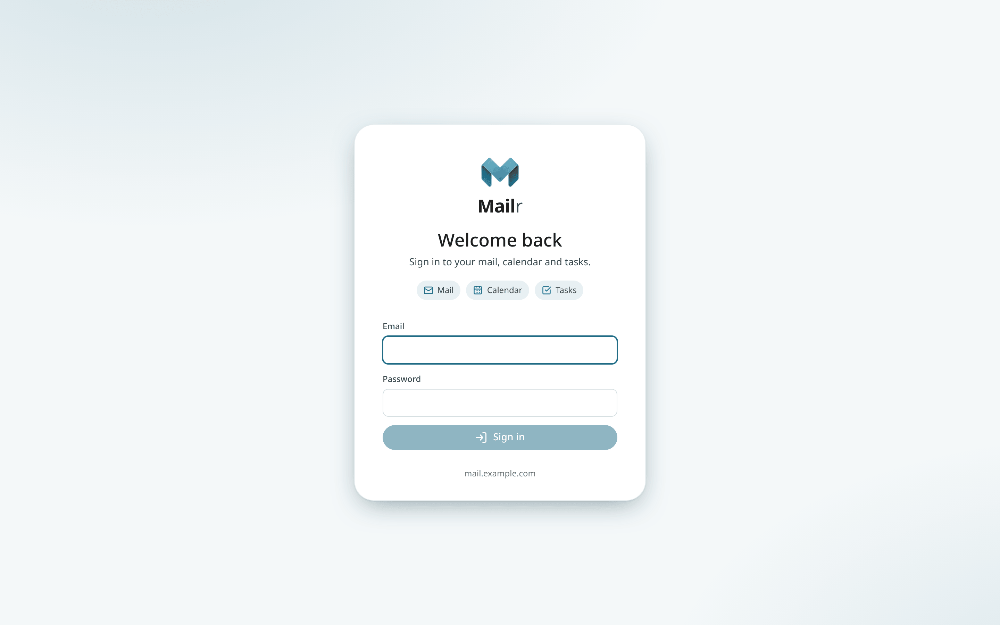

# Set up the first admin

This page covers the first sign-in to a new server with the admin account from `.env`, for the
person who installed Mailr. Every user, including the admin once the server runs, sets up mail with
[the setup guide](your-first-sign-in.md).

## Sign in as the first admin

Open the `MAILR_BASE_URL` in a browser. The sign-in page is shown.

Enter the `MAILR_BOOTSTRAP_ADMIN_EMAIL` and `MAILR_BOOTSTRAP_ADMIN_PASSWORD` from your `.env`. This account is created by the app on its first start, when there are no users yet, with the password from `.env`. Changing these values later does not change the account. For an admin who signs in only with single sign-on, leave `MAILR_BOOTSTRAP_ADMIN_PASSWORD` empty.

!!! tip "Change the password"
    After you sign in, open **Settings → You → Password & devices** and pick a new password. You can then remove `MAILR_BOOTSTRAP_ADMIN_PASSWORD` from `.env`.

## Email and password, or single sign-on

One or both sign-in methods can be turned on.

=== "Email and password"

    By default, each user signs in with a password stored in Mailr. Password sign-in stays on with `MAILR_LOCAL_LOGIN=true`. With `MAILR_ALLOW_SIGNUP=true`, people can create their own accounts; sign-up is off by default, so an admin adds every user.

=== "Single sign-on (OIDC)"

    Set `MAILR_OIDC_ISSUER` and `MAILR_OIDC_CLIENT_ID`, and a **Continue with …** button, named after your provider's host, is shown on the sign-in page. Any OIDC provider works, such as Pocket ID, Authentik, Keycloak or Authelia. See [Sign-in and OIDC](../admin/sign-in.md).

Once single sign-on works, you can set `MAILR_LOCAL_LOGIN=false` so that single sign-on is the only way in.

## The app's main areas

- **Navigation** on the left: Compose, the mailboxes, the apps, labels and Favourites.
- **Search** across the top. Gmail-style operators are supported there, such as `from:` and `has:attachment`.
- **Apps**: Mail, Calendar, Tasks, Notes and, once Speakr is connected, Recordings, in this order in every style.
- **Top bar buttons**: **Ambrose**, the assistant (`Ctrl + .`), waiting approvals, help (press `?` for the keyboard shortcuts), **Quick settings** for style, text and spacing, and reading pane, and the account menu.
- **Panels** on the right (Classic): a small calendar, tasks or notes beside the mail.
- **Settings**: everything else, in nine groups: You, Look, Mail, Calendar & tasks, Notes & tables, Notifications, Ambrose, Agents & API and, for admins, Admin. See [Settings](../user-guide/settings.md).

Until a mail account is added, the inbox shows "No mail account connected yet" with **Connect an email account**, which opens **Settings → Mail → Mail accounts** with the Add account wizard.

## Before the setup guide

Two admin settings are worth making first, because the setup guide and the apps use them:

- **Built-in calendars.** Turn them on under **Settings → Admin → Calendars → Give users a Mailr calendar**. Without them, Calendar and Tasks show "No calendar connected yet" until someone connects a calendar. An admin sees "Built-in calendars are off…" there, with **Turn on built-in calendars**. See [Calendars](../admin/calendars.md).
- **A model, if you use one.** Add it under **Settings → Admin → Models** (see [Models](../admin/models.md)). The setup guide's "About you" step is a chat with Ambrose, which needs a model; without one, the step is skipped and can be done later.

## Set up your own mail

For the admin account from `.env`, the setup guide is not opened automatically. While the account has no mail
address to send from, a **Set up Mailr** card is shown in the inbox. Choose **Start** to connect your
mail, pick a look and get the phone apps, as every new user does. You can open the guide at any
time from **Settings → You → Profile → Setup guide**.

## Next

1. [Turn on built-in calendars and add a model](#before-the-setup-guide), if you have not yet.
2. [The setup guide](your-first-sign-in.md), or [connect the mail accounts](connect-accounts.md) directly.
3. [Add the other users](../admin/users.md). Each of them gets the setup guide at their first sign-in.
4. [Publish the phone apps](../admin/phone-apps.md), so new phones can download them from the server.
