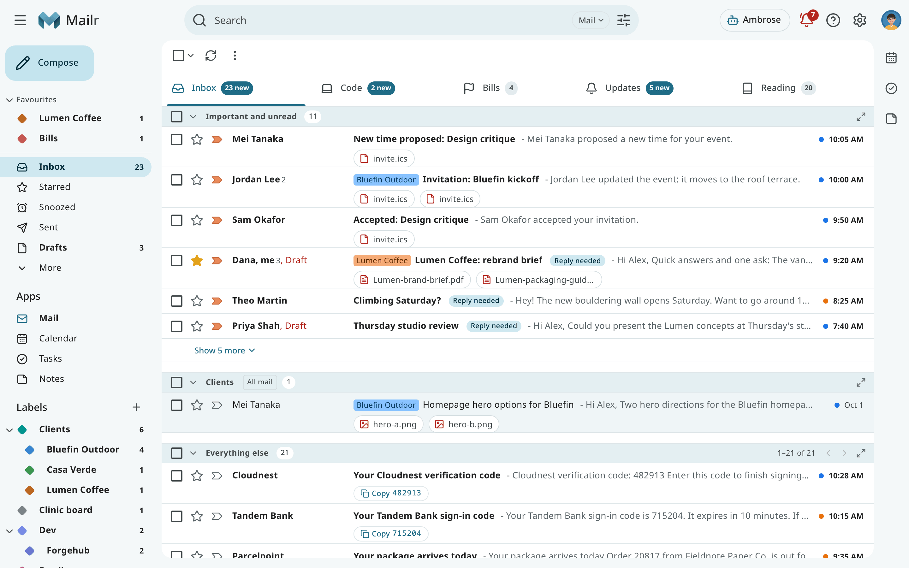
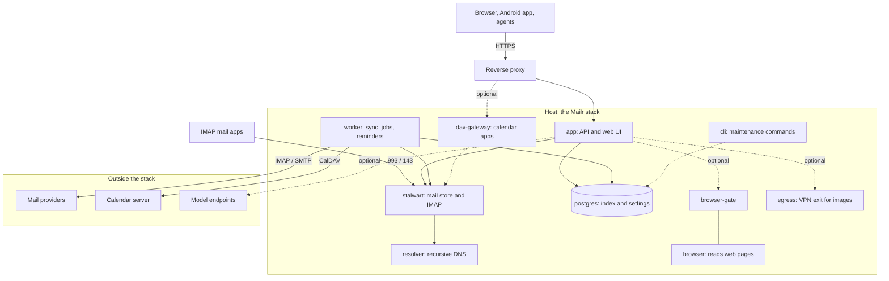

# Overview and requirements

Mailr is a self-hosted mail client with its own mail store, together with a calendar, tasks and notes, on the web and on Android. Any number of mail accounts can be connected, from any providers, and each provider keeps receiving and sending the mail for its addresses. New mail is collected within seconds and stored on your Mailr server.

## Features

- **Mail storage.** Any number of mail accounts can be connected, from any providers. Each provider keeps receiving and sending the mail for its addresses, and the connection to it is made over IMAP and SMTP, as for any mail client. New mail is picked up over IMAP IDLE and kept in Mailr, either in step with the provider or as the long-term copy. An account can also be copied once.
- **Mail client.** The client has conversations, labels, custom inbox sections, categories, snooze, scheduled send, undo send, filters, Gmail-style keyboard shortcuts and search operators.
- **Calendar and tasks.** Calendars are built in, or kept on any CalDAV server. Invitations are answered from the message, an email can be turned into an event or a task, and reminders are shown on every device.
- **Assistant.** The built-in assistant, Ambrose, reads, searches, drafts and organises mail. Sending mail, deleting and changing rules are held until they are approved.
- **Android app.** The app has mail, calendar, tasks, reminders, dictation and sharing, and actions work offline.
- **API for agents.** Claude Code and other agents can work with the mail through a REST API and an MCP server, with scoped tokens and the same approval rules.
- **IMAP access.** The same store can be read over IMAP from Thunderbird, iOS Mail, FairEmail and other mail apps.

Mailr works without any language model. Models add meaning-based search, summaries, briefs, learned sorting and Ambrose. They are connected as OpenAI-compatible endpoints, and the mail that may be sent to each model is configurable.

## Components

Mailr is one Docker Compose stack.

| Service | Role |
|---|---|
| `app` | The web app and the API, on port 8025. |
| `worker` | Account and calendar sync, background jobs, reminders and the daily export. |
| `postgres` | Mailr's index, settings, search vectors and job queue (Postgres 17 with pgvector). |
| `stalwart` | The bundled [Stalwart](https://stalw.art) mail server: the store for every message and the IMAP server for mail apps. |
| `resolver` | A private recursive DNS resolver for spam blocklist lookups. |

Optional services start only with their Compose profile (`COMPOSE_PROFILES` in `.env`):

| Service | Profile | Role |
|---|---|---|
| `egress` | `vpn` | A VPN exit for image fetches and, optionally, for the page-reading browser. See [Image proxy and VPN egress](../admin/image-proxy.md). |
| `browser`, `browser-gate` | `browser` | A headless browser on the server for reading web pages, and the gate that is its only route out. See [Web search](../admin/web-search.md). |
| `dav-gateway` | `phones` | Access for phone and desktop calendar apps to the built-in calendars. See [Built-in calendars](../admin/calendars.md). |
| `cli` | `tools` | One-off maintenance commands while the stack runs: `docker compose run --rm cli mailr <command>`. See [Command line](../reference/cli.md). |

## System requirements

- A Linux host with Docker, Docker Compose v2 and BuildKit (the `buildx` plugin), which the image build requires. No GPU is needed.
- About 2.5 GB of RAM for the whole stack (a host with 4 GB is comfortable) for a small group of people with tens of thousands of messages. See [Deployment](../admin/deployment.md) for the breakdown.
- Disk space of roughly 1.3 times the mail size, plus the same again for the export copy.
- A domain name and a TLS reverse proxy if Mailr is reached from outside the local network.
- Optional: a CalDAV server, an OpenAI-compatible model server, a speech-to-text server and an ntfy server.

## Next steps

**Running a server:**

1. [Install Mailr with Docker Compose](install.md).
2. [Set up the first admin](first-admin.md).
3. [Go through the setup guide](your-first-sign-in.md), or [connect the mail accounts](connect-accounts.md) directly.
4. [Install the phone app](phone.md).
5. [Invite people](../admin/users.md#invite-someone): a link or QR code for each person.

**Joining a server** run by someone else: read [Joining with an invite](start-here.md).
