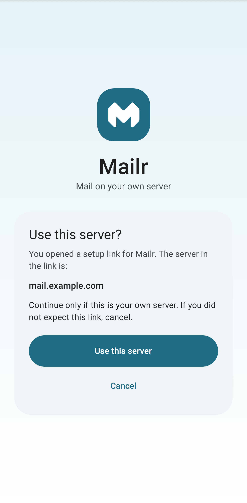
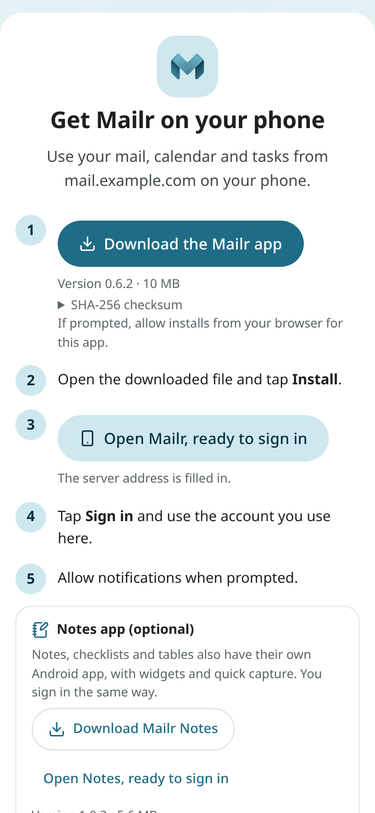
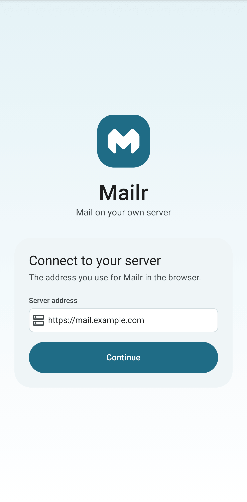

# Install the phone app

Mailr can be used on a phone in three ways: the Android app, the web app installed to your home screen, or any IMAP mail app.

## The Android app

1. On your phone, open `/get-app` on your Mailr server (for example `https://mail.example.com/get-app`) and tap **Download the Mailr app**. With an invite, open the invite link on the phone instead and tap **Get the app**.
2. Open the downloaded file and allow the install. The first time, you are asked to allow installs from your browser or file manager.
3. Open Mailr and enter your server address, for example `https://mail.example.com`.
4. Sign in. When the server is set up for single sign-on in the app, a button for it is shown (see [Sign-in and OIDC](../admin/sign-in.md#the-android-app)). Otherwise, sign in with email and password.
5. After sign-in, a short setup covers three things: notifications, the battery setting for on-time mail (choose Mailr and pick **Allow** or **Don't optimise**), and ntfy, a free notification app, for instant mail. When the server has its own ntfy, tap **Copy and open ntfy** and paste the address in ntfy's **Settings → Default server**. Without ntfy you can choose a live connection instead. Each step can wait; choose **Done for now** to go to your inbox.

The quickest way in is an invite link from the administrator, opened on the phone: with **Open in the Mailr app**, the server is offered and the invite is carried along (see [Joining with an invite](start-here.md)). Or use the setup guide's phone step on the web: scan its code, and on the **Get the app** page (`/get-app` on the server) are the download and then **Open Mailr, ready to sign in**, for opening the app with the server address offered (a `mailr://setup?server=…` link).

A setup link never changes the server by itself. The app first shows **Use this server?** with the full address from the link. Check that it is your own server, then tap **Use this server**; with **Cancel**, nothing changes. While the app is signed in, a setup link is not used: a short notice is shown, and you must sign out first to use another server.

The same page also has the separate, optional [Notes app](../android/notes-app.md) for notes, checklists and tables, with **Open Notes, ready to sign in**.

Android 10 or later is required. The app works on phones, foldables and tablets. Updates are installed over the existing app. New versions are published to the server by the administrator (see [Phone apps](../admin/phone-apps.md)). When a newer version is on the server, **Update available** is shown in the app's Settings. When the installed version is no longer accepted by the server, **Update Mailr to keep syncing** is shown, and changes are kept on the phone until the app is updated (see [Updates](../android/index.md#updates)).

Read more in the [Android app](../android/index.md) section.

## The web app on your home screen

The web app works in any phone browser, and it can be added to the home screen as a progressive web app (PWA): in Chrome with **Install app**, on an iPhone in Safari with **Share → Add to Home Screen**. Mailr then opens in its own window with a tab bar, swipe actions, notifications (on an iPhone only this way) and recent mail kept for offline reading. The steps are in [The web app on your phone](../user-guide/phone.md).

## Other mail apps (IMAP)

The Mailr store can be read directly from any IMAP app, such as Thunderbird, FairEmail or iOS Mail.

1. In Mailr on the web, open **Settings → Mail → Mail accounts → Phone & desktop apps**.
2. Note the IMAP server, port and username.
3. Click **New app password** and copy the password. It is shown only once.
4. Add an IMAP account in your mail app with those details.

Use the app password, not your sign-in password. In IMAP apps, mail and labels are shown as folders. Features such as Ambrose, briefs and approvals are only in Mailr's own apps.
