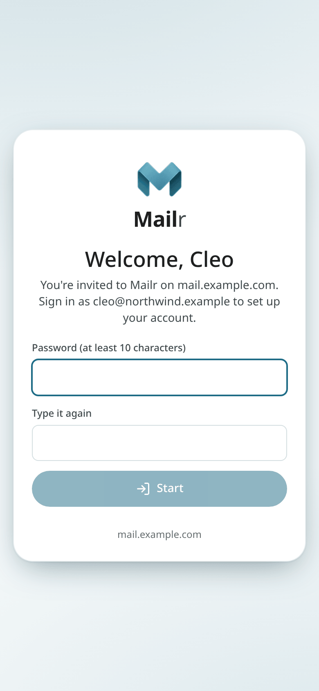
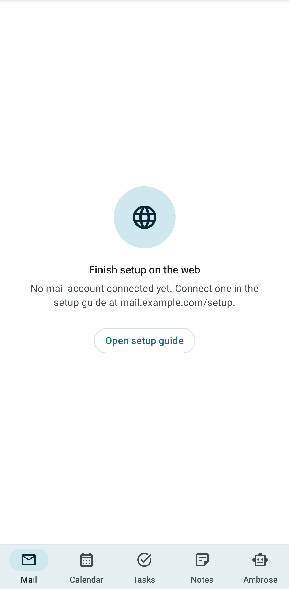

# Joining with an invite

This page covers joining a Mailr server that someone else runs for a family, team or organisation. Nothing is installed on a server. The steps take about ten minutes and require the mail account's password (or an app password, for Gmail) and a phone.

## 1. Open your invite

<!-- covers: household.join -->

The administrator sends a link, or shows a QR code to scan with the phone's camera. The link looks like `https://mail.example.com/join/…`. It can be used once and expires after a few days.

The invite page shows the invited person's name. Then:

- **Continue with …** (single sign-on): sign in with the account you use for the other services on that server. You come back to Mailr signed in.
- **Choose a password**: when the server is set up for passwords, choose one here. Use at least 10 characters.

If the link has ended or was used, ask for a new one. If the link is for another address, sign out first and open the link again.

## 2. Go through the setup guide

Next comes the [setup guide](your-first-sign-in.md). In it you connect the mail account, pick a look and an inbox style, and set up the calendar. Steps whose settings the administrator has already chosen are skipped.

Take care with the mail account step. For Gmail, create an app password first; the guide has a link to Google's page and the steps. See [Connect your accounts](connect-accounts.md).

You can stop at any point. Select **Continue setup** on the inbox to go back to where you were.

## 3. Get the phone app

On an Android phone, open the invite link there, or scan the code on the guide's phone step. Tap **Get the app**, install it, then tap **Open in the Mailr app**: the app opens with the server filled in and the invite carried along. Sign in the same way as on the web. The full steps, including the short setup for notifications and instant mail, are in [Install the phone app](phone.md).

On an iPhone, open the Mailr address in Safari and use **Share → Add to Home Screen** (see [The web app on your phone](../user-guide/phone.md)).

## The "Finish setup on the web" screen

This screen is shown instead of an empty inbox while no mail account is connected. Tap **Open setup guide**, or open the address shown there on a computer, and finish the mail account step. The mail is then shown on the phone too.

## Import notes, calendars and contacts

Each app's **⋮** menu has an import with a preview of what will come in before anything changes. A whole import can be undone in one step.

- Notes from Google Keep: [Notes → Import from Google Keep](../user-guide/notes.md#import-from-google-keep).
- A calendar file (.ics), or a holiday or school calendar link: [Calendar → Import and calendar links](../user-guide/calendar-sharing.md#import-and-calendar-links).
- Contacts (.vcf): [People → Import contacts](../user-guide/people.md#import-contacts).

## Next steps

- [The inbox](../user-guide/inbox.md) and [Reading mail](../user-guide/reading.md).
- [Calendar](../user-guide/calendar.md), [Tasks](../user-guide/tasks.md) and [Notes](../user-guide/notes.md).
- [Ambrose](../user-guide/assistant.md), the assistant. It has the same permissions as the user.
