# First sign-in: the setup guide

This page covers the setup guide on a Mailr server that is already running. After a new
installation, start with [Set up the server's first admin](first-admin.md).

A short setup guide is shown at the first sign-in. It takes about five minutes. Every step can be skipped, and the current step is saved across devices. The About-you chat in step 8 starts over if you leave the page before you save it.

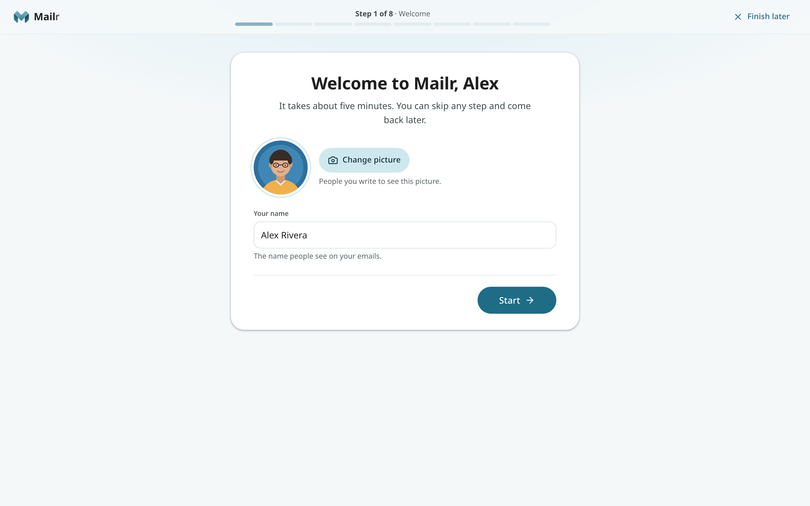

A bar at the top shows progress: it counts the eight steps below (seven when Ambrose is not offered), and **All set** is the closing screen. **Welcome** has only **Start**. From step 2, **Back**, **Skip for now** (**Not now** on the phone and notifications steps) and **Continue** are at the bottom of each step. On the email step, only **Skip for now** is at the bottom until an account is connected (the form's own **Next** continues); **Continue** appears once an account is connected. Choose **Finish later** to close the guide, and the **Continue setup** card in the inbox to return to the same step.

## 1. Welcome

The name and picture are taken from the sign-in account. When the account has no name of its own (with password sign-in, unless the administrator gave one), the name field starts empty, and **Start** waits for a name. The name can be changed; it is the name recipients see. Use **Add a picture** or **Change picture** to set the account picture.

## 2. Connect your email

The step opens with: "Your old account keeps working. With “Keep in sync”, what you read, archive or delete here also changes there." Type the address of the existing account. The provider is found from the address.

Then choose how the existing account is handled:

- **Keep in sync** (recommended). The old account keeps working, and new mail keeps arriving in Mailr. Reading, archiving and deleting in Mailr are applied to the old account too: a message archived in Mailr is archived in Gmail as well.
- **Copy once**. The mail is copied here, and the old account is never changed. New mail stays in the old account and does not arrive in Mailr.

To have Mailr keep the mail instead (new mail keeps arriving and is kept in Mailr, and changes stay in Mailr), add the account later under **Settings → Mail → Mail accounts**; see [Mode](connect-accounts.md#3-mode).

### Supported providers

| Provider | Can connect? | Requirement |
|---|---|---|
| Gmail | Yes | An app password (below) |
| iCloud, Yahoo, Fastmail | Yes | An app password; the steps are in the guide |
| Most other providers (Zoho, Posteo, mailbox.org, a custom domain) | Yes | Usually the normal password |
| Outlook, Hotmail, Live, MSN and Microsoft 365 | Not yet | Microsoft blocks password sign-in for other apps. Keep using Outlook for that account, or connect another address. |

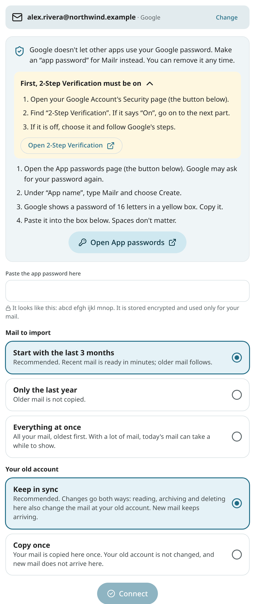

**Gmail.** Google does not accept the normal Google password from other apps. An *app password* is used instead: a separate password only for Mailr, which can be removed at any time.

1. 2-Step Verification must be on for your Google Account. The guide has a link to the page where you check it.
2. Open **App passwords**, type `mailr` as the app name and choose **Create**.
3. Copy the 16-letter password Google shows and paste it into the guide. Spaces do not matter.

iCloud, Yahoo and Fastmail work the same way, with their own app passwords; the steps for each are in the guide. Other providers usually accept the normal password. When the server settings cannot be found, fill them in by hand.

**Mail to import.** With the recommended choice, the last three months are imported first, so the inbox is ready in minutes. Older mail is imported in the background, with the progress in a slim **Importing older mail…** bar until the import is done. The other choices are only the last year, or everything at once.

Choose **Add another account** to connect more addresses, for example a second Gmail account. When an account can send mail, a **signature** is also requested in this step.

## 3. Choose your look

Three styles are suggested: **Classic** (labels in a sidebar, like Gmail), **Cards** (mail bundled into cards, with colour) and **Workspace** (folders and a reading pane). Focus and Desk are under **More styles**. Choose **Light**, **Dark** or **Automatic**, and how much fits on the screen. Every choice is applied at once.

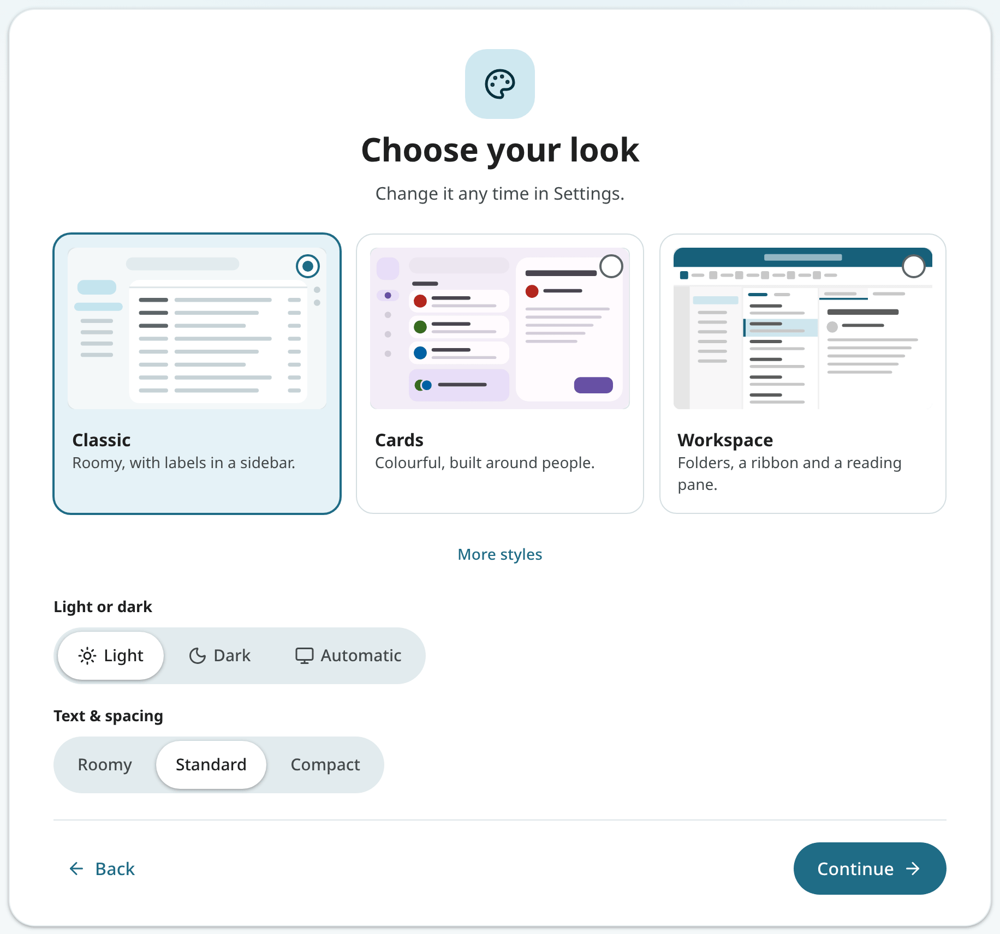

## 4. Choose your inbox style

- **Simple**: all mail in one list, newest first.
- **Important first**: important mail at the top, everything else below.
- **Categories**: tabs for Primary, Promotions, Social, Updates and Forums.

Once mail has arrived, each preview is drawn from the account's newest emails.

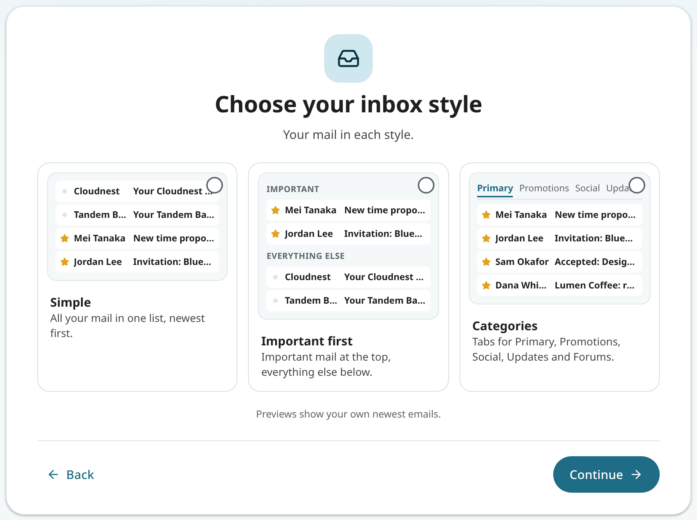

## 5. Your phone

Choose **iPhone** or **Android** (on a phone, the choice is detected). Scan the code with the phone's camera.

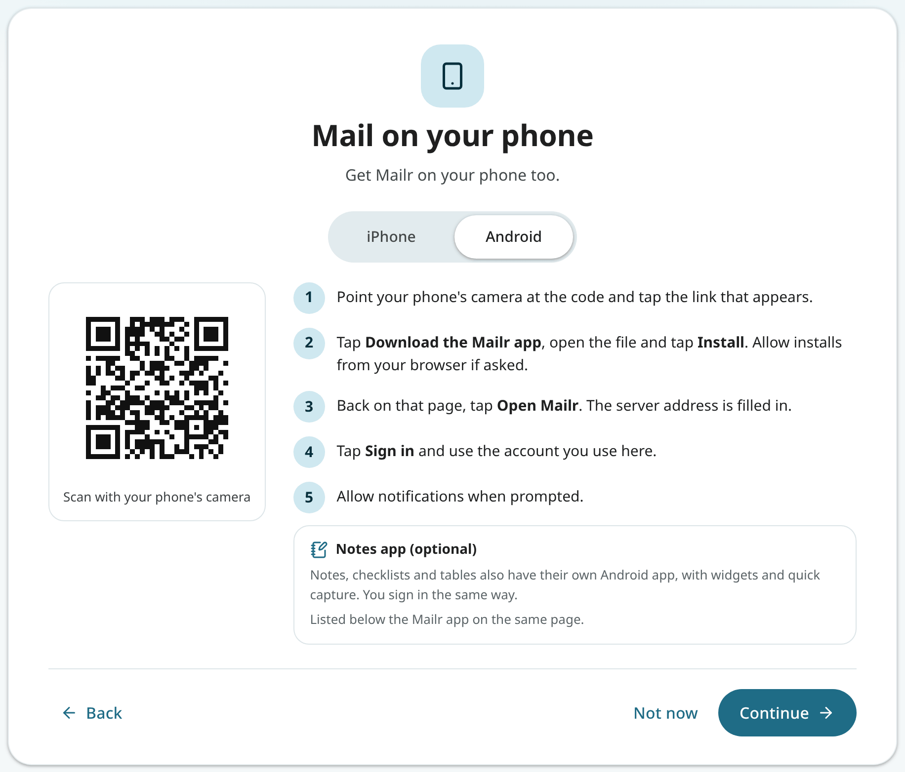

- **Android**: with the code you reach the **Get the app** page. Download the app and install it, then tap **Open Mailr, ready to sign in**: the app opens with the server address filled in. After sign-in with the same account, permission for notifications, the battery setting for on-time mail, and a push app for instant mail are requested. The page lists the version and size of each app, and the separate **Notes** app as well (optional).
- **iPhone**: with the code you open Mailr in Safari. Tap **Share**, then **Add to Home Screen**. Open Mailr from the Home Screen, sign in, and turn on notifications in **Settings → Notifications**.

See [Install the phone app](phone.md) for more.

## 6. Your calendars (optional)

When the administrator has prepared a calendar server, two choices are shown: **Use our calendar server**, with the address filled in (sign in there with your username and password; calendars shared with you on that server are shown too), or a calendar of your own. Otherwise there is no choice to make: a line reads "Fastmail, iCloud, Nextcloud and other calendars that offer CalDAV access…", and **Connect** opens the form. Choose **Add another calendar** to connect more; all of them are shown together in Calendar.

When your mail account is Gmail or Outlook/Microsoft, a note says that Google Calendar and Outlook calendars cannot be connected yet. Choose **Subscribe to a calendar link…** to add one read-only, with Google's secret iCal address or Outlook's published ICS link.

When the administrator has turned on built-in calendars, the **Mailr calendar** is shown in this step as already connected: a calendar and a task list on the Mailr server. The other choices remain available: connect further calendars, or choose **Continue without another**. See [The Mailr calendar](../user-guide/calendar-sharing.md#the-mailr-calendar).

## 7. Notifications

Choose **Turn on notifications**; permission is requested once. Choose **Send me a test notification** to see an example. Then choose which mail triggers a notification: **Important mail** (recommended), **Only my VIPs**, **Every new email** or **None**. On an iPhone, notifications work once Mailr is on the Home Screen.

## 8. About you (optional)

Ambrose uses the details in this step to match drafts to the user's writing and to follow the user's preferences.

- **Fill in a few fields**: what to call you, what you do, how your emails sound, how you sign off, and anything to know or avoid.
- **Have a quick chat**: Ambrose asks a few short questions, one at a time.

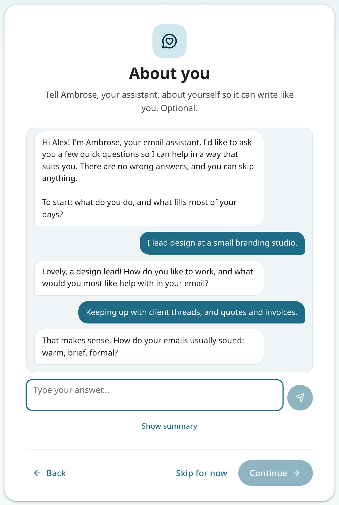

When you have answered enough, choose **Show summary**. Ambrose then shows what it learned: your name, what you do, a few lines about you, how you write, your sign-off and notes to remember. Change anything or leave out a note, then choose **Save**; nothing is saved before then. The sign-off is also used as the email signature. After **Save**, the step shows **Saved**, also when you come back to it later.

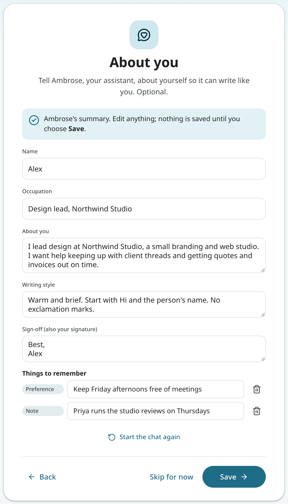

When Ambrose is not available, the fields are shown in this step instead. These details can be changed later in **Settings → Ambrose → About you**.

## 9. All set

The last screen has a **Notes and lists** card. Notes, checklists and tables are kept next to the mail in Mailr.

- Choose **Start a shopping list** for a checklist from the Shopping list template, with the store's sections (Produce, Bakery, Dairy and more) and a few items to replace. The guide then ends, and the list is shown.
- Choose **Start a note** for an empty note, already open.

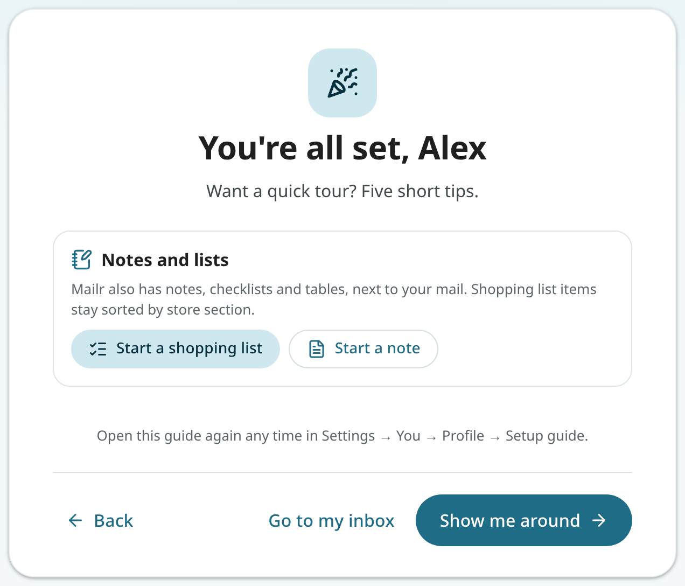

On a phone, the card also shows the **Notes app for Android**, with its version and size. On an iPhone there is no separate app: notes are in Mailr itself, so the card has a reminder to add Mailr to the Home Screen. See [Notes and checklists](../user-guide/notes.md) and [The Notes app](../android/notes-app.md).

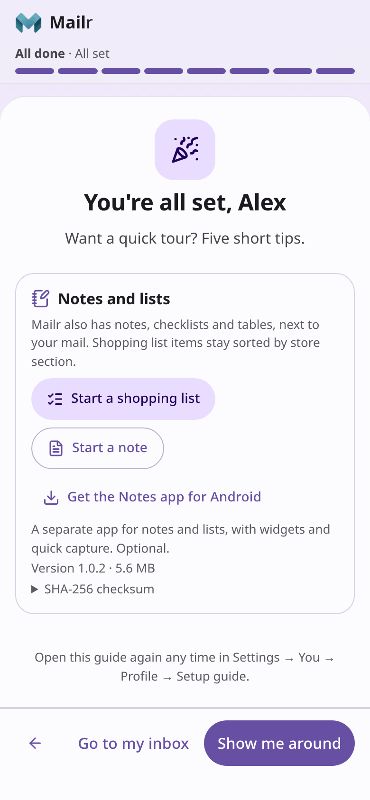

**All set** offers **Show me around**, a short tour of five tips (search, archive and swipe, snooze, labels, and help and Ambrose), or **Go to my inbox** to end the guide. **Skip the tour** ends the tour at any tip.

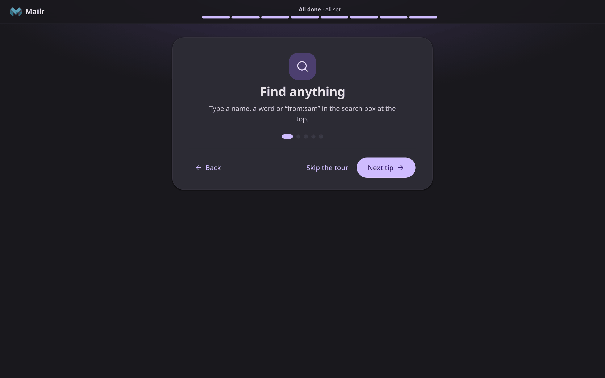

## Open the guide again

<!-- covers: settings.setup_guide -->
Open the guide again at the start from **Settings → You → Profile → Setup guide**. Completed steps stay ticked. To hide the **Continue setup** card without finishing, choose its **×**.

The guide works the same on a phone-sized screen, one step per screen with the buttons at the bottom.

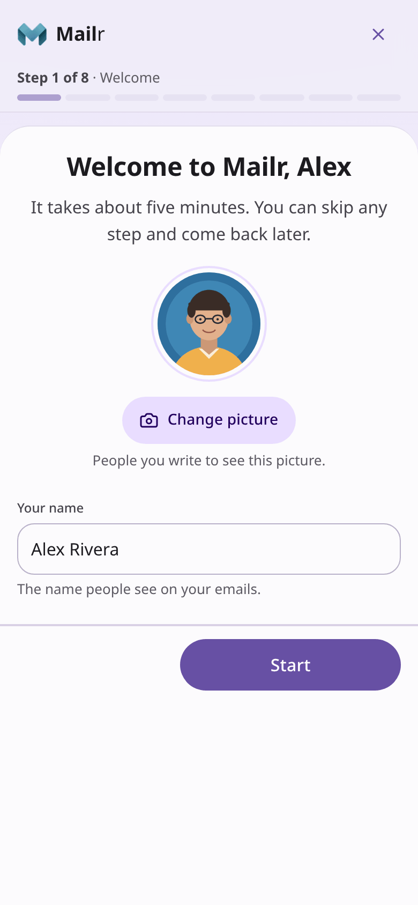
