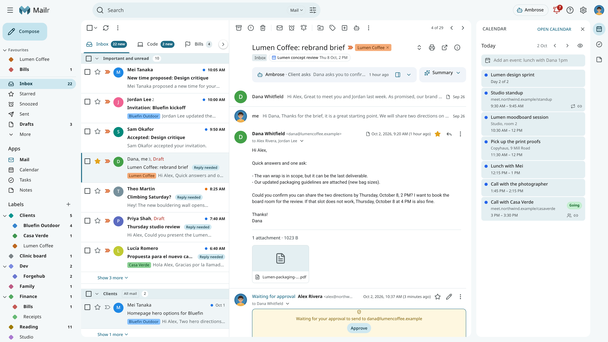
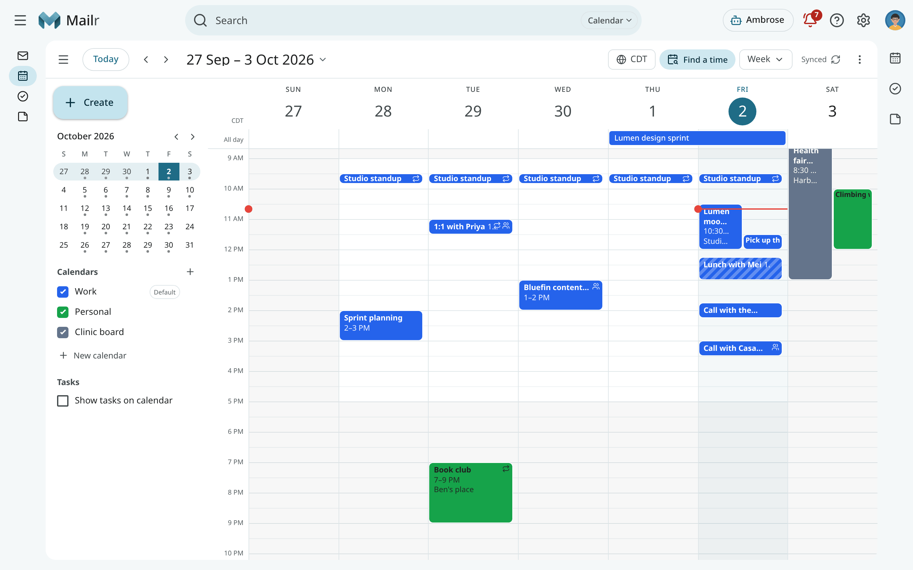
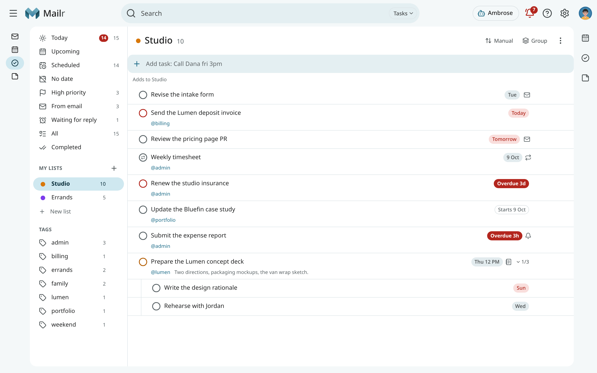
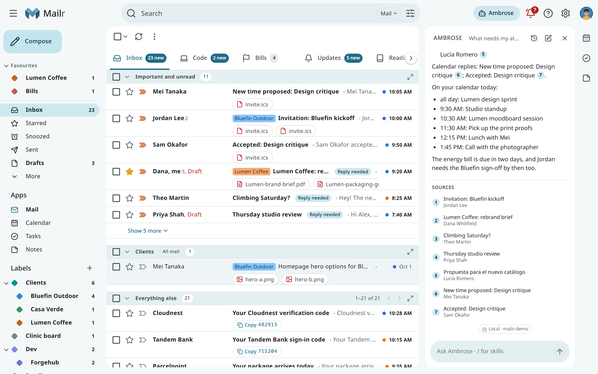
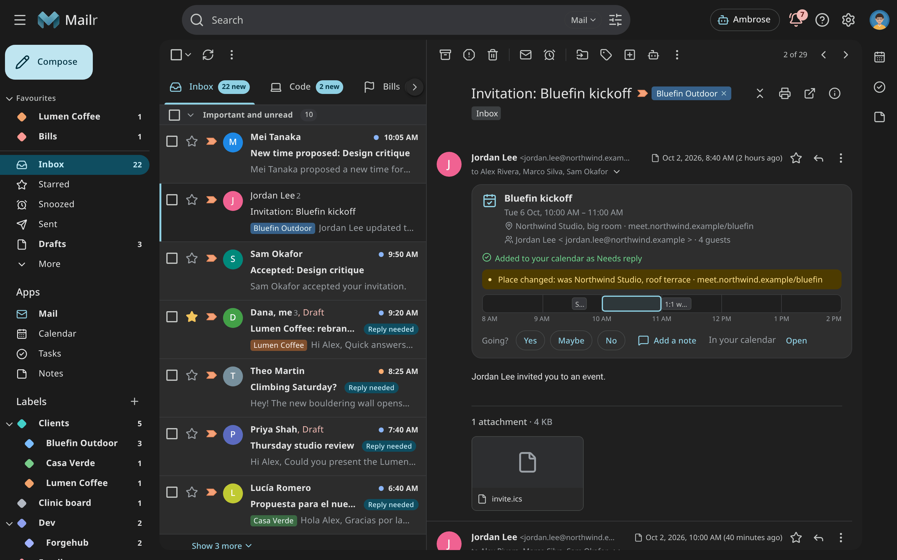

---
hide:
  - navigation
  - toc
search:
  boost: 2
---

# Mailr

**Self-hosted webmail with a mail store, calendar, tasks, notes and an AI assistant.**

Mailr is a webmail application for hosting your mail inbox and mail storage on your own server.
Mail accounts from one or more providers are connected over IMAP and SMTP, and a copy of the mail
from each account is kept in the Mailr mail store. Mail can be read and written in a web browser or
in the Android app, and the stored mail can also be read by other mail applications over IMAP.

Mailr also includes a calendar, task lists, notes and an AI assistant named Ambrose. Ambrose works
as a personal assistant across your mail, calendar, tasks and notes. Ambrose can find messages and
events, compile summaries, draft replies and clean up the inbox. Sending, deleting and rule changes
are held for your approval. Mailr offers a wider range of customization and AI assistance than most
webmail applications, and the language and embedding models used by Ambrose and by search can be
run on your own hardware.

[Install Mailr](getting-started/install.md){ .md-button .md-button--primary }
[I have an account](getting-started/start-here.md){ .md-button }
[Tour the user guide](user-guide/index.md){ .md-button }



## Main differences

- **Your mail accounts stay with your providers.** Accounts from several providers can be connected,
  such as a personal Gmail address, a work account or an address on your own domain. Mail for each
  address is still received and sent by the provider of that address, and a copy of the mail is kept
  in Mailr. With the mode "Mailr keeps the mail", the copy in Mailr becomes the long-term home of an
  account's mail.
- **Approvals for sending, deleting and rule changes.** When Ambrose or an agent with an API token
  sends mail, deletes something or changes a rule, the action is held on an approval card on the
  web or on the phone. Each default can be changed under
  [Approvals](user-guide/approvals.md#approval-defaults).
- **Models are optional.** Mailr can be used without a language model. When models are connected,
  you can set which mail may be sent to which model. Mail in a local-only account is not sent to a
  hosted model.

## Quick start

You need a Linux host with Docker, Docker Compose v2 and BuildKit (the `buildx` plugin), and at
least one existing mail account. The full list is under
[System requirements](getting-started/index.md#system-requirements).

```sh
git clone https://github.com/murtaza-nasir/mailr.git
cd mailr/deploy
cp .env.example .env
openssl rand -base64 32    # run twice: MAILR_SECRET_KEY and MAILR_SESSION_SECRET
nano .env                  # MAILR_BASE_URL, the secrets, the passwords, the first admin
docker compose up -d
```

Place a TLS reverse proxy in front of port 8025. For a local test, set
`MAILR_BASE_URL=http://localhost:8025` instead. Then open the address set in `MAILR_BASE_URL`, sign
in as the first admin, and add a mail account under **Settings → Mail → Mail accounts**. Each step
is explained in [Install with Docker Compose](getting-started/install.md). The reverse proxy, single
sign-on, models and backups are described in the [Admin guide](admin/index.md).

## Features

<div class="grid cards" markdown>

-   :material-home-import-outline: **Mail storage and import**

    ---

    IMAP accounts can be connected, and Gmail accounts can be imported with their labels and
    threads. Mail archives in mbox and Maildir format can be imported through the API. The stored
    mail can be read by other mail applications over IMAP.

    [Connect your accounts](getting-started/connect-accounts.md)

-   :material-inbox-full-outline: **Mail client**

    ---

    Mail is shown as conversations and can be organized with labels, categories, custom inbox
    sections and tabs. Messages can be snoozed, given follow-up reminders or recalled with undo
    send. Five interface styles are available, each in a light and a dark theme.

    [The inbox](user-guide/inbox.md)

-   :material-calendar-check-outline: **Calendar and tasks**

    ---

    Calendars can be kept in Mailr or on a CalDAV server, and invitations can be answered from the
    message. Events and tasks can be created from an email or from one line of text, such as
    `Lunch with Dana fri 12:30`.

    [Calendar](user-guide/calendar.md)

-   :material-robot-outline: **Ambrose, the assistant**

    ---

    Questions about your mail, calendar and tasks can be asked in the Ambrose panel. Ambrose can
    also take dictation, follow standing orders and review a view of mail with `/sweep`. Sending,
    deleting and rule changes are held for your approval.

    [Ask Ambrose](user-guide/assistant.md)

-   :material-shield-lock-outline: **Local-only accounts**

    ---

    Accounts can be marked as local-only. Mail from a local-only account is not sent to a hosted
    model or to an agent that uses a hosted model.

    [Philosophy](philosophy.md)

-   :material-api: **Agents and the API**

    ---

    The web app, the Android app, Ambrose and external agents use the same API. MCP clients are
    connected with a scoped token.

    [Agents & API](agents/index.md)

</div>

## Screenshots

=== "Inbox tabs"

    

=== "Calendar"

    

=== "Tasks"

    

=== "Ambrose"

    

=== "Dark"

    

=== "Android"

    

## Speakr recordings

Mailr can be connected to [Speakr](https://github.com/murtaza-nasir/speakr), a self-hosted
transcription and meeting-notes application. Recordings are shown beside their meetings and emails.
From a recording, a follow-up email can be drafted and the action items can be added as tasks.
See [Recordings](user-guide/recordings.md).

## Open source

Mailr is free software under the GNU AGPLv3, with a commercial licence on request.
See [Licence](license.md).
