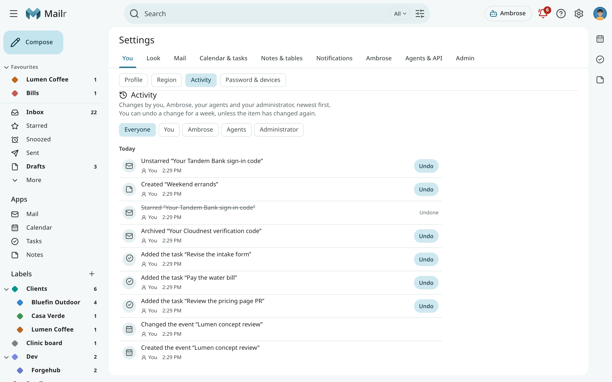

# Activity

**Activity** lists the recent changes in the account, newest first and grouped by day:

- changes you made in mail, the calendar, tasks, notes and tables;
- changes made by Ambrose;
- changes made by agents through their API tokens (each under its token's name);
- changes made by the administrator, such as your name, your groups or a password reset.

Open it from the bell: click the bell at the top of the page, then **Activity** at the bottom
(see [Waiting for you](waiting.md)). It is also in Settings, under **You → Activity**.
It is there for every user, in simple mode too. Nothing is added to the main navigation.

<!-- covers: activity.list -->

## Row contents

- What changed, in a few words: **Archived “Lunch on Friday”**, **Completed “Pay the plumber”**,
  **Created the event “Piano lesson”**. Click it to open the conversation, event, task, note or
  table.
- Who made the change: **You**, **Ambrose**, an agent's name, or **Your administrator**.
- When it happened.
- Small edits that follow each other (typing in a note, checking items in a list, editing cells
  in a table) count as one row, with the number of changes.

Use the chips at the top to show the changes of one person or agent only: **You**, **Ambrose**,
**Agents** or **Administrator**.

Reading mail is not listed: a conversation is marked read when opened, and those rows would hide
the other changes.

## Undo

Most rows have **Undo**. With it, that one change is taken back: an archived conversation returns to the
inbox, a completed task opens again, a deleted event comes back, a note leaves the Trash. The row
then shows **Undone**, and the undo is listed as a change of its own.

<!-- covers: activity.undo -->

**Undo** is offered:

- for a week after the change;
- while the same item has not changed since (otherwise the newer change could be
  overwritten);
- once.

It is not offered for changes that would mean mailing other people again (an event with guests), for
changes to a repeating event, or for an administrator's change. A note's or a table's own
history holds every edit; open the note or table to go back further.

## On the phone

In the Android app, the same list is under **Settings → Activity**, read-only. See
[Settings on Android](../android/settings.md#activity).
