# Styles and appearance

Mailr has five styles. Each style is a complete layout, not only a colour scheme. All of them have light and dark forms and show the same mail, labels and layouts.

## Choose a style

Open **Quick settings** (the gear in the top bar) or **Settings → Look → Style**. Pick a thumbnail. The style is changed at once, on the current page.

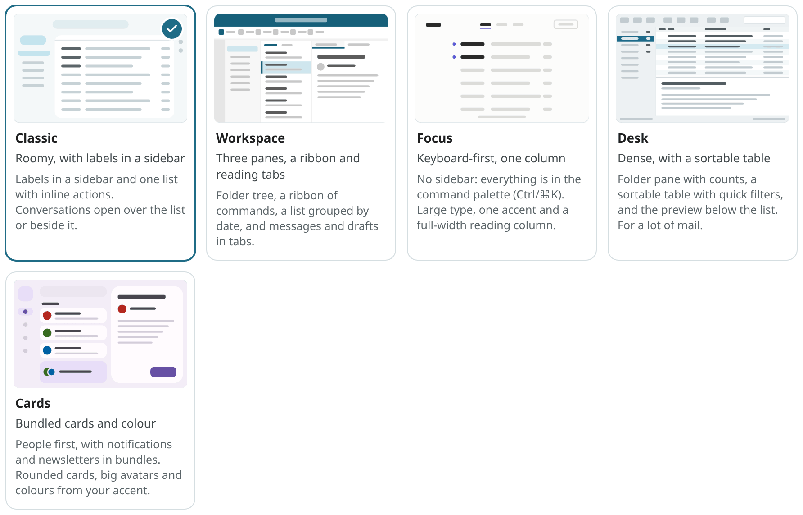

Tick **Only on this device** to keep the choice in this browser. Other devices then keep their own style, for example Desk on a laptop and Cards on a tablet. Untick it to save the current style to your account.

## The same apps in every style

Every style has the same apps, in the same order and with the same names and icons: **Mail**,
**Calendar**, **Tasks** and **Notes**, and **Recordings** once Speakr is connected. Tables are
inside Notes (**Notes**, **Lists**, **Tables**). Only the place differs: the sidebar's **Apps**
group in Classic (in Calendar, Tasks, Notes and Recordings, Classic's sidebar is a narrow rail of
the apps instead of the mail folders), the bar on the far left in Workspace and Desk, the rail in Cards, and the small
icons in the top bar in Focus.

**Ambrose**, the assistant, has its button in the same place in every style: in the top bar, left
of the bell. It is also opened and closed with `Ctrl + .`.

In Classic, use the three icons on the right to open a small Calendar, Tasks or Notes panel beside
the page you are on. The current app stays open; to switch, use **Open
Calendar** at the top of the panel.

The button for a new email is called **Compose** in every style. In the other apps, the button is named for the new item:
**New event**, **New task**, **New note**.

On a phone, every style has the same bar at the bottom: **Mail**, **Calendar**, **Tasks**, **Notes**
and **Ambrose**. See [The web app on your phone](phone.md).

## The styles

### Classic

Classic, the default style, has roomy spacing and a sidebar with your favourites, mailboxes, the apps and your labels. Inbox tabs and custom sections are above the list, and the Calendar, Tasks and Notes panels are on the right.

=== "Light"
    
=== "Dark"
    

### Workspace

Workspace has three panes (a folder tree, a two-line list under date headings and a reading pane with tabs) and a ribbon with **Home** and **View** tabs. The selected conversation is opened in a preview tab, which is replaced by the next selection. Ctrl-click, middle-click or double-click to keep a conversation in its own tab. New mail and drafts are opened as tabs too.

=== "Light"
    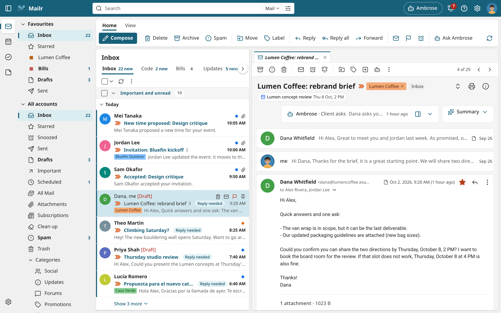
=== "Dark"
    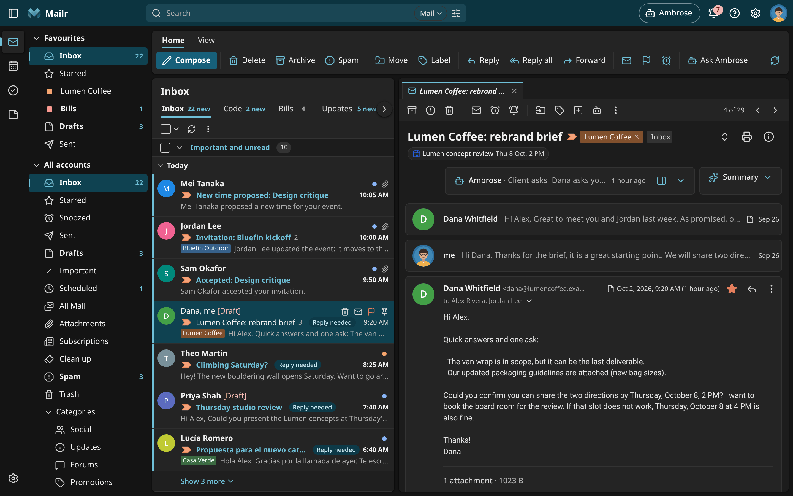

### Focus

Focus is a single column, built for the keyboard. It has no sidebar; the apps are small icons in the top bar. Click **Mailr / Inbox** or press `Ctrl + K` to open the command palette, which lists every view, label, action and setting. A strip at the bottom shows the keys for the current view.

=== "Light"
    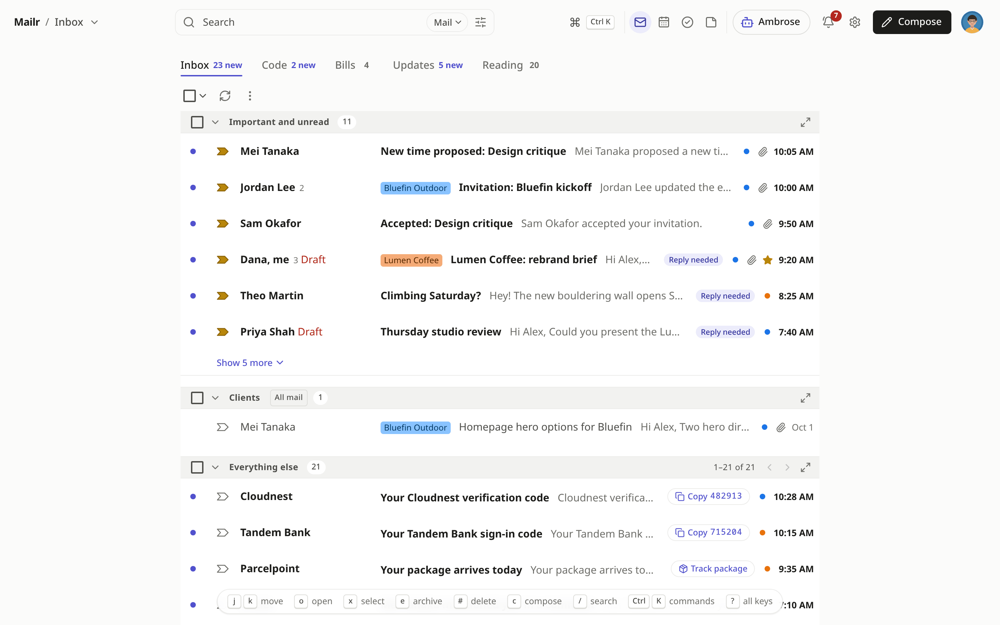
=== "Dark"
    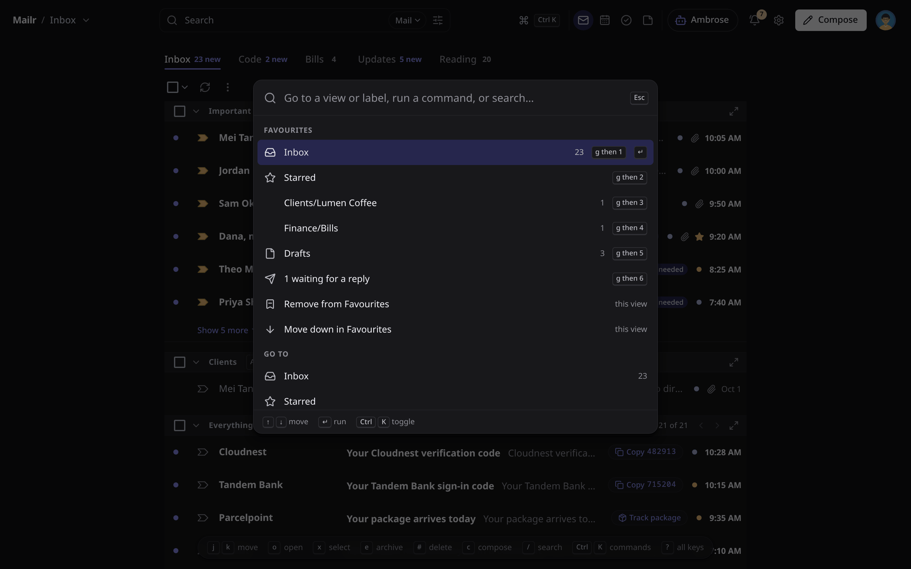

### Desk

Desk is dense, with a sortable table of Star, Attachment, From, Subject, Labels, Messages and Date columns. Click a header to sort; drag the From and Labels edges to resize. Use quick filters (Unread, Starred, Attachment) to narrow the page. The preview is shown below, and a status bar shows counts and sync state.

Point at a row to see its quick actions over the date: **Archive** (or **Move to Inbox** for a conversation that is not in the Inbox, also in Trash), **Delete**, **Mark as read** or **Mark as unread**, and **Snooze**. They are the same buttons as in Classic, and Archive and Delete show an **Undo** in the toast. With the keyboard, press Tab from a row to reach them. On a phone or a narrow list the rows have two lines and no buttons: swipe a row, or press and hold it for its menu.

=== "Light"
    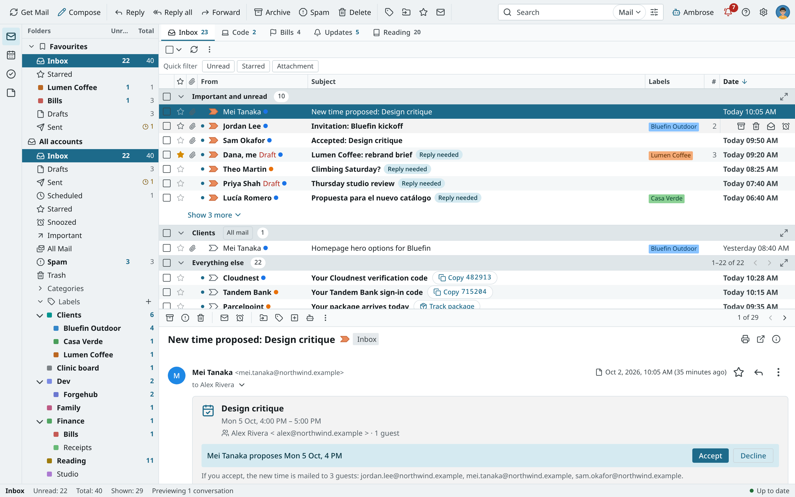
=== "Dark"
    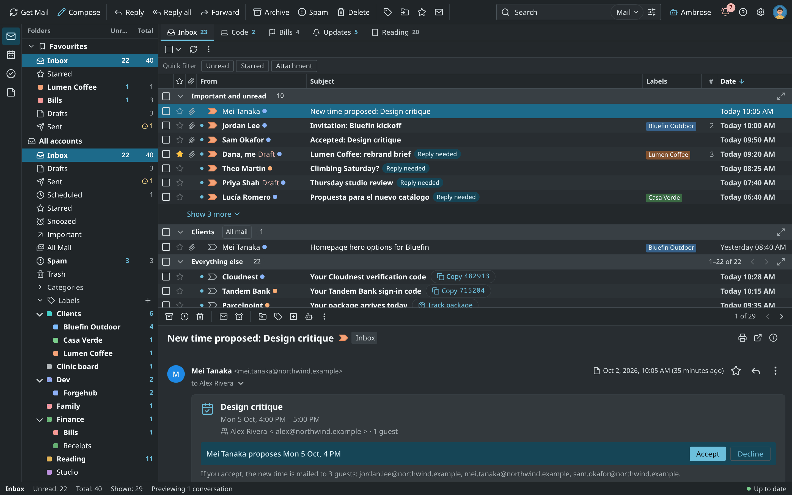

### Cards

Cards has a navigation rail with a compose button and the apps (in Mail also Starred, Snoozed, Sent, Drafts and **More** for the rest), rounded cards with large avatars, and layout tabs as filter chips. In Cards, similar mail is bundled into People, Notes to self, Notifications and Newsletters. Choose when under **Settings → Look → This layout → Bundles**: when the inbox has no sections (the default), always, or never.

The whole Cards palette is derived from its colour: violet, teal, rose, green or blue, or a colour of your own (see [Colours](#colours)).

=== "Light"
    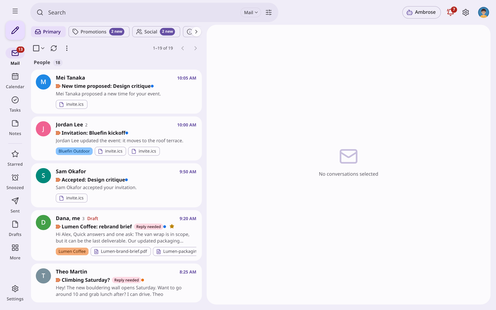
=== "Dark"
    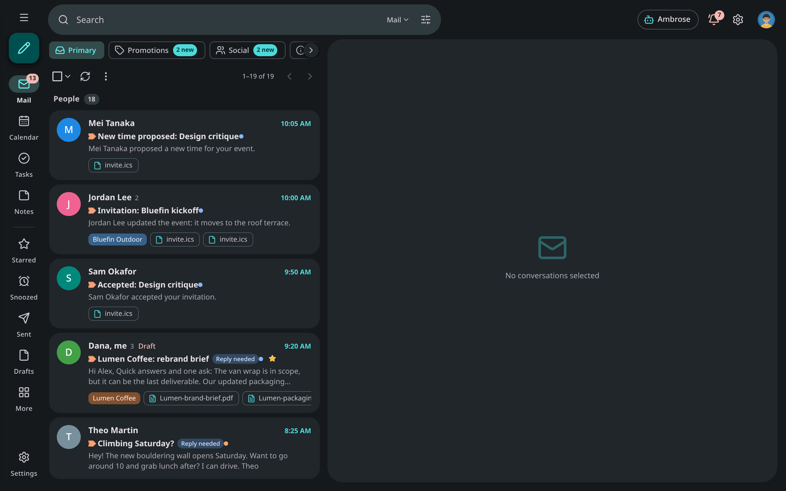

## Colours

<!-- covers: settings.colours_preset settings.colours_custom -->

Every style has its own accent colours. Under **Settings → Look → Colours**, one of the
style's presets or a custom colour is picked. Surfaces, text and layout keep the style's own colours.
Quick settings shows the presets too, under the styles.

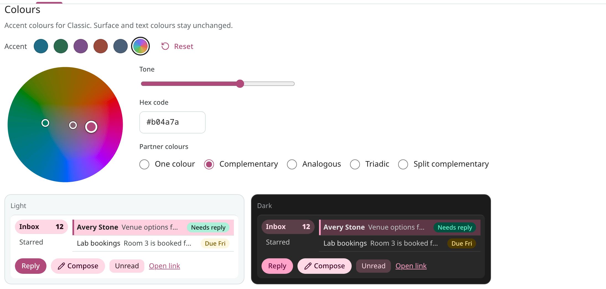

- **Presets.** Each style has five. The first one is the style's own colours. A preset belongs to
  its style: when you switch to another style, that style's own colours show, and the preset is
  restored on return.
- **Custom.** Choose the rainbow swatch. Drag the dot around the wheel to change the hue, and
  outward to make the colour stronger. Use **Tone** to make it lighter or darker. You can also type a
  hex code such as `#b04a7a`. A colour of your own is used in every style.
- **Partner colours.** A second and a third colour are added to yours. They are shown as small
  dots on the wheel and move with your dot. With **One colour**, they stay muted and close to yours;
  with **Complementary**, the third colour is opposite; with **Analogous**, both are next to yours;
  with **Triadic**, all three are evenly spaced; with **Split complementary**, both are on either
  side of the opposite. They appear on filter chips, the **Needs reply** chip and, in most styles, the active folder.
- **Preview.** A small sample shows your colours in light and dark side by side: the active
  folder, a selected row, buttons, chips and a **Due** chip.
- **Reset.** Use it to go back to the style's own colours.

Text stays readable with any colour. Text on a filled colour (a button, a badge, the count on a
tab) is white or near black, whichever reads better by the APCA perceptual contrast measure, and
the fill gets lighter or darker until it reaches APCA's level for small bold text (Lc 60). Other
text (links, the active folder, chips) is checked against the WCAG AA rule (4.5 to 1). Both apply in
light and dark, so the displayed colour can be a little lighter or darker than the picked one. Each
style's own colours follow the same rules.

The colours are saved to your account. With **Only on this device** ticked under the styles, they
are kept in this browser instead. The Android app can use the same colours: see
[App settings](../android/settings.md).

=== "Cards, dark"
    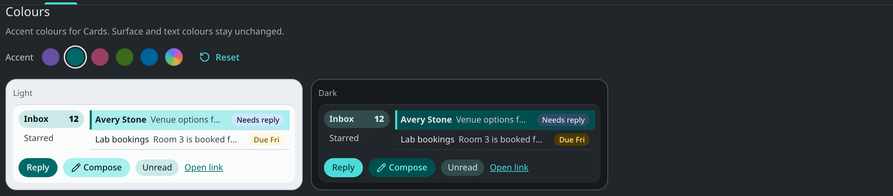

## Light, dark or the device

Under **Settings → Look → Light or dark** choose **Automatic**, **Light** or **Dark**. With **Automatic**, the scheme of your system is used and changes with it. Quick settings has the same choice, and the same words are used in the setup guide.

## Text & spacing, and the reading pane

- **Text & spacing** (`density`, **Settings → Look**): **Roomy**, **Standard** or **Compact**. It is applied in its own way in every style.
- **Reading pane** (Quick settings or **Settings → Look → This layout**): With **No split**, a conversation opens over the list; with **Right of inbox**, beside the list; with **Below inbox**, under it. In Workspace, Focus, Desk and Cards the reader has a fixed place, and the choice is saved for each style.

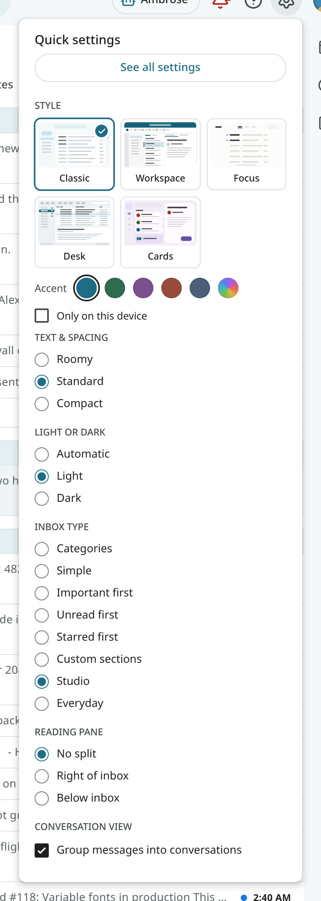

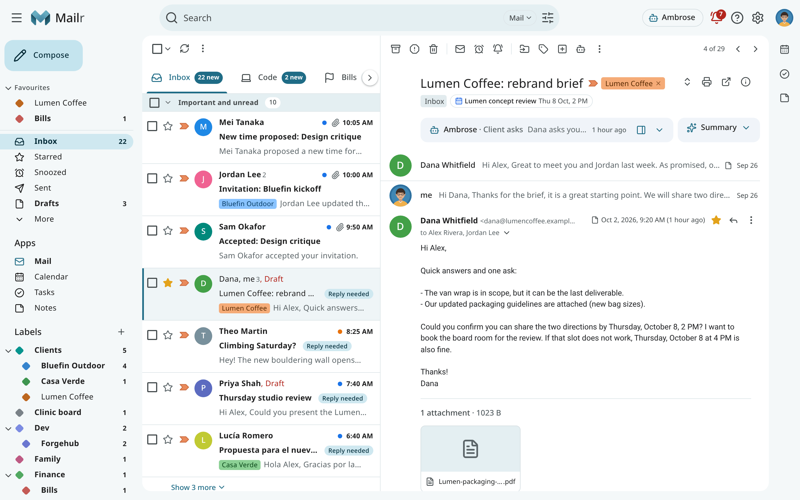

## Sender pictures

By default, initials are shown. Turn on **Settings → Mail → Reading → Look up sender pictures** to fetch brand logos (BIMI) and Gravatar or Libravatar photos. Those lookups are made from the Mailr server, and the addresses you receive mail from become known to those services. With **Show initials**, no lookups are made.

## Your picture

<!-- covers: settings.picture_upload settings.picture_remove settings.picture_use_sign_in settings.picture_publish_check settings.picture_bimi_check -->

Under **Settings → You → Profile → Your picture** you upload a picture for your account (PNG, JPEG, GIF or WebP, up to 2 MB). A 256-pixel copy is kept, without the photo's location or camera data. Choose **Replace picture** to change it, or **Remove** to go back to initials.

When you sign in with single sign-on and your provider has a picture of you, it is used until you upload your own. Choose **Use my sign-in picture** to switch back to it.

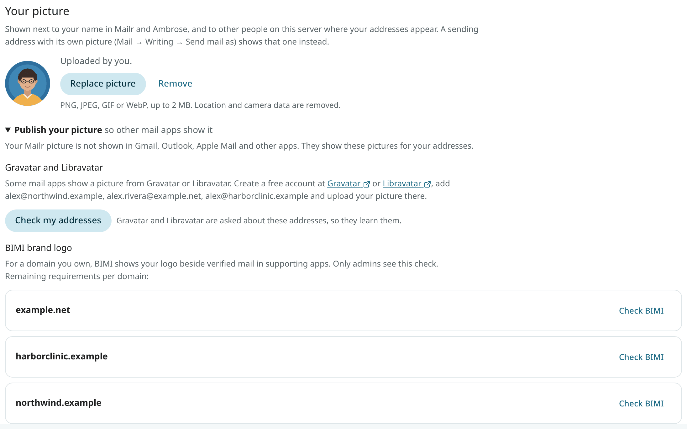

Your picture is shown in the top bar, on the messages you send, next to what you write to Ambrose, and wherever you appear in a conversation. For a sending address with its own picture (under **Send mail as**), that picture is shown instead. Other people on the same Mailr server see your picture next to mail from your sending addresses, and only for those addresses.

### Publish your picture

Your Mailr picture is not shown in other mail apps (Gmail, Outlook, Apple Mail). Open **Publish your picture** to see what is shown there for your sending addresses and how to set it. Only the parts that apply to your addresses are shown:

- **Google account photo.** For a Gmail or Googlemail address, or one that sends through Google Workspace, the photo on your Google account is shown in Gmail. Follow the link to Google Account → Personal info, where you change it.

- **Microsoft account photo.** For an Outlook, Hotmail, Live or MSN address, or one that sends through Microsoft 365, the photo on your Microsoft account is shown in Outlook. Follow the link to Microsoft account → Your info. For a work or school account, My Account is used, and your organisation may manage that photo.

- **Gravatar and Libravatar.** For any other address, create an account at Gravatar or Libravatar, add the address, and upload your picture there. With **Check my addresses**, both services are asked whether they have a picture for these addresses. Your addresses become known to the services you ask, so the question is sent only when you press the button. Your Gmail and Outlook addresses are not sent.

- **BIMI brand logo** (admins only). For a domain you own, with **Check BIMI** the BIMI record is looked up, with a report of whether DMARC is at enforcement (`p=quarantine` or `p=reject` with `pct=100`), whether the logo is an https SVG Tiny PS file, and whether a mark certificate (VMC or CMC) is listed. The certificate is required by Gmail and Apple Mail. Each requirement is marked met or not, with the next step. Shared mailbox domains such as gmail.com are not listed: BIMI for them is set by their owners.

## Time, time zone and week start

Under **Settings → You → Region** you set your time zone, the first day of the week, the time format (automatic, 12-hour or 24-hour), the date order and the currency. These apply to mail dates, the calendar, reminders and tables. Working hours, working days and the length of a new event are under **Settings → Calendar & tasks → Working hours & new events**.

## On phones

Every style has a form for a phone-sized browser: a drawer or bottom bar for navigation, full-screen conversations and compose.

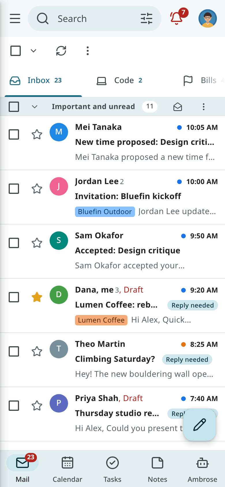

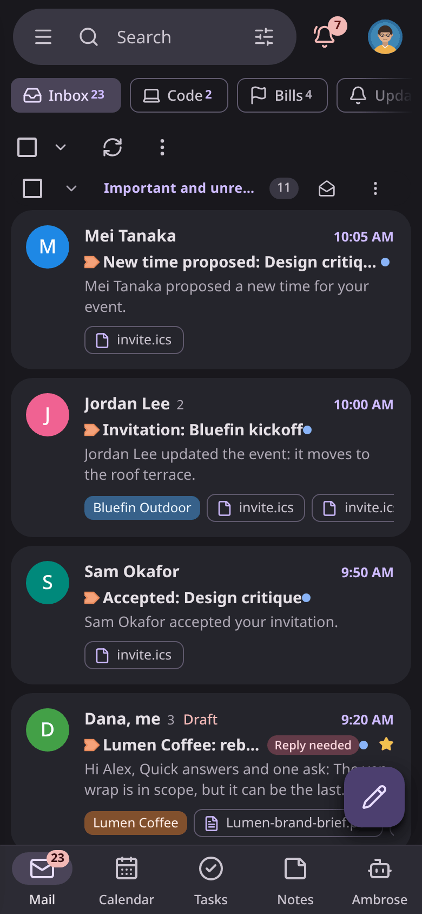

The [Android app](../android/index.md) has its own appearance settings.
