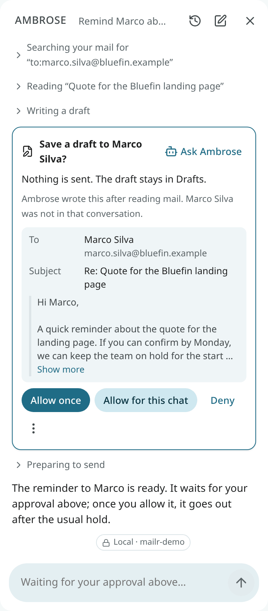
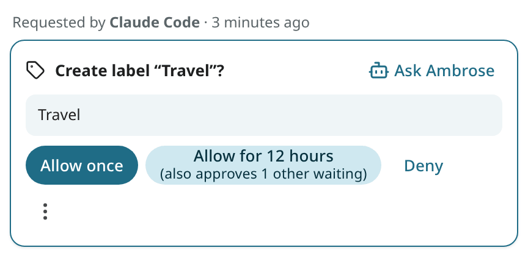
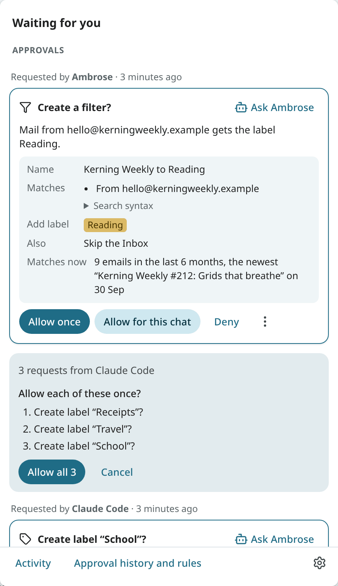
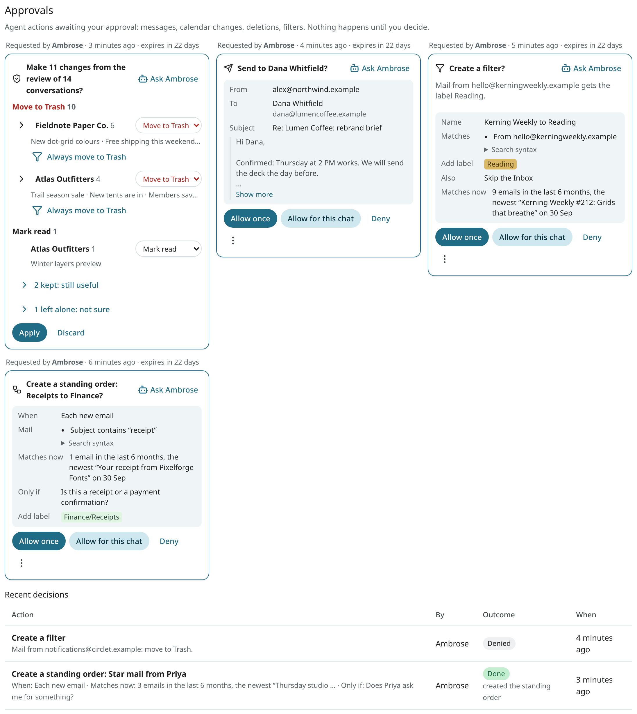

---
search:
  boost: 2
---

# Approvals

By default, Ambrose and outside agents send mail, delete things or change rules only after approval. Such an action is shown on an **approval card** and held until it is approved or denied.

Approvals apply only to Ambrose and to agents with API tokens, never to your own clicks in Mailr.

## Approval defaults

By default, these actions require approval:

- sending an email, and releasing a scheduled send;
- moving mail to Trash or Spam, deleting forever, unsubscribing and blocking senders;
- creating, changing and applying filters;
- creating, changing and deleting events, answering invitations, and anything that emails guests;
- deleting tasks, and renaming or deleting task lists;
- creating, renaming and deleting calendars;
- changing settings, layouts, signatures, skills and standing orders;
- deleting labels;
- sending an attachment to Speakr, and creating a public recording link.

Reading, drafting, labelling and creating tasks are done without asking. Each of these defaults can be changed under **Settings → Agents & API → Permissions**.

!!! warning "First messages to new addresses"
    Approval is always required for the first email to an address you have never written to, whatever the rules. This also applies to invitations to new guests.

## The approval card

An approval card shows what will happen. Its title is a question about the outcome: "Send to Marco Silva?", "Save a draft to Marco Silva?", "Delete “Weekly sync”?". Below it is the email with its recipients and subject, the event with its time and guests, or the filter with its search and actions. A draft card shows that nothing is sent. The reason is in plain words, for example "Ambrose wrote this after reading mail. Marco Silva was not in that conversation."

While Ambrose works, each step and its result are shown. Nothing more is shown for a step that did not work, or **retried** when the next try worked; the tool's own message is under **Technical details**.

For a change to an event, the card shows which event and, for a repeating event, how much of the series: "Tue 6 Oct, 10:00–11:00 AM (this occurrence only)", "This and following occurrences, from Tue 6 Oct" or "The whole series (weekly on Tuesday)". For each change, the old value is crossed out next to the new one: the time, the title, the place, the repeat rule and the calendar. Times are in your time zone with the weekday, in your 12-hour or 24-hour setting. For an event kept in another time zone, that zone's time is shown too. Calendars are named as in the calendar list, with "shared by …" or the group for a calendar someone else owns.

For an email, the card shows the whole text, including any quoted part. Where the text says "[image]", the card lists the address each remote image is loaded from under **Remote images**, and **Links to** lists the sites the message links to. A very long message ends with a note of how much more there is.

Choose one:

| Button | Result |
|---|---|
| **Allow once** | This request is run now. Nothing else changes. Approval is required again for the next one. |
| **Allow for this chat** | This request is run. The same kind of action, with any input, is run without asking in this chat for the next 12 hours. For an agent with a token, the button is labelled **Allow for 12 hours** and covers that token. |
| **Always allow…** (under ⋮) | A standing permission rule is created for this agent and this kind of action. On the web it is narrowed to this calendar, task list, recipients' domain or labels, where the request has one. It can be changed under **Settings → Agents & API**. |
| **Deny** | Nothing happens to this request. Ambrose is told that the request was denied. |

A request held by a hard rule, such as text Ambrose writes after reading mail, is decided on its own: the card shows only **Allow once** and **Deny**.

<!-- covers: approval.approve approval.deny -->

### Requests already waiting

With **Allow for 12 hours** (or **for this chat**) and **Always allow…**, the other waiting requests that the new rule covers are also approved: the same agent, the same kind of action, and the same calendar, list, domain or labels when the rule is narrowed. Each one is run as if allowed individually. The button shows the count in advance: "Allow for 12 hours (also approves 2 other waiting)".

Hard rules still apply: the first message to a new address, a Screener decision, a public recording link, an unsubscribe or cleanup plan, a bulk review card, and a request held because Ambrose read mail in that turn stay waiting, whatever is allowed.

After the tap, a message shows what happened, for example "Allowed for 12 hours. Also approved 2 other requests." With its **Undo**, the new rule is removed and the other requests that have not run yet are put back. If some already ran, the message shows that too. The request you tapped stays approved.

<!-- covers: approval.undo_grant -->

### Allow several at once

When one chat or one agent has several requests waiting, a line above them gives the count: "3 requests from claude-code". Click **Allow all 3**. The list of the three requests opens, each with its own question. Click **Allow all 3** again to allow each of them once, or **Cancel**.

Each request is allowed once, as if you had clicked **Allow once** on its card. No rule is created, so approval is required again for the next request from that chat or agent. A request that was decided in the meantime is skipped, and the message says so.

<!-- covers: approval.approve_many -->

After a decision, the card is updated in place with the outcome, for example "Approved · sent" or "Denied". A red warning on the card means the action cannot be undone from Mailr.

Click **Ask** on a card to have Ambrose explain what the action does and what each choice allows. The decision is still made on the card.

## Approval locations

- **In the chat**, right where Ambrose asked.
- **In the bell** at the top of every page, under **Approvals**. The bell's count includes the waiting approvals. See [Waiting for you](waiting.md).
- **From a link.** An agent can provide an approval link (`https://mail.example.com/approvals/aSChI8VY0d`), and push notifications for approvals have the same link. With it, the bell opens on that request, outlined. A request that was already decided shows its outcome.
- **Under Settings → Agents & API → Approvals**, with recent decisions and their outcomes. The words of each card are kept with its decision: the event and its time, the calendar by its name.
- **On your phone**, as a notification with **Allow once** and **Deny**, and in the app's **Waiting for you**. See [Ask, dictation and sharing](../android/assistant-and-sharing.md).

An approval expires after 24 hours by default. The admin can change this period.

## Send hold and undo

An approved email from an agent is not sent at once. It is held for a short time (60 seconds by default), during which it can still be cancelled. Your own sends have the usual **Undo** window.

If a message fails to send, it is marked **Not sent** in its conversation and appears in the
**Outbox** in the mail folders, with **Retry** and **Edit**. It is also listed in the bell under
**Not sent**, with **Retry**, and in Settings → Agents & API → Failed messages.

A draft written by Ambrose and awaiting approval is marked **Waiting for your approval** in its
conversation, with **Approve** and **Edit**. With **Edit**, the draft is opened and
Ambrose's request withdrawn; the draft is then sent only when you send it.

## Change the permission rules

**Settings → Agents & API → Permissions** lists every kind of action with its current effect: **Allow**, **Ask me** or **Deny**. Add a rule for Ambrose, for one chat, for one token or for every agent. A **Deny** rule always takes precedence. See [Approvals for agents](../agents/approvals.md) for the full rule format.
