---
search:
  boost: 2
---

# Ask Ambrose, the assistant

Mailr has a built-in assistant called Ambrose (the name can be changed in **Settings → Ambrose → About you**). Ambrose answers questions about mail, calendar, tasks, notes and recordings, with links to the messages it used. It can also draft replies, edit the email being written, create tasks and events, manage [notes and lists](notes.md#ask-ambrose), and change labels, filters and settings.

Ambrose has the same tools and the same permissions as every other agent. Sending mail, deleting something and changing rules require approval first. See [Approvals](approvals.md).

!!! note "A chat model is required"
    Ambrose requires a chat model, connected to Mailr by the admin. Without one, the Ask buttons are hidden and mail is unaffected. See [Models](../admin/models.md).

## Open Ambrose

Ambrose can be opened from most views:

- Open **Ambrose** beside your mail with its button in the top bar (every style has it in the same place, left of the bell; on a phone it is at the right of the bottom bar), or with `Ctrl + .`.
- Press `Shift + a` to ask about what is open: the conversation you are reading, the focused event or task, the open note, a reminder or a recording.
- Use the **Ask Ambrose** button on a conversation, an event, a task, a note, a recording, a reminder or an approval card.
- Type a question in the command palette.

When you ask about an item, a chip at the top of the box shows what is attached. Ambrose reads that item with every message in the chat. Click the chip's **×** to detach it.

<!-- covers: agent.ask_about -->

Ambrose also knows what else is on your screen, but only by id: the view, how many rows the list shows, which rows are checked and which email is open. When your question is about those emails ("anything urgent here?", "archive the newsletters on screen"), Ambrose reads their subjects and senders first ("Reading what is on screen"). A question about something else, such as adding an item to your shopping list, does not read them. Its changes then do not need the extra approval that applies after reading other people's text. In Calendar, Tasks and Tables it knows the view, the selected tasks and the table the same way, and reads their titles only when your question needs them.

<!-- covers: agent.read_screen -->

On a narrow screen, the Ask box is shown as a sheet from the bottom.

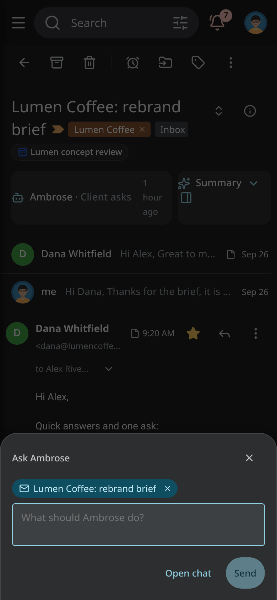

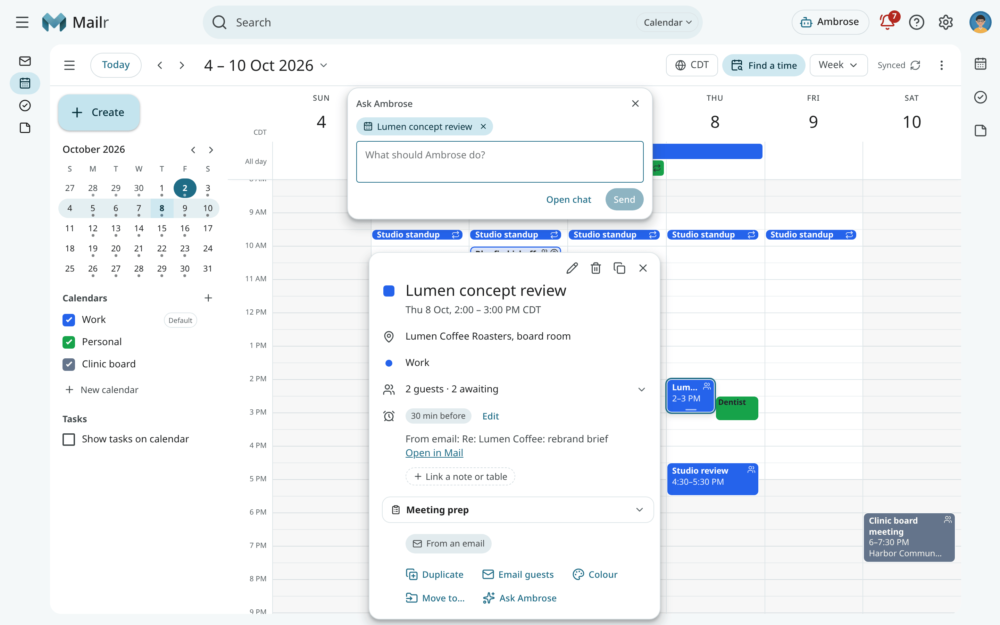

## Ask a question

Type your question and press `Enter`. While Ambrose works, each step is shown ("Searching mail", "Reading “Lumen kickoff”"). You can press **Stop** at any time.

A search asked for again with the same words is not run again: its result cannot change. The steps show it once, with the number of times it was asked ("Searching your tasks ×3"). After two such repeats Ambrose stops searching and answers with what it found, and says so under the answer.

For tasks, words in a question match task titles and notes. For "Deadlines next week", Ambrose finds the tasks due next week; it does not look for the word "deadline" in them.

For "Remind me about the renewal on Wednesday at 6:00", Ambrose makes a new task with that due time and a reminder at it. It adds the reminder to an existing task only when you name that task or are talking about it.

When Ambrose changes something, the step shows what was saved, for example "Changing a task · saved · reminds 2026-10-14 06:00". If a reply says a change was made but no step saved one, Ambrose is asked to correct the reply. If the reply still says so, a note under it reads "This reply says something was changed, but no change was saved in this turn."

For example:

- "What needs my attention today?"
- "What did Lucía ask for?"
- "When is the Bluefin sign-off due?"
- "Summarise my last three emails with Dana."

The answer carries numbered **citations**. Click a number to open the message at the quoted passage, highlighted. Every quote is checked against the message text before it is shown, so a citation always points at words the email contains.

Beside the page, the cited item opens next to the chat. On a phone, the Ambrose panel is hidden while
the item is shown; tap **Back to Ambrose** or go back to return to the chat.

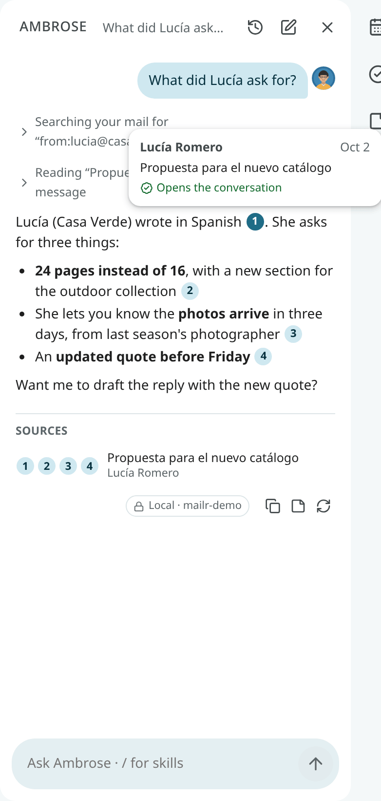

Each reply has buttons to **Copy** it and to **Rerun** it. Press `Shift + r` to rerun the last reply. To change a question you already sent, use **Edit & resend**. Chats are kept on the server and can be reopened later from [Chats](#chats).

!!! info "Mail is never treated as instructions"
    Ambrose reads email as data. It does not follow instructions written inside a message, and it does not open links from other people's mail. A link in your own message can be opened (see [Search the web](#search-the-web)).

## Chats

Earlier chats with Ambrose are under **Chats**, the clock button at the top of the Ambrose panel, next to **New chat**. Each chat shows its title, when it last changed and the start of the latest answer. The chat you have open is marked **Open now**.

- Click a chat to open it with its answers, sources, approval cards, **Used memories** and person chips. Write to go on with it. If Ambrose is still answering in that chat, the answer continues in place.
- Use **New chat** to start a fresh one.
- Each chat has a **⋯** menu (point at the chat to see it) with **Rename** and **Delete**.
- To delete a chat, choose **Delete** in its menu, or press `Delete`. While the message is shown, you can bring the chat back with **Undo**; after that, it is gone for good.
- Use the arrow keys to move through the list and `Enter` to open a chat. Use **Back** or `Esc` to return to the chat you had open.

The list fills the Ambrose panel. On a phone it fills the screen.

### Search your chats

Type in **Search chats** at the top of the list. Ambrose's answers, your questions and the chat titles are searched. The last word you type can be the start of a word, so `invo` finds "invoice". The newest match comes first. Under each chat, the words around the match are shown, with the match marked. When no word matches, part of a word or an address is looked for too.

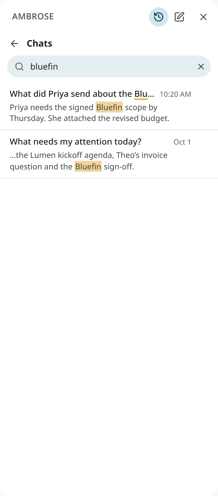

- Press `/`, `Ctrl + F` or `Cmd + F` in the list to go to the search box.
- `↓` goes from the box to the first chat, and `↑` on the first chat goes back to the box.
- `Esc` clears the box. With the box empty, `Esc` returns to the chat.

### Rename a chat

While Ambrose writes the first answer, the chat gets a short title of two to six words made from your first question, such as "Fitness log entry". The title is made by the same model as the chat, so a chat that stays on your local model gets its title there too. If no title can be made, the chat keeps your first question as its name. To give it another name, choose **Rename** in its **⋯** menu, or press `F2` on the chat. Type the name and press `Enter`, or press `Esc` to keep the old one. You can also double-click the title of the open chat at the top of the panel, or press `Enter` on it.

With **Undo** in the message, the old name is put back. A name you give stays when you go on with the chat. Leave the name empty to go back to the short title. To make a new short title, type `/retitle`. A name can be up to 120 characters long.

<!-- covers: agent.chat_list agent.chat_open agent.chat_delete agent.chat_search agent.chat_rename -->

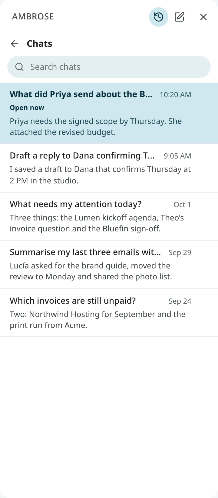

## Draft replies with Ambrose

Ask Ambrose to draft a reply ("Draft a reply to Dana confirming Thursday"). It finds the thread, writes the reply in your voice and saves it in **Drafts**. Click the **draft card** in the chat to open it in the compose window. Nothing is sent.

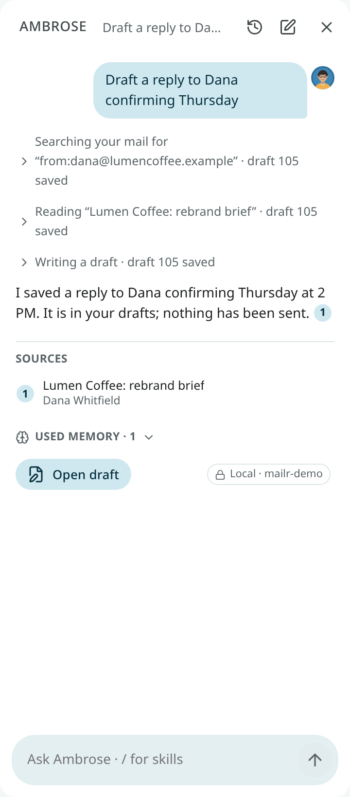

When a compose window is open, its contents are available to Ambrose, including text you have not saved. Ask it to "make this shorter" or "add the meeting time". The change appears in your window at once with **Undo** (see [Editing together](#editing-together)).

If Ambrose suggests different recipients, the recipients are not changed automatically. The proposal is shown in the window, with added addresses highlighted and removed ones struck through. Press **Accept** or **Reject**.

In the compose window, use **Help me write** to do the same for the email in front of you.

## Editing together

A draft can be edited by you and by Ambrose at the same time. The same applies to an event,
a task, a memory or a filter, and to changes from an agent, another browser tab or your phone.

- **Each draft has one window.** When you ask for a change ("make it shorter", "fix that"), the
  assistant changes the draft it wrote or the one you have open. It does not start a new draft
  unless you ask for one. Use **Open draft** on a chat card to bring the open window forward;
  only a draft that is not open yet gets a new window. A card for a draft that changed later is
  marked **Updated since**, and the current text is shown when it is opened.
- **Changes show in place.** The open window is updated at once. The changed paragraphs are
  highlighted for a moment, and the notice **Updated by Ambrose** has **Undo**. With Undo, your text
  is put back and saved as a new change.
- **Typing is not blocked.** While Ambrose writes, the window shows **Ambrose is editing this
  draft…**. Your changes and Ambrose's are combined when they touch
  different paragraphs or fields.
- **When both change the same part**, nothing is overwritten. You are asked, in a bar, to choose: **Use
  mine**, **Use Ambrose's** (or **Use theirs** for an agent or another device), or
  **Compare** to see both versions side by side.
- **Before each answer**, every open editor is saved, so Ambrose works on the
  current text.
- **Wait while I type.** With a draft open, turn on this switch above the message box to
  have the assistant wait until you pause typing (a few seconds at most) before it changes the draft. It is
  off by default.
<!-- covers: draft.live_update draft.resolve_conflict draft.open agent.wait_for_typing -->

The event editor and the task pane behave the same way: a change saved elsewhere appears at once
with **Undo**, and the bar appears when you both changed the same field. In the event editor,
nothing is saved until you click **Save**, because guests can be emailed when an event is saved.
<!-- covers: event.live_update event.resolve_conflict task.live_update task.resolve_conflict -->

In the memory and filter editors in Settings, a change saved while the editor is open is shown,
and with **Save** both changes are kept when they touch different fields.
<!-- covers: settings.memory_live_update settings.filter_live_update -->

## Dictation

When the admin sets up a speech-to-text model, a microphone button appears in the Ask box and Ambrose panel. Click it, speak, and click again (or pause) to stop. The text appears in the box, to be checked before sending.

<!-- covers: agent.dictate -->

A short clip is recorded in your browser and passed to the server's speech-to-text model. The browser's built-in recognition is never used, and the clip is never kept. Clips are limited to two minutes.

In a chat that has read local-only items, and in a new chat about an email or a recording, the clip goes only to a local speech server. Without one, "Not available with local models only" is shown, and the request has to be typed. In other chats the clip may go to a hosted speech service, when your administrator set one up. With **Local models only for me**, every clip stays local. See [Dictation server](../admin/dictation.md) for setup.

## Commands

<!-- covers: agent.commands agent.chat_retitle -->

Type `/` at the start of a message to see the commands, then your skills. Choose one with the arrow keys and `Tab`, or keep typing. `Enter` runs a command that needs nothing more, such as `/new`. Type `/help` for the whole list.

| Command | What it does |
|---|---|
| `/new` (or `/clear`) | Start a new chat. |
| `/chats` *words* | Open your chats, searched for the words if you give any. |
| `/rename` *name* | Rename this chat. |
| `/retitle` | Make a new short title for this chat. |
| `/delete` | Delete this chat. **Undo** brings it back while the message is shown. |
| `/retry` | Write the last answer again. |
| `/copy` | Copy the last answer. |
| `/note` | Save the last answer to a note. |
| `/local` | Keep this chat on your local model from your next message on. A **Local only** chip shows it; once a message is sent this way, the chat stays local. |
| `/model` | Show which model answers in this chat. |
| `/help` | List the commands and your skills. |
| `/task` *text* | Add a task, for example `/task call the bank fri 3pm`. |
| `/event` *text* | Add a calendar event, for example `/event dentist tue 10am for 45 min`. |
| `/remember` *text* | Ask Ambrose to remember something. |
| `/forget` *text* | Ask Ambrose to forget something; you see what is removed. |
| `/today` | Today's calendar, the tasks due, and the mail that needs you. |
| `/week` | This week's events, deadlines, and mail still waiting for your reply. |
| `/summarize` | Summarize the open conversation, with any questions or actions for you. |
| `/reply` *what to say* | Draft a reply to the open conversation. The draft is saved for you to review; nothing is sent. |
| `/waiting` | Mail you sent that is still waiting for an answer. |
| `/find` *words* | Search your mail and list what matches. |
| `/sweep` (or `/cleanup`) *wishes* | Review the whole list on screen and propose what to clear out, on one card. See [Clean up a whole view](#clean-up-a-whole-view). |

The commands from `/task` down are requests to Ambrose: the chat shows what you typed, and Ambrose uses the same tools and approvals as for any question. A command comes before a skill of the same name, and a new skill cannot take a command's name. The Android app has the same list: type `/` at the start of a message and tap a command or skill.

## Clean up a whole view

<!-- covers: agent.review_mail agent.list_view agent.review_filter agent.review_move -->

Ambrose knows which list is on your screen and how many conversations it holds, not only the rows you can see. Ask "clean up this view" or type `/sweep`, optionally with what to keep (`/sweep keep anything about running`).

What "this view" covers:

| On screen | "This view" means | Named in the chat |
|---|---|---|
| An inbox tab with several sections | Every section of the tab, all of each one | **Inbox tab (all sections)** |
| One section shown alone (**Show only this section**) | That section | **Inbox: Unread** |
| A tab with one section | The tab | **Promotions tab** |
| A label, folder, category or search | The whole list | The list's name |

"My inbox" or "my whole inbox" means the Inbox across all its tabs. When your inbox has more than one tab, Ambrose calls it **Inbox (all tabs)**.

Ambrose then reviews every conversation in that scope in the background:

- Starred and important conversations, conversations you replied to, mail from people you write to and invitations are kept without asking.
- A sender whose mail you moved on an earlier review card gets the same move again, without the model (see [Your past choices](#your-past-choices)).
- The rest is judged in batches of 25, with your chat's model and its local-only rule (see [What the model sees](#what-the-model-sees)). An email is read in full only when the first look is not enough.
- The progress line in the chat names the scope and its size as soon as the review starts, for example "Reviewing Inbox tab (all sections): 9 conversations", with how many are checked so far. If the scope is wrong, choose **Stop** at once. **Stop** pauses the review after the batch in progress; **Continue** picks up where it stopped.

When nothing in the scope would change, the review ends with "Reviewed 12 conversations: nothing to change" and no card. The conversations kept without asking (above) stay kept even when you ask otherwise in the command.

Otherwise the review ends in one card, titled with the scope. If you leave the chat, the card waits under the bell (**Approvals**), where you can apply or discard it. It lists the proposed moves (Move to Trash, Archive, Label, Mark read), grouped by sender with counts and sample subjects, then what is kept and why, and what Ambrose could not decide.

Each sender has a move menu, for example **Move to Trash ▾**. Choose another move to send all of that sender's mail in the group there: **Move to Trash**, **Archive**, **Mark read**, **Label** with each label the review could add, or **Keep** to leave the mail where it is. The sender moves to that group and the counts change. A sender with more than one conversation has an arrow: open it to see each conversation with its date and its own move menu. The rows kept as still useful and those Ambrose was not sure about have the same menu, so you can also send one of them to Trash or Archive. What you keep is listed under **kept: you chose Keep**.

Choose **Apply** to carry out the plan with your changes; beside it, the card says how many you changed ("3 changed by you"). **Discard** drops the whole plan; the card then reads "Discarded · nothing changed", and the chat goes on. When three or more of one sender's conversations get the same move, the sender also has **Always …** (for example **Always move to Trash**): it makes a filter that does the same to their future mail, with **Undo**. Nothing changes before you apply. The moves run in the background with **Undo**, like the [Cleanup page](subscriptions-and-cleanup.md).

The Android app shows the same progress line and card, with the same move menus, in the Ambrose chat and on its Approvals screen.

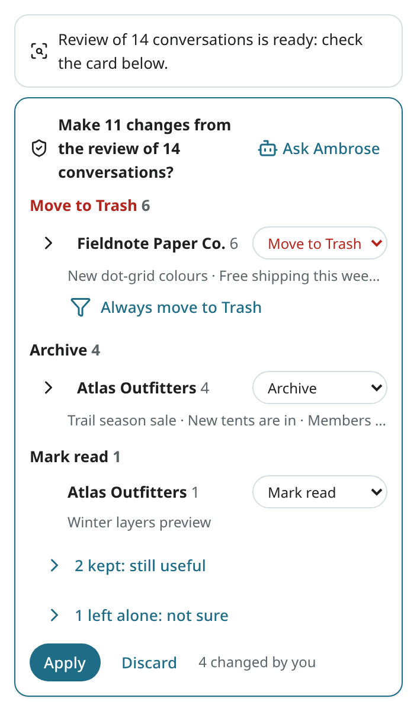

A routine can do the same on a schedule ("every Sunday, review my promotions"). Its review card waits for you in the approvals; a scheduled review never applies anything on its own.

Ambrose can also archive, trash or mark read a whole list at once with exceptions ("archive this view except the three from my bank"). That asks once, on one card, and runs in the background with Undo.

### Your sweep rules

<!-- covers: settings.sweep_rules -->

Under **Settings → Ambrose → Sweep**, write the rules every review follows, in your own words (the setting `sweep_rules`, at most 2000 characters). For example: "Trash promotions and shipping notices once delivered. Archive only receipts, bank and tax mail, tickets and confirmations." The field is saved when you leave it or stop typing.

Below the field, the page shows what each move means by default (Move to Trash, Archive, Mark read, Keep, Not sure). Your rules adjust these meanings and take precedence over them. The conversations kept without asking (starred, important, replied to, from people you write to, invitations) stay kept whatever the rules say.

The rules apply to every review: `/sweep`, a review you ask for in the chat, and a routine's review. What you ask for in one review (`/sweep keep anything about running`) is added after your rules; where the two disagree, the request for that review wins. You can also ask Ambrose to change the rules ("add to my sweep rules: keep school newsletters"); the change waits for your approval like other settings.

### Your past choices

<!-- covers: agent.review_choice_remove agent.review_choice_clear -->

When you change a move on a review card and apply it, the move you chose is remembered for that sender (by address). In later reviews, that sender's conversations get the same move without the model, with the reason "your past choice", and you can change them on the card again. A changed move replaces the one remembered before. A remembered **Keep** lists the conversation as kept. Moves the card proposed and you left as they were are not remembered.

The conversations kept without asking stay kept even when a past choice says otherwise, and a remembered Archive or Mark read is dropped for a conversation that is already archived or already read.

**Settings → Ambrose → Sweep → Your past choices** lists each sender with the move and when it was chosen. **Remove** forgets one; **Clear all** forgets every one. On Android, **Settings → Sweep** (under Ambrose) has the same field with **Save**, the meaning of each move and the same list.

### What the model sees

For each conversation, the model gets one short line: the sender, the subject, the date, the start of the latest message, whether it is unread or out of the Inbox, its category (Primary, Promotions, Social, Updates, Forums or Purchases), its age in days and your labels on it. It also gets two facts about the sender's other mail: whether you read any of it in the last 180 days, and how many of the sender's other conversations are in Trash, archived or still in the Inbox. The text of an email is sent only in the second look, for the conversations the first look could not decide.

## Skills

A skill is a named set of instructions, such as a writing style or a procedure. Type `/` followed by its name in the chat or in Help me write, for example `/formal` or `/concise`. Type `/` to see your skills with their descriptions. A skill you invoke stays active for the rest of that chat and is shown as a chip above the box.

Mailr has built-in skills: `email-basics` (the writing defaults, applied automatically), `formal`, `friendly`, `concise`, `polite-decline`, `follow-up`, `create-skill` and `configure-mailr`. Skills can be edited, added and tried on a sample text. See [Skills](../agents/skills.md).

## Change Mailr by asking

Ambrose can change labels, filters, inbox layouts, signatures and many settings. Ask "make a filter for Circlet notifications" or "switch to the compact density". Changes made at once are shown in the chat with an **Undo** button. Filter, setting and layout changes require approval first.

<!-- covers: agent.match_check -->

Before you approve a filter or a standing order for new mail that Ambrose wrote or changed, its search is tried on your mail of the last 6 months. The card then has a **Matches now** line, for example "191 emails in the last 6 months, the newest “Re: Elevator” on 20 Oct". When the search matches no email, the line says so, and Ambrose checks the search with you before you approve. A common cause is mail from a mailing list: it arrives from the list's address (often `list+name@domain`), not from the person who wrote it, so the search needs the list's address (`to:` or `from:` with the list's domain, or `list:`).

## About you and memory

Open **Settings → Ambrose → About you** to describe yourself to Ambrose. Each field is saved when you leave it:

| Field | Description |
|---|---|
| **Name** | The name Ambrose calls you and signs drafts with. |
| **Role or affiliation** | Used when Ambrose writes replies and reads your mail. |
| **Time zone** | Shown here, set under **Settings → You → Region**. It is used for "today", deadlines and meeting times, and in the calendar too. Ambrose writes times in your clock style from the same page: "5:08 PM" with a 12-hour clock, "17:08" with a 24-hour one. |
| **Languages** | The languages you write and read. Mail in these languages gets no **Translate** bar (see [Translate a message](reading.md#translate-a-message)). |
| **Writing preferences** | Applied to every draft, for example "Short paragraphs. No exclamation marks." |
| **About me** | Anything else about your work and the people you deal with. |
| **Ambrose** | Its name. The name you choose is used throughout the app, on the web and on your phone: in the chat, in notifications and on approval cards, on buttons such as Ask, in the Android apps' tab, launcher shortcuts, Quick Settings tile and widgets (the phone's lists of widgets and tiles to add keep the default name), and as the name of this settings section. Quiet hours, during which notifications from standing orders are held, are also set here. |

Ambrose keeps short **memories**, written to you: "You teach on Tuesday evenings", "Dana is your accountant". It saves one when you tell it something lasting. All memories are on one page, **Settings → Ambrose → Memory**:

- **To review**: suggestions from your mail and your chats. They are not used until you **Keep** them. **Keep all** and **Dismiss all** settle every suggestion at once.
- **About you**: notes about you. The same notes are shown under **Settings → Ambrose → About you**.
- **People**: notes grouped by person. Use **Open card** to open the person's card (see [People & groups](people.md#a-persons-card)).
- **Topics**: notes about organisations, projects, topics and places. Use **Open card** to see the topic's name, other names, domains and notes.

One search box and the kind chips cover every section. Memories come in four kinds:

| Kind | Example |
|---|---|
| **Fact** | Works at Northwind |
| **Preference** | Prefers short replies |
| **Routine** | Teaches Tuesday evenings |
| **Commitment** | Promised João a licence quote. Use **Create task** to turn it into a task. |

With **Add memory**, you enter what to remember, its kind and who it is about (**You**, a person or a topic). Every memory can be edited, pinned and deleted. Memories are separate from your own notes in the [Notes app](notes.md).

With **Learn from my mail** on, Ambrose reads the recent sent mail once a day and suggests memories. Notes you send to yourself are skipped. The line under the page title says when it last learned and how many suggestions are new, or why the last try failed. A failed try is repeated an hour later with the same mail. Use **Learn now** to start a pass at once. With **Suggest memories from chats** on, a lasting statement in a chat ("I'm vegetarian") becomes a suggestion too. Such a memory says **From a chat**, also after you keep it: click it to open that chat at the message it came from. When the chat is deleted, the words stay without a link. A memory Ambrose writes after reading someone else's email is always a suggestion, so no instructions can be planted in its memory through a message.

On Android, the same page opens from the **⋮** menu of the Ambrose tab or **Settings → Ambrose → Memory**, and a person's card from a sender's picture (see [Memory and person cards](../android/assistant-and-sharing.md#memory-and-person-cards)).

### Memory selection

Ambrose does not read every memory for every question. A memory is used only when it fits what you asked:

- it is about a person or topic you name, or about the people of the email you have open or are replying to;
- it shares a word with your question ("What do I **teach**?" finds "You **teach** on Tuesday evenings");
- it is close in meaning to your question ("Who handles my taxes?" finds "Dana is your accountant").

When a local decision model is available on the server, the memories found by words or meaning are checked with it, and the ones that do not help are left out. The check takes a fraction of a second, at the same time as the rest of the question is prepared. Without an answer in time, the memories are used as found.

No memories are used for plain commands such as "add razors to the list", "archive this" or "snooze until Monday", unless they name a person or topic you have memories about ("remind me to send Sam the receipts").

**Pinned** memories are always used, except in plain commands. Pin only what should apply to everything, such as how you sign your emails.

Ambrose also has the list of people and topics you have memories about, without the memories themselves. When a question touches one of them, it looks the memories up (the step "Checking what I remember about …" in the answer).

Under an answer or a Help me write draft, **Used memories · 2** lists the memories that went into it, including the ones Ambrose looked up during the answer. Memories that were left out are not listed. Click one to edit it, or delete it. For sorting new mail, standing orders, reply suggestions and meeting prep, only the memories about the people in an email or a meeting, and pinned preferences, are used. Memories learned from local-only mail are sent only to local models.

<!-- covers: memory.learning_status memory.learn_now memory.accept_suggestion memory.dismiss_suggestion memory.add memory.make_task memory.topic_edit memory.used memory.open_chat person.card -->

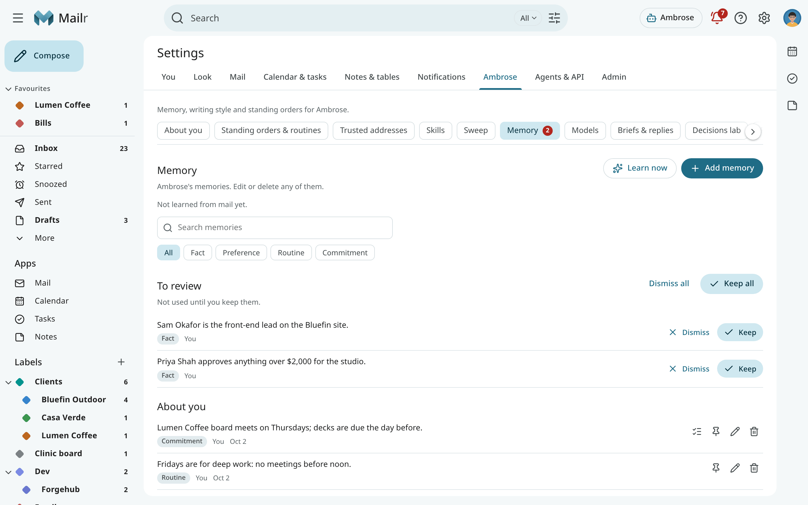

## Choose your models

**Settings → Ambrose → Models** shows which model is used for each kind of work:

- **Assistant and writing**: chat, summaries, briefs, drafting help and standing-order errands.
- **Sorting and decisions**: importance, categories and the yes/no questions of standing orders.

With "Server default", the admin's choice is used. Any other model the admin has made available can be selected. Mail from local-only accounts always stays on a local model, whatever the selection.

## Local models only

**Settings → Ambrose → Models → Local models only** has one switch: **Local models only for me**.
With it on, only the local models of your server are used for your mail, notes and tables, for
Ambrose and every other model feature (summaries, translation, sorting new mail, the search index).
With the switch, things can only be made stricter: mail from accounts marked
local-only, and notes and tables marked local-only, stay local whether it is on or off.

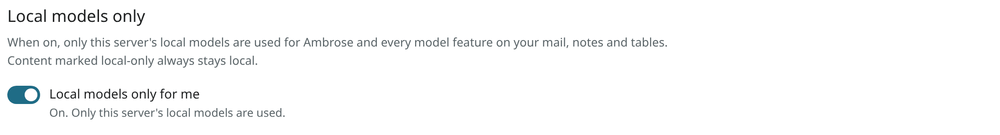

- When a kind of work has no local model, it is stopped, with the message "Not available with local
  models only". That work is listed below the switch.
- New notes, lists and tables you make while it is on are marked local-only. When they are shared,
  they are kept local for other people's Ambrose too.
- An administrator can set local models only for everyone on the server. The switch is then shown as
  on and locked, with the reason: "Your administrator set local models only for everyone on this
  server". It cannot be locked off by any setting, so each user can always turn it on.

<!-- covers: settings.local_models_me -->

## Local and hosted answers

Every answer from Ambrose ends with a small chip: **Local · qwen3** or **Hosted · gpt-5**. Hover over
it, or focus it, to see the endpoint. Local means the model runs on the server's own network, and nothing
left that network. Hosted means this chat was sent to that provider.

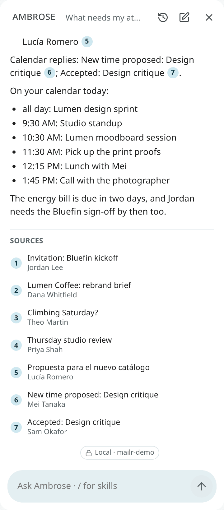

<!-- covers: agent.answer_model -->

## Model use

**Settings → Ambrose → Models → Model use** lists, for the last 30 days, the model used for each
kind of work: Ambrose, summaries, translation, sorting new mail, categories, standing orders, the
search index and the rest. Each row shows whether the model was local or hosted, and how many times it
was used.

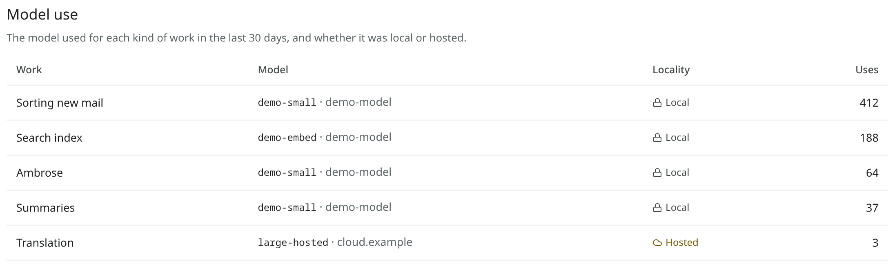

<!-- covers: settings.model_use -->

## Search the web

When the admin has set up web search and the access policy allows it, Ambrose can look things up on the internet: "How long should coffee rest after roasting?", "When does the city library open on Sunday?". It searches, reads a page or two from the results when more detail is required, and answers with web citations.

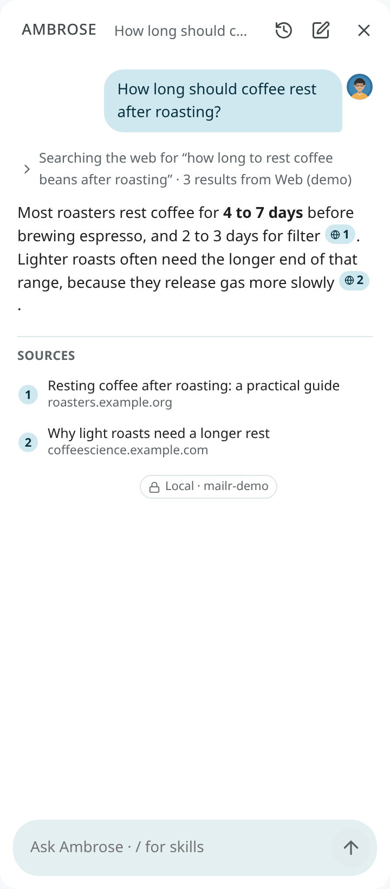

- **Every query is shown.** The steps show the exact words sent to the search service ("Searching the web for “how long to rest coffee beans after roasting”").
- **A web citation has a globe**, the page's title and its site. Click it to open the page in a new tab, outside Mailr.
- **Local-only mail is excluded.** Once local-only mail has been read in a chat, web search is off in that chat. Start a new chat to search the web.
- **Links in other people's mail are never opened.** Ambrose reads pages its search found, links you wrote in the chat, and links in your own email.
- **Your own links can be opened.** In a note to yourself, a link you shared from your phone with **Send to self**, or a reply you wrote, Ambrose may open the links you put there: "Summarise the Reddit post I sent myself" works, in a chat or a standing order. It must be provably your message: one you sent from Mailr, one with a copy in your Sent folder, or one whose sender check (DKIM or DMARC) passed for your address. A message that only shows your address in From is not enough. Links in the quoted or forwarded part of your message are not yours, and they are never opened. The page's text is still treated as data.
- **Queries can require approval.** Searches are run without a click unless you set **Search the web and read pages from the results** to **Ask me** under **Settings → Agents & API → Permissions**; Ambrose then shows each query on an approval card.

<!-- covers: agent.web_search agent.read_page agent.read_own_link -->

Setup is described in [Web search](../admin/web-search.md).

## Local-only mail and Ambrose

Mail from an account marked **local-only** is never sent to a hosted model. Once local-only mail has been read in a chat, a local model is used for every later step in that chat. If no local model exists, Ambrose stops and states the reason.

What Ambrose writes in such a chat stays local too. Notes, lists and tables it makes are marked local-only. A task, a skill, a rewritten brief, or a draft that would not be saved on the local-only account is held for your approval first, and the card gives the reason.

When a request names someone ("Remind me to call Dana"), Ambrose is shown the people you correspond with who match that name. A hosted model is not shown a name or an address that only local-only mail contains.
