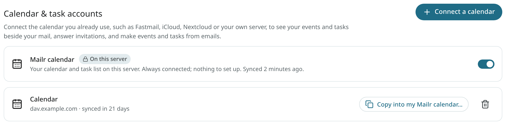
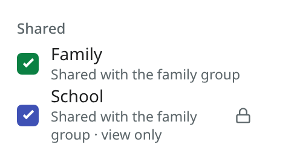
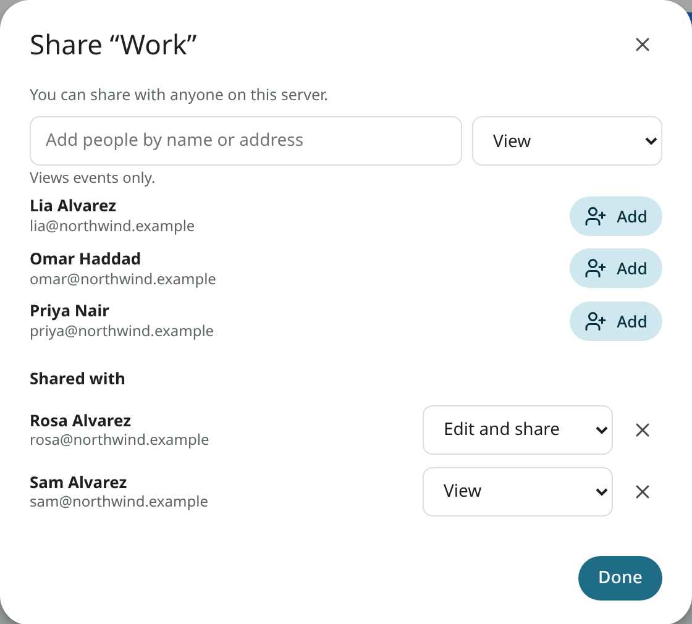
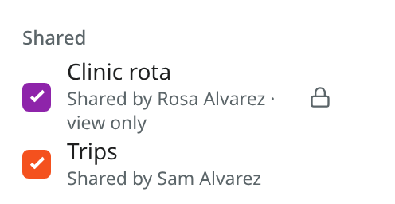
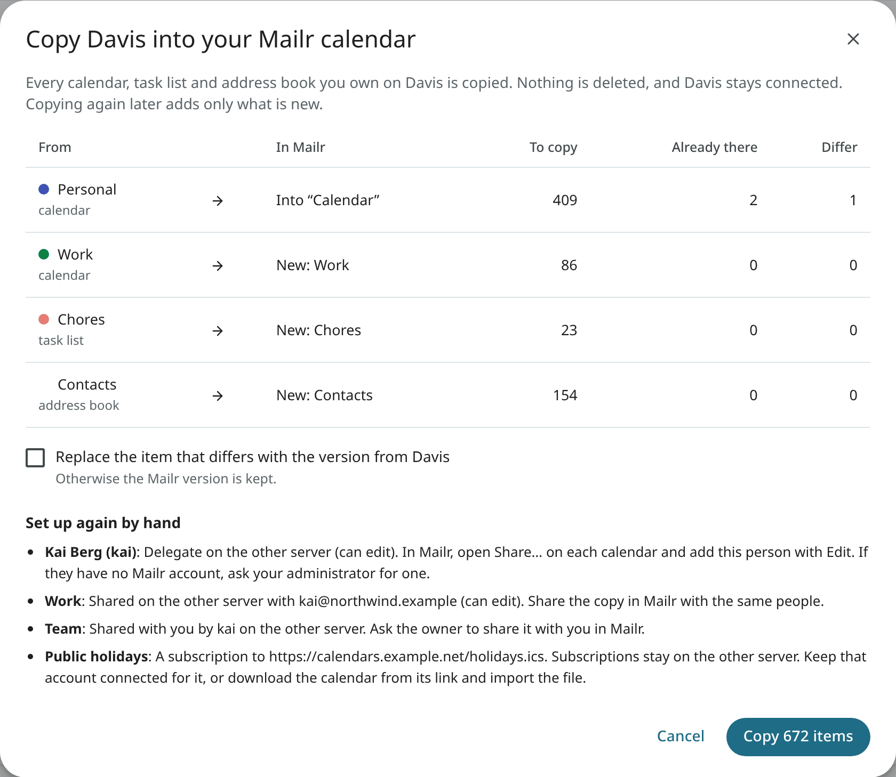
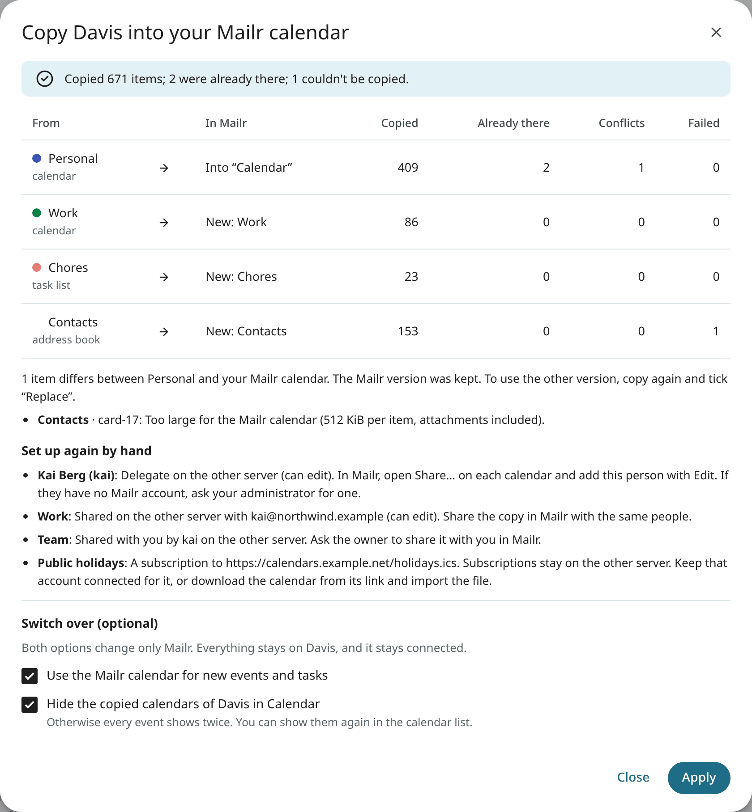
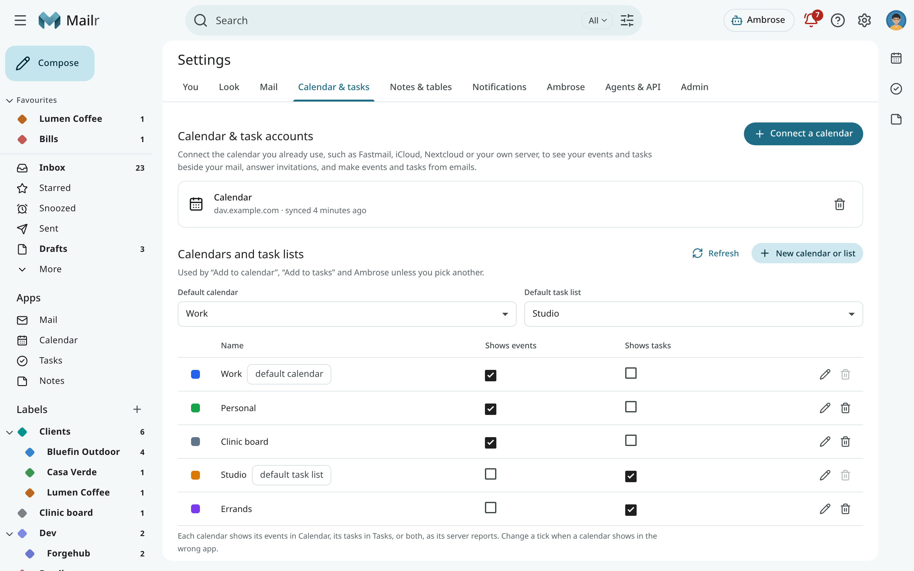
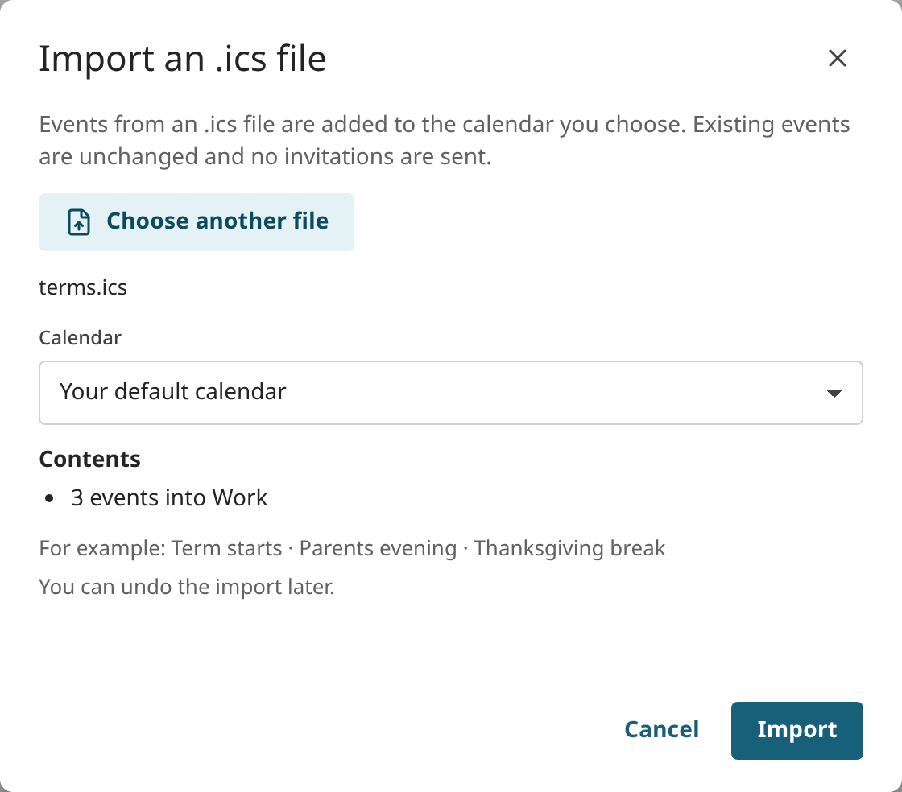
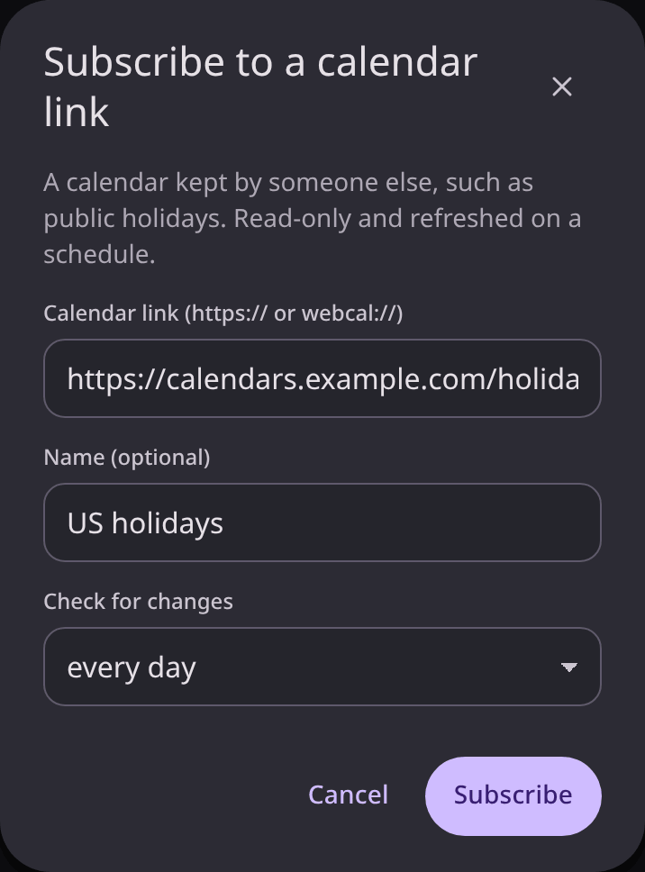

# Calendar sharing and import

This page covers the Mailr calendar on the server, sharing, connecting another CalDAV account, importing files,
calendar links and moving calendars into Mailr. Using the calendar day to day is covered in
[Calendar](calendar.md).

## The Mailr calendar

The administrator can provide every user with a calendar on the Mailr server itself. It is then
listed as **Mailr calendar** under **Settings → Calendar & tasks**, with the badge **On this
server**. It is connected from the start; no setup is required.

- It holds a calendar named **Calendar** and a task list named **Tasks**. They are your default
  calendar and default task list, unless you already used another calendar for events or tasks.
- You can rename, recolour and add calendars and task lists in it, as in any other account.
- It cannot be removed, and its address and sign-in cannot be changed. To hide it,
  turn off the switch on its card. Its events and tasks are then hidden, and they stay on the
  server. Turn the switch on again to bring them back.
  <!-- covers: calendar.builtin_hide -->
- Existing calendars can still be connected next to it.

### Shared group calendars

The administrator can attach calendars to a group, such as a family or a team. They are listed
under **Shared** in the calendar list, each with the line **Shared with the … group**.

- In most group calendars every member can add and change events.
- Some are view only: they are marked **view only** and have a lock. Only the editors
  named by the administrator can change it. A view-only calendar is not offered
  when you create an event, and Ambrose does not write into it either.
- You can hide a group calendar with its box, like any calendar, and give it a colour of your
  own. Other members keep theirs.
- A group calendar cannot be renamed or deleted by members. Only the administrator can.
- When you leave the group, its calendars are removed from your list. Your own calendars stay as they are.
<!-- covers: calendar.group_shared -->

### Share a calendar

Your own calendars in the Mailr calendar can be shared with other people on this server. The
administrator sets who calendars can be shared with: anyone on the server, only people in the
same groups, or nobody.

1. In Calendar, open the menu of a calendar in the left column (the three dots) and choose
   **Share…**. In **Settings → Calendar & tasks** you can use the share button next to the
   calendar instead.
2. Type part of a name or an address to find someone.
3. Choose what they can do, then select **Add**:
    - **View**: they see every event and change nothing.
    - **Edit**: they add, change and delete events.
    - **Edit and share**: they edit, and they can share the calendar with other people too.

- To change what someone can do, choose another level next to their name.
- To stop sharing with someone, select the cross next to their name. The calendar is removed from
  their list within a minute or two.
- Under your calendar, the calendar list shows **Shared with 2 people**, for example.
- Only calendars can be shared, not task lists. Calendars from other accounts you connected
  (Google, Fastmail, your own server) are shared in those services, not in Mailr.
- If the administrator later limits sharing, the people you already shared with keep the
  calendar until you stop sharing it.
<!-- covers: calendar.share -->

### Calendars shared with you

When a calendar is shared with you, a line is shown above the calendar list, for example
**Rosa Alvarez shared “Clinic rota” with you.** Select the cross to dismiss it. If Mailr is open,
a short message also appears. No email is sent about it.
<!-- covers: calendar.share_notices -->

The calendar is listed under **Shared**, with the line **Shared by** and the owner's name.

- If you can only view it, it is marked **view only** and has a lock. It is not offered
  when you create an event, and Ambrose does not write into it either.
- You can hide it and give it a colour of your own. The owner and other people keep theirs.
- You cannot rename or delete it. Only the owner can.
- If the owner allows resharing, **Share…** appears in its menu, and you can add people within
  the same limits as your own calendars. You cannot change your own level.
- Ambrose reads shared calendars like the user's own, and it never shares a calendar.
<!-- covers: calendar.user_shared -->

### Move your calendars into the Mailr calendar

If you already keep your calendars on another server, such as Davis, Nextcloud or Fastmail, you
can copy them into the Mailr calendar. Connect that account first (see
[Connect a calendar](#connect-a-calendar)). Then:

1. Open **Settings → Calendar & tasks**.
2. On the card of that account, click **Copy into my Mailr calendar…**.
3. Read the preview. It lists each calendar, task list and address book, where it goes in the
   Mailr calendar and how many items it holds. A calendar with the same name as one of yours is
   merged into it. Any other one becomes a new calendar with the same name and colour.
4. Click **Copy**. A progress bar is shown during the copy. Closing the window does not stop the
   copy.

Details of the copy:

- Events are copied with their repeats, the changed and cancelled dates of a series, time zones,
  reminders, guests and links to attachments. Tasks are copied with their subtasks, and contacts
  with their photos.
- Nothing is deleted, here or on the other server. The other account stays connected and
  unchanged.
- The copy can be repeated later. Items already there are skipped.
- When an item differs between the two places, the version in the Mailr calendar stays. These
  items are counted under **Differ** in the preview. Tick the **Replace** box below the table to take
  the other server's version instead.
- Some things cannot be copied. They are listed under **Set up again by hand**, each with
  instructions: people you shared a calendar with, assistants who could act for you (delegates), calendars
  other people shared with you, subscriptions to calendar links, and invitations still waiting on
  the other server.
<!-- covers: calendar.migrate -->

After the copy, the same events are shown twice, once from each account. To avoid the duplicates, tick one or
both choices under **Switch over**. Both are off until you tick them, and both apply to Mailr only:

- With **Use the Mailr calendar for new events and tasks**, the copies become your default
  calendar and default task list.
- With **Hide the copied calendars of …**, the other account's calendars are hidden in Calendar. Show them
  again with their boxes in the calendar list.

Click **Apply**. The other account can be disconnected later.
<!-- covers: calendar.migrate_cutover -->

## Connect a calendar

1. Open **Settings → Calendar & tasks**.
2. Choose **Connect a calendar**. In the dialog "Connect a calendar", enter the **Calendar server address** (the CalDAV address the provider gives for other apps, or the server's address, for example `https://dav.example.com/`), your **Username** and your **Password**. A name left empty takes the server's name, such as fastmail.com.
3. Save. Your calendars and task lists are found automatically.

Several accounts can be connected. Each account card shows the server's host, not the full address. The calendars and task lists of each one are listed on the same
settings page, where they can be renamed, recoloured or deleted. The columns **Shows events** and **Shows tasks** say where each calendar appears: each calendar shows its events in Calendar, its tasks in Tasks, or both, as its server reports. Change a tick when a calendar shows in the wrong app. If the same server also holds
address books, contacts are read from it too (see [People & groups](people.md)).

## Import and calendar links

<!-- covers: event.import_ics calendar.subscribe calendar.unsubscribe import.undo -->

The **⋮** at the right of the calendar's top bar has **Import an .ics file…**, **Subscribe to a
calendar link…** and **Calendar settings**.

Use **Import an .ics file** for a calendar file, for example a Google Calendar export (Google
Takeout, or **Settings → Import & export** in Google Calendar). Choose the file and the calendar
it goes into. Before anything changes, a summary shows how many events come in and how many are
already in the calendars, with a few examples. Click **Import** to add them. Events already in the
calendars are left alone, and no invitations are sent. The message afterwards has **Undo**, to
delete every imported event.

Use **Subscribe to a calendar link** to add a calendar that someone else keeps, such as public holidays
or your children's school terms. Paste its address (`https://…` or `webcal://…`), optionally give it a
name, and choose how often it is checked for changes (every 6 hours to once a week). It is listed
in the left column with your other calendars, read-only: its events cannot be edited, and they do
not count as busy when people look for a free time. Its menu shows where it comes from, and has
**Refresh now** and **Remove**. The link is fetched by the server, under the same guard as every
other outside address the administrator allows. Without a calendar yet, Calendar shows "No calendar connected yet" with **Connect a calendar** and **Subscribe to a calendar link…**.

A few limits apply to calendar links:

- The address must start with `https://` or `webcal://`. A plain `http://` address works only for
  a calendar on the local network, and only when the administrator allows private addresses. A
  link that redirects from `https://` to `http://` is refused.
- The file can be at most 5 MB, with at most 10,000 events, and the link may redirect at most 5 times.
- At most 30 calendar links can be subscribed to.
- The feed's own reminders are not used. Its events get your default reminders, as set in
  **Settings → Calendar & tasks**.
- A time zone the file defines for itself is used only when it is simple. Otherwise its events use
  that zone's fixed offset. See [Invitations](invitations.md#time-zones-in-invitations).
- When a link fails, its next try waits longer: a day after the first failure, then twice as long
  after each failure in a row, up to a week. **Refresh now** tries at once.

When an email has a calendar file that is not an invitation, such as a conference schedule,
**Add to calendar** is shown in the reader, with a calendar picker. One event is added for each
event in the file. See [Invitations](invitations.md#calendar-files).

To export, use **Download .ics first** in a calendar's delete dialog, in the left column or in
**Settings → Calendar & tasks**. On Android, the calendar and task list menus also have an export.
