# Calendar

The Calendar app shows the Mailr calendar on the server and the calendars of any connected CalDAV
account (Radicale, Nextcloud, Davis or a hosted one). Changes made in Mailr are shown in other
calendar apps, and changes made there are shown in Mailr within seconds. Sharing,
connecting and importing calendars are covered in [Calendar sharing and import](calendar-sharing.md).

Without a calendar, the Calendar app shows "No calendar connected yet" with **Connect a calendar** (it opens **Settings → Calendar & tasks** with the connect form) and **Subscribe to a calendar link…**. Under it, an admin sees "Built-in calendars are off…" with **Turn on built-in calendars**; a member sees "No calendar of your own yet? Ask whoever runs this Mailr server to turn on built-in calendars…".

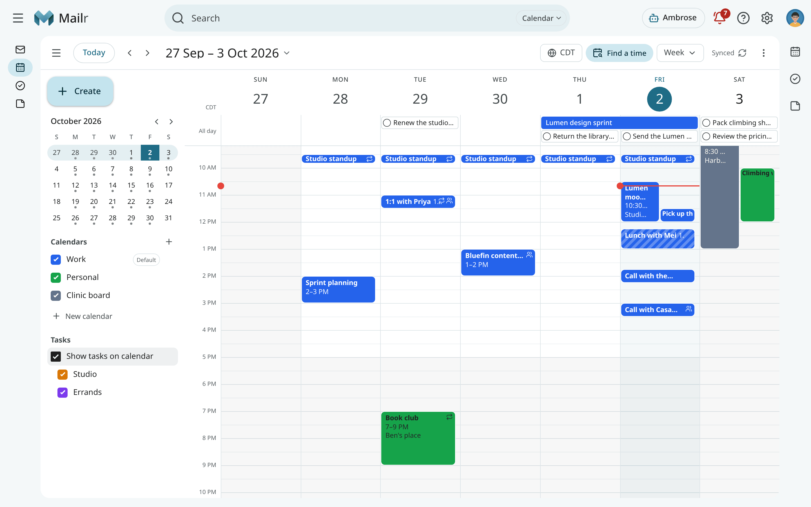

## Open the calendar

=== "Web"

    Click **Calendar** in the navigation, or press `g` then `c` from anywhere. The address of a
    view is stable, so a week such as `/calendar/week/2026-10-01` can be bookmarked.

=== "Android"

    Tap **Calendar** in the bottom bar or the navigation rail. Swipe sideways to change the
    period, and pinch to change the hour height in Day and Week.

Each style has its own frame for the calendar. Event details are shown in a popover in Classic
and Desk, in the reading pane in Workspace, in a centred card in Focus and in a bottom sheet in
Cards. The actions are the same everywhere.

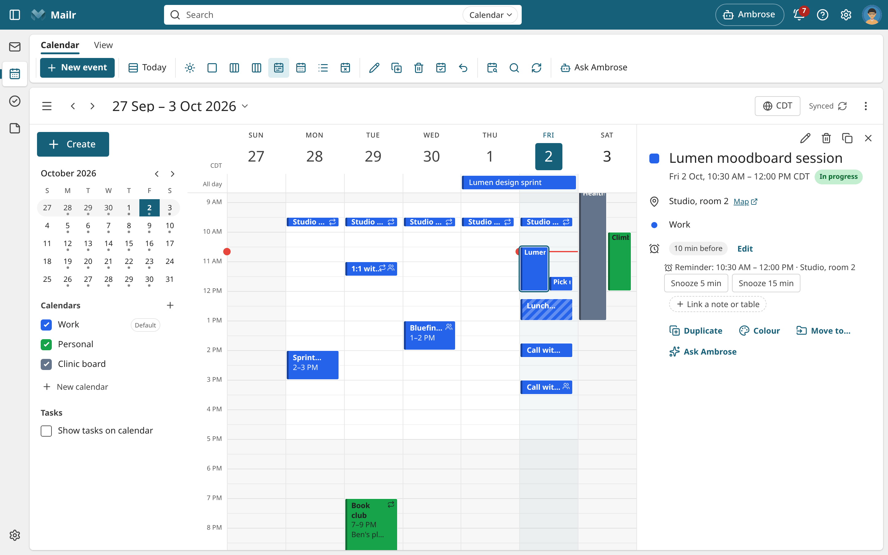

## Today

The first view is **Today**, one page with everything for the day.

- The date and a greeting for the time of day, with a one-sentence summary of the day ("3 events,
  2 tasks due and 1 reply to wait for.").
- A line across the day's hours with your events on it in their colours, and a mark at the
  current time. Click an event on the line to open it.
- **Agenda**: today's events in order. Click one to open its details. Cancelled events and the
  ones you declined are left out.
- **Tasks due**: tasks due today, and overdue ones marked **Overdue**. Click the circle to
  complete a task; **Undo** is shown for a few seconds. Click the title to open the task in Tasks.
- **Waiting on a reply**: conversations where you set **Remind me if no reply** and nobody
  answered (**No reply**), and follow-ups due today. You are asked again in three days;
  to clear an item, use **Archive** (or **Stop waiting**). Click the subject to open the conversation.
- **Approvals** and **Missed reminders**, which can be decided and handled there, as in the bell.

<!-- covers: calendar.today_view -->

A section is shown only when it has something in it. Use the arrows or `j` and `k` to move to the
next or previous day; the page then shows that day's events and the tasks due on it.

The last view used is remembered on every signed-in device. Choose **Today** in the
view menu, or press `h`, to come back to it.

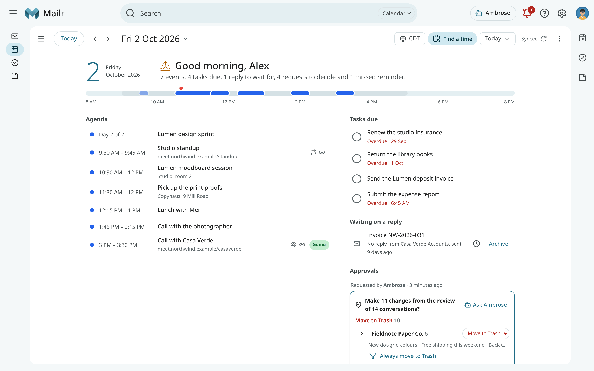

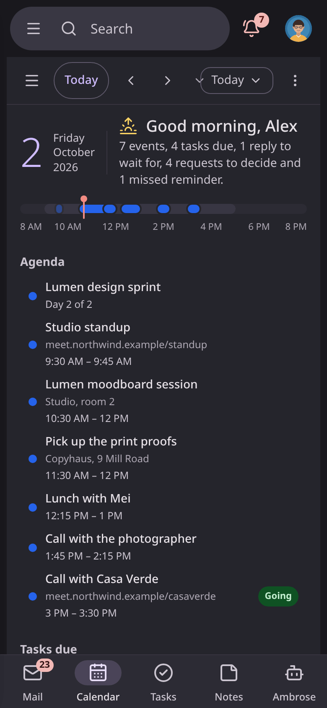

## Views

| View | Key | Contents |
|---|---|---|
| Today | `h` | The day at a glance (see [Today](#today)). |
| Day | `d` | One day with an all-day strip, an hour grid and a line at the current time. |
| 3 days | `x` | Three days side by side. |
| Work week | `o` | Your working days. |
| Week | `w` | Seven days from your first day of the week. To hide Saturday and Sunday, use **Hide weekends** in the view menu. In a phone-sized browser window, Week shows three days, as 3 days does. |
| Month | `m` | A month grid. Multi-day events span the cells; Click "+3 more" to open the whole day. |
| Schedule | `a` | A continuous list of the days that have something on them. |

Calendar opens on the last view used (`calendar_view`), and on Today the first time. Press `t` for today, and `j` or `k` (or the arrow buttons) for the next or previous period.
Click the period title to jump to another month. Press `g` and type a date, such as `g 12 dec`,
to go straight there. Press `[` to show or hide the left column.

### Moving between events from the keyboard

Press Tab to move the focus in the usual order: into the events once, then on to the next part of
the page. Inside the events, use the arrow keys to move from one event to the next:

| Key | Day and week | Month | Schedule |
|---|---|---|---|
| `←` and `→` | The previous or next event | The previous or next event | The previous or next row |
| `↑` and `↓` | The event above or below on the same day | The first event a week earlier or later | The previous or next row |

With no event focused in the day and week views, you move the selected time slot with the arrow
keys instead; press Enter there to create an event. In a focused button or field, the arrow keys
work as usual.

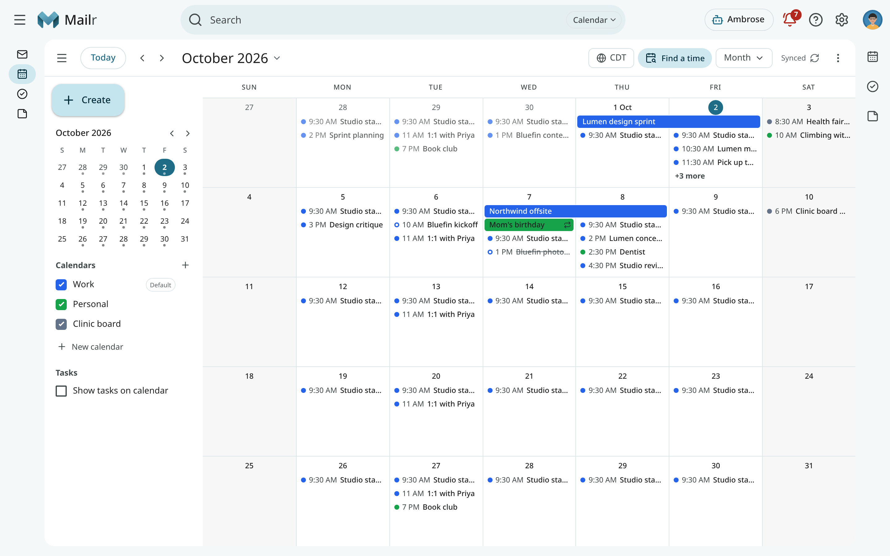

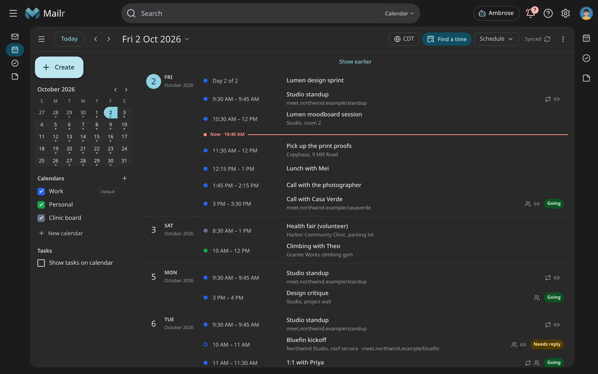

Tasks with a due date are shown in the grid as small checkbox chips. To turn them on or off per
task list, use **Show tasks on calendar** in the left column.

The time zone chip in the header has two tabs. With **Show times in**, the calendar is shown
in another zone for a while, for example during travel. With **Second zone**, a second time
column is added.

## Calendars in the left column

The left column holds the mini-month and your calendars, grouped by account. Each calendar has a
colour, a visibility checkbox and an options menu.

- Tick or untick the checkbox to show or hide a calendar. The choice is kept on your other
  devices too. On Android, the drawer has the same switches.
  <!-- covers: calendar.toggle_visibility -->
- **Alt+click** a checkbox, or choose **Show only this** in its menu, to hide every other
  calendar. Choose **Show all** to bring them back.
  <!-- covers: calendar.show_only -->
- Use **Colour** to change the calendar's colour. The colour is saved on your CalDAV server when
  the server supports it, and kept in Mailr otherwise.
  <!-- covers: calendar.color -->
- Use **Rename…** to change its name on the server.
  <!-- covers: calendar.rename -->
- Use **Default reminders…** to set the reminders every new event in this calendar starts with.
  <!-- covers: calendar.default_reminders -->
- Choose **Default** to make it the calendar new events go to. The default calendar is marked in
  the list. You can
  also choose it under **Settings → Calendar & tasks → Default calendar**.
  <!-- covers: calendar.set_default -->
- Use **Delete…** to remove the calendar and every event in it from the server. Deletion is confirmed with
  its name. The default calendar and the last remaining calendar cannot be deleted.
  <!-- covers: calendar.delete -->
- Use **Refresh** to load the calendar from the server again.

Click **New calendar** (the + next to **Calendars**) to create one. Choose the account, a name, a
colour and whether it holds **Events**, **Tasks** or **Events and tasks**.
<!-- covers: calendar.create -->

!!! tip "Keep a copy before you delete"
    The delete dialog has **Download .ics first**. With it, the whole calendar, with every event,
    repeat rule and exception, is saved as one `.ics` file that can be imported anywhere.
    <!-- covers: event.export_ics -->

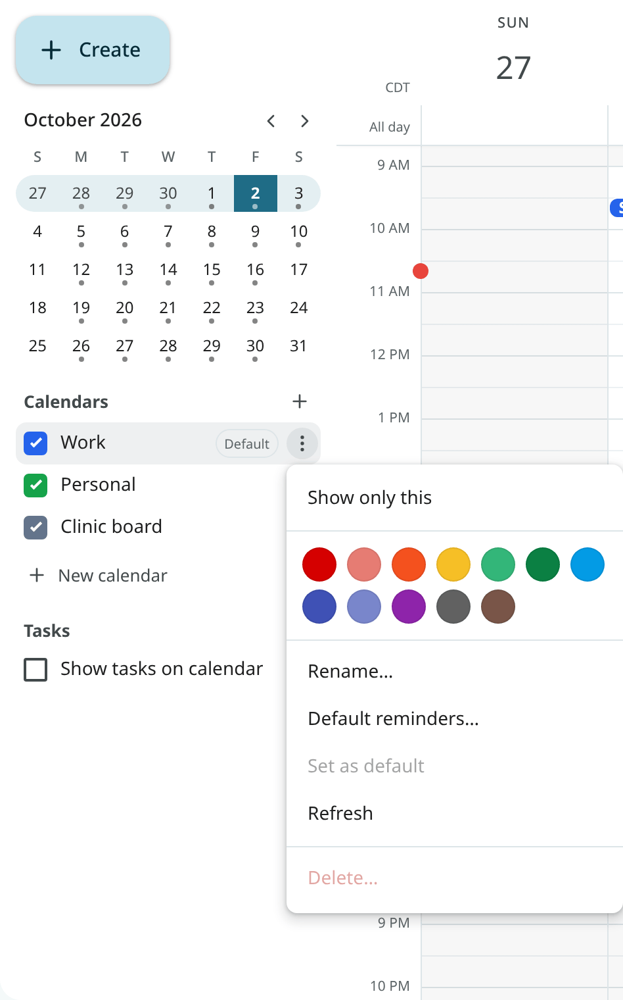

Press `r`, or click the sync status in the header, to read every calendar from the server now.
On Android, pull down to refresh. The header shows "Synced 4 min ago" when sync falls behind.
<!-- covers: calendar.sync -->

## Create an event

An event can be created in several ways:

- Click an empty slot to open quick create at that time, with the default length.
- Drag over empty space to choose the start and end. Times are snapped to 15 minutes by default
  (`calendar_snap`).
- Click or drag in the all-day strip or the month grid for an all-day event.
- Press `c` to open quick create at the next half hour.
- Click **Create** in the left column and choose **Event** or **Task**.
- On Android, tap the + button.

<!-- covers: event.create -->

Quick create takes one line of plain text. Type `Lunch with Mei fri 12:15 at Café Luna`
and the date, time and place are picked out, highlighted and shown as chips under the line. Words
that are not recognised stay in the title. Press Enter to save, or Ctrl+Enter (or
Shift+Enter) to open the full editor with everything carried over. See
[Quick add](quick-add.md) for the full grammar.

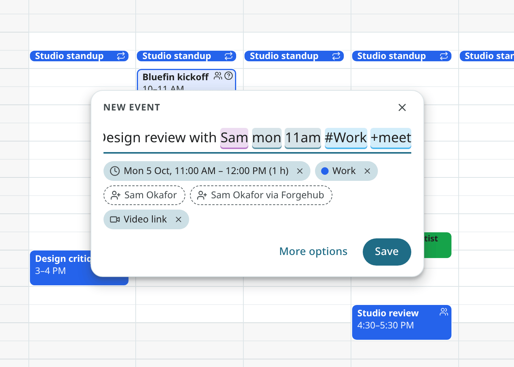

When an event overlaps another, an "Overlaps" line is shown in quick create and the editor.
Saving is still allowed. The line is turned off with `calendar_conflicts`.

## The event editor

The full editor has every field of an event:

| Field | Description |
|---|---|
| Title | The event's name. |
| When | Start date and time, end date and time, all-day, and separate start and end time zones. Dates such as "tom 3p" are accepted. |
| Repeat | Daily, weekly, monthly, yearly or a custom rule, with an end date or a count. An event saved by another app with a rule that repeats far too often to list is shown with its first occurrence only. |
| Guests | People to invite, each optional or required, with their answer. |
| Location | A place, with addresses suggested from your contacts. |
| Video | Use **Add video link** to add a meeting link. |
| Calendar | Which calendar the event is in. |
| Colour | A colour for this event only. |
| Show as | Busy or Free. |
| Visibility | Default or Private. |
| Reminders | When reminders are sent. |
| Description | Notes, shown with clickable links. |

Save with Ctrl+Enter. If you close the editor with unsaved changes, you are asked first. After an
accidental close, the draft is restored when the editor is opened again.
<!-- covers: event.edit -->

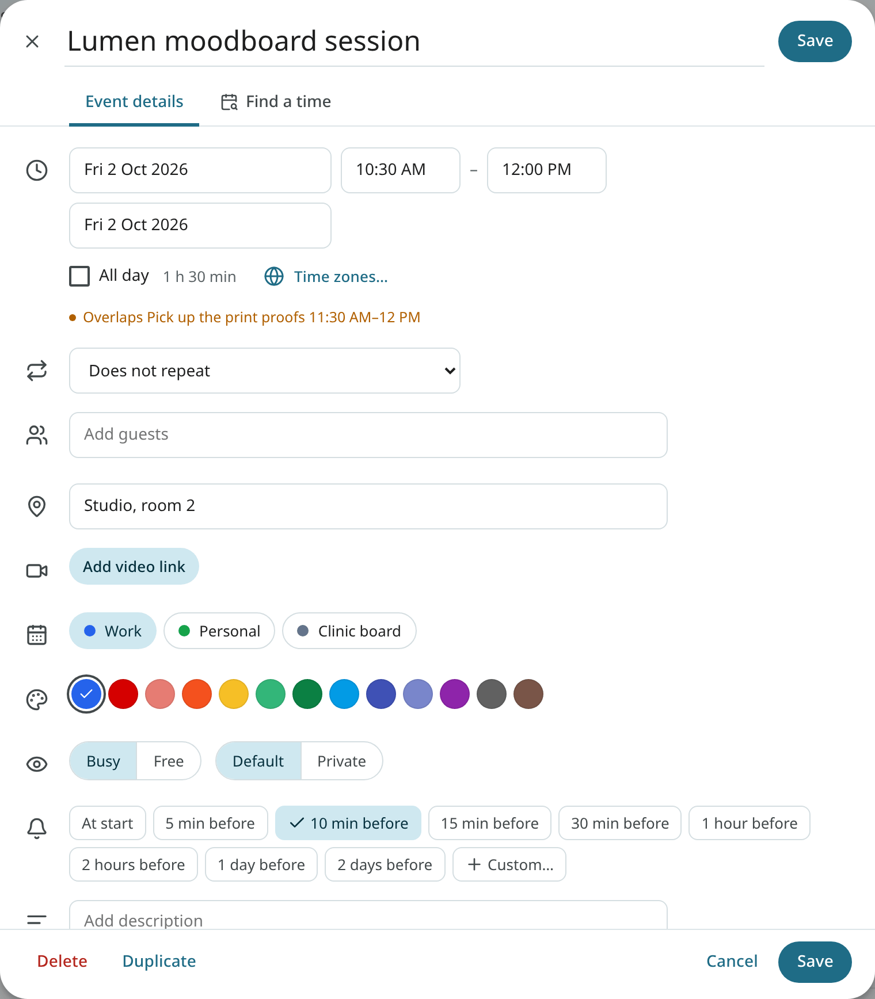

### Location from your contacts

Typing in the location field brings up the postal addresses on file: the guests' addresses first,
then those of the most frequent correspondents. The addresses come from the address book and from
accepted signature details.
<!-- covers: event.suggest_location -->

### Video calls

Use **Add video link** to put a meeting link in the event. The link is built from a template in
your calendar settings (`calendar_video_template`), where `{id}` is replaced by a fresh room name.
The default template is set up for a free Jitsi Meet room.
<!-- covers: event.add_video -->

When a meeting with a link is about to start, its block has a **Join** badge, and the event
details, the reminder and the phone's full-screen alert all have **Join**. Select Join to open the link.
A meeting link is an https address on a meeting service's own site (Google Meet, Zoom, Microsoft
Teams, Jitsi Meet, Whereby, Webex, BlueJeans or GoTo Meeting, including their subdomains such as
`us02web.zoom.us`). Any other https address in the event's URL field is shown as **Join on
&lt;site&gt;** in the event details, so the destination is shown before the link is opened.
<!-- covers: event.join -->

### Colours

Every event has its calendar's colour. To give one event its own colour, use **Colour** in the
editor or the event details. Choose **Calendar colour** to go back.
<!-- covers: event.set_color -->

### Guests

Add guests in the **Guests** field. Type a name, an address or the name of a
[contact group](people.md#groups). When you save an event with new guests, you are asked whether
to send them invitations. Invitations are sent from your own address under the same send rules as
your mail.

An address still typed in the field when you click **Save** is added as a guest. If the field holds text that is not an address, the event is not saved and a note appears at
the field. Choose the person from the list, or type the full address.
<!-- covers: event.invite -->

Click × next to a guest to remove them. That person is sent a cancellation when you save.
<!-- covers: event.uninvite -->

Use **Email guests** to open a new message to the guests, with the event's title as the subject and a
link to the event. It goes to everyone, to those who said yes, or to those who have not answered, as chosen.
<!-- covers: event.email_guests -->

## Event details

Click an event to see its details: the time (in both zones when they differ), the repeat rule,
the place with a map link, the calendar, the organiser and guests with their answers, your own
answer, the reminders, the description and any linked email.

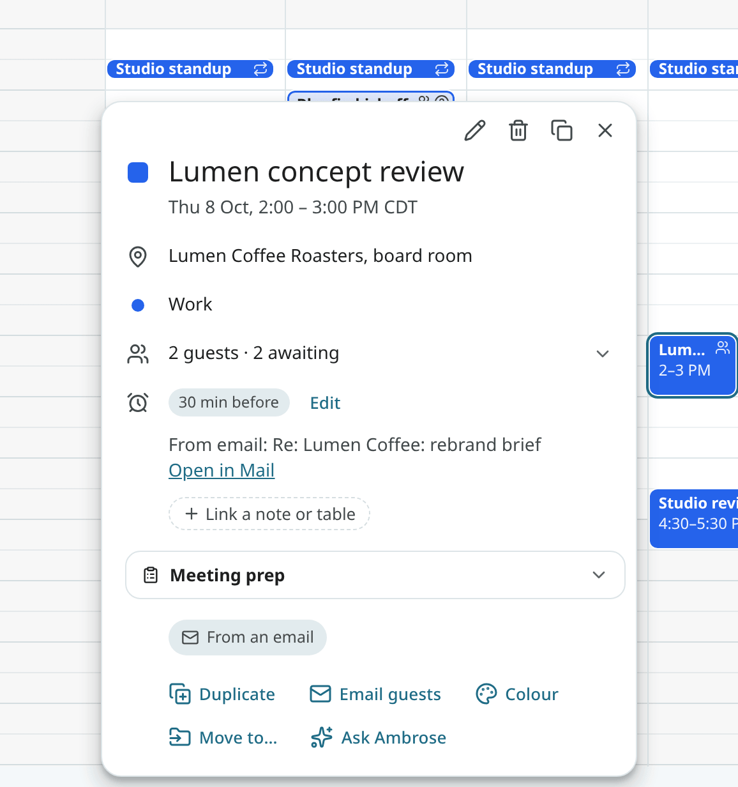

From the details you can:

- **Edit** (`e`) to open the editor.
- **Delete** (`#`). For a repeating event you are asked whether you mean this event, this and
  following events, or every event.
  <!-- covers: event.delete -->
- **Duplicate** (Ctrl+D) to open the editor with a copy. Guests are kept but not invited until
  you save.
  <!-- covers: event.duplicate -->
- **Move to calendar** to move the event, or a whole series, to another calendar of the same
  account.
  <!-- covers: event.move_calendar -->
- **Cancel event** when you organise a meeting with guests. The event stays in your calendar,
  marked cancelled, and the guests get a cancellation with an optional message.
  <!-- covers: event.cancel -->
- Open the **linked email** when the event came from a conversation. The chip shows the subject;
  click it to open the conversation.
  <!-- covers: event.open_email -->
- **Ask Ambrose** to open Ambrose with this event attached.

A meeting recording of the event is also shown in the details. See
[Recordings](recordings.md#recordings-in-the-calendar).

## Meeting prep

An upcoming event with guests has a **Meeting prep** section in its details. Click it to gather
the material for the meeting in one place:

- **Last time**: the recording of the previous meeting in the series, or of an earlier meeting
  with the same title and people, with the first line of its summary. Below it are the action
  items you made into tasks from that recording, and how many of them are done. A Speakr account is
  required for this part (see [Recordings](recordings.md)).
- **Open items**: questions the guests asked after your last reply, threads where you wait on
  them, and what you promised them in recent mail ("I'll send the deck on Monday").
- **Recent threads**: the latest conversations with the guests. Click one to open it.
- **Tasks**: open tasks made from those threads or from the last recording, and tasks that name
  a guest.
- **Memories**: what is stored in Ambrose's memory about the guests and about the things named in
  the title, such as a client or a project.
- **Files**: attachments you exchanged with the guests in the last three months.

The pack is gathered without a language model. Use **Summarise** to ask the assistant model for
one short paragraph about it. Only a model the administrator allows is asked. When the
pack holds mail from a local-only account, only a local model may be used for the summary; when none
is available, a note says so and no summary is written.

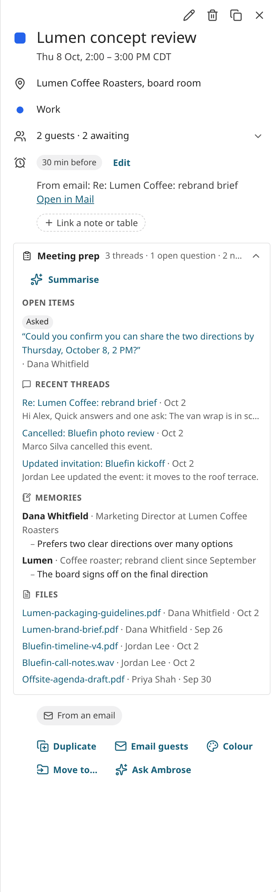

The reminder of a meeting with guests has a link to its prep: **Prep** on the desktop notification
and in the reminder sheet. See [Notifications](notifications.md). A routine's digest can also end
with today's meetings and a link to each one's prep. See
[Standing orders and briefs](standing-orders.md#routines).
<!-- covers: event.prep -->

## Move and resize events

Drag an event to move it. A ghost shows the new time, and you can drag across days. In month
view, drag a chip to another day and the time stays. When you drop a repeating event, you are
asked which occurrences to change. When the event has guests, you are asked whether to send them
an update. After every change, **Undo** is offered for a few seconds.
<!-- covers: event.reschedule -->

Drag the top or bottom edge to change the length. With an event focused, press Alt+Shift+↑ or ↓
to change the end from the keyboard.
<!-- covers: event.resize -->

Alt-drag (Ctrl-drag on Linux and Windows) to drop a copy instead of moving the event.

From the keyboard, focus an event (Tab, then the arrow keys), then use Shift+↑ or ↓ to move it by one step and
Shift+← or → to move it by a day. Press Enter to keep the change, or Esc to cancel it.

=== "Android"

    Long-press an event to lift it, then drag it. Drag the handles to resize it. A floating
    toolbar has **Duplicate** and **Delete**.

## Find a time

Use **Find a time** (`f`) to look for free slots in your own calendars, inside your working hours.
Set the length, the range of days and an optional buffer between meetings. Up to eight slots are
ranked, and your busy blocks are shown for each day. Click a slot to create an event there.
<!-- covers: event.find_time -->

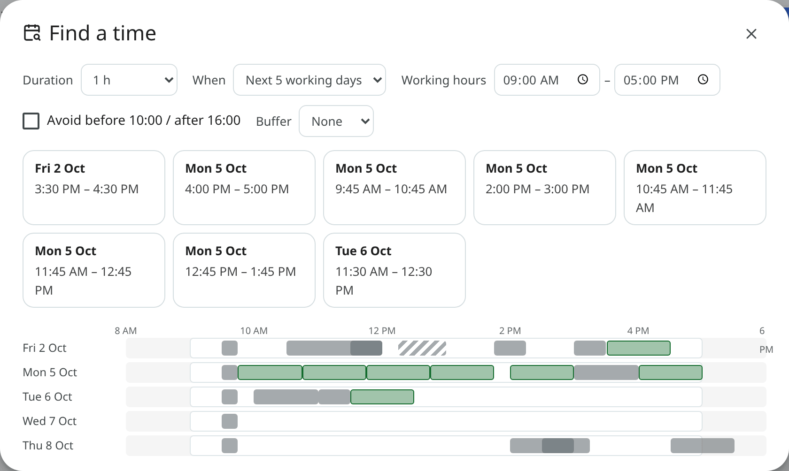

Your working hours and days are set under **Settings → Calendar & tasks → Working hours & new events**
(`calendar_working_hours`).

### Free/busy sharing with your groups

People in one of your Mailr groups (your team or your family, for example) can share when they are busy.
When someone shares, they are listed under **Include** in Find a time. Tick a name to count their
busy times too. Those times are left out of the slots and shown on each day as a thin band.
In the event editor, guests who share are ticked at once. Their titles, places and guests are never
shown in Find a time, only when they are busy. Other guests' calendars stay unknown.

<!-- covers: event.find_time_household -->

To share your own free/busy, turn on **Share my free/busy with my groups** under
**Settings → Calendar & tasks** (`calendar_share_free_busy`, off by default). The busy times of
your calendars in the Mailr calendar are then shared with the people who share a group with you. Your
other calendar accounts are not shared. If your administrator turned calendar sharing off for
the server, nobody's free/busy is shown.

When you write a reply, use the **Insert times** button in the compose toolbar to put three free
slots at the cursor ("Would any of these work? …"). See [Invitations](invitations.md#suggest-times-in-a-reply).

## Search the calendar

Press `/` in Calendar, or click the search box at the top while its chip says **Calendar** (see
[Search](search.md#search-scope)). Results are shown as you type: upcoming events
first, then past ones. Free text is matched against titles, places, descriptions and guest names. You can
also use these words:

| Word | Matches |
|---|---|
| `with:dana` | Events with Dana as a guest or organiser. |
| `cal:work` | Events in the Work calendar. |
| `after:` and `before:` | Events in a date range. Dates such as `fri` and `oct 12` work. |
| `is:recurring` | Repeating events. |
| `is:invite` | Invitations you have not answered. |
| `has:guests`, `has:video` | Events with guests, or with a video link. |
| `loc:` | Events at a place. |

Click a result to open it on its date. Click **Back** in the search box to end the search. A search
with the **All** chip also shows the top matching events and tasks above the mail results.
<!-- covers: event.search -->

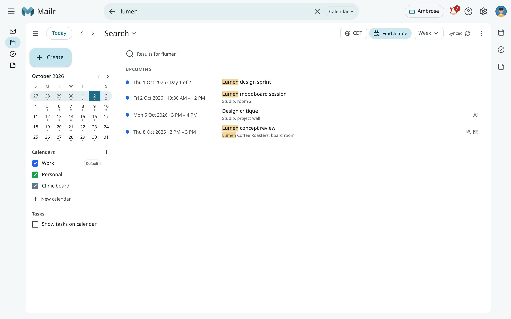

## Sharing, connecting and importing calendars

The Mailr calendar on your server, sharing calendars with people, connecting another CalDAV
account, importing `.ics` files, calendar links and moving your calendars into Mailr are in
[Calendar sharing and import](calendar-sharing.md).

## Calendar settings

**Settings → You → Region** holds the time zone, the clock and the first day of the week, for the
calendar and everything else:

| Setting | Description |
|---|---|
| Time zone | Your home zone (`timezone`). With **Automatic**, the device's zone is used. Ambrose uses the same one. |
| Week starts on | The first day of the week (`week_start`). |
| Clock | 12-hour or 24-hour times (`time_format`). |

**Settings → Calendar & tasks** holds the rest. Working hours and the default event length are under **Working hours & new events**:

| Setting | Description |
|---|---|
| Working hours | Your working hours and days (`calendar_working_hours`). |
| Default event length | The length of a new event (`calendar_default_duration`). |
| Reminder defaults | The reminder for timed events and for all-day events, and the morning hour (`reminders.default_timed_event`, `reminders.default_all_day_event`, `morning_hour`). |
| New invitations | When invitations are added to your calendar (`calendar_add_new_invites`). See [Invitations](invitations.md). |

Turn on `calendar_week_numbers` to add week numbers, and `calendar_dim_past` to dim events that
have ended.
The full list is in [Settings](../reference/settings.md).

## On the phone

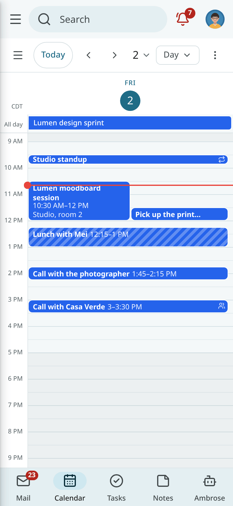

The Android app has the same views, plus Schedule as its default. The drawer holds the mini-month
and the calendar switches. Changes made offline are queued and sent when the phone is
back online. See [Calendar, tasks and reminders on Android](../android/calendar-and-reminders.md).
