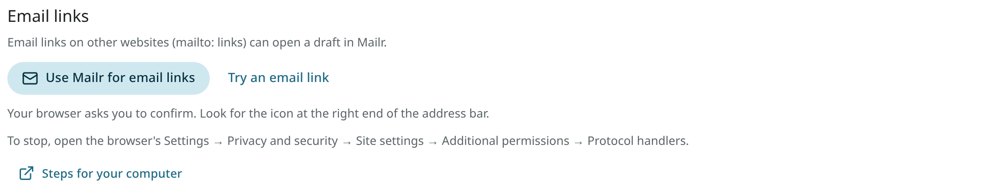

# Make Mailr your email app

An email link (a `mailto:` link) is a link that starts an email: "Write to us" on a website, an
address in a PDF, "Send by email" in another program. In Mailr such a link opens a draft in Mailr's
own composer, with the recipients, the subject and the text filled in. Browsers and computers can be set
to do the same for email links everywhere else. Nothing is sent by a link; the draft is sent only
with **Send**.

A link fills at most 50 recipients (To, Cc and Bcc together) and 50,000 characters of text. Each
recipient shows its name; point at it, or move to its **×** with the keyboard, to see the address.

<!-- covers: compose.deeplink settings.mail_handler -->

## Email links inside Mailr

These open a draft in Mailr, in the current style:

- an email link in a message you read;
- an address in an answer from Ambrose;
- the address on a person's card (**Settings → Mail → People & groups**, or a card opened from Ambrose);
- **Email it** in the invite dialog (**Settings → Admin → Users → Invite someone**): the draft is
  addressed to the person you invited and holds the link and its last day.

Hold `Ctrl` (or `⌘` on a Mac) while you click an email link to leave it to your browser instead.

## Compose links

Any link of this form opens a draft in Mailr, on your own server's address:

```text
https://mail.example.com/compose?to=dana@example.com&cc=sam@example.com&subject=Plans&body=Hello
https://mail.example.com/compose?mailto=mailto%3Adana%40example.com%3Fsubject%3DPlans
```

- `to`, `cc` and `bcc` take one address or several, separated by commas. Names may be included:
  `"Dana Lee" <dana@example.com>`.
- `subject` and `body` are the subject and the text. Write a line break as `%0A`.
- `mailto` takes a whole email link. Other email programs and the browser use this form.

When you are signed out, the sign-in page comes first, and the draft opens after you sign in.

## Browsers



In Chrome, Edge, Brave, Opera, Vivaldi and Firefox on a computer, Mailr can open the email links of
every website:

1. Open **Settings → Mail → Writing** and go to **Email links**.
2. Click **Use Mailr for email links**.
3. Confirm in your browser. Chrome and Edge show an icon at the right end of the address bar;
   Firefox shows a bar at the top of the page.
4. Click **Try an email link** to check. A browser does not tell a website whether you confirmed,
   so the setting cannot show it.

To stop, choose another app for email links: in Chrome and Edge under **Settings → Privacy and
security → Site settings → Additional permissions → Protocol handlers**, in Firefox under
**Settings → General → Applications → mailto**.

The installed Mailr app (in Chrome or Edge, see [The web app on your phone](phone.md)) can also be set
as the email app. The browser asks the first time an email link opens with it.

Safari cannot send email links to a website, on a Mac, an iPhone or an iPad. **Email links** says so
when you open it there. On a Mac, use Chrome, Edge or Firefox for this.

## Linux desktops

After these steps, email links in every program open a draft in Mailr in the default browser:
links in PDFs, "Send by email" in a file manager, links in other browsers.

1. Save this helper as `~/.local/bin/mailr-compose`, with your server's address in place of
   `https://mail.example.com`, and make it executable (`chmod +x ~/.local/bin/mailr-compose`):

    ```sh
    #!/bin/sh
    exec xdg-open "https://mail.example.com/compose?mailto=${1:-}"
    ```

2. Save this as `~/.local/share/applications/mailr-compose.desktop`, with your home folder in the
   `Exec` line:

    ```ini
    [Desktop Entry]
    Type=Application
    Name=Mailr
    GenericName=Email
    Exec=/home/you/.local/bin/mailr-compose %u
    Icon=mail-message-new
    Terminal=false
    Categories=Network;Email;
    MimeType=x-scheme-handler/mailto;
    ```

3. Make it the default for email links:

    ```sh
    xdg-mime default mailr-compose.desktop x-scheme-handler/mailto
    ```

4. On KDE Plasma, also open **System Settings → Default Applications** and choose **Mailr** under
   **Email client**. On GNOME, **Settings → Apps → Default apps → Mail** shows it too.
5. Test it: `xdg-open 'mailto:someone@example.com?subject=Hello'`.

With a copy of Mailr's source, run `tools/desktop/install-mailto-handler.sh https://mail.example.com`
to do steps 1 and 2.

## Windows and macOS

Use the browser handler above, in Chrome, Edge or Firefox, and make that browser your default
browser. Windows and macOS then send email links to the browser's choice. On Windows, if email
links still open another program, open **Settings → Apps → Default apps**, search for `MAILTO`
and choose your browser.

## Android

In the Mailr app, email links open the app's composer with the recipients, Cc, Bcc, subject and
text filled in. To make Mailr your phone's email app, open the phone's **Settings → Apps → Default
apps** (the name differs between phones) and choose Mailr for email. Or tap an email link once and
choose **Mailr** with **Always**. See [Mail on the phone](../android/mail.md#writing).
