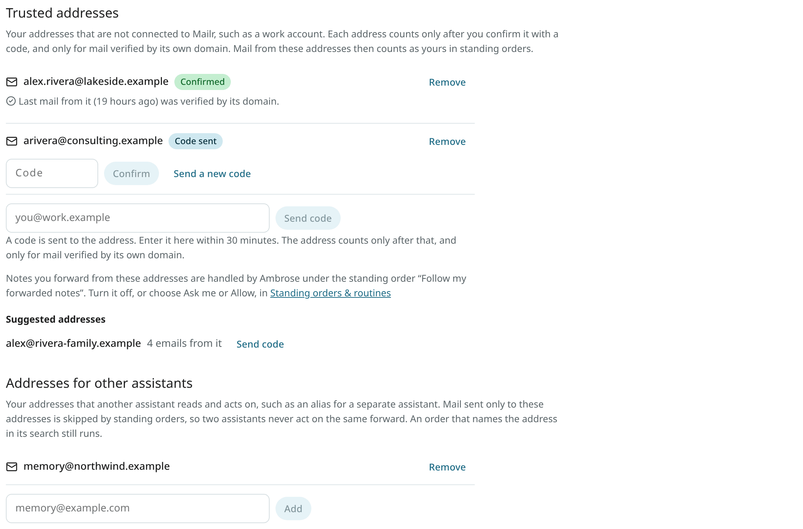

# Trusted addresses

Mail in accounts that Mailr is not connected to, such as a work account, can still be passed to Ambrose. Forward an email to your Mailr address and write a note on top: "add this to my calendar", "remember that the meeting moved to room 210", "draft a reply saying I will attend". Ambrose reads the note as an instruction.

Notes are followed only from addresses you confirmed, and only in mail verified by the address's own domain.

**Settings → Ambrose → Trusted addresses** is about the addresses only: which ones are yours, their codes, and whether their mail is verified. Ambrose's handling of a note is set in the standing order **Follow my forwarded notes**, under [Standing orders](standing-orders.md#follow-my-forwarded-notes).

## Add an address

1. Open **Settings → Ambrose → Trusted addresses**.
2. Type the address, for example `you@work.example`, and click **Send code**. The code is mailed to that address through your usual sending account.
3. Open the mail at that address and type the code next to the address within 30 minutes. Click **Confirm**.

<!-- covers: trusted.add, trusted.confirm -->

The address now shows **Confirmed**. Until then it shows **Code sent**, or **Code expired** when the 30 minutes are over. Use **Send a new code** to get another one. At most three codes are sent to one address per hour, and ten a day to all your addresses together (removing an address does not reset this limit). After five wrong codes the address is locked until you remove it and add it again. The code mail names you by your account's address. Up to 10 trusted addresses are allowed.

<!-- covers: trusted.resend -->

**Suggested addresses** lists addresses from your mail history that carry your name and were verified by their domain. Such an address counts only once it is confirmed with a code, like any other.

For each confirmed address, the page says whether its last mail was verified by its domain. When it was not, notes from that address do not count. The address's mail administrator can turn on DKIM signing or DMARC for the domain.

<!-- covers: trusted.list -->

Click **Remove** to take an address off the list. Its mail is then ordinary mail again.

<!-- covers: trusted.remove -->

The same page is in the Android app: **Settings → Ambrose → Trusted addresses**. There you can also add an address, type its code, send a new code and remove it.

## Addresses for other assistants

Another assistant program may be set up on one of your addresses, for example on an alias such as `memory@example.com`. When the same mail also arrives in Mailr, both assistants would act on one forward, and two events would be created.

To prevent duplicates, list the address under **Addresses for other assistants** on the same page. Mail sent only to that address is then left alone by standing orders, **Follow my forwarded notes** included. Mail that also went to another address of yours is handled as usual. An order whose search names the address, such as `to:memory@example.com`, is still run. The list is empty until you add an address, and it holds up to 20 addresses. The setting is `handled_elsewhere`.

When a note is left alone for this reason, the run of **Follow my forwarded notes** under **Activity** on the Standing orders page names that address.

The Android app has the same list.

## Forward with a note

Forward the email from the confirmed address to your Mailr address and write your note above the forwarded part. Outlook, Gmail, Apple Mail and Thunderbird all work, in English, German, French, Spanish, Portuguese, Russian and Chinese, and so does an email attached to a new message.

- The email must forward something: a forwarded part with its usual heading ("Forwarded message", "Begin forwarded message", "Weitergeleitete Nachricht", Outlook's "From: … Sent: …" block, and the like) or an attached email. A message from your trusted address that forwards nothing, or a reply that only quotes an earlier email, is ordinary mail.
- Only your note is an instruction. The forwarded email below it (the "From: … Sent: …" block, the "Forwarded message" part, an attached email and its attachments) is read as data, like any mail. Instructions written inside it are never followed.
- A forward with no note is ordinary mail. It can still match another standing order (see below).
- Ambrose works on the first 4,000 characters of the note, as if you had typed it in a chat about that email: the same tools and the same permissions. No one supervises the run, so mail that it would send always requires approval, and what it learns after reading the forwarded email is kept as a suggestion.
- The result is shown as a brief on the email and as a notification.
- A note is followed once. Each email carries an ID (its Message-ID). When a copy of the same email arrives again, for example re-sent with other recipients, it is ordinary mail. An email without such an ID is never followed.
- With **Ask me**, the approval shows the whole note, the same text Ambrose gets.

Forwarded notes are handled by the standing order **Follow my forwarded notes**. Every account has it, at the top of **Settings → Ambrose → Standing orders & routines**.

<!-- covers: trusted.act_on_note -->

### Checks on a forward

A forward is your instruction only when all of these hold:

- it comes from one of your confirmed addresses, and its From line is one plain address. A From line that is malformed, names two addresses, or has another address in its name (`"you@work.example" <someone@work.example>`) matches nobody. The reader shows a warning on such an email;
- it passes the receiving server's checks for that address's domain (DMARC passes for the domain, or the domain's DKIM signature is valid), and DMARC did not fail;
- nobody else sent or re-sent it: no Sender line other than the same address (a malformed one counts as another), no Resent headers, no mailing list;
- it is addressed only to you: every To and Cc address is one of your own. An email you only copied yourself on ("Hi Bob, …") stays ordinary mail.

Anything else is ordinary mail, even when the From line shows your address.

## Ask me, Allow or Off

Ambrose's handling of a note is set on the order **Follow my forwarded notes**, under **Settings → Ambrose → Standing orders & routines**:

- **Ask me** (the default): each note waits as an approval with the note and the email's subject. Ambrose starts once the note is approved. See [Approvals](approvals.md).
- **Allow**: Ambrose starts on the note at once.
- **Off** (the order's switch): forwarded notes are ordinary mail. Your other standing orders can still match them.

Each step Ambrose then takes still follows its own permission under **Settings → Agents & API → Permissions**. With **Allow** for forwarded notes and **Ask me** for creating events, for example, Ambrose starts at once and asks before it adds the event. When you approve a note with **Always allow…**, the order shows **Allow** afterwards. Only a permission rule that names forwarded notes (`agent.forwarded_instructions`) sets the order to **Allow**; a wildcard rule such as `*` or `agent.*` never does, and a broad **Deny** rule still stops it.

Under [Activity](activity.md), each change Ambrose made on a note shows **From your forward** with a link to the email, and **Undo** where the change has one.

## Organiser changes you forward

When the organiser moves or cancels a meeting, the update arrives in your work account. Once it is
forwarded to Mailr from a confirmed address (a rule for this is described below), it can be applied
to your copy of the event:

- The update inside the forward is matched to your event by the invitation's ID. Nothing is changed
  by a forward that fails the checks above.
- The author of the message inside a forward cannot be verified. An update from anyone who names
  the organiser is forwarded by the work account, so a forwarded change is never applied
  automatically. It always requires approval, also when the permission **Change events** is **Allow**. The approval
  shows the change before and after (time, place, title, description, guests and meeting link) and
  says "Forwarded by you from you@work.example; claims to be from Chair <chair@work.example>", with
  the organiser's address. Approve it only when you expect the change.
- The usual rules apply: only the organiser of your copy can change it, and only with a newer
  version than yours. Your reminders, your answer (when the time stays), and your colour and
  categories are kept.
- On approval, a notification is sent, for example "Ops Review moved to Wed 28 Oct, 1–3 PM
  (was Wed 14 Oct)", and the entry under [Activity](activity.md) has **Undo**.
- After an approved cancellation, the event is marked cancelled. It is removed only with
  **Remove from calendar** on the card, which has **Undo**.
- A new invitation inside a forward is not added automatically either. The card offers **Apply anyway**
  to add it.

<!-- covers: invite.forwarded_update -->

### An Outlook rule for meeting mail

To forward meeting requests, updates and cancellations from a work account (Microsoft 365 or
Exchange) to Mailr, set up a rule as follows. Use **Forward**, not **Redirect**: a redirected message keeps
the organiser as its sender, so it does not come from your confirmed address.

In Outlook on the web (and the new Outlook for Windows):

1. Open **Settings** (the gear) → **Mail** → **Rules**, and click **Add new rule**.
2. Name it, for example "Meetings to Mailr".
3. Under **Add a condition**, choose **Message type**, then the meeting type (shown as
   **Meeting request**, or **Calendaring**, depending on the version).
4. Under **Add an action**, choose **Forward to**, and type your Mailr address.
5. Leave **Stop processing more rules** off, and click **Save**.

In classic Outlook for Windows:

1. On **Home**, click **Rules** → **Manage Rules & Alerts**, then **New Rule**.
2. Choose **Apply rule on messages I receive** and click **Next**.
3. Tick **which is a meeting invitation or update** and click **Next**.
4. Tick **forward it to people or public group**, click **people or public group** in the lower
   box, and enter your Mailr address. **Forward it as an attachment** works too.
5. Click **Finish**. With a Microsoft 365 or Exchange account, the rule is run on the server, also
   while Outlook is closed.

Some organisations do not allow forwarding to outside addresses. A report that the message could not be
delivered then appears in Outlook. Ask your IT department in that case.

## Forwarded invitations

When you forward a meeting invitation from a confirmed address, the invitation inside the forward is found, also when the original email is attached by Outlook. The invitation card is shown on the email, with options to add the event or answer it. See [Invitations](invitations.md).

To add such invitations without a note, create a [standing order](standing-orders.md):

1. Click **New order** under **Settings → Ambrose → Standing orders & routines**.
2. Tick **Only mail I forward from my trusted addresses**.
3. Under the instant actions, tick **Add the invitation to my calendar (no reply to the organiser)**.

The event is added as accepted, and no reply goes to the organiser. Adding it is a calendar change by Ambrose, so it depends on the permission **Create events**: with **Ask me**, approval is requested first.

<!-- covers: invite.add_to_calendar -->
