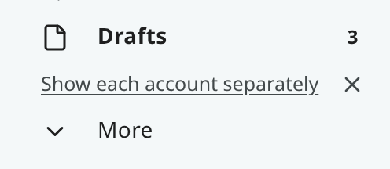
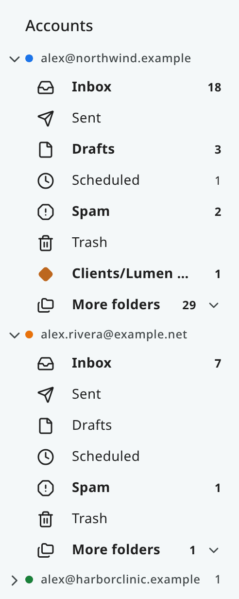
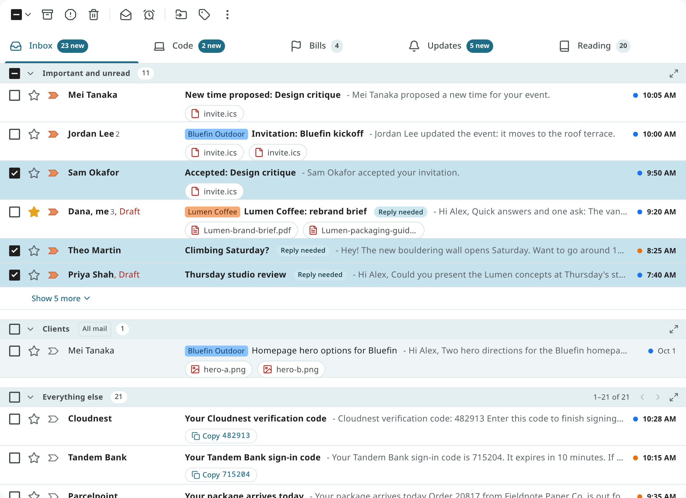
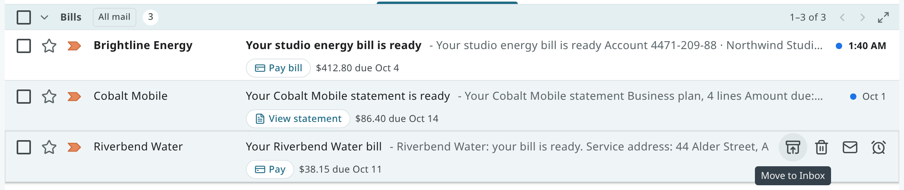
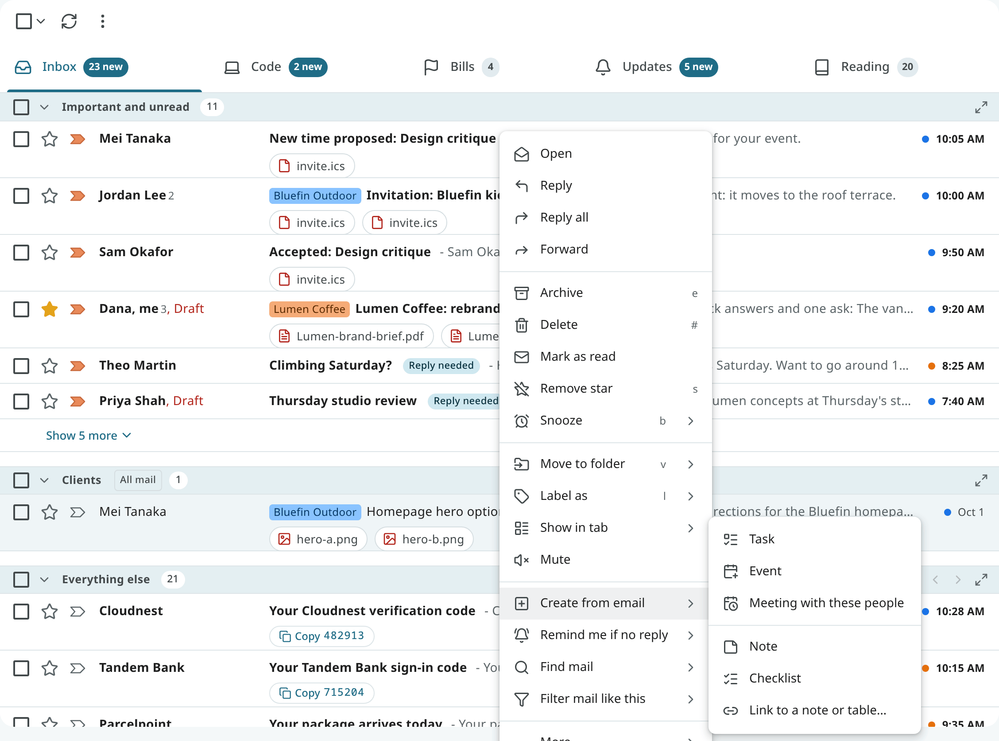
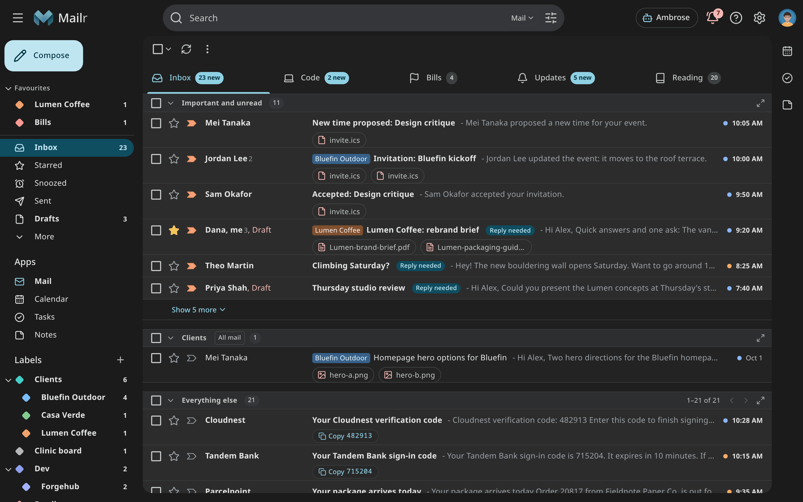

# The inbox

In Mailr the unit is the **conversation**: a message grouped with its replies.
Lists, search results and actions all apply to whole conversations. Labels take the place of
folders, and **Inbox** is a label like any other: when you archive a conversation, the label is removed.

A user with no mail account and an empty inbox sees "No mail account connected yet" with **Connect an email account**, and no inbox tabs. The button opens **Settings → Mail → Mail accounts** with the Add account wizard.

## The navigation

The left side of the window holds the mail views.

| Entry | Contents |
|---|---|
| **Favourites** | The views and labels you pinned, in your order (see [Favourites](organize.md#favourites)). |
| **Inbox** | Conversations that carry the Inbox label, drawn with your [layout](tabs-and-layouts.md). Its number is the count of unread mail in your first tab, or in every tab (see [The Inbox count](tabs-and-layouts.md#the-inbox-count)). |
| **Screener** | First-time senders waiting for your decision, while the [Screener](screener.md) is on. Its number is the count of senders waiting. |
| **Starred**, **Snoozed**, **Important** | Conversations with a star, waiting to come back, or marked important. |
| **Sent**, **Drafts**, **Scheduled** | Your own mail: sent, being written, or waiting to go out. |
| **All Mail** | Every conversation except Spam and Trash. |
| **Attachments** | Every file you received, newest first, searchable. |
| **Spam**, **Trash** | Mail set aside by you or your filters. |
| **Categories** | Social, Updates, Forums, Promotions and Purchases: each conversation is sorted into one of these or into Primary. With the Categories inbox type, Primary, Promotions, Social, Updates and Forums get an Inbox tab by default; Purchases can be added as a tab under **Settings → Mail → Inbox → Categories** (see [Built-in inbox types](tabs-and-layouts.md#built-in-inbox-types)). |
| **Labels** | Your labels, nested by `/` in their names. |

Each style has its own form of the navigation: a sidebar in Classic, a folder pane in Workspace, a
folder tree in Desk, a rail in Cards and a command palette in Focus. The entries are the same. See
[Styles and appearance](appearance.md).

## Several mail accounts

When you connect more than one mail account, all their mail is kept in one mailbox. The Inbox, Sent,
Drafts and every other view hold the mail of all your accounts, and the mailbox's heading in the
navigation is **All accounts**. With one account, the heading is that account's address.

With two or more accounts, each row of the list shows a small dot in the
colour of the account the mail belongs to. Hover over the dot, or listen to it with a screen
reader, to hear the account's address. Each account is given a colour when you add it. To change
one, open **Settings → Mail → Mail accounts** and click the dot on the account's card.

<!-- covers: mail.account_colour -->

Mail belongs to an account when it arrived through that account, or when you sent it from one of
the account's addresses. A conversation that went through two accounts belongs to both.

### Each account's own folders

Turn on **Show each account separately** (`account_folders`) in **Settings → Mail → Inbox** to see
each account on its own as well. When you have two or more accounts and the setting is off, a short
line about it appears in the navigation: click **Show each account separately** there to go to the
setting, or click **✕** to hide the line. The line does not come back once you hide it or change
the setting. Focus has no navigation column, so the line does not appear there.

 The navigation then lists the folders of all accounts and,
below them, one group for each account with its own **Inbox**, **Sent**, **Drafts**,
**Scheduled**, **Spam** and **Trash**, and below those the account's folders (see the next
section). Categories stay shared by all accounts.

- Classic lists the groups under **Accounts** in the sidebar. A group closes with the arrow next to
  the address.
- In Workspace, each account is a folder node of its own, as in Outlook.
- In Desk, the groups are in the folder tree; in Cards, they are in the drawer.
- In Focus, each account's folders are in the command palette (Ctrl+K), under **Accounts**.
- On a phone, the folders are in the mail drawer, and in the Android app's drawer too.

Each folder has its own address in the browser, so the back button and bookmarks work. The number
next to it is for that account's mail only. **Select all** and the bulk actions stay inside the folder. A
message you start in an account's folder is sent from that account's address. A search you type
there covers that account only. An **In:** chip with the address appears above the results;
click it to search all accounts again.

<!-- covers: mail.account_folders mail.account_view -->

### Folders inside an account

In Mailr a folder is a label. While **Show each account separately** is on, each account's group
has, below its **Trash**, the labels that hold mail of that account. Each one shows only that
account's mail, and its number counts only that account's unread mail.

To keep each group short, only the folders you pinned to that account come below **Trash**, in
your order, followed by one row, **More folders**, with all the others. The number next to **More
folders** is the count of unread mail in the folders inside it. Click it to open the rest as a tree, and click it again to close
them. Which groups are open is saved with your settings, so they look the same on every device.

- To pin a folder, open its **⋮** and choose **Pin to** and the account's address. Choose
  **Unpin** to put it back under **More folders**. You can reverse either with **Undo** in the message.
- To move a pinned folder, choose **Move up** or **Move down** in its **⋮**, or press Alt+↑ or
  Alt+↓ while it has the focus.
- With a mouse, you can drag folders. Drop a folder on a pinned folder to pin it there, or on the
  **Pin here** line that shows during the drag to pin it last. Drop a pinned folder on **More
  folders** to unpin it.
- Pins belong to one account. A folder pinned to one account stays under **More folders** in the
  others.
- To see new mail without opening **More folders**, turn on **Show folders with unread mail above
  More folders** in **Settings → Mail → Inbox**, under **Show each account separately**. A folder
  with unread mail then shows above **More folders** until you read it. Pinned folders keep their
  order.
- The folder you have open stays in view while **More folders** is closed.
- On a phone, long-press a folder in the drawer to pin or unpin it.

To make a folder in one account, open the **⋮** next to the account's address and choose **New
folder**. The folder appears under that account at once, pinned there, even while it is empty. If the account's
mail is kept on its own server (an account that is kept in sync), the folder is made there too. On the servers of
other accounts, the folder is made only when you file their mail in it.

The name is shared. "Receipts" under two accounts is one label, and each account's group shows that
account's mail in it. The **Labels** list shows all the mail with the label. There, a label made
in an account has that account's coloured dot after its name.

- Rename a folder, change its colour, nest a folder inside it or delete it from its **⋮**, as with
  any label. The mail stays when the folder is deleted.
- Mail of one account can be filed in a folder made in another. The mail gets the label and stays
  in the account it arrived through, and nothing is copied to the other account's server. A short
  message about this is shown.
- When you turn **Show each account separately** off, the groups are only hidden. The folders stay
  in the **Labels** list, and they are back under their accounts when you turn it on again.
- In Focus, the command palette lists each account's folders, the pinned ones first. Choose
  **New folder in** and an address to make one.
- In the Android app, each account's folders are in the drawer, with the same pins and the same
  **More folders**. Long-press a folder there to pin it, unpin it or move it.
- To make a folder in the Android app, tap **⋮** next to the account's address in the drawer, or
  long-press the address, and choose **New folder**. Type a name and, if you want, pick the folder
  it goes inside under **Inside**. To make one inside a folder of the group, long-press that folder
  and choose **New folder inside**. The new folder is pinned to the account and opens.

<!-- covers: mail.account_folder_create mail.account_label_view -->
<!-- covers: mail.account_folder_pin mail.account_folder_unpin mail.account_folder_reorder mail.account_folders_more mail.account_folders_show_unread -->

## The mail list

Each row shows the senders, the subject, a snippet, the labels and the date. A conversation that
only you wrote in shows whom it went to instead, such as **To: Dana Whitfield** for a sent email
with no reply yet. In the Android app, mail you sent only to your own addresses reads **Note to
self**. Chips after the
snippet show what was found in the mail: **Reply needed**, **Waiting**, a **Due** date, **No
reply**, or a one-tap action such as **Pay bill** or **Track package**. Each of
them is explained on the [Triage](triage.md) page.

The snippet is the start of the text you see when you open the message, as it is shown in other
mail apps. A newsletter's preview line (the hidden "preheader" at the top of the message) comes first,
and a preview the sender declared for mail apps (schema.org markup) is used when there is one.
Image descriptions, link addresses, quoted replies and hidden text are left out.

The list's appearance is set in **Settings → Mail → Reading** and **Settings → Look**:

| Setting | Choices |
|---|---|
| Page size (`page_size`), Mail → Reading | How many conversations are on one page (default 50). |
| Text & spacing (`density`), Look | Roomy, Standard or Compact. |
| Conversation view (`conversation_view`), Mail → Reading | With it on, replies are grouped into conversations; with it off, every message is listed on its own. |

Where a conversation opens is set with the reading pane setting (`reading_pane`): on its own
page, to the right of the list, or below it. The setting is saved for each style.

## Selecting conversations

- Click the checkbox on a row, or press `x` on the focused row.
- Ctrl-click (⌘-click on a Mac) to add a row; Shift-click to select a range.
- Use the checkbox menu in the toolbar to select **All**, **None**, **Read**, **Unread**, **Starred**
  or **Unstarred**. After **All**, a banner appears with an option to select every conversation in
  the view, not only the page.
- Right-click a row for its menu. With several rows selected, the menu applies to all of them.

## Acting on conversations

The same actions are in the toolbar, the row's right-click menu, the reader and the keyboard.

Use **Archive** to take the conversation out of the Inbox. It stays in All Mail, under its labels, and
in search. Press `e`, or use the archive button on the row or in the reader.

The button shown depends on the conversation, whatever list it appears in. A conversation that is not in the
Inbox has **Move to Inbox** where Archive usually is: on the row, in its right-click menu, in the
swipe, in the toolbars of Office, Desk and Focus, and on the `e` key. The same applies in an Inbox tab, for a label
section that shows archived mail. In a label's own list (a "Later" tab, for example), Archive stays,
and that label is removed when you use it (see [Archive and delete options](#archive-and-delete-options)).
In Spam and Trash the actions are **Not spam** and **Restore**.

<!-- covers: mail.archive -->

Use **Delete** to move the conversation to Trash. Press `#`. In Trash, use **Delete forever** to remove it
(see [Delete forever](#delete-forever)).
<!-- covers: mail.delete -->

Use **Mark as read** and **Mark as unread** to change the read state. Press `Shift + i` or `Shift + u`.
A conversation is marked read when you open it.
<!-- covers: mail.read mail.unread -->

**Star** a conversation to find it again under Starred. Press `s` to toggle the star.
<!-- covers: mail.star -->

Use **Mute** to keep future replies out of your Inbox. The conversation stays in All Mail and in search,
and it comes back only when you unmute it. Press `m`.
<!-- covers: mail.mute -->

Use **Move to folder** to take a conversation from one place to another in one step; it is also
removed from the Inbox. You can move it to a label, to Archive, Spam or Trash, or back to the Inbox
from Spam or Trash. Press
`v`, pick the destination, or drag the row onto a label in the navigation with Shift held. To keep
a conversation in the Inbox and only change the inbox tab it is shown in, use **Show in tab** instead
(see [Show a conversation in a tab](tabs-and-layouts.md#show-a-conversation-in-a-tab)).
<!-- covers: mail.move -->

### Drag onto the navigation

Drag a row, or a selection, onto the navigation:

- onto a label to add that label;
- onto a label with Shift held to move the conversation there;
- onto Inbox, All Mail, Spam or Trash to move it there;
- onto Starred to star it, or onto Important to mark it important.

### Undo

After every action, a short notice with **Undo** is shown. Press `z` to undo the last action.

### Delete forever

**Delete forever** is offered in Trash and Spam, for a selection or for the whole list. You are asked
to confirm first, and there is no undo. The message is then removed from:

- the mailbox: it is gone from every list, search and the mail apps that read Mailr;
- the database: its subject, sender and recipients, text, preview, attachment names and attached
  emails, its search index and vectors, the reasons the models gave for it, the memories the
  assistant only suggested from it, the quotes that chat answers cited from it, and the cached
  summary of its conversation;
- the daily mail export and the backup copy of that export, when the administrator set one up.

A small record stays in the database: its Message-ID, the IDs of the messages it answered, its place
at the provider, a fingerprint of its content, and its dates, size and flags. With it, the deletion
at the provider can still find the message, and later replies still join their conversation. A
message you reported as spam also keeps its sender's address, because spam reports are counted per
sender.

The text and the export file are removed in the background, usually within a minute. The nightly
database dumps still hold the message until they age out, and so do backups the administrator
makes outside Mailr (see [Data at rest](../admin/security.md#data-at-rest)).

At the provider:

- In an account that is kept in sync, the message is deleted at the provider too.
- In an account where Mailr keeps the mail, a copy still at the provider (one inside the delay before deletion) is deleted
  there too, whether or not deletion at the provider is turned on. A **Resync from scratch** then
  does not bring the message back.

Messages removed with another mail app, or by the mail store's own Trash cleanup, are only marked
as deleted at first. A daily cleanup then removes their text and export files the same way. Their
provider copies are not deleted.

<!-- covers: mail.delete_forever -->

### Archive and delete options

In the reader, the view that opens next is set with **Auto-advance** (`auto_advance`,
Settings → Mail → Reading): the list, the newer conversation, or the older one. What else is
cleared on archive is set with two settings:

- **Also remove the label of the list I'm in** (`archive_removes_current_label`, on by default):
  when you archive from a label's list, that label is removed too.
- `archive_also_removes`: labels removed with every archive, chosen under **Archive** in
  Settings → Mail → Reading.

=== "Web"

    Hover a row for its quick buttons: archive, delete, mark as read and snooze. Right-click it
    for everything else.

=== "Android"

    Swipe a row to archive or delete it (the swipe actions are set in the app's settings).
    Long-press a row to select it, then use the top bar. See [Mail on the phone](../android/mail.md).

## Dark mode and other styles

Every page is available in light and dark, and in every style.

