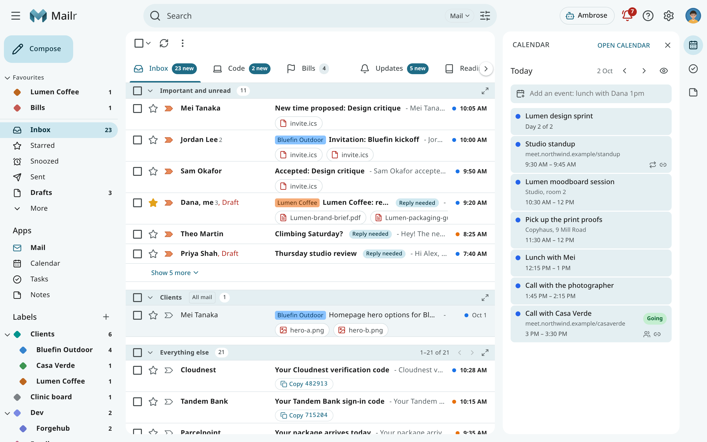

# User guide

This guide describes the daily use of Mailr: reading and writing mail, keeping the inbox in
order, the calendar and tasks, and Ambrose. The examples follow Alex Rivera, a
design lead at Northwind Studio, who reads a work account, a personal account and a clinic board
mailbox in one place.

!!! tip "Help inside Mailr"
    In Mailr, choose **Help** in the **?** menu or in your account menu to open this guide in a new
    tab.

## Mail

| Page | Topics |
|---|---|
| [The inbox](inbox.md) | The mail list, the navigation, selecting and acting on conversations, undo. |
| [Tabs and layouts](tabs-and-layouts.md) | Inbox types, custom tabs and sections, reading a tab with sections, tab indicators, section actions. |
| [Reading mail](reading.md) | The conversation view, images and trackers, translation, reply suggestions, attachments. |
| [Writing mail](writing.md) | Compose, replies, signatures, inline images, templates, undo send, scheduled send, the away message. |
| [Make Mailr your email app](email-links.md) | Opening `mailto:` links on websites and in other apps with Mailr. |
| [Search](search.md) | The search box, operators, advanced search, finding mail by meaning. |
| [Labels, filters and favourites](organize.md) | Labels and nesting, filters, blocked senders, favourites in the navigation. |
| [Subscriptions and cleanup](subscriptions-and-cleanup.md) | Newsletters and offers by sender, unsubscribing, clearing out old mail in bulk. |
| [Triage signals and importance](triage.md) | Categories, importance and the review queue, VIP senders, spam, Reply needed, deadlines, one-tap actions. |
| [The Screener](screener.md) | Holding mail from first-time senders until they are allowed or blocked. |
| [Snooze, follow-ups and reminders](snooze-and-reminders.md) | Snoozing mail, "remind me if nobody replies", reminders and their actions. |
| [Waiting for you](waiting.md) | The bell: approvals, messages not sent, and reminders. |

## Calendar and tasks

| Page | Topics |
|---|---|
| [Calendar](calendar.md) | Views, events, guests, meeting prep, finding a free time, search. |
| [Calendar sharing and import](calendar-sharing.md) | The Mailr calendar, sharing, connecting a CalDAV account, `.ics` import, calendar links, moving calendars. |
| [Calendar on phones and computers](phone-calendar.md) | Calendars, task lists and contacts in the apps on iPhone, Mac, Android and Thunderbird. |
| [Invitations](invitations.md) | Answering invitations, updates and cancellations, proposed new times. |
| [Tasks](tasks.md) | Lists, subtasks, repeating tasks, tags, priorities, bulk changes. |
| [Quick add](quick-add.md) | Typing an event or task in one line: "Lunch with Dana fri 12:30 at Café Luna". |

## Notes and tables

| Page | Topics |
|---|---|
| [Notes and checklists](notes.md) | Keep-style notes and lists, sections, quantities, usual items, labels, version history. |
| [Tables](tables.md) | Small typed lists such as a workout log or an inventory, with columns, a row form and views. |

## Ambrose, the assistant

| Page | Topics |
|---|---|
| [Ask Ambrose](assistant.md) | The chat, Ask about what is open, chats, commands, cleaning up a whole view, dictation, Help me write. |
| [Standing orders and briefs](standing-orders.md) | Instructions Ambrose follows on new mail or on a schedule, and the briefs it leaves. |
| [Trusted addresses](forwarded-notes.md) | Forwarding mail from accounts outside Mailr with a note for Ambrose. |
| [Approvals](approvals.md) | The approval card for sending, deleting and changing rules, and its defaults. |

## People and recordings

| Page | Topics |
|---|---|
| [People & groups](people.md) | Correspondent profiles, contact groups, address books. |
| [Recordings (Speakr)](recordings.md) | Meeting recordings next to the related mail and events. |

## Account and devices

| Page | Topics |
|---|---|
| [Settings](settings.md) | The settings groups, region, password and devices, two-factor sign-in. |
| [Styles and appearance](appearance.md) | Classic, Workspace, Focus, Desk and Cards, light and dark, density. |
| [Notifications](notifications.md) | Desktop notifications for new mail and reminders, push to a closed browser. |
| [Activity](activity.md) | Recent changes in your account, with Undo. |
| [The web app on your phone](phone.md) | Mailr added to a phone's home screen: tab bar, swipes, notifications, offline use. |
| [Keyboard shortcuts](keyboard-shortcuts.md) | How shortcuts work, and the command palette. |

The keys for every app are in the [shortcut reference](../reference/keyboard-shortcuts.md); press
`?` in Mailr to see the keys of the app you are in.

The phone app has its own section: [Android app](../android/index.md).
