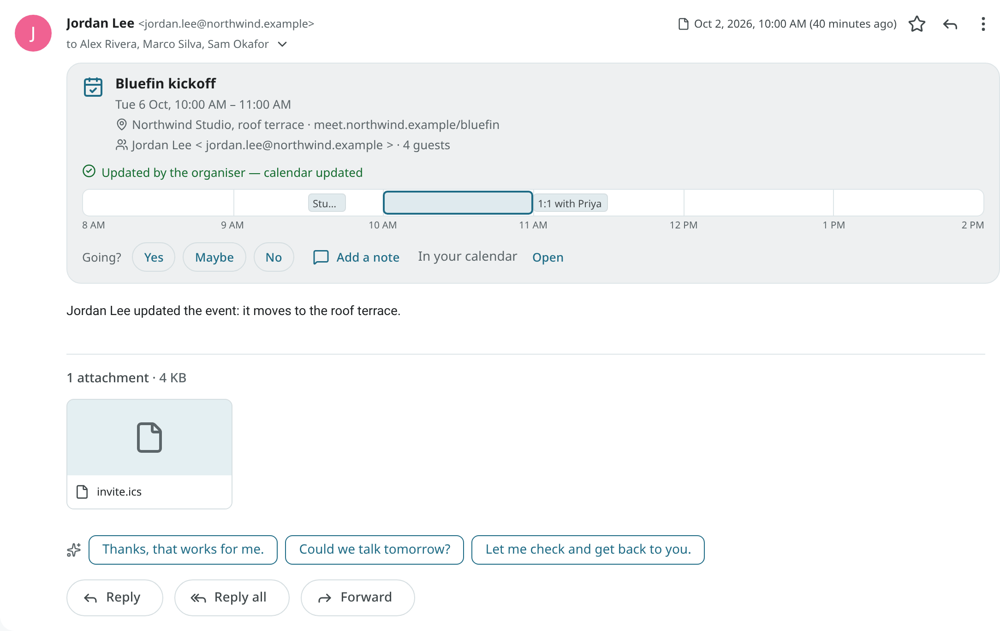
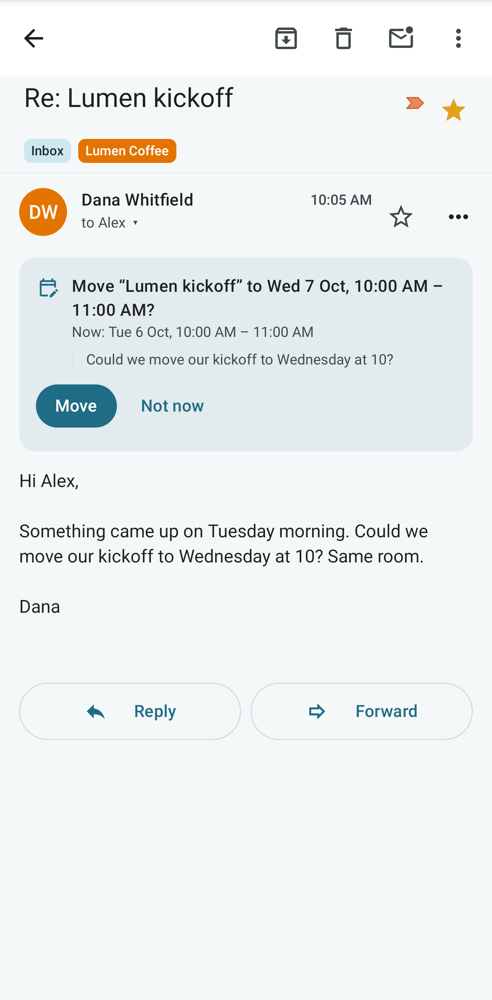
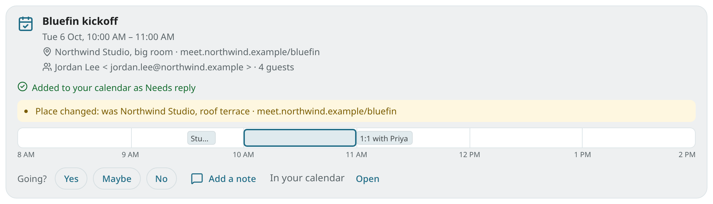
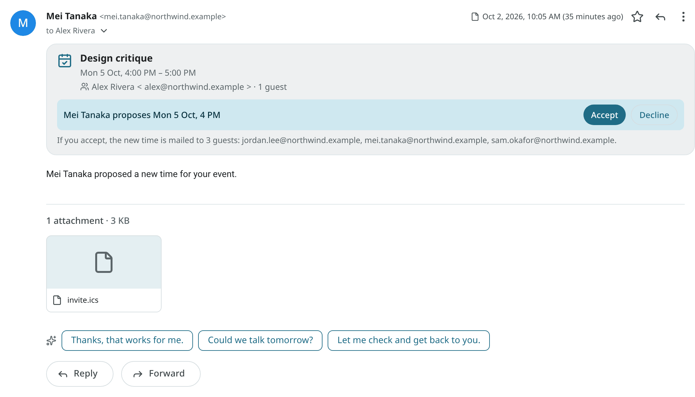
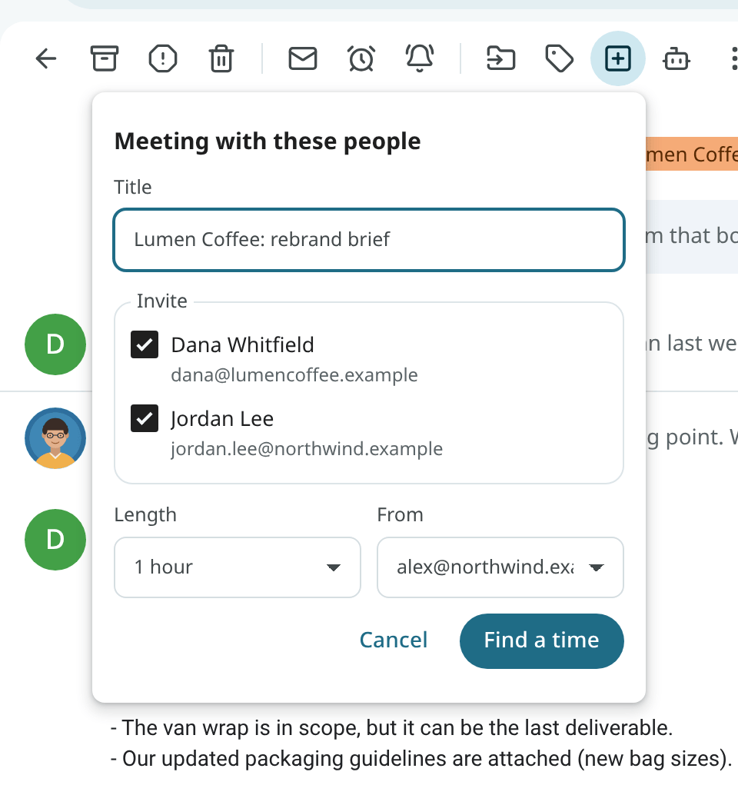
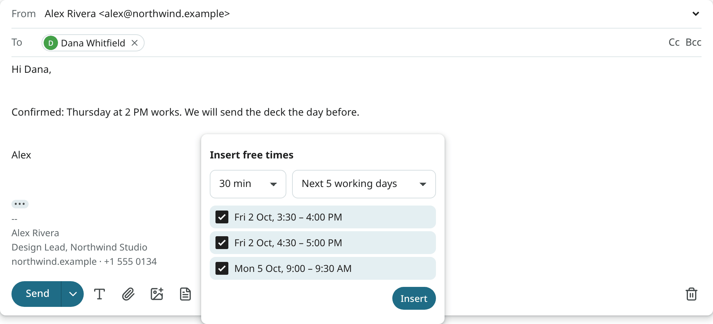

# Invitations

Meeting invitations arrive as email. The calendar part of each invitation is read and shown
as a card above the message, and the calendar is kept in step with the organiser.

## The invitation card

An open invitation has a card above the message with:

- the title, and when it happens in your time zone (plus the organiser's zone when it differs);
- the place, the organiser (the name and the address, with a warning when the name shows another
  address or mixes alphabets) and the number of guests;
- a conflict line when the time is already taken;
- a small timeline of your day around the meeting (**Your day around this time**);
- **Going?** with Yes, Maybe and No.

<!-- covers: invite.view -->

## Answer an invitation

Click **Yes**, **Maybe** or **No** in the card. You can add a **Note for the organiser** before
you answer. Your answer is sent from the address the invitation reached, under the same send
rules as your other mail, and the event in your calendar is updated. For a repeating meeting, you
are asked whether your answer covers one occurrence or the whole series.

You can also answer from the calendar: open the event and use **Going?**, or press `y` (Yes),
`s` (Maybe) or `v` (No) with the event focused. On Android, the event sheet and the reminder
have the same buttons.
<!-- covers: event.rsvp -->

## New invitations in your calendar

By default, a new invitation is added to your calendar when you answer it. You can change this under
**Settings → Calendar & tasks → Invitations & repeating tasks**:

| Choice | Result |
|---|---|
| **Add to my calendar when I answer** | The default. The invitation stays in your mail until you answer. |
| **Add to my calendar at once, marked "Needs reply"** | The event is shown in your calendar right away, outlined, until you answer. Only invitations sent by their organiser are added. |

An invitation is never accepted automatically. The setting is `calendar_add_new_invites`.
<!-- covers: invite.auto_add -->

## Updates and cancellations

When the organiser changes a meeting you are invited to, the event in your calendar is
updated, and your own reminders are kept. The card on the update shows **Changes**, for
example "Time changed: was Tue 3 PM".
<!-- covers: invite.apply_update -->

When the organiser cancels, your copy of the event is marked as cancelled. The card shows **The
organiser cancelled this event.** and has **Remove from calendar**. This happens only when the
cancellation is verified: it comes from the organiser of your copy, and the organiser's mail server
vouches for the sender (see [Changes from an unverified sender](#changes-from-an-unverified-sender)).
Any other cancellation shows "This email says the event is cancelled. Nobody verified that the
organiser sent it." and has no **Remove from calendar**. The event is not changed.
<!-- covers: invite.apply_cancel -->

The event is removed only with **Remove from calendar**, and the toast then has **Undo** to put
the event back. In the calendar, a cancelled event is struck through, and its details
say who cancelled it, for example "Cancelled by Dana Lee".
<!-- covers: invite.remove_cancelled -->

## Events already in your calendar

Your own copy of the invitation is recognised, also when it was made another way: an event with
the invitation's ID, an event you made from this conversation, or an event at the same times with
the same title (a "Fw:" or "RE:" in front does not count). The card then says **In your calendar**
with **Open** and no **Add to calendar**, and your copy is never counted as a conflict with itself.

When your copy was made another way, use **Link to this invitation** to give it the invitation's
identity in place. It stays in its calendar with your reminders, and from then on the organiser's
updates and cancellations are applied to it. The toast has **Undo**.

Linking makes the invitation's organiser the organiser of your event, so it has two limits:

- The button is shown only when the organiser is verified (the invitation came from the organiser,
  and their mail server vouches for it), or when you forwarded the invitation from a
  [trusted address](forwarded-notes.md).
- When your copy matches only by its time and title, you are asked first: "Link to this
  invitation?", with the organiser's name and address. Link only when you know the organiser.
<!-- covers: invite.link_existing -->

An event you make from an email that carries an invitation (**Create event**, or Ambrose) gets
the invitation's identity from the start, and "Fw:", "RE:" and similar prefixes are removed from
its title. This happens only when the invitation's organiser is verified, or you forwarded it from
a trusted address, and when every invitation in the conversation names the same organiser.
Otherwise the event is made as your own.
When the invitation is in your calendar already, no second copy is made.

## Moves described in plain text

Some changes come as a plain sentence, with no calendar part: "Could we move our Ops review to
October 28?". When the organiser or a guest of an event you have proposes such a move in new mail,
and their mail server vouches for their address, a card is shown
above the message: **Move "Ops Review" to Wed 28 Oct, 1 – 3 PM?**, with the event's current time
and the sentence it came from. Click **Move** to change the event (the toast has **Undo**), or **Not now**.
In the Android app, the same card appears in the reader, with **Move** and **Not now**; after **Move**,
the message at the bottom of the screen has **Undo**.

The email is read only by a local model, under your
local-only rules. With no local model, no card is shown. A card appears only when the event, the
new time and the sentence are clear. Mail from someone who is not on the event never shows a card,
and neither does mail whose sender is not verified. A note you forward from a
[trusted address](forwarded-notes.md) counts as yours.
<!-- covers: event.change_suggestion -->

## Changes from an unverified sender

An update, a cancellation, a guest's answer or a new invitation is applied on its own only when
the sender's address is vouched for by the sender's mail server (a DMARC pass, or a DKIM signature
from the sender's own domain). Otherwise the card shows, for example, "An update from an unverified
sender; your calendar was not changed" and has **Apply anyway**. Use it when you know the
change is genuine.
<!-- covers: invite.apply_unverified -->

Some changes are never applied, not even with **Apply anyway**:

- a message that names more than one sender;
- an update whose parts do not all name the same organiser and event, or that names you as the
  organiser of someone else's meeting;
- an update or new invitation that repeats more often than Mailr supports (every few seconds or
  minutes, or hourly with no end); the card shows why.

The sender's own reminders and alarms are never added to the calendar,
and an update cannot remove or change the reminders you set. A new event from an invitation gets
your default reminders, as set in **Settings → Calendar & tasks**.

### Time zones in invitations

An invitation names the time zone of its times. A known name, such as "Europe/Berlin" or Outlook's
"Central Standard Time", always means the standard zone of that name. The sender's own description
of that zone is ignored, and the standard name is stored.

An unknown name is read from the invitation's own description, but only when the
description is simple. A description that changes the clock more often than once a month, or is
too long, is not used. That zone's fixed offset is then used, and the card says "The sender's
time zone … was not used as written". Check the time with the sender when it is close to a clock
change.

A calendar part larger than 2 MB is not read, so no invitation card is shown for it.
<!-- covers: invite.view -->

## Meetings you organise

When you invite people, their answers come back as email. Each answer is read, and that guest's
status in your event is updated, with any comment they wrote. Only answers from people on the
guest list count.
<!-- covers: invite.apply_reply -->

A guest can propose a new time. The card then shows, for example, "Mei proposes Thu 3 PM", with
**Accept** and **Decline**. Below it are the guests who would receive the updated invitation.
<!-- covers: invite.counter -->

A proposal counts as the guest's only when the sender is verified, as for answers: the receiving
server has confirmed that the message came from the guest's own domain. Otherwise the card says that
nobody could verify the sender, and shows the address. Anyone can put a guest's address in an
email, so check with the guest when you did not expect the proposal.

With **Accept**, the event is moved to the proposed time and the update is sent to every guest
listed under the proposal. For an unverified proposal, **Accept** first requires confirmation with
**I trust this proposal: move the meeting**; nothing changes and no mail is sent until then.
<!-- covers: event.accept_proposal -->

With **Decline**, the time stays as it is, and a reply giving the reason is offered.
<!-- covers: event.decline_proposal -->

## Schedule a meeting from a conversation

Use **Meeting with these people** to turn a thread into a meeting:

1. Choose **Create from email → Meeting with these people** in the reader's toolbar or in the
   row's right-click menu.
2. Check the title (the subject without "Re:"), the guests (everyone on the thread except you,
   without mailing lists and automated senders) and the length.
3. The event editor is opened on **Find a time**, with ranked free slots.
4. Pick a slot and save. The guests are invited, the event is linked to the conversation, and
   **Reply on the thread** is offered with the details.

<!-- covers: mail.schedule_meeting -->

## Suggest times in a reply

While you write, use the **Insert times** button in the compose toolbar to put three free slots
from your calendars at the cursor as text, for example "Would any of these work?
Tue 6 Oct, 10:00 AM …". The text is part of the draft and can be edited like any other text.
<!-- covers: event.insert_times -->

## Calendar files

Some emails have a calendar file that is not an invitation, such as a conference programme or a
booking. **Add to calendar** is shown in the reader, with a calendar picker. One event is added for
each event in the file. An event that repeats more often than Mailr supports (every few seconds
or minutes, or hourly with no end) is listed as not added.
<!-- covers: event.import_ics -->

You can also turn any email into an event or a task with **Create from email → Event** and
**Task**. See [Reading mail](reading.md#create-from-email).
