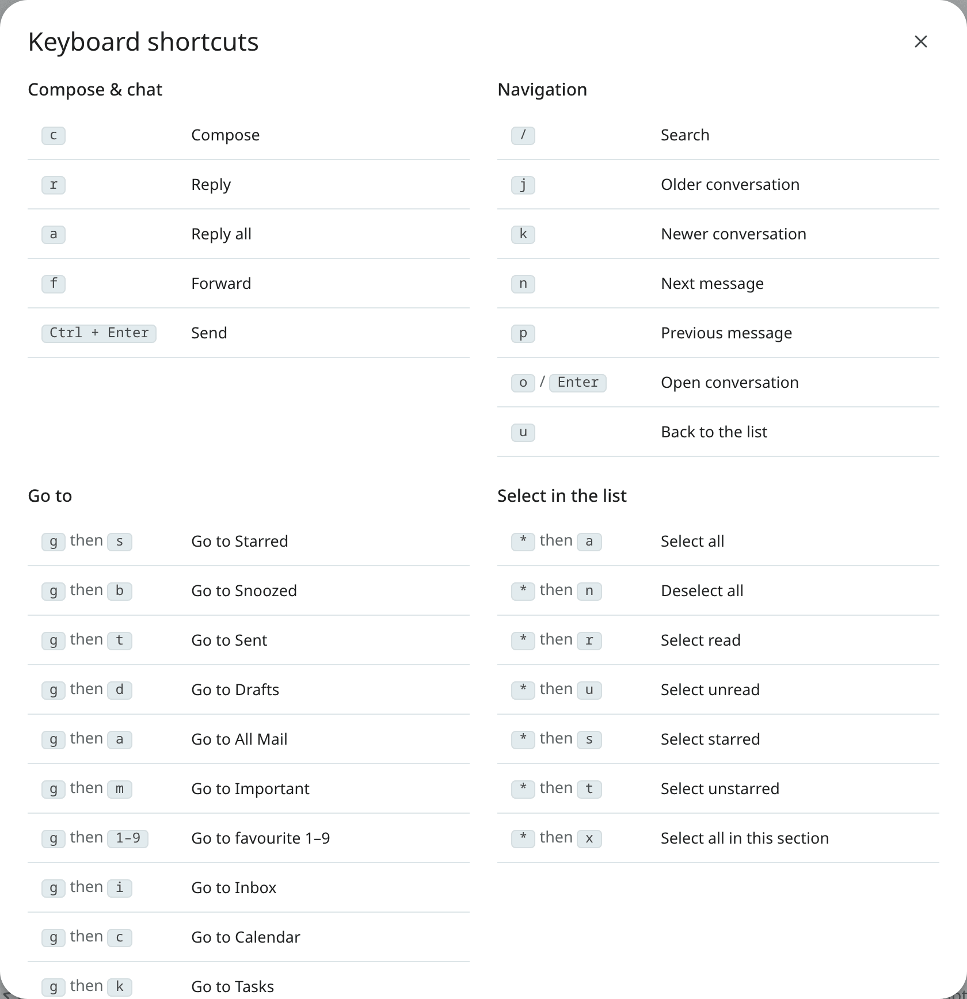

# Keyboard shortcuts

Mailr has Gmail's keys for mail, and similar keys in the Calendar, Tasks, Notes and Recordings apps.
Press `?` in any app to see every key for the page you are on. Turn shortcuts off or on with
**Keyboard shortcuts** in Settings → Look (`keyboard_shortcuts`).

Every key, app by app, is listed in the [shortcut reference](../reference/keyboard-shortcuts.md).
The most-used ones are `c` to compose, `r` to reply, `e` to archive, `/` to search, `g then i` for
the Inbox and `Ctrl + .` for Ambrose.

## Key conventions

- Keys written as `g then i` mean: press `g`, release it, then press `i`.
- Each app's keys work only in that app. In Settings, only the keys listed under **Everywhere** in
  the reference work, so a mail key such as `#` never changes mail you cannot see.
- When a link, a button or another control has the focus, `Enter`, `Space`, `Tab`, the arrow keys,
  `Delete` and `Backspace` work on that control as usual: with `Enter` you follow the link or press
  the button, and with `Tab` you move on. Letter keys remain shortcuts.
- Letters depend on `Shift`, not Caps Lock: `r` is Reply with Caps Lock on.
- A button's tip is shown while you point at it or it has the keyboard focus. It goes when the
  focus or the pointer moves on, when you press `Esc`, and when you switch to another tab or
  window.
- In the calendar, you move through the page with `Tab` as usual, and between events with the
  arrow keys (see [the calendar guide](calendar.md#moving-between-events-from-the-keyboard)).
- In Tasks, `Space`, `Tab` and `Shift + Tab` change a task only while the focus is on the task list
  or nowhere in particular. In the task pane and the sidebar, these keys work as usual for moving
  the focus and pressing buttons.

## The command palette

Press `Ctrl + K` (⌘K on a Mac) to open the command palette in every style: type to find a view, a
label, an action or a setting. Use `↑` and `↓` to move through the list, and `Enter` to run the item
marked ↵. The mark is on the first item at first and moves with the selection.
