# Notes and checklists

Notes are short cards, as in Google Keep. A note holds text, or it is a checklist: a list of items
you check off, such as a shopping list or a packing list. A note can switch between the two at any
time. Notes are stored on the Mailr server, next to mail, events and tasks.

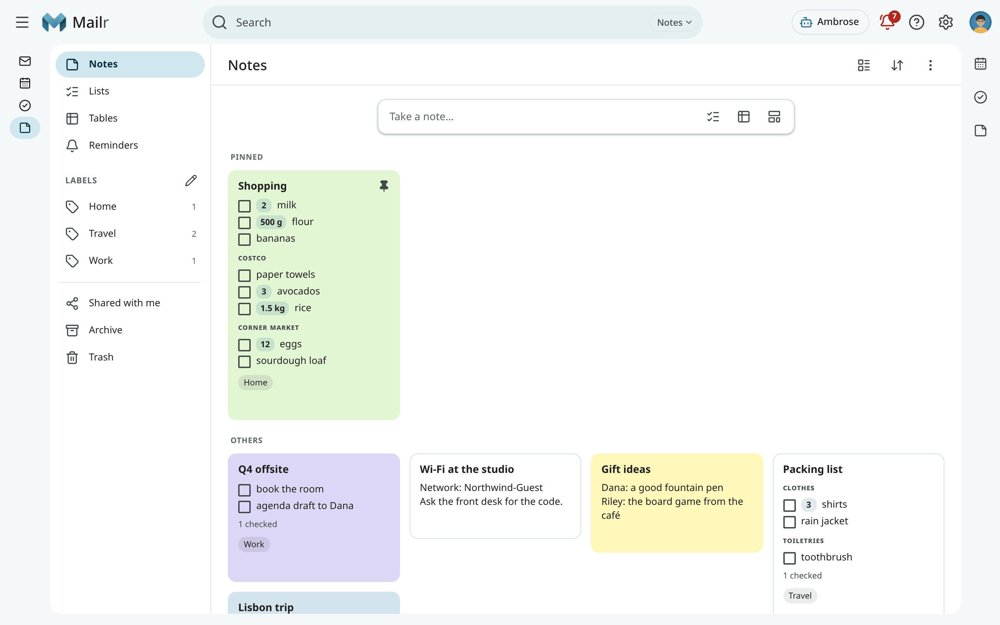

=== "Web"

    Click **Notes** in the navigation, or press `g` then `n` from anywhere. In the Focus style,
    click the note icon in the top bar, or choose **Go to Notes** in the command palette. On a phone,
    tap **Notes** in the bottom bar. Tables are part of Notes, under **Tables** in its left column.

=== "Android"

    Tap **Notes** in the bottom bar of the Mailr app. See [Notes, lists and tables](../android/notes.md).

Notes are separate from Ambrose's memories, which are under **Settings → Ambrose →
Memory**.

## The grid

The views are listed in the left column:

| View | Contents |
|---|---|
| **Notes** | Every note not archived or moved to Trash. |
| **Lists** | Checklists only. |
| **Tables** | Tables only ([Tables](tables.md)). |
| **Reminders** | Notes with a reminder of yours, the next one first. See [Reminders](#reminders). |
| **Labels** | The notes with one of your note labels. The number is how many notes have it. |
| **Shared with me** | Notes and tables other people share with you, and your groups' lists, by owner. |
| **Archive** | Notes you archived. |
| **Trash** | Deleted notes, for 30 days. |

Pinned notes sit at the top, under **Pinned**. The rest follow under **Others**. With the buttons in
the header, you switch between a grid and a single column and change the sort: **Manual** (your own
order), **Edited**, **Created** or **Title**. In Manual sort you drag a card to a new place, or
press `Alt + ←` and `Alt + →` on the focused card.

<!-- covers: note.reorder -->

A card shows the title, the first lines of a text note, or the first eight open items of a list
with their quantities and section names. Items left off the card are summed up in a line such as
"+ 6 more · 4 checked". Click a checkbox on a card to check the item in place.

To act on several cards at once, click the round tick at a card's corner, or press `x` on the
focused card. With the bar above the grid, you then pin, archive, label, colour or delete them all. One
toast shows what changed, and with its **Undo** every card is put back as it was.

## Take a note

<!-- covers: note.create -->

Click **Take a note…** above the grid, type a title and the text, then click anywhere outside the
card or press `Esc`. The note is saved. An empty card is not saved.

- Use **New list** (the checklist button, or `l`) to start a list instead. A list has a **Title**
  field and an **Items** field, and it opens with the cursor in **Items**. Type one item per line, or
  separate items with commas. Click **Title** above the items to name the list.
- In a label's view, a new note gets that label.
- Use **New list in a group** (the people button) to make a list that belongs to one of your groups,
  such as "Team". Everyone in the group can edit it. See [Share a note](#share-a-note).
- In the command palette (`Ctrl + K`), you can type **New note: …** and **New list: …**. Under
  "New list" you also see a task list; pick the checklist for Notes.
- Use **New from template** (the template button) to start a note, a list or a table from a template.
  See [Templates](#templates).

## Edit a note

<!-- covers: note.edit note.history note.restore_version -->

Click a card to open it. Where it opens depends on your style: a card over the grid (Classic and
Focus), the reading pane (Workspace), the pane below the grid (Desk), or a sheet from the bottom
(Cards, and every phone).

A note that opens over the grid works like any dialog. The rest of the page is unavailable until
you close the note, and with `Tab` you move only between the note's own controls. Press `Esc` to close it (in an
item you are editing, the first `Esc` leaves the item). The keyboard focus goes back to the card. An
open Ambrose panel stays usable beside the note. In the reading pane and the pane below the grid,
the notes stay usable while the note is open.

Changes are saved 1.5 seconds after typing stops, and at once when you leave a field or
close the note. There is no Save button. In a text note, **bold**, *italics*, links and `-`
bullets are shown formatted when you are not typing in the text.

If the note changed somewhere else while you typed (in another tab, or on your phone), the two
versions are merged. Only when both versions changed the same line are you asked, in a bar, to keep theirs
or use yours.

**Version history** (the clock button) lists the saved versions of the last 30 days, by day,
with who made each one and what changed. Select one to see it, with the lines that differ from
now marked. With **Restore this version**, it is saved as a new version, and the restore can itself be undone.

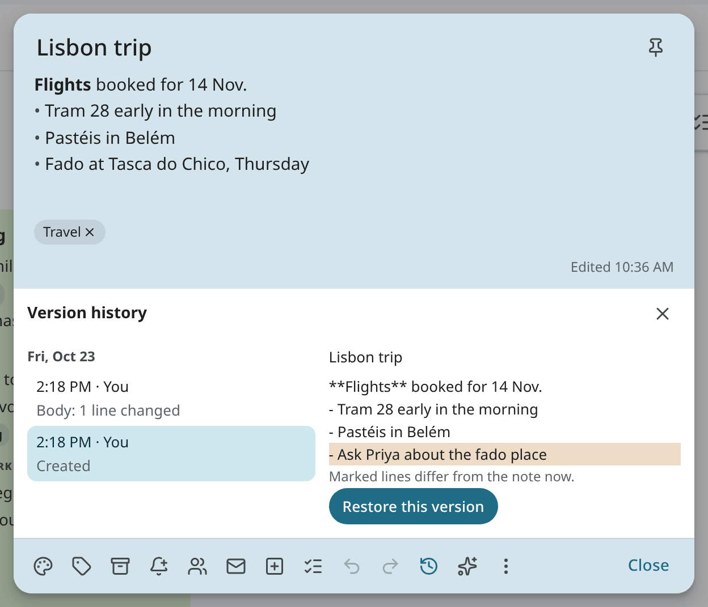

### Undo and redo

<!-- covers: note.undo_edit note.redo_edit -->

While a note is open, its changes are kept in a list and can be undone and redone one at a time.
Use the **Undo** and **Redo** buttons at the bottom of the note, or the keys:

- `Ctrl + Z` (`⌘ Z` on a Mac) undoes the last change.
- `Ctrl + Shift + Z` (`⌘ ⇧ Z`) or `Ctrl + Y` redoes it.

Each of the following counts as one change:

- Typing is undone a word at a time, or up to a pause of about a second.
- A paste, a cut, a spelling correction, a replace, a dictated phrase or a rewrite by Ambrose is one
  change. When you paste over the whole text by mistake, the old text is back after one undo.
- On a list, each tick, added or deleted item, move, section change and **Clear checked** is one
  change. So are a new colour, a label and **Make it a list**.

An undo or a redo is saved like any other edit, as a new version. A new change after an undo clears
the redo. The list holds the last 200 changes.

When one change removes more than three lines, or clears the note, a message says **Text removed**
with **Undo**.

While you type a new item, or change an item's text and have not left it yet, `Ctrl + Z` undoes
your typing in that line only. Outside a note, `z` still undoes the last action in the Notes app.

## Switch between text and list

<!-- covers: note.to_checklist note.to_text -->

Use the list button in the editor (`Ctrl + Shift + 8`) to turn a text note into a checklist. Each line
becomes an item, and a line such as `Costco:` becomes a section. Use the same button to turn a list
back into text: items become `- [ ]` lines, checked ones `- [x]`. Switching back restores
the same items, with their order and history.

## Checklists

<!-- covers: checkitem.add note.add_items checkitem.check checkitem.uncheck checkitem.edit checkitem.delete checkitem.move -->

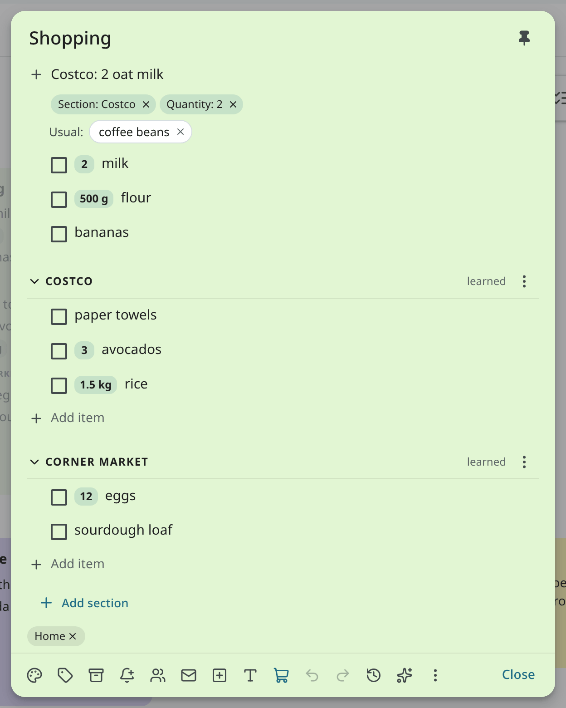

- **Add.** Type in **Add item** and press `Enter`. Separate items with commas or new lines to add
  several at once. Each section has its own **Add item** line. Press `Enter` in an item to add a new
  one after it.
- **Quantities.** Type "2 milk", "milk x2", "500 g flour", "Coke 2L" or "rice (2 kg)" to give the
  item a quantity, shown as a chip. "2% milk", "2026 planner" and "2 x 4 lumber" stay text. Chips under
  the add line show what will be read; click × on a chip to keep those words as text. Click a quantity
  chip to change it with − and +, or to remove it.
- **Duplicates.** When you add an item that is already on the list, the quantities are added up
  ("milk 1 → 3"). If the item is there but checked, it is unchecked. When the quantities cannot be
  added, a toast has **Add anyway**.
- **Paste.** When you paste several lines, a prompt shows what will be added, such as "Add 7 items to
  Shopping (Costco 3, Corner market 4)?". Press `Enter` to add them.
- **Check.** Click the box, or press `Ctrl + Enter` in the item. The item is struck through and
  is moved into the "n checked" group at the bottom a moment later. Click it there to uncheck it.
- **Edit.** Click the text. Type "x2" at the end to turn it into the quantity chip. Press
  `Shift + Enter` to add an extra line under the item ("the ripe ones").
- **Delete.** Empty the text and press `Backspace`, or use the item's ⋮ menu.
- **Move.** Drag the handle, or press `Alt + ↑` and `Alt + ↓`. Press `Alt + Shift + ↑` or
  `Alt + Shift + ↓` to move the item to the previous or next section.

<!-- covers: note.clear_checked note.uncheck_all checkitem.to_task -->

Use **Clear checked** to remove the checked items (they stay in the version history). Use
**Uncheck all** in the ⋮ menu to start a list over, for example a packing list. Use **Turn into a
task** in an item's menu to make a task with the item's text, linked back to the list.

### Sections

<!-- covers: checksection.create checksection.rename checksection.reorder checksection.order_mode checksection.delete -->

Use sections to split a list, for example one per shop. Make one with **Add section**, with a line such
as `Costco:` when you add items, or with `Alt + Enter` in an item. Click a section's name to fold
it. Use its ⋮ menu to rename, move or delete it. When a section is deleted, its items are either kept
(moved to the top of the list) or deleted too.

Type `Costco: milk, eggs` to add both items to Costco. The first letters of a section are enough
when only one section starts with them ("Cor: eggs" for Corner market). In a new list, a section is made
for a name you have not used yet. `Costco: 2 milk, eggs` makes a Costco section with milk (2)
and eggs. In a list that already exists, add the section first. When items such as "Costco: towels" are
already in the list, the toast after **Add section** has **Move them in**.

### Shopping lists

Use the cart button to mark a list as a shopping list. Two helpers are then turned on. Both are
based on counts of the items checked on this list; no model is involved.

- **Learned order.** Inside each section, items are sorted in the order in which they are usually
  checked, so the order of the list follows the route through the shop. Checks less than 45 minutes apart count as one
  trip. In a section's menu, you switch between **Learned** and **Manual** order and see how
  many trips the order is based on. Use **Reset learned order** to start again. The items above the first section
  have their own choice in the list's ⋮ menu, under **Order of the items above the sections**.
- **Usual items.** Items you check every so often are suggested again under the top add
  line: "Usual: coffee beans". Click one to add it to its last section with its last quantity.
  Click × to hide it until it is due again; right-click it for **Never suggest**. To turn the
  suggestions off for the list, use **Suggest usual items** in the ⋮ menu.

<!-- covers: checkitem.usual_add checkitem.usual_dismiss -->

### Repeating lists

<!-- covers: note.repeat -->

A list of weekly chores, or a packing list for a trip you make often, can be started over automatically.
Choose **Repeat…** in the list's ⋮ menu:

- **Weekly on** a day, for example Sunday.
- **Every** few days, for example every 3 days.
- Or type it the way you type a task's repeat: "every sunday", "every 3 days".

On each repeat, every checked item is unchecked at 4 in the morning in your time zone. Nothing is
deleted: the checks stay in the list's history, and the repeat is a version of its own, so
the checked state can be restored from **Version history**. Under its items, the list shows
"Repeats weekly on Sunday · next Sun 11 Oct", and its card has a repeat mark. To stop it, choose
**Repeat…** again, then **Does not repeat**.

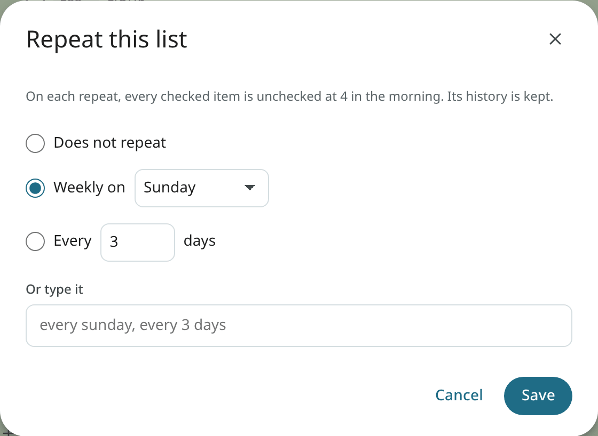

## Reminders

<!-- covers: note.remind -->

A reminder is a notification about a note at a set time. Open the note and click **Reminder** (the
bell in the toolbar), or click **Remind me** on a card. Pick **Later today**, **Tomorrow**, **Next
week** or **Pick a date and time…**. The time is shown as a chip on the note, and on its card too.
Click × on the chip to remove the reminder; the toast has **Undo**.

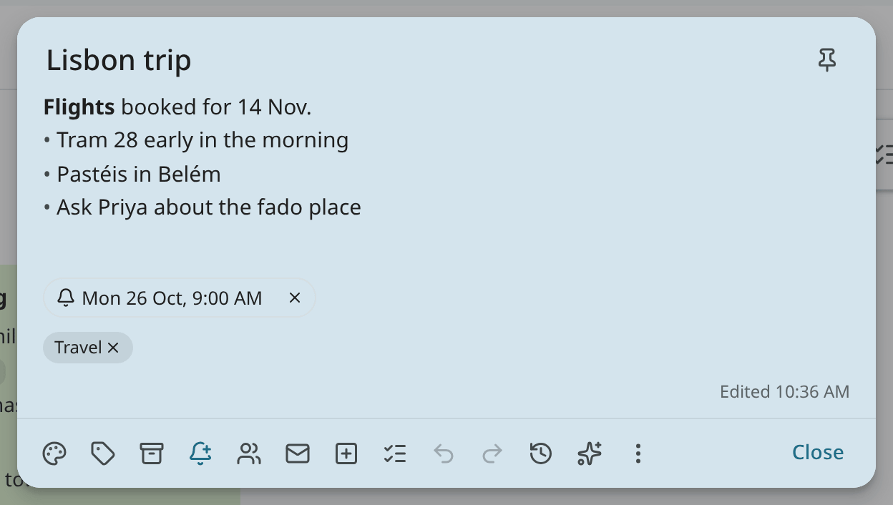

At the set time, the reminder arrives like other reminders: in the bell (**Waiting for you**), as a
browser notification, and on the phones that receive reminders. Use **Snooze** to bring it back later,
or **Dismiss** to end it on every device at once. See [Snooze and reminders](snooze-and-reminders.md).

- A reminder is personal. Other people on a shared note do not receive it, and one can be set on a
  view-only note.
- Notes with a reminder are listed under **Reminders** in the left column, the next one first. A note
  taken there gets a reminder; pick when in the card's footer.
- To find them in search, use `has:reminder`.
- Items of a list have no reminders of their own. To give an item a time, make it a task
  (**Turn into a task** in the item's menu).
- Ambrose can set or remove a reminder on a note ("remind me about the passport note on
  Friday at 9"). It never snoozes or dismisses one.

## Templates

<!-- covers: note.from_template note.save_template note.delete_template table.save_template -->

Use a template to start a new note, list or table with the same content each time, such as a weekly
shopping list with your shop's sections, a packing list, meeting notes, or the columns of a table.

Click **New from template** above the grid to open the templates. A few starters are included: a
**Shopping list** with store sections, a **Packing list**, **Meeting notes** and an **Expenses**
table. Your own templates follow under **Your templates**. Click one to make a new note, list or
table from it. A list from a template has every item unchecked.

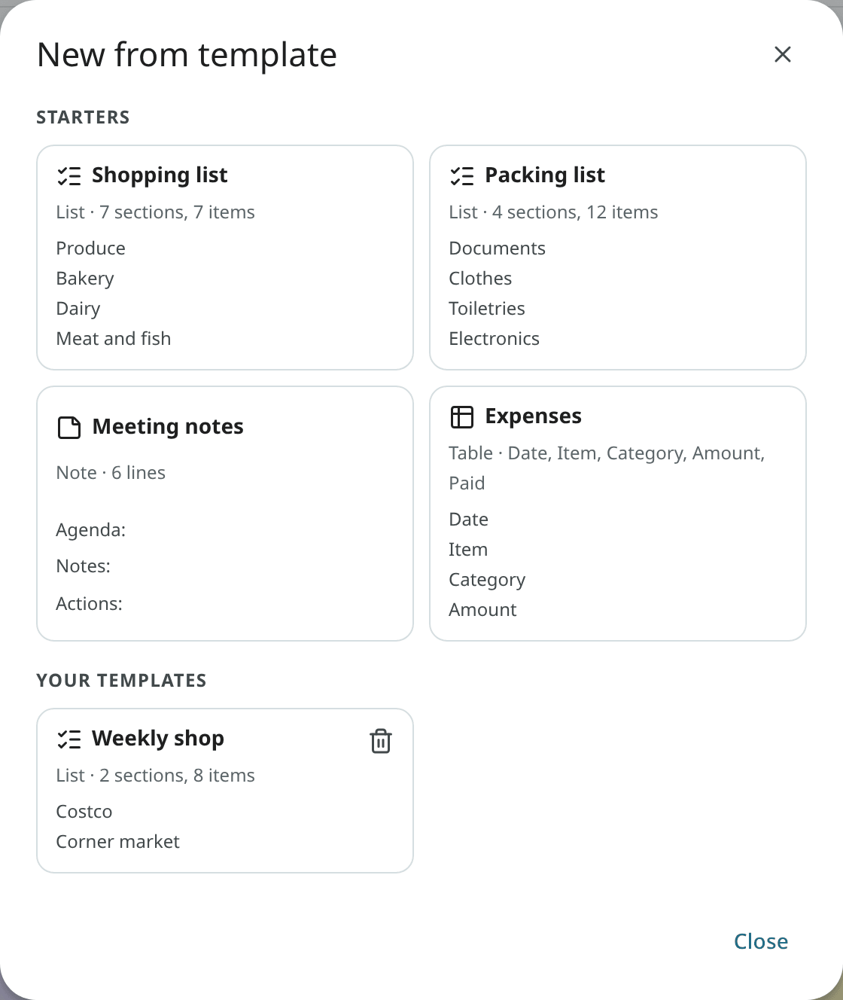

To make your own, open a note or a list and choose **Save as template** in its ⋮ menu. Name it and
click **Save template**. A template holds the title and the text, or the sections and the items
with their quantities. Labels, shares, links and history stay with the note. In a table, use **Save as
template** in the ⋮ menu to keep the columns. Rows and link columns stay with the table.
A template made from a note, a list or a table with **Local models only** keeps that mark: anything made
from it is local-only too, and it is hidden from API tokens that are not local-only.

Click the trash button on one of your templates to delete it; the toast has **Undo**. The starters
stay. The template a note came from is never changed when you change the note.

## Colours, pins, labels and archive

<!-- covers: note.color note.pin note.label note.archive notelabel.create notelabel.rename notelabel.color notelabel.reorder notelabel.delete -->

Hover over a card, or use the editor's toolbar:

- Use **Colour** to give the card one of 12 named colours.
- Use **Pin** (`f`) to keep the note at the top.
- Use **Labels** (`t`) to add your note labels. Type a new name to create one. You can also drag a card
  onto a label in the left column. Note labels are separate from mail labels and task tags.
- Use **Archive** (`e`) to take the note out of the grid; it stays in Archive and in search.

Click the pencil next to **Labels** to open **Edit labels**: rename a label (every note keeps it under the
new name), give it a colour, move it up or down, or delete it (the notes stay).

## Trash

<!-- covers: note.delete note.restore note.purge note.duplicate -->

Use **Delete** (`#`) to move a note to Trash. A toast has **Undo** for 7 seconds. In Trash each card
shows how long ago it was deleted and how many days it has left. Use **Restore** to bring it back
with everything it had. With **Delete forever** and **Empty Trash**, you are asked first and offered
a Markdown copy of the notes before they are gone.

Use **Make a copy** in a note's ⋮ menu to duplicate it, and **Make a copy as a list** or **Make a
copy as text** to make a copy of the other kind.

## Share a note

<!-- covers: note.share note.unshare note.leave note.move_group note.share_notices -->

You can share a note, a list or a table with other people on your Mailr server. Open the note and
click **Share** (the people button in the toolbar), or choose **Share…** in a card's ⋮ menu.

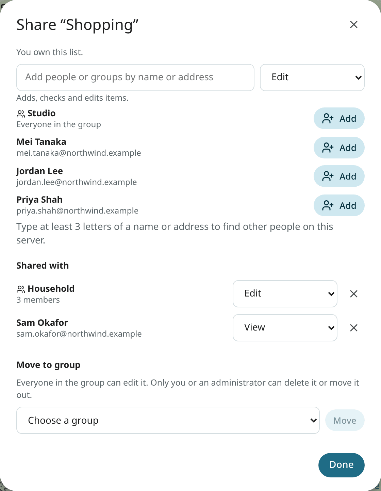

1. Type a name or an address. The list shows the people in your groups and the groups you can add.
   Other people on your server show up once you type at least three letters of their name or
   address; the full list of people on the server is never shown.
2. Pick a level: **View** (reads it, changes nothing), **Edit** (adds, checks and changes items),
   or **Edit and share** (edits, and shares it with other people too).
3. Click **Add**.

Change a level in the menu next to a person. Click **×** to stop sharing with them; the note is removed
from their notes at once. Someone at **Edit and share** manages the other people as you do, but
cannot change your own access.

The administrator sets whether sharing is allowed with anyone, only with people in the same groups, or with nobody. A narrower setting is noted in the dialog.

**Groups.** You can share with a group you are in: everyone in it gets the level you pick. Use **Move
to group** in the dialog to hand the note to one of your groups. Everyone in the group can then edit it.
Only you, as the person who made it, or an administrator can delete it or **Move out of the group**.
Someone who leaves the group loses access to the note; the note itself stays.

**Receiving a share.** When someone shares a note with you, you see a short notice in the left column
("Dana shared “Groceries” with you") until you dismiss it, and the note is listed under **Shared
with me**. A note at **View** is marked "View only · shared by Dana" and its checkboxes are off. A card shows the
initials of the people on it, and a dot when someone else changed it since you last opened it.
While another person writes, the open note shows "Dana is editing", and their items are marked
"Added by Dana". Pins, labels, archive and grid order are kept per person.

Use **Remove from my notes** (⋮, or in the dialog) to take a note someone shared with you out of
your notes. It stays for everyone else. The toast has **Undo**. A group's list is removed from your
notes when you leave the group. In the owner's dialog, the people who removed it are listed, with
the day, under **Removed it from their notes**. Use **Share again** to give it back to them at View.
When you stop sharing with someone who removed it, their **Undo** no longer brings it back: only a
new share from you does.

A link in a shared note (to an email, an event, a task or a recording) is shown with its title only
to people who can open the linked item. Everyone else sees "Email (not shared with you)" or
"Not shared with you". An API token is shown a title only when the email or the event is inside its
limits: a local-only account's mail stays hidden from a token that is not local-only.

Ambrose has the same access to each shared note as its user, and it never shares one. To find
shared notes and tables in search, use `is:shared`.

<!-- covers: note.share_quick note.presence -->

**Hand a list over.** The ⋮ menu of an open list has **Share with Mei** for up to two people
who are in one of your groups and do not have the list yet. With one click, you share it at
**Edit**; the toast has **Undo**. To share with anyone else, use **Share…**.

**Presence.** While someone else has a shared list open, you see "Dana is in this
list" on yours. You see her ticks as they happen, with her name beside the row for a moment. When she
closes the list, the line is removed. Presence is not stored.

## Local models only

<!-- covers: note.local_only -->

Turn on **Local models only** in a note's ⋮ menu to exclude that note, list or table from hosted
models: only a model that runs on your own server is used on it, for Ambrose, search and summaries. Anyone
who can edit it may turn it on. Only its owner may turn it off; for a group's list, the person who
made it. Someone else sees the switch on and locked, with "Only the owner can turn this off." When
another person turns it on, the owner is notified. A card has a lock.

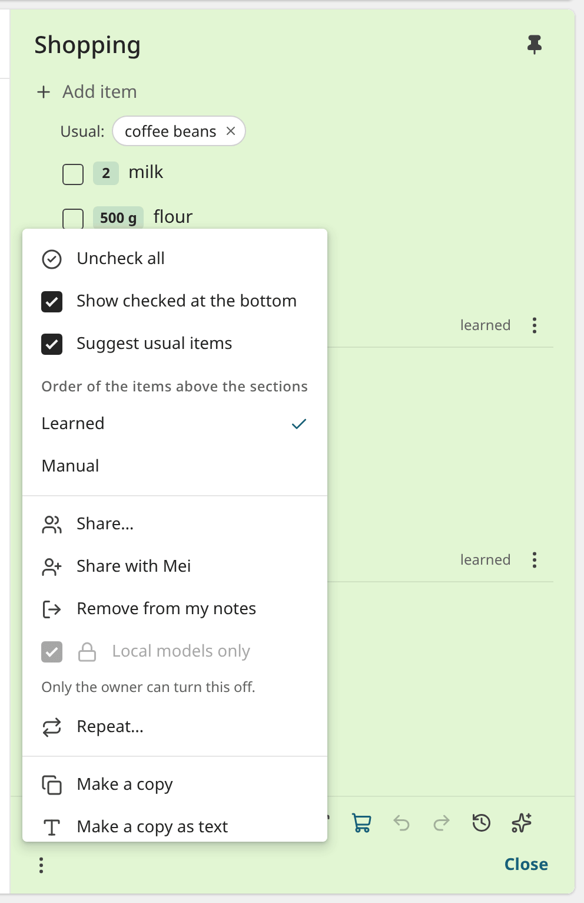

Your own **Local models only for me** switch, and your administrator's rule for everyone, are
described in [Local models only](assistant.md#local-models-only). With either one on, every note is treated more strictly, whatever its own switch is set to.

## Search

<!-- covers: note.search -->

Press `/` in Notes, or use the search box at the top while its chip says **Notes** (see
[Search](search.md#search-scope)). Titles, text, items and section names are searched as you
type. A search with the **All** chip shows a **Notes** section above the mail results with
the first three matching notes and **See all in Notes**. The command palette has **Search notes for …** and **Go to** a note by
its title.

## Notes from email, and links

<!-- covers: note.from_email note.link note.unlink -->

In a message's ⋮ menu, use **Save to a note** to make a note with the subject and a link back to
the conversation; text you selected in the message is put into the note. Use **Make a checklist from
it** to turn the selected lines into items. A note or a checklist made from the mail of a local-only
account is local-only too, like a note from a local-only recording.

A note's links are shown as chips under the text. Click **Add a link** (the mail button in the
toolbar) to open a search: type a few words, and pick an email, an event, a task or a recording from the
results. A pasted Mailr address works too. Click × on a chip to remove the link; the toast has **Undo**.

The link is shown on the other side as well, as chips you can click. Click × on a chip to remove
the link; the toast has **Undo**.

- On **an email**, they are shown on its subject line, after the labels. **Create from email** in
  the reader's toolbar and in the row's right-click menu has **Note**, **Checklist** and **Link to a
  note or table…** (search your notes and tables, and pick one). On a phone, it is in the ⋮ menu.
  See [Create from email](reading.md#create-from-email).
- **An event's details, a task's pane and a recording's Links tab** have the chips and one
  **Link a note or table** button. With it you open the same search; use its last row, **New
  note**, to make a note named after the event, task or recording, linked to it.

### Create from note

Use **Create from note** (the square with a plus in a note's toolbar) to make something from the note:

- **Task**: the task editor is opened with the note's title, and its text with a link back. Once
  saved, the task is linked to the note, and the message has **Open** and **Undo**.
- **Event**: the event editor is opened the same way. Once saved, the event is linked to the note.
- **Email**: a new email with the note's title as its subject and its text as the message. For a
  checklist, the open items are used.

<!-- covers: note.to_task note.to_event note.to_email -->

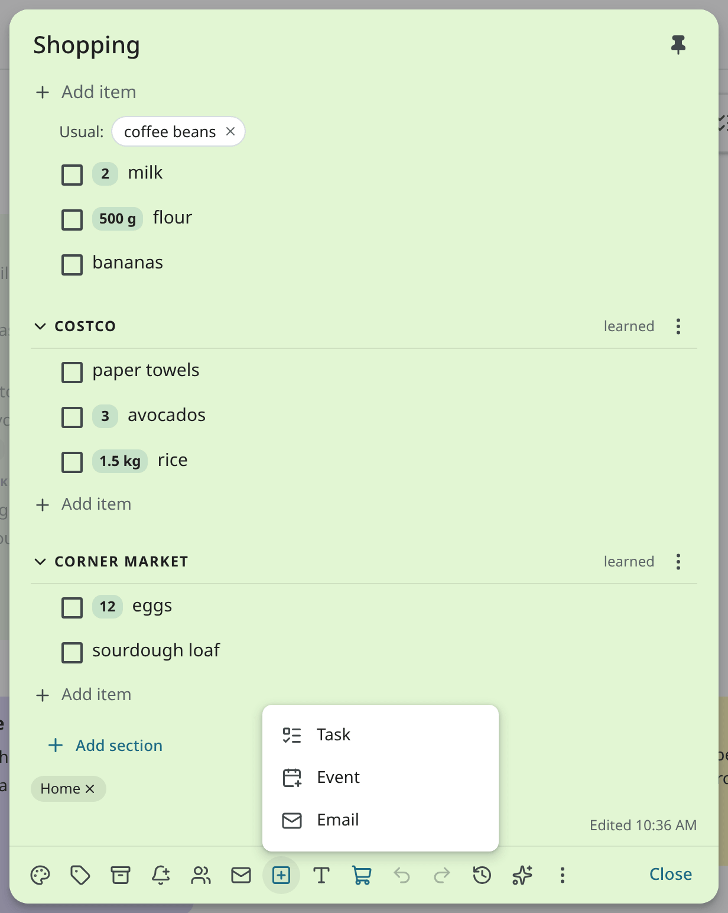

A list item you turned into a task (**Turn into a task**) is shown on the task as **From the list
…**; click it to open the list at that item.

<!-- covers: note.from_recording -->

Use **Create note from recording** (under the chips in a recording's Links tab) to write a text
note from what is known of the recording: its title, the date and time, the people in it, Speakr's
summary and the action items. The action items are the summary's own list and the tasks you already
made from the recording. The transcript is never included. The note is linked to the recording, and
each can be opened from the other. A note from a local-only recording is local-only too. Click the toast
to open the note.
You can also ask Ambrose: "Make a note from this recording".

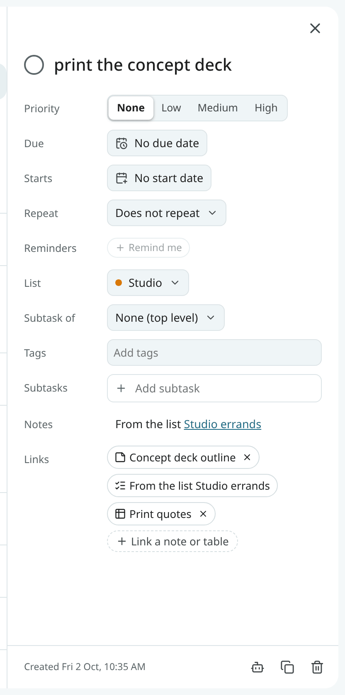

## Notes beside the page, and the palette

Click the Notes icon on the right (Classic), or choose **Notes beside** in the
command palette in every style, to open a panel next to your mail: your pinned lists with
their open items, which you can check, and a line for adding items to a list you choose. In the
palette, type **Add to Shopping: milk, eggs** to add items to a list by its name.

<!-- covers: note.quick -->

**A quick note from anywhere.** Press `Shift + N` anywhere in Mailr, or choose **New note…** in the
palette. Type a note and press `Enter`: the first line is its title. Start with `#` and a list's name
to add items to that list instead. For example, type `#Shopping Costco: milk` to add milk to the
Costco section of Shopping. The line under what you type shows what will happen ("Add to Shopping: milk", with a chip
"milk · Costco"). For a name that is no list yet, a new list is made. The toast has **Open**
and **Undo**.

## Ask Ambrose

<!-- covers: agent.ask_about -->

The [assistant](assistant.md) can also manage notes and lists. Ask it in plain words, from any
screen:

- "Add milk and 2 eggs to my shopping list under Costco." It finds the list by its name, makes the
  Costco section when the list has none, and reads "2 eggs" as a quantity. Without a section, an
  item goes where it was the last time you had it.
- "Check off bread and butter." "Move the hinges to Hardware." "Clear the checked items."
- "Make a checklist from this email." It reads the email and proposes a new list that links back
  to it.
- "Turn these into tasks." The items you selected become tasks, each linked back to its list.
- "What was on the packing list last week?" It reads the list's versions.

Use **Ask Ambrose** (the sparkle button in the note's toolbar, or `Shift + A`) to open the ask box
with the note attached. Select items first to ask about those items only.

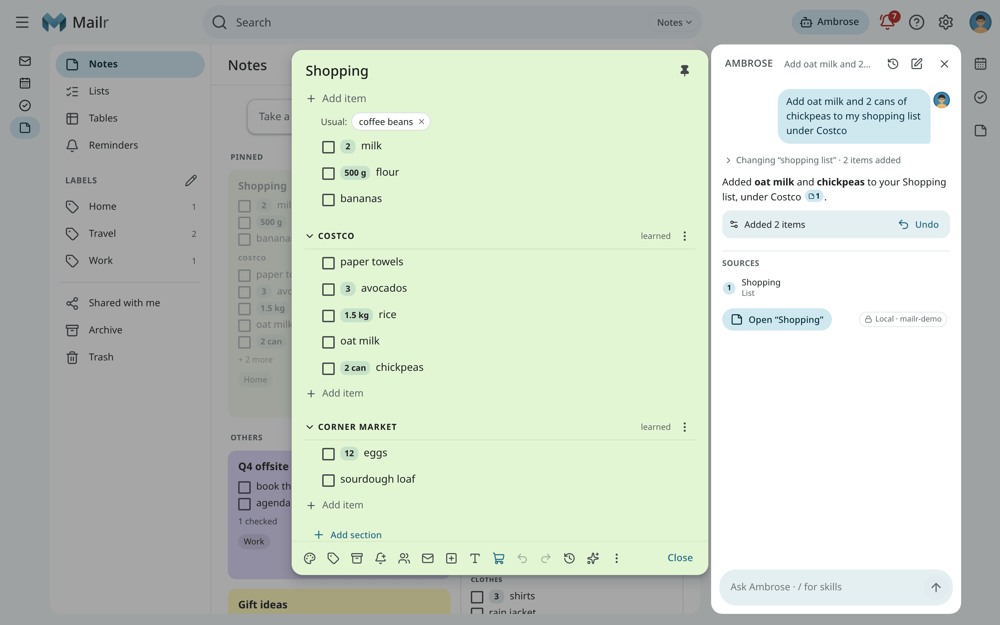

What Ambrose changes is shown in the chat with **Undo**, and the answer has a link to the list. Each
change is a version of its own in **Version history**, marked **Assistant**.

<!-- covers: note.from_answer -->

Use **Save to note** (the note button under an answer) to keep the answer as a text note. The note
has the answer's text and a "Sources" list, and has links to the emails, events, tasks and recordings the
answer cites. A web page the answer cites stays as a line under "Sources". Click the toast to open the note.

Ambrose has the same access to each note as its user. A note shared with you to view only stays
read-only for Ambrose too, and Ambrose never shares a note. Approval is required for moving a note to Trash and
clearing checked items. When Ambrose has read text from other people in the
same request, such as an email or a list someone shares with you, it also asks before it writes new
text into a note. No approval is required for checking items. These rules are set under **Settings → Agents & API
→ Permissions**, in **Notes and checklists**. See [Approvals for agents](../agents/approvals.md).

A local-only note is never sent to a model hosted outside your server. In a chat on such a model,
a message states that some notes are hidden from it.

When someone else turns **Local models only** on (see [Local models only](#local-models-only)), you
see a line at the top of Notes ("Dana turned Local models only on for
“Camping”"), and the change is recorded in the note's version history or the table's history. When
Ambrose or an agent asks to turn it off, approval is always required, and the approval card
shows that hosted models could then read the note.

## Import from Google Keep

<!-- covers: note.import_keep import.undo -->

The **⋮** at the right of the Notes top bar has **Import from Google Keep…**.

1. In [Google Takeout](https://takeout.google.com), choose only **Keep** and download the export.
2. In Mailr, choose **Import from Google Keep…** and pick the .zip file. You can also pick the
   `.json` files from its Keep folder.
3. Before anything changes, a summary lists what comes in: how many notes and checklists, which labels
   (and which are new), and what stays behind. Then click **Import**.

Text notes become notes and lists become checklists, with checked items still checked. Labels,
colours, pins and archived notes come across. Notes in Keep's trash and attachments such as
pictures stay behind. For a note longer than Mailr's limit, only the first 20,000 characters are kept.

The message afterwards has **Undo**. With it, every imported note is moved to Trash, and the labels
made by the import are removed unless another note has them.

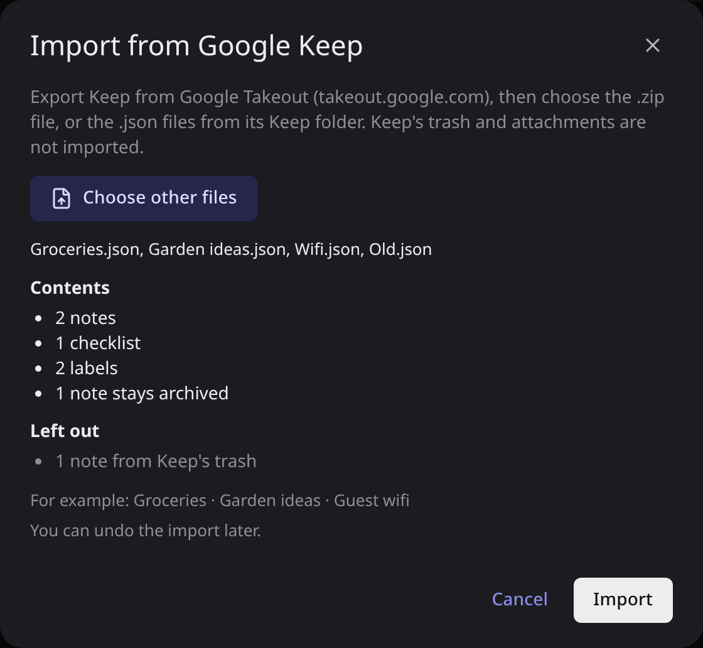

## Export

<!-- covers: note.export -->

Use **Export as Markdown** in a note's ⋮ menu to download it as a Markdown file. Use **Settings →
Notes & tables → Export all notes** to download every note as Markdown files plus a JSON copy, in
one zip file. A checklist is exported as `- [ ] milk ×2` lines, which are read back as the same
items when you paste them into a list.

An export is not required as a backup. Notes, lists and tables are written to plain files on the
server every day, next to the copy of the mail, and these files are included in the server's backups. See [Backups](../admin/backups.md#notes-lists-and-tables).

## On a phone

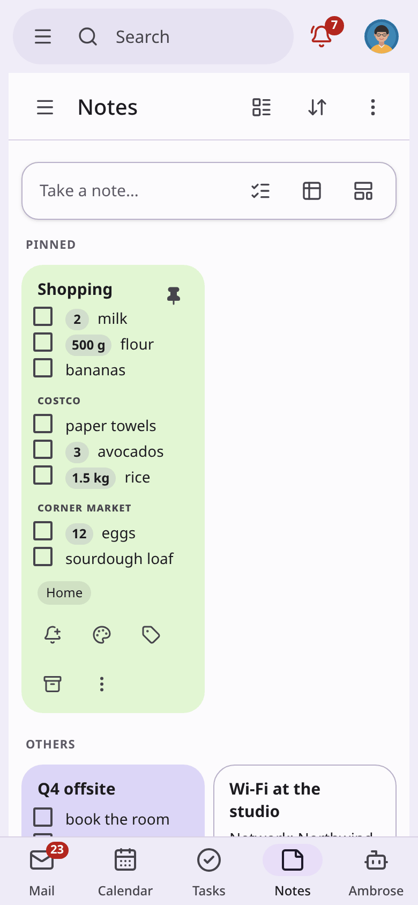

The grid has two columns. A note is opened as a sheet from the bottom. The Mailr Android app has
Notes with offline editing too; see [Notes, lists and tables](../android/notes.md).

## Offline

Lists also work offline, for example in a shop with no signal. In the web app, and in the app
installed from the browser:

- Lists opened on this device are kept there and can be opened with no connection.
- One line at the top shows that you are offline and what keeps working in Notes: "Lists keep working:
  changes wait on this device and are sent later".
- Ticks, new items and changes to an item's text, quantity or extra line are kept on this device.
  You see them in the list at once, with a dashed edge, and its last line under the items shows "2
  changes wait on this device", then "Sending 2 changes made offline…" when you are back online.
- When the connection is back they are sent in order, each once. A tick keeps the time you made it,
  so when two people tick the same item, the later tap counts.
- If one is refused (someone changed the same item meanwhile), you see the refusal in that line, with
  **Retry** and **Discard**.
- A connection is required for moving items, sections, clearing checked items, usual items, new
  notes and the note's own settings. You are told so when you try. A text note is read-only offline.

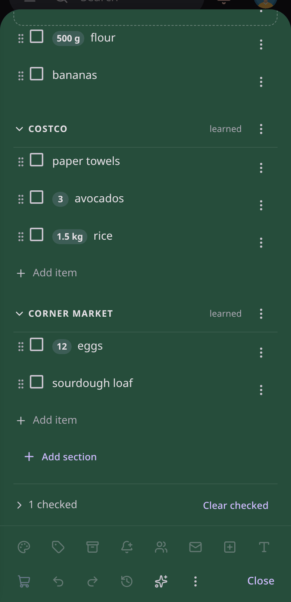

## Keys

| Action | Keys |
|---|---|
| Go to Notes | `g then n` |
| A quick note from anywhere (`#List` adds items) | `Shift + N` |
| New text note | `c` |
| New list | `l` |
| Next card / previous card | `j` / `k` |
| Open the focused card | `o` or `Enter` |
| Search notes | `/` |
| Go to Lists | `g then l` |
| Undo the last action (outside a note) | `z` |
| Undo / redo in an open note | `Ctrl + Z` / `Ctrl + Shift + Z` or `Ctrl + Y` |
| Make it a list / make it text | `Ctrl + Shift + 8` |
| Check or uncheck the focused item | `Ctrl + Enter` |

The [shortcut reference](../reference/keyboard-shortcuts.md#notes) lists every key of the Notes app.
