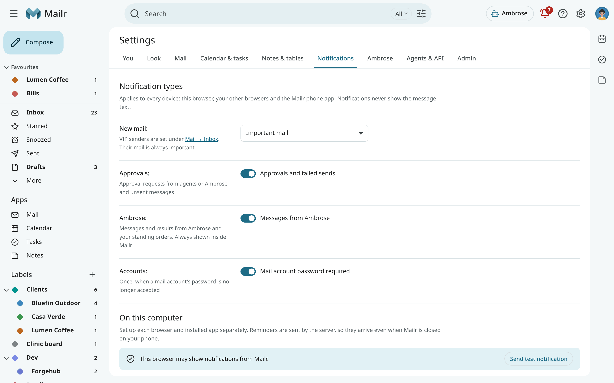
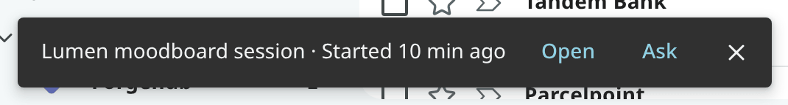

# Notifications

Notifications for new mail, and reminders of events and tasks, can be shown on a computer. The phone
app has its own notifications; see [Calendar, tasks and reminders](../android/calendar-and-reminders.md)
and [App settings](../android/settings.md). For Mailr added to a phone's home screen (new mail,
approvals and Ambrose, also on an iPhone), see [The web app on your phone](phone.md#notifications).

## Notification choices

Open **Settings → Notifications**. **Notification types** is one choice per kind, the same on every
device: this browser, your other browsers, Mailr on a phone's home screen and the Android app.

| Choice | Setting | Notified about |
|---|---|---|
| **New mail** | `mail_notifications` | **Off**, **VIP senders only**, **Important mail** (the default), **Important and Primary**, or **All new mail**. Mail from your [VIP senders](triage.md#vip-senders) is always important. |
| **Approvals** (**Waiting for you** on Android) | `notify_approvals` | An agent or Ambrose asks for your approval, or a message wasn't sent. |
| **Ambrose** (**Messages from Ambrose**) | `notify_assistant` | Messages from Ambrose and your standing orders. Inside Mailr they are always shown. |
| **Accounts** (**Mail account password required**) | `notify_accounts` | One notice when syncing of a mail account stops because its password is no longer accepted. |

An approval notification is removed once the request is answered, wherever it is answered: in
this browser, in another browser, on the phone or from the phone's notification. It also goes when the
request expires, or when you send or cancel the draft in the request. The same applies on every
device that shows approval notifications.
<!-- covers: approval.sync -->

The message text is never shown in a notification. Click it to open the conversation. No notification is sent for
mail waiting in the [Screener](screener.md); once the sender is allowed, notifications follow for their later mail.

<!-- covers: notification.choose -->

## On this computer

**On this computer** holds the choices for this browser only. The page shows whether notifications
are allowed in this browser, and permission is asked for the first time you turn a switch on.

| Switch | Effect |
|---|---|
| **While Mailr is open** (**Desktop notifications**) | In a background tab: the notifications chosen under **Notification types**, and reminders with Snooze and Done or Dismiss. |
| **When Mailr is closed** (**Push to this browser**) | The notifications chosen under **Notification types**, and reminders, reach this browser even when no Mailr tab is open, through Web Push. Each browser is set up on its own. |
| **Mail on this browser** | Shown while push is on. With **Off**, mail notifications stop in this browser only. Approvals, Ambrose and reminders still arrive. |

The bell (**Waiting for you**) also has a one-time banner, **Get reminders on this computer**, with **Turn
on** and **Not now**.
<!-- covers: notification.subscribe -->

!!! note
    For push to a closed browser, the server must be reachable over HTTPS. If the switch shows
    that the browser cannot receive push, ask your administrator; see
    [Push notifications](../admin/push.md).

### The buttons on a reminder notification

| Reminder | Buttons |
|---|---|
| Task | **Done**, **Snooze 1 h** |
| Event, more than 5 minutes before the start | **Snooze 5 min**, **Remind before…**, **Dismiss** |
| Event with guests, more than 5 minutes before the start | **Snooze 5 min**, **Prep**, **Remind before…** |
| Event, about to start | **Snooze 5 min**, and **Join** when the event has a video link (otherwise **Dismiss**). An event with guests also has **Prep**. |

Use **Prep** to open the event with its [meeting prep](calendar.md#meeting-prep). The reminder
stays as it is. Only two buttons are shown in some browsers. Click the notification itself to open the reminder sheet
in Mailr. See [Snooze, follow-ups and reminders](snooze-and-reminders.md#the-reminder-sheet).

When desktop notifications are off and a reminder fires while Mailr is open, it appears as a small
notice inside the page with **Open** and **Ask**.

### Reminder kinds

The switches under **Reminders** apply to every device that gets reminders from the server.

| Switch | Setting |
|---|---|
| **Events** | `reminders.events` |
| **Tasks** | `reminders.tasks` |
| **Missed** (one quiet notice for reminders that fired while the computer was off or asleep) | `reminders.missed` |
| **Remind again** (every few minutes until you act, at most 3 times) | `reminders.repeat` |
| **Sound** (a short chime with each reminder on this computer) | `reminders.sound` |

The places web reminders appear (desktop notifications and browser push) are stored in `reminders.web`.
