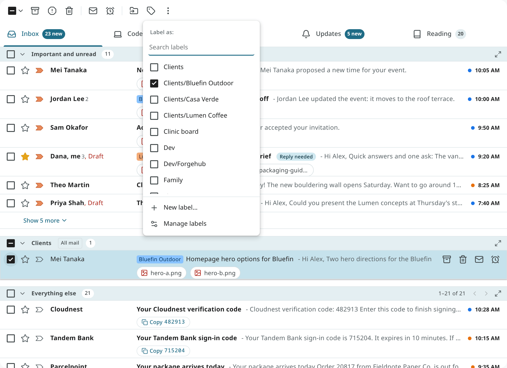
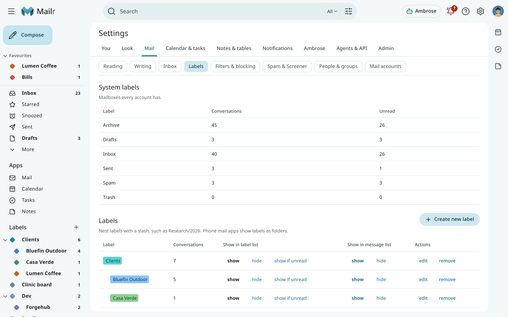
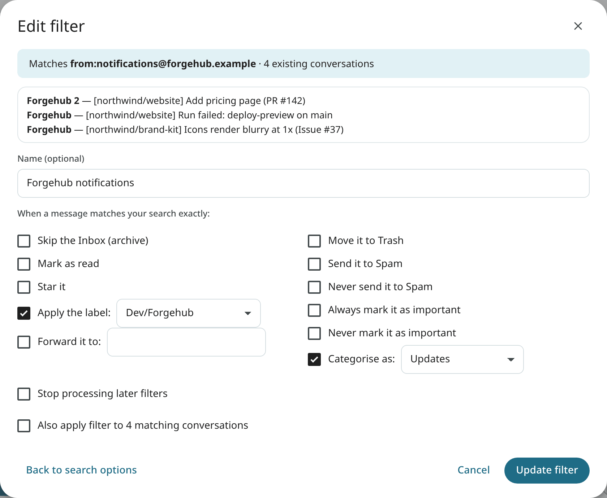
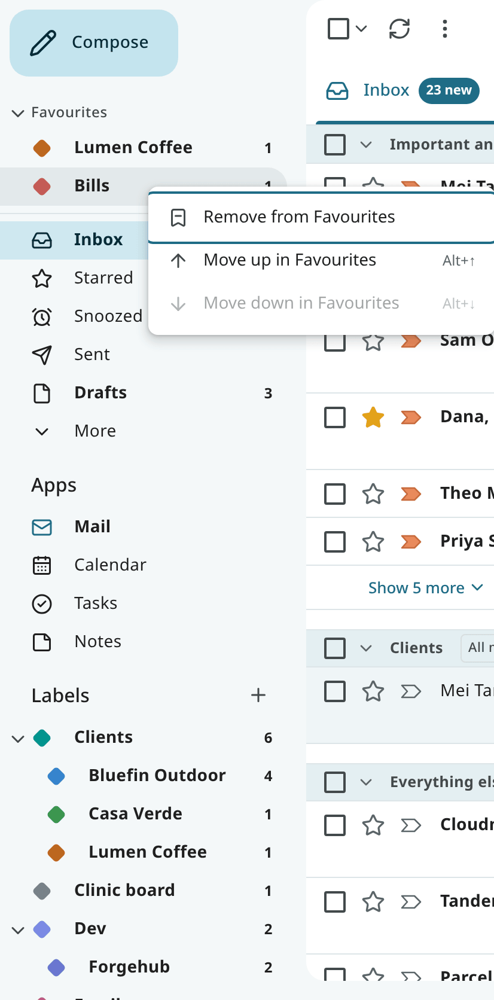

# Labels, filters and favourites

## Labels

A label is a tag on a conversation. A conversation can have many labels, and it stays in the
Inbox until you archive it. Folders from your other mail accounts are shown as labels.

**Label a conversation** with `l`, the **Labels** button in the reader or toolbar (its menu is headed
**Label as**), or **Label as** in the row's right-click menu. Tick the labels you want. For a new label, type its name, choose **New label "…"…**, and then **Create** in the dialog
(where it can also be nested under another label). You can also drag
rows onto a label in the navigation. Labels are shown as coloured chips on the row and in the reader.
<!-- covers: mail.label -->

### Managing labels

Open **Settings → Mail → Labels**:

- **Create** a label, or nest it under another with a `/` in its name: `Clients/Lumen Coffee`.
- **Edit** a label to rename it, pick a colour, or move it under another label.
- Use **Show in label list** and **Show in message list** to hide a label from the navigation or
  from the rows.
- **Remove** a label. The conversations stay; only the label is removed.

Right-click a label in the navigation for a quick colour change, and to show or hide it. The colour
picker shows the scheme set in Settings → Mail → Labels (`label_scheme`).

### Suggested labels

The labels you give by hand are used as examples. Once a label has enough examples, it is suggested
on new mail that looks alike, and the **Why this is here** panel in the reader lists the
suggestion with **Apply** and **Dismiss**. Use **This is wrong** to remove an automatic label. A label that proves accurate is applied on its own to new
mail. Each automatic label you remove is also used as an example.
Whether recent labels count more than old ones, and how quickly old ones fade, is set under
**Settings → Mail → Labels → Learn from my choices** (`label_recency`).

A label is applied on its own only to mail from a sender or mailing list that you have already
given that label. Mail from anyone else gets a suggestion at most.

Mail in Spam or Trash, and mail that looks like spam, gets no suggested or automatic labels. When
mail moves to Spam, its suggestions and the labels that were applied on their own are removed.
When you report mail as spam, your own labels (the ones you or a filter gave) are set aside while
it is in Spam. With **Not spam**, they are put back, and labels can be suggested for it again.
Spam and Trash are left out of a label's list, its count and an inbox tab built on it. To find labelled mail there, search for `in:spam label:name` or `in:anywhere label:name`.

## Filters

A filter applies to new mail that matches a search. Open **Settings → Mail → Filters & blocking →
Create filter**, or start from a search with **Create filter**, or from a message with **Filter
messages like this**.

1. Type the **Search query**. Any [search operator](search.md) works. The form shows how many
   messages match now.
2. Choose what happens to a match:

    | Action | Effect |
    |---|---|
    | **Skip the Inbox (archive)** | The mail goes straight to its labels. |
    | **Mark as read** | |
    | **Star it** | |
    | **Apply the label:** | Add a label (create it here if needed). |
    | **Forward it to:** | Forward to another address. The address must be confirmed first: a code is sent to it. Mail that ends up in Spam or Trash, or comes from a blocked sender, is never forwarded. Forwards are marked as automatic (`Auto-Submitted`), so they get no automatic answers from other systems. |
    | **Move it to Trash** | Move to Trash. |
    | **Never send it to Spam** | Ignore every spam check. |
    | **Send it to Spam** | |
    | **Always mark it as important**, **Never mark it as important** | |
    | **Categorise as:** | Put the mail in a category tab. |
    | **Stop processing later filters** | This mail is skipped by later filters. |

3. Tick **Apply to existing mail** to run the filter on what you already have, then save.

Filters are run in order, top first; use **Move up** and **Move down** to reorder them. Turn one off
for a while with **Disable filter**. A filter always takes precedence over Mailr's own guesses.

Use **Import Gmail filters** with the filters file exported from Gmail (Settings → Mail → Filters & blocking →
Export in Gmail) to create the same filters in Mailr.

## Blocked senders

Choose **Block "…"** in a message's menu. Mail from that address goes to Spam from then on. The
**Blocked addresses** list in Settings → Mail → Filters & blocking shows everyone you blocked,
with **Unblock**.

## Favourites

Favourites are views and labels pinned to the top of the navigation, in a custom order. They
are shown in every style, and in the phone's drawer too.

- **Add** a favourite: right-click a view or label in the navigation and choose **Add to
  Favourites**. On the phone, long-press an entry in the drawer.
- **Remove** one: right-click it and choose **Remove from Favourites**.
- **Reorder** them: drag a favourite up or down, use **Move up in Favourites** and **Move down in
  Favourites** in its menu, or focus it and press `Alt + ↑` or `Alt + ↓`.

In the Classic layout, Inbox, Starred, Snoozed, Sent and Drafts are always in the sidebar, so they
are left out of the Favourites group, which has only the other views and labels you added. The group
is hidden until you add one. In other layouts, the whole list is shown.

Press `g` then `1` to `9` to jump to your first nine favourites, in the order of the navigation.
The list is stored with the
account (`nav_favorites`), so the same favourites appear in every browser and on the phone.
<!-- covers: nav.favorite_add nav.favorite_remove nav.favorite_reorder -->

