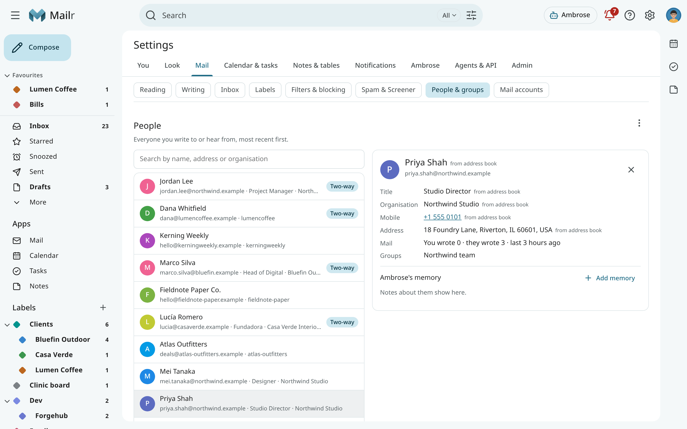
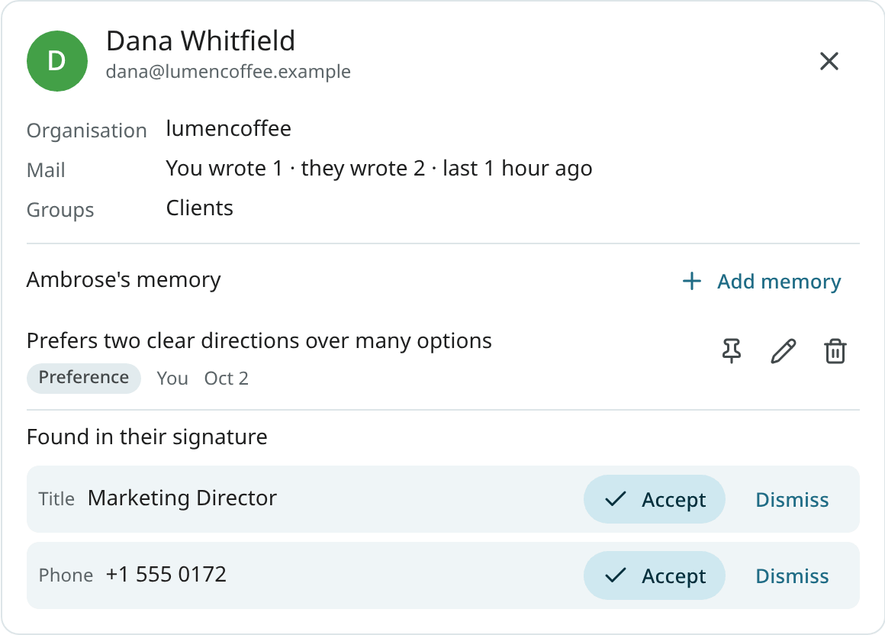
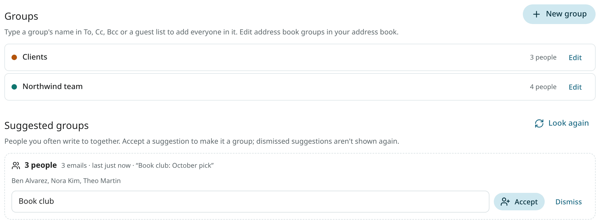
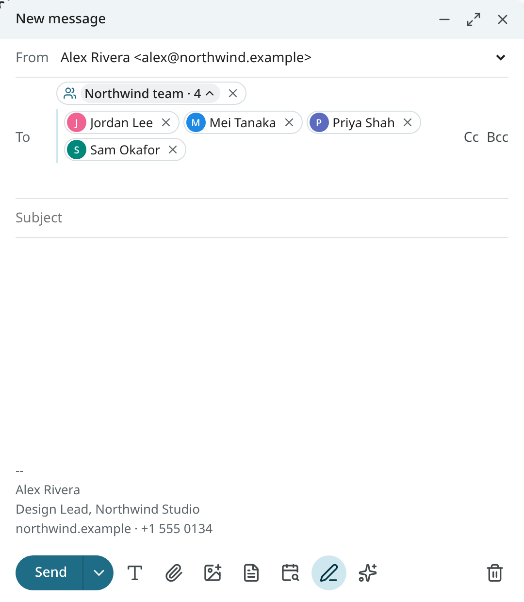

# People & groups

A list of the people you correspond with is built from your mail. They are ranked by how much
and how recently you write to each other, their details are filled in from your address book and
their signatures, and groups of people you often write to together are suggested.

Open **Settings → Mail → People & groups** to see them.

## Find a person

Search by name, address or organisation in the People list. In this order, the people you write
to most, and most recently, come first; people who write back rank higher than those who never do. The
same order is used for the suggestions in the To, Cc and Bcc fields, the guest field of the calendar,
and Ambrose's people search.
<!-- covers: person.find -->

## A person's card

Click a person to open their card. It shows:

- their name, addresses, organisation, title, phone numbers, postal address and birthday;
- how often you exchange mail, and whether it goes both ways (**Two-way**);
- your recent conversations with them;
- their meeting recordings, when you use [Speakr](recordings.md);
- **Ambrose's memory**: Ambrose's memories about them. Use **Add memory** to add one; each can be edited, pinned or deleted.

The same card opens from **Settings → Ambrose → Memory** (**Open card**) and from a chat where Ambrose looked the person up. People in Ambrose's memory who are not in your mail are in the list too, marked **No mail**.

<!-- covers: person.memories -->

### Details found in signatures

The signatures of the people you write to most are read, and the details found there are
suggested: a phone number, a title, an organisation or a postal address. They are shown under
**Found in their signature**, with the message they came from.

Click **Accept** to add a detail to the person.
<!-- covers: person.accept_detail -->

Click **Dismiss** to drop it. A dismissed detail does not come back.
<!-- covers: person.dismiss_detail -->

!!! note "Local-only mail"
    A detail found in a local-only account's mail stays local: it is available only to local models
    and local-only tokens.

## Groups

A contact group is a named set of addresses, such as "Northwind team" or "Clients". Groups are
listed under **Groups** on the same settings page, each with its colour and members.

Ambrose can list them too.
<!-- covers: group.list -->

### Create and edit groups

1. Click **New group**.
2. Enter a **Group name** and pick a colour.
3. Add members: type a name or an address in **Add a person or address**.
4. Click **Save**.

<!-- covers: group.create -->

Click a group to edit it. Change its name to rename it.
<!-- covers: group.rename -->

Add more people in **Add member**.
<!-- covers: group.add_members -->

Click × next to a member to remove them.
<!-- covers: group.remove_members -->

Use **Delete** to remove the group. The people stay in your People list.
<!-- covers: group.delete -->

Groups from your address book have a lock: they are read-only in Mailr. Change them in your
address book, and the change is picked up in Mailr.

### Write to a group

Type a group's name in To, Cc or Bcc, or in an event's guest field, and choose it. Every member
is added under one chip, such as "Northwind team · 4 of 4". Click the chip to see the members
and remove anyone you want to leave out. Ambrose can address a group too ("send the
agenda to the Northwind team").
<!-- covers: group.expand -->

The normal send rules still apply to every member. A person you have never written to is
treated as a new address, even inside a group.

### Suggested groups

People you often write to together are found from the mail you send. They are suggested as
groups under **Suggested groups**, with a proposed name taken from the subjects or a shared
organisation. The suggestions are refreshed every day.
<!-- covers: group.suggest -->

Name the suggestion and click **Accept** to make it a group.
<!-- covers: group.accept_suggestion -->

Click **Dismiss** to drop it. A dismissed suggestion does not come back.
<!-- covers: group.dismiss_suggestion -->

## Address books

When your calendar server also holds address books (CardDAV), they are read with the same
account. Names, organisations, titles and birthdays from a card take precedence over what was
learned from mail. Phones and postal addresses from the card are added to those you accepted from
signatures. Groups in the address book become read-only groups in Mailr.

Address books are only read, never written to.

The **Address book** section shows each address book and when it was last read. It is read
every 30 minutes. Click **Read now** to read it at once.
<!-- covers: contacts.sync -->

## Import contacts

<!-- covers: contacts.import_vcf import.undo -->

The **⋮** beside **People** has **Import contacts (.vcf)…**. Use a contacts file from Google
Contacts (**Export → vCard**), from your phone or from another mail program.

Each contact is matched by its email address. Before anything changes, the counts are shown:
new people, people already known, and cards left out because they have no email address. For a
person already known, only empty details are filled in, such as a phone number or a birthday; no
value set by you or by the address book is replaced. A card's details are marked
"from an import" on the person's card.

The message afterwards has **Undo**. With it, the people added by the import are removed (unless
mail with them has arrived since), and the details filled in by the import are emptied.

## Blocked senders

To block a sender, open their message and choose **Block** followed by their name from the message menu. Their
future mail is marked as spam. Blocked addresses are listed, and can be removed, under **Blocked
addresses** in **Settings → Mail → Filters & blocking**. See [Labels, filters and favourites](organize.md).
