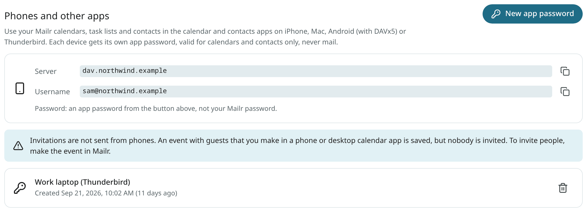
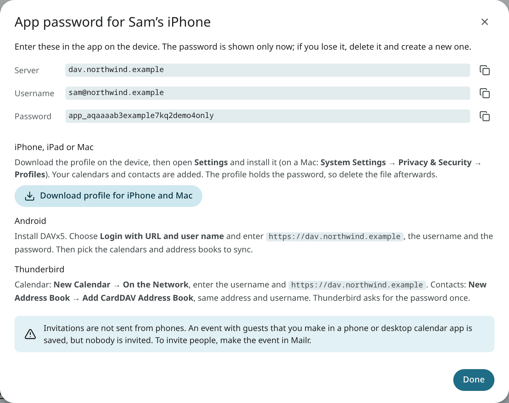

# Your Mailr calendar on iPhone, Mac, Android and Thunderbird

Mailr calendars, task lists and contacts can be used in other calendar and contacts apps: Calendar, Reminders and Contacts on an iPhone, iPad or Mac, any calendar app on
Android through DAVx5, and Thunderbird on a computer. Changes are synchronised in both
directions: an event added on the phone appears in Mailr, and an event added in Mailr appears on the
phone.

These apps can connect only when:

- the account has a **Mailr calendar** (it is listed under **Settings → Calendar & tasks**), and
- the administrator has turned on phone access. Otherwise a note about it is shown in the section below.

The Mailr app for Android shows the calendars without any setup; this page applies only to other apps.

## Make an app password

Each device gets its own app password. It is valid for your calendars, task lists and contacts
only. Your mail cannot be opened with it, and your calendars cannot be shared with other people
through it.
The Mailr password is not accepted in these apps.

1. Open **Settings → Calendar & tasks**. **Phones and other apps** shows the server and
   your username.
2. Click **New app password**, give the device a name such as "Sam's iPhone", and click
   **Create password**.
3. Copy the password into the app on the device now. It is shown only once.

The username is the account's email address. The server is the address the administrator set up for
phones, for example `dav.example.com`.

<!-- covers: settings.phone_passwords -->

## iPhone and iPad

On an iPhone, use the profile. Make the app password in Safari on the iPhone itself:

1. Open Mailr in Safari, go to **Settings → Calendar & tasks** and make a new app password.
2. Tap **Download profile for iPhone and Mac** and allow the download.
3. Open the **Settings** app. Tap **Profile Downloaded** near the top, then **Install**. The profile
   is marked as not verified, because it is not signed.
4. The calendars appear in **Calendar**, the task lists in **Reminders**, and the contacts in
   **Contacts**.

The profile holds your password. Delete the file afterwards if you saved it somewhere.

Without the profile: open **Settings → Calendar → Accounts → Add Account → Other → Add CalDAV
Account**. Enter the server, your username and the app password. For contacts, do the same with
**Add CardDAV Account** under **Settings → Contacts → Accounts**.

## Mac

Download the profile in the same dialog on the Mac, double-click it, and install it under
**System Settings → Privacy & Security → Profiles** (on older versions of macOS: **System
Settings → General → Device Management**). Or add the accounts by hand in **Calendar → Settings →
Accounts** (type **Other CalDAV Account**) and **Contacts → Settings → Accounts** (type **Other
CardDAV Account**).

## Android with DAVx5

1. Install **DAVx5** from Google Play or F-Droid.
2. Tap **+** and choose **Login with URL and user name**.
3. Enter the server address with `https://` in front, for example `https://dav.example.com`, your
   username and the app password.
4. Choose which calendars, task lists and address books to sync. The calendars then appear in
   the phone's calendar app. For task lists, a tasks app such as jtx Board or Tasks.org is
   suggested in DAVx5.

## Thunderbird

- **Calendar:** in the Calendar tab, choose **New Calendar → On the Network**. Enter your username
  and the server address with `https://` in front. The calendars are found, and the password is asked
  for once.
- **Contacts:** in the Address Book, choose **New Address Book → Add CardDAV Address Book**, with
  the same username and address.

## Invitations made on a phone are not sent

When you add guests to an event in a phone or desktop calendar app, the event is saved, but
nobody is invited. No warning is shown on the phone. To invite people, make the event in Mailr
(the web app or the Android app). The invitation is sent from your address, after the usual
approval step. Replies to invitations work the same way: answer them in Mailr.

## Calendars shared with you and group calendars

Calendars shared with you, and group calendars, are shown on the devices too. Rights in Mailr also
apply on the device: a view-only calendar stays read-only, even if an app has an edit option.
Calendars can be shared only in Mailr, not in these apps.

## Lost or replaced devices

Under **Phones and other apps** each password is listed with its name and its creation date.
Click the bin next to a password to delete it. Syncing with the device that used it ends at once.
Then make a new password for the new device.

A password marked **Paused** does not work at the moment. A password is paused when the
administrator turns phone access off, or when your account has no Mailr calendar for the moment.
The password works again, unchanged, when phone access is back.
