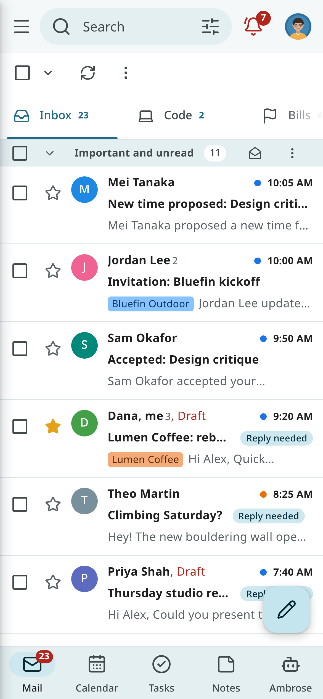
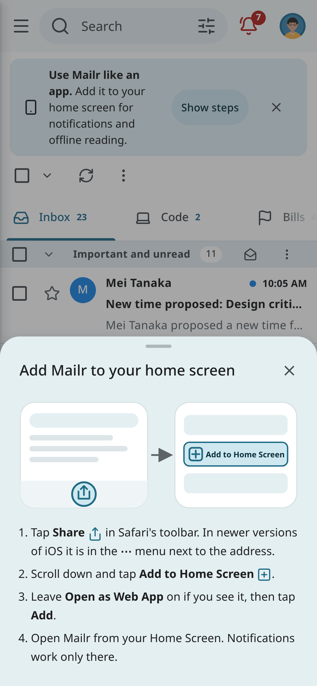
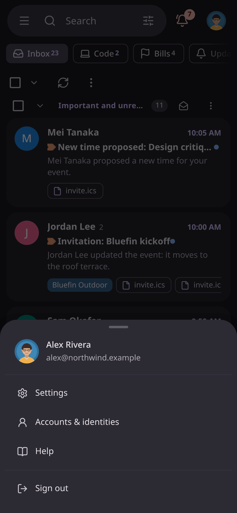
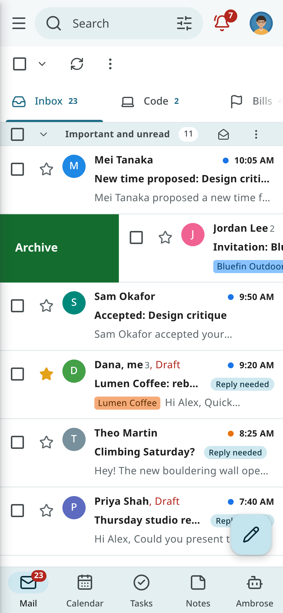

# The web app on your phone

Mailr's web app can be added to a phone's home screen as a progressive web app (PWA). It then opens
full screen, with a tab bar at the bottom, swipe actions, notifications and recently read mail
available without a connection. This page covers the
iPhone and Android. On Android, the native [Android app](../android/index.md) is also available
(see [Install the phone app](../getting-started/phone.md)).

## Add Mailr to your home screen

Open your Mailr address in the phone's browser, for example `https://mail.example.com`, and sign
in. On a phone, a banner, **Use Mailr like an app**, is shown with **Show steps**. The steps are also
under your picture (top right) **→ Install app** and in **Settings → You → Password & devices → App installation**.

### iPhone and iPad

1. Open Mailr in **Safari**.
2. Tap **Share** (the square with an arrow). In newer versions of iOS it is in the **⋯** menu next
   to the address.
3. Scroll down and tap **Add to Home Screen**.
4. Leave **Open as Web App** on if you see it, and tap **Add**.
5. Open Mailr from your Home Screen.

On iOS 16.4 and later, Chrome, Edge and Firefox on the iPhone have **Add to Home Screen** in
their Share menu too.

### Android

1. Open Mailr in **Chrome** (or Edge, or Samsung Internet).
2. Tap **Install** in Mailr's banner or in **Settings → You → Password & devices → App installation**. If there is no
   Install button, open the browser menu (**⋮**) and choose **Install app** or **Add to Home
   screen**.
3. Open Mailr from your home screen or app drawer.

Long-press the Mailr icon for shortcuts to **Compose**, **Calendar** and **Tasks**.

### Computers

Mailr can also be installed from Chrome and Edge on a computer, with the install icon at the end of
the address bar or with **Settings → You → Password & devices → App installation**. Mailr then has its own window.

## Navigation at phone width

At phone width every style has the same frame:

- The **tab bar** at the bottom: **Mail** (with the same number as **Inbox** in the navigation, see
  [The Inbox count](tabs-and-layouts.md#the-inbox-count)),
  **Calendar**, **Tasks**, **Notes** and **Ambrose**, always in this order, with Ambrose at the
  right. Tap **Mail** again to go back to the top of the list. The bar holds at most five tabs.
- Tap the **menu button** at the top left to open the mail drawer: every mailbox (Starred, Sent, Drafts,
  Spam, Trash …), the categories and your labels. In the Focus style, tap the name of the list at
  the top left instead.
- Tap your **picture** at the top right to open a menu with **Settings**, **Accounts & identities**,
  **Recordings** when you use them, **Pending changes** when some wait, **Install app** and **Sign
  out**. A small dot on your picture means changes made offline wait to be sent.
- Menus are shown as **sheets** from the bottom of the screen. Drag a sheet down, or tap outside it, to
  close it.
- The ⋮ menu of a conversation, and of a selection in the list, has the common actions first, then
  the groups **Create from email** (in a conversation), **Organise** and **More** (Mute, Report spam).
  A long sheet scrolls.
- An open conversation has the whole screen; go back to see the tab bar again.
- Ambrose fills the screen above the tab bar. Tap a citation, a source or a link in an answer to
  hide the Ambrose panel and show the email, event, task or note. Tap **Back to Ambrose**, the
  **Ambrose** tab or go back to see the same chat again. Links to other websites open in a new tab.

### Gestures

| Gesture | Effect |
|---|---|
| Swipe a conversation to the right | Archive (not in the Inbox: move to Inbox; in Trash: restore; in Spam: not spam) |
| Swipe a conversation to the left | Delete (move to Trash) |
| Press and hold a conversation | Its menu: read or unread, star, labels, move, snooze and more |
| Pull the list down from the top | Refresh it |

Change the swipe actions in **Settings → Mail → Reading → Swipe actions**: **Archive**, **Delete**,
**Mark read/unread**, **Snooze**, **Star** or **None**, for each direction. The choice belongs to
the device, as in the Android app. A swipe that is not far enough slides back.
Use **Undo** in the message at the bottom to take a swipe back.

When the phone is set to reduce motion, rows and sheets appear and disappear without sliding.

## Notifications

Turn them on in **Settings → Notifications** on the phone itself; each phone and each browser is
set up on its own. You are asked for permission the first time.

| Setting | Notifications |
|---|---|
| **New mail** | **Off**, **VIP senders only**, **Important mail**, **Important and Primary** or **All new mail** |
| **Waiting for you** | An agent or Ambrose asks for your approval, or a message wasn't sent |
| **Messages from Ambrose** | Messages and results from Ambrose and your standing orders |
| **Push to this browser** (under **On this computer**) | The notifications above, and event and task reminders, on this phone (see [Notifications](notifications.md)) |

A notification shows who wrote, never the text of the message. Tap it to open the conversation.
Where notifications have buttons (Android), new mail has **Archive** and **Mark read**. Once you
read a conversation, in Mailr on any device, its notification is removed the next time you open
Mailr on the phone.

The app icon shows the number of unread conversations in your Inbox, where the phone supports it.

### On an iPhone

- Notifications work only for Mailr **added to the Home Screen** and opened from there, on iOS
  16.4 or later. In Safari, **Settings → Notifications** says so, with a link to the install steps.
- Turn notifications on from inside the Home Screen app: permission is asked for only after a tap.
- On iOS, web notifications have no buttons. Tap a notification to open Mailr on the conversation
  or the reminder.
- To stop them, turn the settings off in Mailr, or turn Mailr off in the iPhone's **Settings →
  Notifications**.

## Offline use

Recently viewed content is kept on the phone:

- the app itself, so it opens without a connection;
- the last list pages you opened (up to 40), the conversations you opened (up to 150) and their
  message bodies, and the session, labels and counts needed to start.

When the phone has no connection, the line **You're offline. Showing what's cached.** is shown. For a
conversation never opened, its subject and sender are shown with a note that it opens when the
connection is back. Search, attachments and new mail are available only with a connection.

Actions taken offline are kept and sent later:

| Kept for later | Not offline |
|---|---|
| Archive, delete, move back to the Inbox or restore from Trash | Sending mail (the draft stays on the phone and is restored) |
| Mark read or unread, star, important | Snooze, move to a label, report spam |
| Add or remove a label | Calendar, tasks and Ambrose |

A **pending changes** chip shows how many changes wait. Tap it to see them. When the connection is
back, they are sent in the order they were made, and a note says so. A change that cannot
be made (the conversation was deleted on another device, for example) is dropped; one that is
refused stays in **Pending changes** as failed, with **Retry** and **Discard**. A change and its opposite (star,
then remove the star) cancel each other before anything is sent.

When you sign out, the mail kept on the phone is deleted. Changes that have not been sent wait until you
sign in again as the same person.

!!! note "Limits"
    The storage allowed for an app depends on the phone. On iOS, the stored mail of a Home Screen app you
    have not opened for some weeks may be cleared, and changes are not sent in the background: they
    are sent the next time you open Mailr.

## Updates

When the server has a newer version of Mailr, **New version of Mailr** is shown with
**Reload**. The update is applied only when you tap **Reload**; open drafts are kept.

## Returning to the last page

Mailr may be closed while it is in the background. When it is opened again within an hour, the last
page is shown again.
