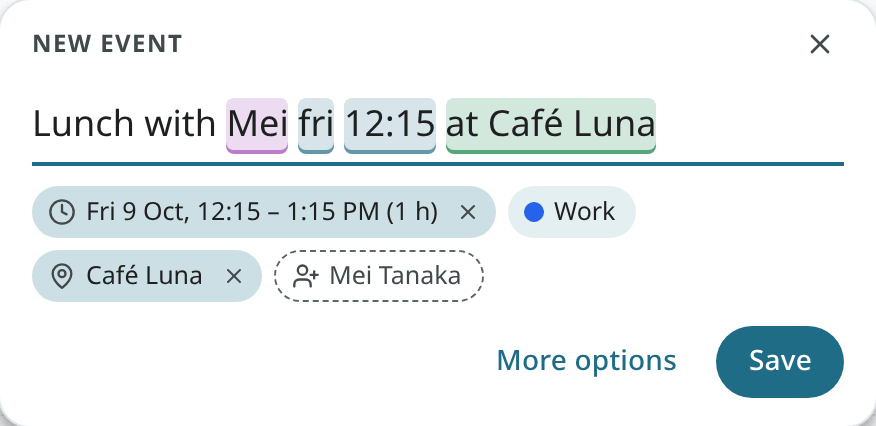
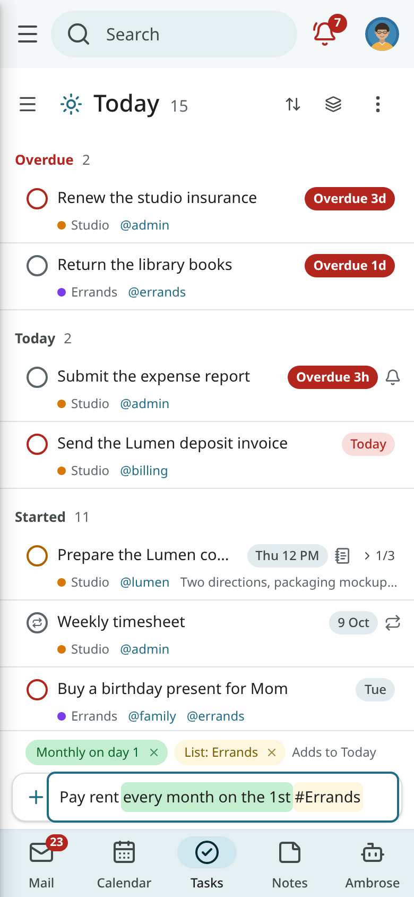

# Quick add

With quick add, one line of plain English becomes an event or a task. It is available in the calendar's
quick create, the quick-add bar of the Tasks app, the Calendar and Tasks panels beside the page, the command
palette ("New event: …", "New task: …") and the Android app. The line is read in the same way
in the web app and on the phone.

## Reading rules

- A word is taken only when it matches a rule exactly. Everything else stays in the title.
- Each word taken is highlighted and shown as a chip under the line, so the result is
  visible before saving.
- Click a highlighted word, or × on its chip, to keep it as plain text. Or press Backspace right
  after a word.
- Put text in quotes to keep it as it is: `"Friday review" notes due mon`.
- No model is involved. The same line always has the same result.

## Events

| Line | Result |
|---|---|
| `Lunch with Mei fri 12:15 at Café Luna` | Friday 12:15 to 13:15 at Café Luna, with Mei suggested as a guest. |
| `Design critique tue 3-4pm #Work +meet` | Tuesday 15:00 to 16:00 in the Work calendar, with a video link. |
| `Standup weekdays 9:15 for 15 min` | A repeating event every weekday at 9:15, 15 minutes long. |
| `Offsite 14–16 oct` | An all-day event over three days. |
| `Dentist oct 12 2:30pm remind me 1 hour before` | October 12 at 14:30, with a reminder an hour before. |
| `Book club every first mon at 7pm` | A monthly event on the first Monday. |

- A date alone means an all-day event. A time alone means today, or tomorrow when the time has
  passed.
- Without a length, the event has your default length (`calendar_default_duration`).
- With `with Dana`, Dana is suggested as a guest. Nobody is invited until you click the guest's chip to
  confirm it.
- With `#Work`, the calendar is picked by name. The start of a name is enough.
- Use `at` or `@` followed by a capitalised name, such as `at Café Luna`, to set the place.

## Tasks

| Line | Result |
|---|---|
| `Call Dana fri 3pm !! @phone` | Due Friday at 15:00, Medium priority, tagged phone. |
| `Pay rent every month on the 1st #Errands` | Due on the 1st of each month, in the Errands list. |
| `Water the plants every! 3 days` | Repeats three days after each time you complete it. |
| `Renew the studio insurance by fri` | Due Friday, no time. |
| `Prepare the Q4 deck start mon due thu` | Starts Monday, due Thursday. |
| `Buy milk tom` | Due tomorrow. |

- `!!!` or `p1` is High, `!!` or `p2` is Medium, `!` or `p3` is Low.
- Use `@phone` to add a tag. Several tags are allowed.
- Use `#Groceries` to pick a list. When no list has that name, a new list by that name is offered.
- With `every!`, the next date is counted from when you complete the task.

## Words that stay in the title

Ordinary words are left alone. These lines stay as titles:

- "Weekly review" (a repeat word only counts at the end of the line);
- "Read Sunday papers" (a bare weekday only counts at the end);
- "Meet May" (a month is read only with a day number);
- "Shopping for gifts" (`for` is read only with a length after it);
- "Call Tom" (only lower-case `tom` means tomorrow).

## Full grammar

[Quick-add grammar](../reference/quick-add.md) lists every date, time, range, length, repeat,
reminder, place, guest, priority, tag and list form, with examples.

