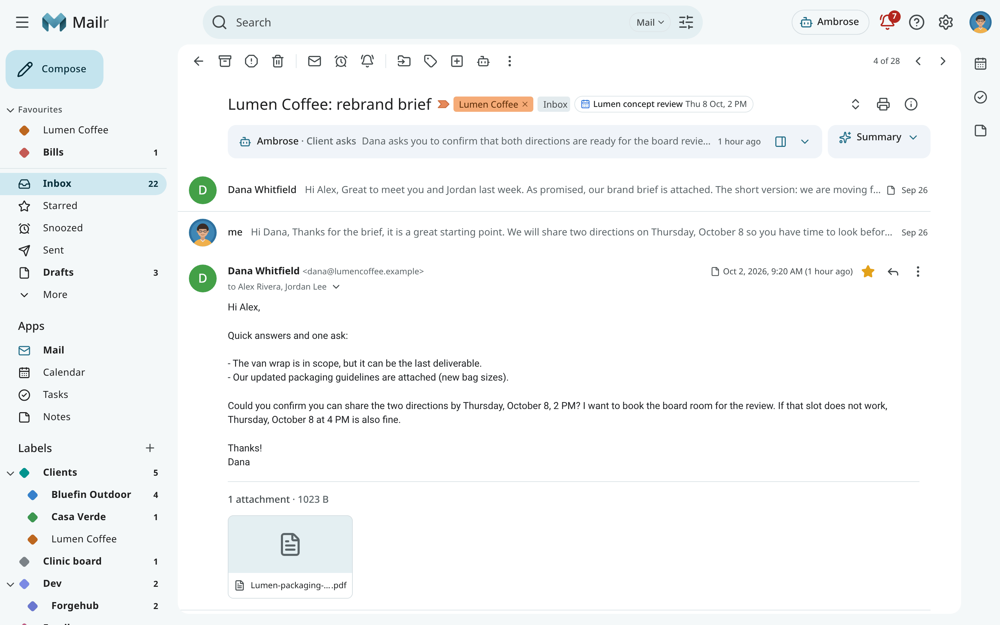
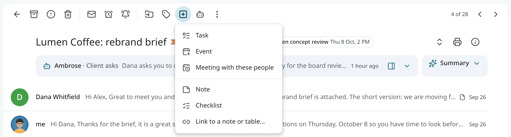
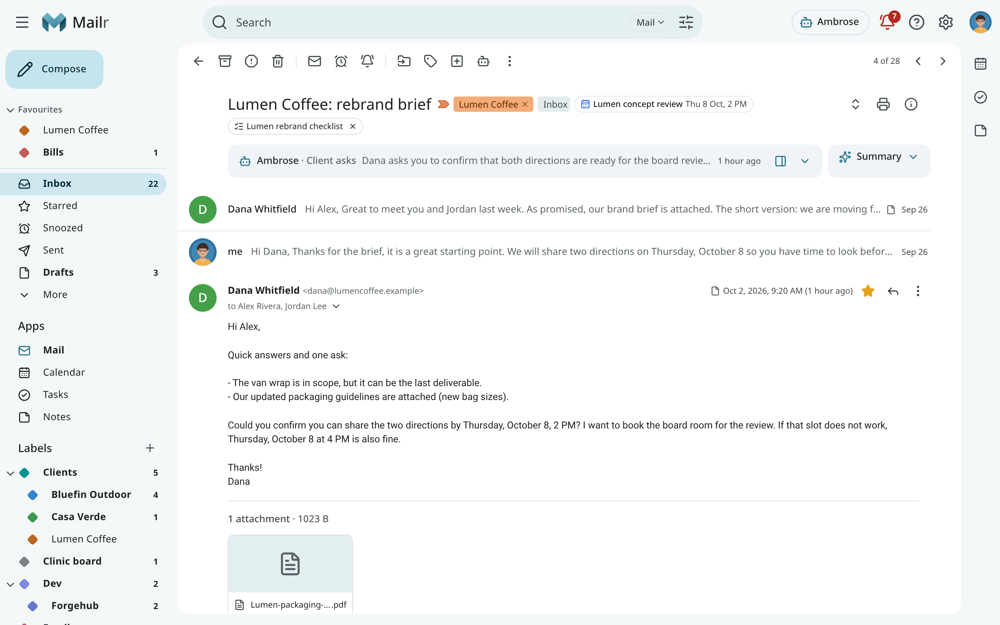
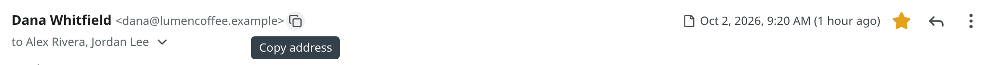
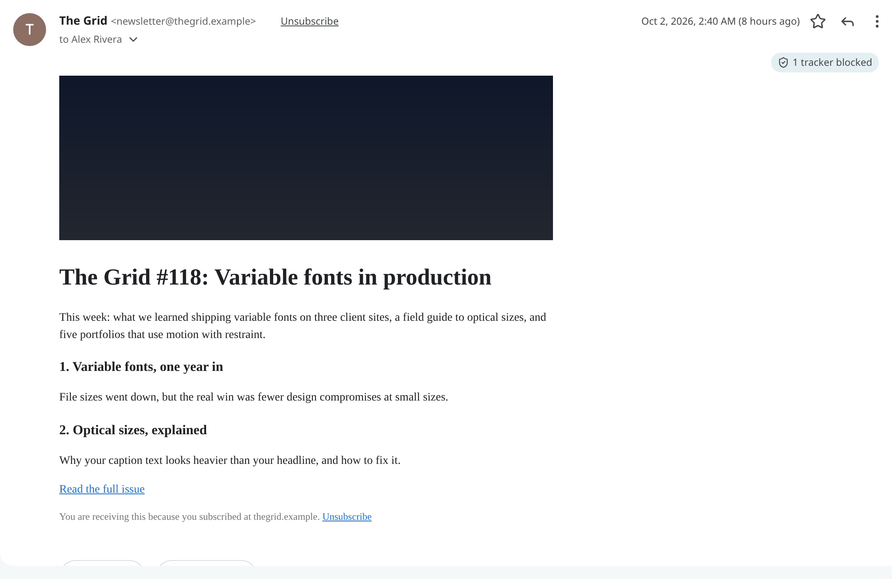
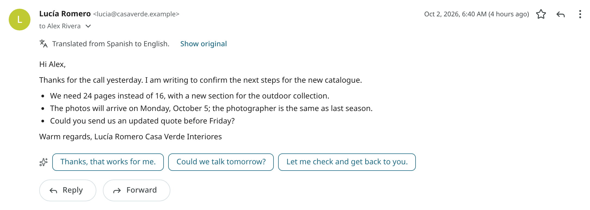
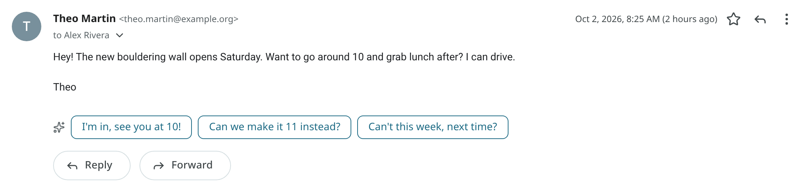
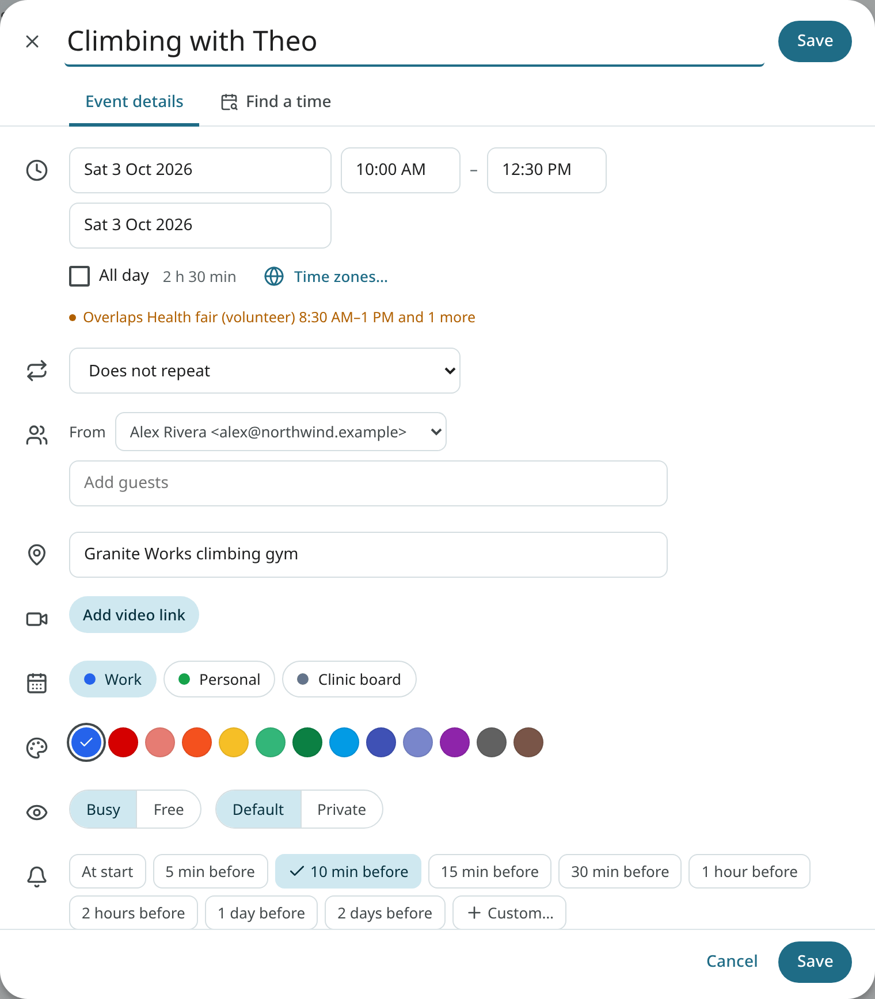
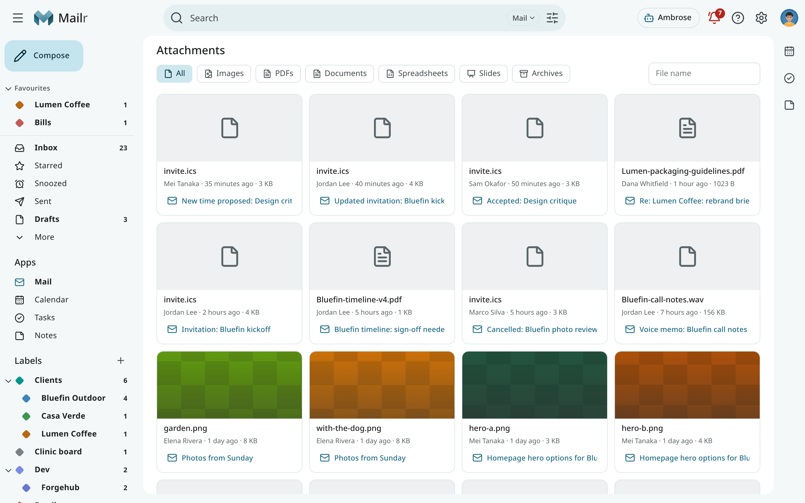
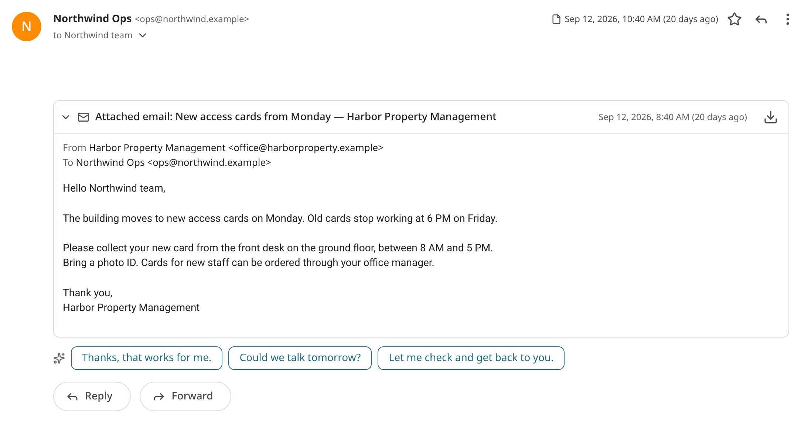

# Reading mail

Open a conversation from the list to read it. Older messages are folded into one line each; click one
to expand it, or use **Expand all**. Quoted history is trimmed: click **Show trimmed content** to bring
it back.

## Moving around

| Key | Action |
|---|---|
| `j` / `k` | Open the older or newer conversation. |
| `n` / `p` | Move to the next or previous message in the conversation. |
| `u` | Go back to the list. |
| `[` / `]` | Archive, then open the previous or next conversation. |

The reader's toolbar holds the conversation actions: archive, report spam, delete, mark as unread,
snooze, move, labels, **Notes**, ask Ambrose and the ⋯ menu. Use **Open in full view** to give
the conversation the whole window; press Esc to return. On a phone the toolbar has archive, delete, snooze,
move and labels; report spam, mark as unread, Notes and Ask Ambrose are in the ⋯ menu.

## The subject line

The subject is followed by everything about the conversation as a whole, on the same line:

- the importance marker and the labels (click × to remove a label);
- the email's main action, such as **Track package** or **Check in**, with its key fact;
- the events and tasks made from the email, with their state;
- the notes and tables linked to it. Click one to open it; click × to remove the link; the
  toast has **Undo**.

With a short subject, these items all fit on one line. A long one is wrapped like a sentence. When nothing is
linked, no extra line appears.

## Create from email

**Create from email** in the toolbar (the square with a plus, or `Shift+T`) holds every item that
can be made from a conversation:

| Item | Result |
|---|---|
| **Task** | A task, filled in from the email (below). |
| **Event** | An event, filled in from the email (below). |
| **Meeting with these people** | A meeting with the people on the thread. See [Invitations](invitations.md#schedule-a-meeting-from-a-conversation). |
| **Note** | A note with the subject and a link back. It is opened at once. |
| **Checklist** | A checklist from the lines you selected. |
| **Link to a note or table…** | A link to an existing note or table. |

Each one has a link back to the conversation. The same menu is in the row's right-click menu, under
**Create from email**. On a phone it is in the reader's ⋮ menu. See also
[Notes from email, and links](notes.md#notes-from-email-and-links).

The sender's name appears with the real address beside it. A note appears under the name when the
name contains a different address from the one the message came from, or when it mixes letters from
alphabets that look alike.

## The summary card

Longer conversations have a **Summary** card at the top: a few lines on what the thread is about, with
links to the sentences they come from. Click a link to jump to the sentence in its message. The
card appears only when a language model is set up on the server.

In a thread of three or more messages, or when a conversation has both a summary and a brief from
a standing order, the two start folded into one strip, so the newest message stays in view. The
folded brief shows its first line. Click either one to open it; a card you open or close stays
that way. An invitation, or a reply to one, gets no summary: its invitation card holds the same
details.

## The message menu

Each message has a ⋮ menu:

| Item | Action |
|---|---|
| **Reply**, **Reply all**, **Forward** | Start a reply or forward of this message. |
| **Create event**, **Add to tasks** | Turn the email into an event or a task (below). |
| **Filter messages like this** | Open a new filter for this sender. |
| **Copy sender's address** | Put the sender's address on the clipboard. |
| **Make … a VIP sender** | Always mark this sender's mail important (see [VIP senders](triage.md#vip-senders)). |
| **Translate to English** | Show the message in English (below). |
| **Print** | Print the message. |
| **Delete this message**, **Report spam** | Act on this one message only. |
| **Block "…"** | Send this sender's future mail to Spam (see [Blocked senders](organize.md#blocked-senders)). |
| **Mark as unread** | Mark from this message on as unread. |
| **Split into new conversation** | Move a message that does not belong into a conversation of its own. |
| **Show original** | Show the raw message with every header. |

Click the small arrow next to the sender, **Show details**, to see the recipients, the date, the
mailing list, and whether the message passed sender authentication. A message that failed DMARC has
a warning above its text.

A warning is shown beside the sender's address in these cases:

- the name shows another address than the one the message came from;
- the name or the address mixes look-alike letters from different alphabets ("pаypal" with a
  Cyrillic "а");
- the From line is malformed or names two addresses. Such a message is matched to nobody: it never
  counts as yours or as from one of your trusted addresses.

Hidden characters that turn text around or hide inside it are removed from addresses, also in what
**Copy address** copies.

### Copy an address

<!-- covers: mail.copy_address -->

- **With a mouse or keyboard:** point at the sender's name or address, or move the focus there.
  A small copy button appears beside the address. Click it to copy the address, or Shift+click
  it to copy the name and address together ("Bich Nguyen <bich@example.com>"), ready to paste into a
  To field. Each address in **Show details** has the same button.
- **On a phone or tablet:** touch and hold the sender's name or address, or an address in the
  details. Choose **Copy address**, **Copy name** or **Copy name and address**.
- **In the Android app:** touch and hold the sender's name in an open message, or an address in its
  details, for the same three choices. In TalkBack, they are available as actions.
- The message's **⋮** menu also has **Copy sender's address**.

## Images and trackers

Remote images are loaded through Mailr, never from the sender's server. They are fetched when the
mail arrives, so the sender cannot tell when a message is opened later. Known tracking pixels are
removed in every case; a line above the message shows "2 trackers blocked" and their hosts.
Wrapped links (click trackers that hide the real address in the URL) are unwrapped to their real
address.

A link whose text shows a web address or a domain, but which opens a different site, is a common
trick in phishing mail ("www.yourbank.example" that leads somewhere else). In the web app, such a
link asks first: "This link opens another site" names the site it really opens, and **Open** goes
there. Ambrose's drafts show the real address beside such a link instead.

Choose how images appear under **Settings → Mail → Reading → Images** (`images`):

| Choice | Result |
|---|---|
| **Always display images** | Images are shown at once, through Mailr (the default). |
| **Ask before displaying images** | A bar appears with an option to display them, for this message or always for this sender. |
| **Never display images** | Images stay hidden. |

Images in Spam are loaded only after confirmation, with a warning that the sender can then learn
that the address is active.

When you reply to or forward a message, its quoted images follow the same choice. Images not
shown in the reader appear as outlined boxes in the editor, and the recipient still gets them.
<!-- covers: mail.show_images -->

!!! note
    Image fetches can be routed through a VPN by the administrator, so that senders see the VPN's
    address instead of the server's. See [Image proxy and VPN egress](../admin/image-proxy.md).

With **Sender pictures** (`sender_pictures`, off by default), pictures for senders are looked up
from BIMI, Gravatar and Libravatar. Without it, rows have initials.

## Plain-text mail

Plain-text mail is often broken into lines of about 72 characters by the sender's mail app. In the
web app, such lines are joined again into paragraphs, so they fit the width of the window or the
phone. Lists, quotes, indented text, tables and signatures keep their line breaks, and so do blank
lines between paragraphs.

## Wide mail on a phone

Some mail is laid out for a fixed width, such as a 600 px newsletter or a bank statement. On a phone,
in the web app and in the Android app, such a message is shrunk to the width of the screen, so
nothing is cut off at the sides and the page does not scroll sideways. Pinch to zoom in on a part
of it. Mail that already fits a phone stays at its normal size.

## Translate a message

A bar with **Translate to English** is shown above a message in a language outside the user's
languages. The language of each message is identified on arrival, on the server, from the visible
text (quoted replies and signatures left out). The bar appears only when the language is clear and
is not one of the languages set under **Languages** in
[About you](assistant.md#about-you-and-memory) (for example "English, Urdu"); with none set,
English is assumed. Very short messages get no bar. **Translate to English** is always available
in the message menu. The translation is shown in place of the text; use **Show original**
to switch back. Mail from a local-only account is translated only by a local model, or not at all.
<!-- covers: mail.translate -->

## Reply suggestions

Under the last personal email in a conversation, three short replies are offered, such as "Sounds
good, see you Thursday." Click one to start a reply with that text, then edit it.
Suggestions never appear for mailing lists, automated mail, promotions or spam. Turn them off with
**Show reply suggestions** in Settings → Ambrose → Briefs & replies (`reply_suggestions`).
<!-- covers: mail.reply_suggestions -->

## Turn an email into a task or an event

Choose **Create from email → Task** or **Event** in the toolbar or in the row's right-click menu,
or **Add to tasks** or **Create event** in a message's menu. A title, a date and a place are read from the email, and a form opens with
them filled in. Check it and save. The task or event has a link back to the conversation. The confirmation message has **Open** and **Undo**.
<!-- covers: mail.to_task mail.to_event -->

Invitations get their own card at the top of the message. See [Invitations](invitations.md).

## Attachments

Attachments sit under their message with a preview for images and PDFs and a download button.
The file's extension always stays in view. A program or script (such as `.exe`, `.js` or `.lnk`)
is marked with a warning sign; open one only if you expected it. The same holds for the files
inside an attached email.
The **Attachments** view in the navigation lists every file you received, newest first; search it
by name, sender or type.

### Attached emails

<!-- covers: mail.open_attached_email -->

An email can carry another email as an attachment: a **Forward as attachment** from another mail
app, a digest of several emails, or the original message returned with a delivery failure. Each
attached email gets a card under the message. The card shows **Attached email:**, the subject and
the sender, with the date and the first words. Click the card to open it: the attached email's
sender, recipients, body and files appear inside it. Its images follow the message that carries
it: anyone can write any sender into an attached email, so only the outer sender counts for
**Always display images from**, and an attached email does not offer that button. Use the download button to save the attached email as an `.eml`
file, which any mail app can open.

When the message itself has no text, as with a plain forward as attachment, the first card is
already open.

The text of an attached email is not part of the message that carries it. Only the message's own
text is used for the list preview, summaries, Ambrose and your writing samples. An attached email can still
be found by its words in search; see [Search](search.md#words).

An attached email that cannot be read, such as one cut short in transit, is listed as a plain
`.eml` file with the other attachments.

## Unsubscribe

Mail from a mailing list has **Unsubscribe** next to the sender. The list's one-click unsubscribe
is used when the list has one. Otherwise an unsubscribe email is prepared for review before
sending.

## Decision reasons

Click **Why this is here** (the ⓘ button) in the reader to see every automatic decision on the
conversation: the category, importance and spam verdicts and the suggested labels, each with its
reason, then the filters and standing orders that matched, in words ("Filter Bills: From
billing@…"). **Show all checks** lists every filter and standing order with its search terms and
which of them matched. See [Triage](triage.md).

## Offline and new versions

When the connection drops, the banner **You're offline. Showing what's cached.** is shown.
Conversations already opened stay readable. For a conversation not yet opened, the subject and
preview from the list are shown, and the full conversation once the connection is back.
**Couldn't find this conversation** is shown only when the conversation no longer exists on the server.

When the connection is up but the server does not answer, **Can't reach Mailr. Retrying.** is
shown, and the connection is retried with longer pauses between tries. The session stays signed
in, and open compose windows stay open. The sign-in page is shown only when the session has ended,
and unsent text is restored after the next sign-in.

After Mailr is updated on the server, **New version of Mailr** is shown in an open tab, with a
**Reload** button. If part of the app cannot be loaded after an update, the page is reloaded once.
