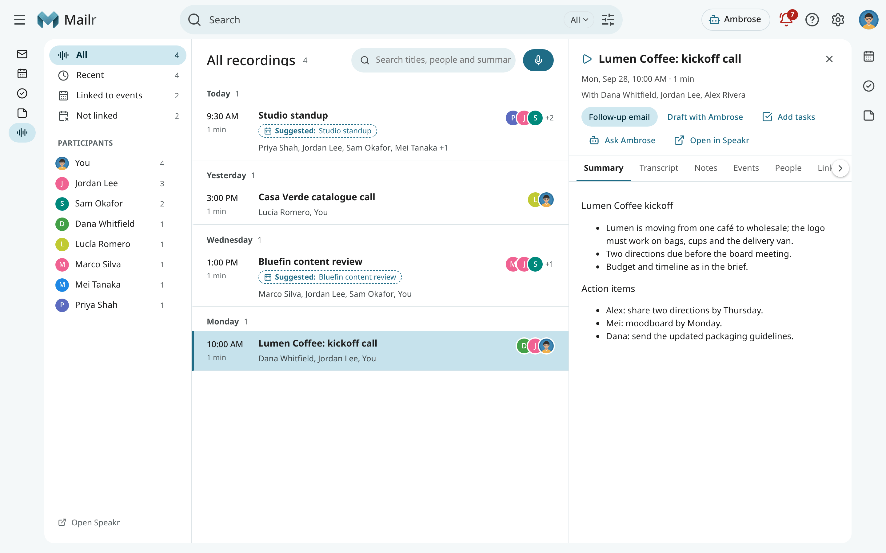
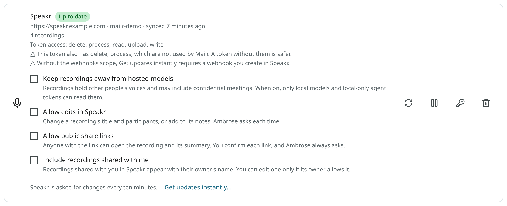
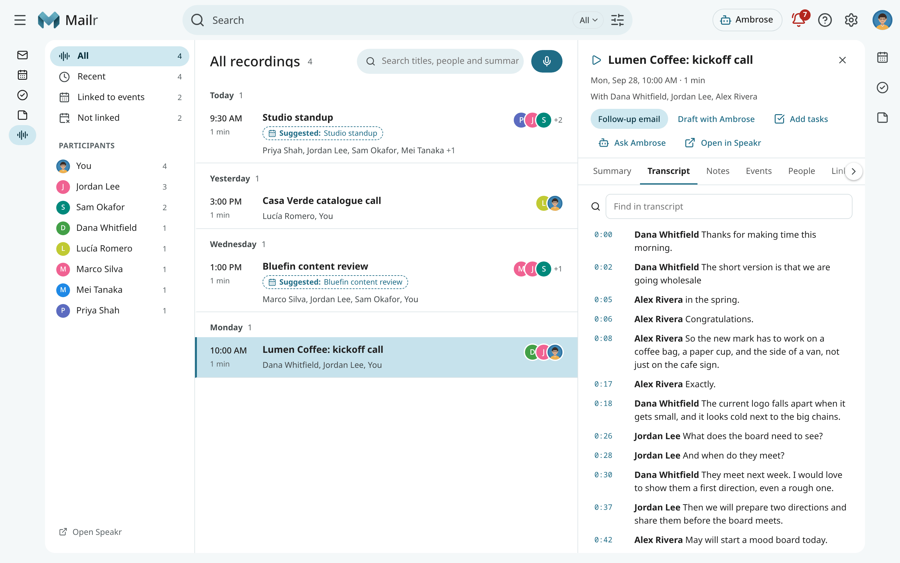
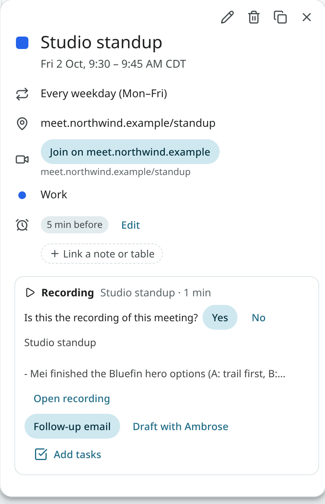
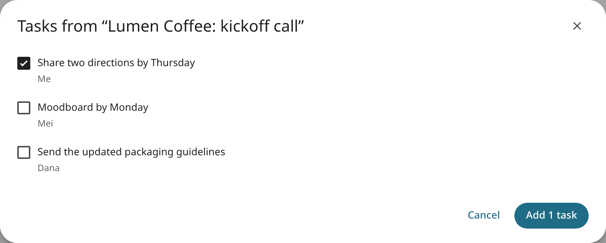
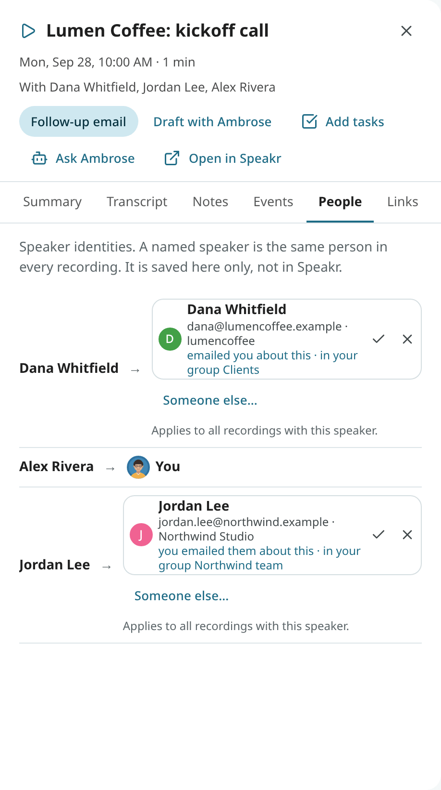
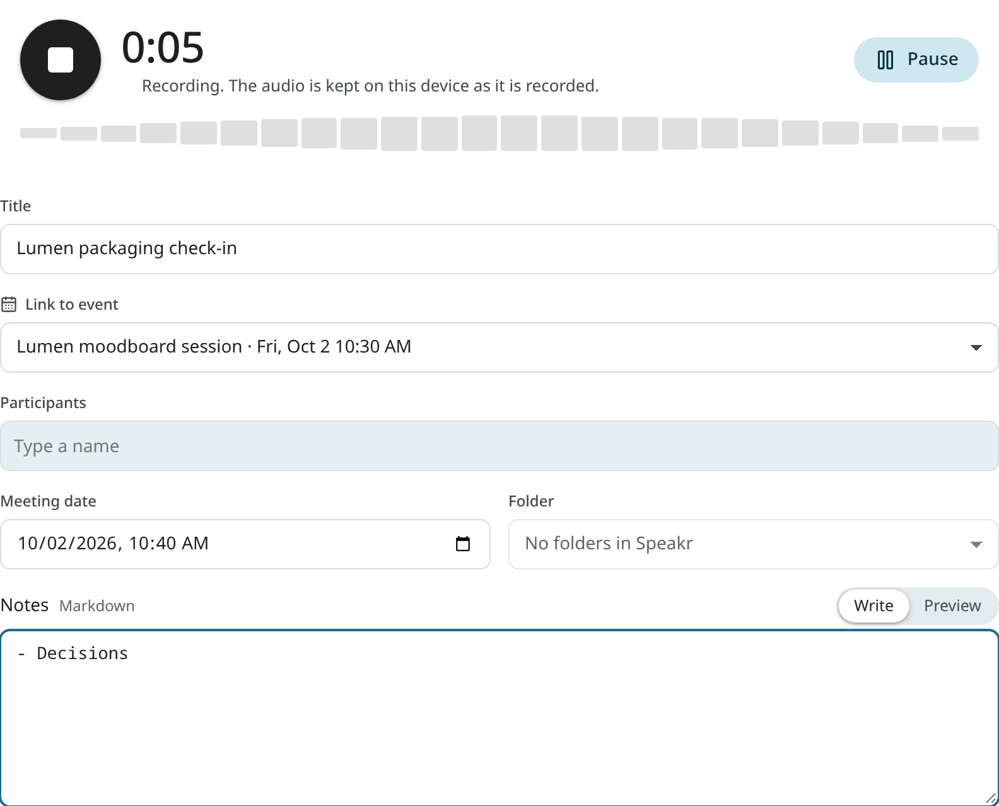
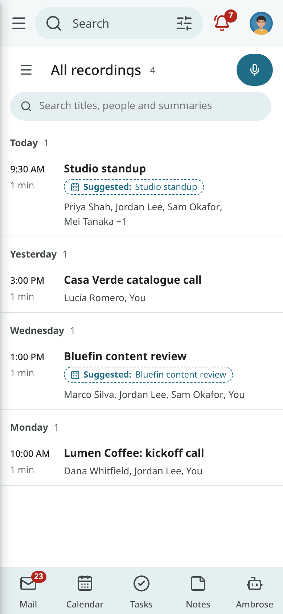

# Recordings (Speakr)

Mailr can be connected to [Speakr](https://github.com/murtaza-nasir/speakr), a self-hosted app for
recording, transcribing and summarising meetings. With a Speakr account connected, meeting
recordings are shown next to the events they belong to, the people who spoke, and the mail about
them. A follow-up email or tasks from the action items are created in one click.

Recording features are shown only when a Speakr account is connected. Recordings remain in
Speakr: they are read by Mailr and changed only when allowed.

## Connect Speakr

You need a running Speakr server and an API token from it.

1. In Speakr, create an API token in your account settings.
2. In Mailr, open **Settings → Mail → Mail accounts** and find **Recordings (Speakr)**. With
   simple settings, the section is shown only once a Speakr server is connected; open it with
   **Connect Speakr** in the Recordings app, or turn on **Advanced settings**.
3. Click **Connect Speakr**.
4. Enter the **Speakr address**, for example `https://speakr.example.org`, and paste the
   **API token**.
5. The address and the token are tested, and then the account is connected. The recordings
   appear after the first sync.

<!-- covers: speakr.connect -->

The token is stored encrypted and never shown again. Use **Paste a new token…** to replace it.

The card has these switches:

| Switch | Default | Effect |
|---|---|---|
| **Keep recordings away from hosted models** | On | Only local models are used on your recordings and their transcripts. |
| **Allow edits in Speakr** | Off | A recording's title, participants, tags and notes can be changed from Mailr. |
| **Allow public share links** | Off | Public Speakr links to a recording can be created. |
| **Include recordings shared with me** | Off | Recordings other Speakr users shared with you are shown, read-only. |

The card also shows the token's access, with a warning when the token is missing a required
permission. Use **Pause** to stop syncing for a while and **Resume** to start it again. Use **Remove** to
disconnect Speakr: Mailr's copy of the recording list and your links are deleted, and the
recordings stay in Speakr.

!!! note "For admins"
    A Speakr server on your own network works for admin users. For other users, add the
    Speakr host to `MAILR_OUTBOUND_ALLOW`. The largest file sent to Speakr is set by
    `MAILR_SPEAKR_MAX_UPLOAD_MB`. See [Configuration](../admin/configuration.md).

### Syncing

Speakr is checked for new and changed recordings on a schedule. Use **Sync now** to check at once
and to clear an error after you fix the token.
<!-- covers: speakr.sync -->

For instant updates, click **Get updates instantly…**. A webhook is then created in Speakr
through its API, so Mailr is told the moment a recording is ready. Use **Send test** to check that
Mailr can be reached from Speakr, and **Turn off** to remove the webhook. If you made the webhook in Speakr yourself,
choose **I made the webhook in Speakr myself** and paste its secret.

## The Recordings app

Click **Recordings** in the navigation, or press `g` then `r`. Use the left column to filter the list:

- **All**, **Recent**, **Linked to events** and **Not linked**;
- your Speakr **Folders** and **Tags**;
- **Participants**: everyone who speaks in your recordings.

Use `j` and `k` to move through the list and Enter to open a recording.

### Search recordings

Search titles, people and summaries in the search field (`/`). Recent recordings are also
searched by their transcripts. In mail search, matching recordings are shown in a
**Recordings** section above the mail results, and mail linked to recordings is found with these
operators:

| Operator | Matches |
|---|---|
| `has:recording` | Conversations linked to a recording. |
| `recording:kickoff` | Conversations linked to a recording whose title matches. |

Conversations linked to a recording have a ▶ chip in the mail list. The command palette has
**Open recording…** and a search of your recordings.
<!-- covers: recording.search -->

## Open a recording

Click a recording to open its sheet. The same sheet can be opened from an event, a linked
conversation, a task, a person's card, a citation in an assistant answer, or the palette.
<!-- covers: recording.view -->

The header shows the title, the meeting date and length, the participants, the tags and the
folder. The sheet has these tabs:

| Tab | Contents |
|---|---|
| **Summary** | Speakr's summary. |
| **Transcript** | The speaker turns with their times. Use **Find in transcript** to search it. |
| **Notes** | The notes kept with the recording. |
| **Events** | Meetings and dates mentioned in the recording, as found by Speakr. |
| **People** | Who each speaker is. |
| **Links** | The events, conversations and tasks the recording is linked to. |

Use **Open in Speakr** to open the recording in Speakr. Click a time in the transcript to open
Speakr at that moment.
<!-- covers: recording.open_speakr -->

## Link recordings

Each recording is matched to the calendar event it most likely belongs to. When one event is a
clear match, **Is this the recording of this meeting?** is shown on the event. Click **Yes** to link
it. You can also link a recording to an event, a conversation or a task in the **Links** tab, or
pick a recording for a past meeting with **Find recording…** in the event's details.
<!-- covers: recording.link -->

When an email contains a link to one of your recordings (a "Transcription ready" notice, or a message with
the recording's address pasted in), its conversation is linked to that recording once the
recording is in Mailr. The link is made directly only when the email comes from your Speakr server's own
domain and passes the sender checks, or when you sent it; from anyone else it is shown as
**Suggested** in the **Links** tab until you click **Confirm**. For a recording order, only links
you confirmed, links Ambrose made, or the email an attachment was sent from are used, and only
confirmed links are written to Speakr as references.

Remove a link in the **Links** tab, or answer no to a suggestion. A dismissed suggestion does not
come back.
<!-- covers: recording.unlink -->

## Recordings in the calendar

An event with a recording has a **Recording** section in its details: the summary's first
lines, **Open recording**, **Follow-up email** and **Add tasks**.

Before a meeting that repeats, the details show **Last time:** with the latest recording of the
same series, or of an earlier meeting with the same title and people, and the first line of its
summary. The Calendar panel beside the page shows it too.
<!-- covers: event.last_recording -->

**Events** in the recording sheet lists meetings mentioned in the recording, such as
"Let's meet again next Thursday". Use **Add to calendar** to open the event editor with the
details filled in. Nothing is saved until you click Save.
<!-- covers: recording.event_to_calendar -->

## Follow up after a meeting

Use **Follow-up email** to draft a message to the meeting's guests, without you, mailing lists
and automated senders. Speakr's summary is used as written. Use **Draft with assistant** to have
Ambrose write the email from the summary instead. When the meeting came from an email thread, the
draft is a reply in that thread. It is never sent automatically: the draft is opened in compose,
to be edited and sent.
<!-- covers: recording.follow_up -->

Use **Add tasks** to see the meeting's action items, each with an owner and a due date when they
were named in the meeting. Your own items start ticked and other people's start unticked.
Items you already added are marked **Already added**. Tick the ones you want and add them: each
becomes a task linked to the recording, and the task's details show the moment it came from.
<!-- covers: recording.to_tasks -->

While you write any email, use **Insert from a recording** in the compose toolbar to insert a
recording's summary, or the transcript turns you tick, as a quoted excerpt with speaker names and
times.
<!-- covers: recording.insert -->

## Ask about a recording

Use **Ask Ambrose** in the recording sheet to open Ambrose with the recording attached. Ask
"What did Dana decide about the packaging?" and the answer cites the moments it comes from. Click
a citation to open the transcript at that moment.
<!-- covers: recording.ask -->

## Speakers

The **People** tab of a recording shows each speaker and who they are:

- your own voice is shown as **You**;
- a confirmed person is shown with their name, address and organisation, and a link to their card;
- otherwise up to three people are suggested (from the event's guests, the mail about the
  meeting and your frequent correspondents). Click ✓ to confirm one or ✕ for **Not them**, or
  choose **Someone else…** to search your People.

A choice for a named speaker applies to every recording with that speaker name. Use **Not them in
this recording** to limit a change to one recording. With **Allow edits in Speakr** on, the
person's address is also saved on the speaker in Speakr; when an agent or token maps a speaker,
approval is asked first for that part (`speakr.write`).
<!-- covers: speaker.map -->

### Merge participants

The same person can appear under several spellings, such as "Dana", "Dana W." and "Dana
Whitfield". In the **Participants** list of the Recordings app, open a person's menu and choose
**Same person as…** to merge them. Merges with high confidence are also suggested. Use **Separate**
to undo a merge. With edits allowed, you can rename the speaker in Speakr too.
<!-- covers: participant.merge -->

## Edit and share

With **Allow edits in Speakr** on, use **Edit** in the recording sheet to change the title, the
participants and the tags, or to add a line to the notes. The change is saved in Speakr.
<!-- covers: recording.edit -->

With **Allow public share links** on, use **Share link** to create a public Speakr link to the
recording, with its summary and, if you choose, its notes. Anyone with the link can open it, so
you are asked to confirm. **Public links** lists the recording's links, and each can be revoked.
<!-- covers: recording.share_link -->

## Record a meeting

Meetings can be recorded directly in Mailr. Click **New recording** in the Recordings app (or press `n`),
choose **Record this meeting** in the details of a meeting that is under way, or use the palette.

1. Press **Record**. You are asked to allow the microphone.
2. While you record, the time and the input level are shown. You can pause, resume and write notes.
3. Fill in the title, participants, meeting date, folder, tags and the event to link, before,
   during or after recording.
4. Press **Stop**, then **Upload to Speakr**.

<!-- covers: recording.record -->

Close the dialog and the recording keeps going in a small bar at the bottom of the window. If you
close the tab by accident, you are offered the audio for upload the next time you open the
Recordings app.

## Transcribe an attachment

An audio or video attachment in an email has **Transcribe in Speakr**. With it, the file is sent
to Speakr, the recording is linked to the conversation, and a link back to the email is put in the
recording's notes. When the file is over Speakr's size limit, an error is shown.
<!-- covers: mail.to_speakr -->

Above an email from Speakr announcing that a recording is ready, the recording itself is shown,
with **Open**, **Follow-up email** and **Add tasks**.

## On the phone

=== "Web"

    

=== "Android"

    The Android app has the recording sheet, the event's Recording section, follow-ups, action
    items and recording. Turn the feature on or off under **Recordings (Speakr)** in the app's
    settings. See [Android app settings](../android/settings.md).
