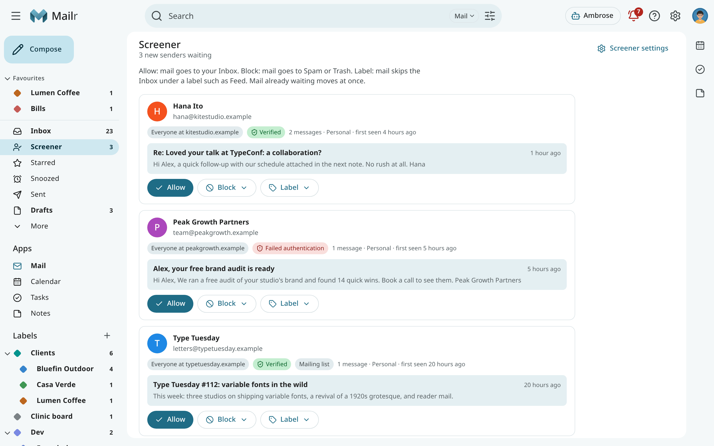
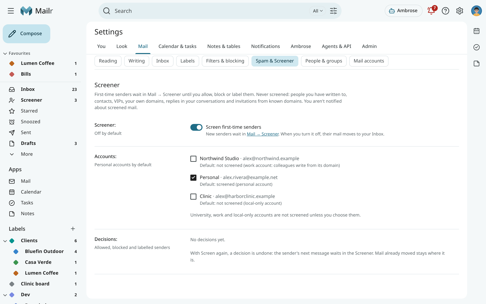
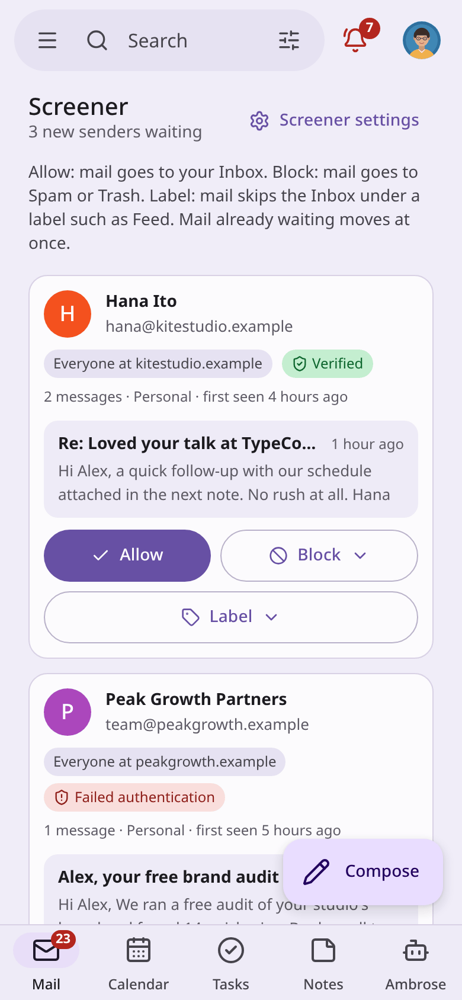

# The Screener

While the Screener is on, mail from first-time senders is kept out of the Inbox. It is held in
**Mail → Screener** until a decision is made about the sender: **Allow**, **Block** or **Label**.
The decision is made once per sender and applies to that sender's later mail.

The Screener is off by default.

## Turn the Screener on

Open **Settings → Mail → Spam & Screener** and switch on **Screen first-time senders** (`screener`). A
**Screener** entry then appears under the Inbox in the navigation, with the number of senders
waiting.

The accounts that are screened are set under **Accounts** (`screener_accounts`):

- Personal accounts are screened by default.
- University, government and work accounts are not screened by default. Students, colleagues and
  conference organisers often write to these for the first time. An account counts as a work account
  when it is a Google Workspace or Microsoft 365 account on an organisation's domain, or when several
  other people write to you from its domain.
- Local-only accounts are not screened by default.

Tick an account to screen it, or untick it to stop.

<!-- covers: screener.configure -->

## Screened senders

A sender is screened when there is no sign that you know them. These senders are never screened:

- people you have written to, and people who have written to you before;
- your contacts, including members of your contact groups;
- your VIP senders;
- anyone on one of your own domains;
- replies in a conversation you started or wrote in;
- calendar invitations from a domain you already have mail with.

The Screener is applied after your provider's spam filter, your blocked senders and Mailr's spam
checks. Mail sent to Spam by those checks stays in Spam. Mail archived or deleted by a filter is not held
either.

Mail waiting in the Screener:

- is not in the Inbox and not in the Inbox count;
- has no notifications;
- is still found by search and listed in All Mail.

## Review the senders

Open **Mail → Screener**. Each card shows:

- the sender's name and address;
- who your decision covers: **This address only**, or **Everyone at** a company's domain;
- an authentication hint. **Verified** means it was confirmed on the receiving server that the mail
  came from the sender's domain. **Failed authentication** means it may not be from there. **Not
  verified** means there was no result for that domain;
- how many messages wait, from which account, and when the sender first wrote;
- the subject and preview of the latest message. Click it to read the conversation.

Then decide:

- **Allow**: the mail waiting is moved to your Inbox, and later mail arrives in the Inbox. Your
  filters still apply to it.
- **Block**: the mail waiting and later mail are sent to Spam, and the sender's address is added to
  your blocked senders. With **Block and delete**, it is sent to Trash instead.
- **Label**: the mail waiting and later mail stay out of the Inbox under a label. **Feed** is a
  label for newsletters and updates to read later; it is created the first time.

<!-- covers: screener.review screener.allow screener.block screener.label -->

When you write to a sender who is waiting, they are allowed.

## Addresses and domains

A decision about someone at a company's domain covers everyone at that domain: when you
allow `ana@acme.example`, mail from `billing@acme.example` is let in too. At shared mail providers such as
gmail.com or outlook.com, and at universities and government domains, many unrelated people share
the domain, so each decision covers one address only.

## Change a decision

Every sender you allowed, blocked or labelled is listed under **Settings → Mail → Spam & Screener → Decisions**.
Use **Screen again** to undo a decision: that sender's next message waits in the Screener again. Mail
that already moved stays where it is. A block to Spam is lifted from your blocked senders.

<!-- covers: screener.forget -->

## Turn the Screener off

Switch off **Screen first-time senders**. The mail waiting is moved to your Inbox, and new senders
arrive there as before. Your decisions stay: blocked senders still go to Spam, and labelled senders
still go to their label.

## Routines and Ambrose

- When a routine has a digest, the digest ends with how many senders wait in the Screener and a
  **review** link. See [Standing orders and briefs](standing-orders.md#routines).
- Ambrose and connected agents can list the senders waiting (`list_screened_senders`). An
  agent can ask to allow, block or label a sender (`screener_decide`), but such a request always
  requires approval, even when everything else is allowed by a rule, so that a stranger cannot use an
  email to ask an agent to let them in. See [Approvals](approvals.md).
