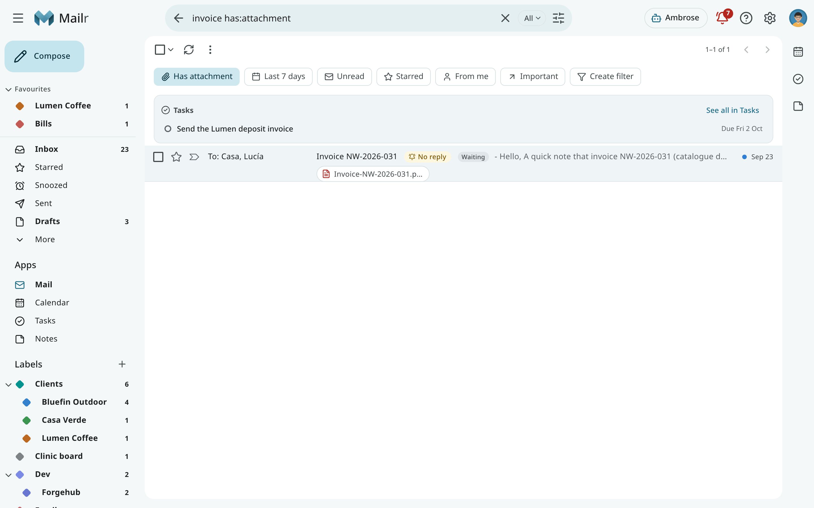
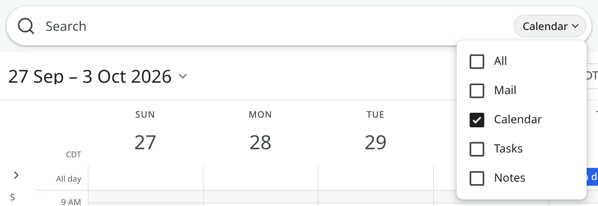
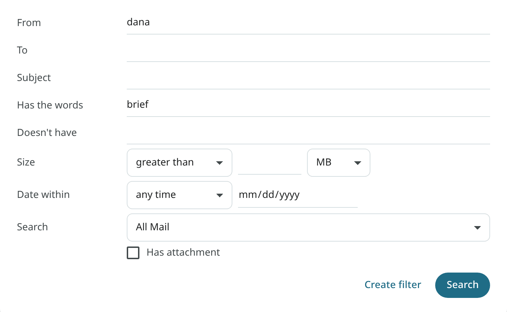

# Search

Press `/` or click the search box at the top. Type words, operators, or both, and press Enter. The
same syntax, based on Gmail's, is used in the search box, filters, layouts and the API. A filter
always matches the same mail as the same search.

## Search scope

The search box has a chip on its right: **All**, **Mail**, **Calendar**, **Tasks** or **Notes**. It
is set to the app you are in, so in Mail it shows **Mail** and in Calendar it shows **Calendar**.
Press Esc in the box to switch it to **All**, or click the chip to pick another place. When you
change the chip after a search, the search is carried over.

| Chip | Results |
|---|---|
| **All** | Mail results, with the matching notes, events and tasks above them. The app you searched from comes first. |
| **Mail** | Mail only. |
| **Calendar**, **Tasks**, **Notes** | That app's own results, as you type. |

When only notes, events or tasks match, the mail part shows **No mail matches** in one line.

On a phone, the chip appears while you type in the box.

## Words

Words without an operator are searched for in the subject, the sender and recipients, attachment names and the
text of each message. Quoted history is left out, so an old reply does not match every later
message. Put a phrase in quotes to match it exactly: `"landing page"`.

A word of three or more letters also matches part of a word in the subject or the sender, so
`invo` finds "Invoice". A word of one or two letters matches whole words only: `Q3` finds
"Q3 report" but not "FAQ3".

The text of an email attached to a message (see [Attached emails](reading.md#attached-emails)) is
searched too, but it ranks below a message's own text. When a conversation matches only inside an
attached email, its row says **In an attached email**.

Spam and Trash are left out unless the search includes `in:spam`, `in:trash` or `in:anywhere`.

## Operators

The most-used operators are:

| Search | Matches |
|---|---|
| `from:dana` | Mail from Dana (name or address). `from:me` is mail you sent. |
| `to:me`, `cc:`, `bcc:` | Mail by recipient. |
| `subject:"weekly update"` | Words in the subject. |
| `label:clients` | A label and the labels nested under it. |
| `in:inbox`, `in:sent`, `in:snoozed` | A place. |
| `is:unread`, `is:starred`, `is:important` | A state. |
| `has:attachment`, `filename:pdf` | Attachments, by presence, name or type. |
| `newer_than:7d`, `older_than:1y` | Relative dates (`d`, `m`, `y`). |
| `after:2026/09/01`, `before:2026/10/01` | Absolute dates. |
| `larger:5M`, `smaller:100K` | Message size. |
| `category:promotions` | An inbox category. |
| `list:thegrid.example` | A mailing list. |
| `account:work@example.com` | Mail of one of your mail accounts, by its address: mail that arrived through it, and mail you sent from its addresses. In an account's own folder, this operator is added to your search (see [Several mail accounts](inbox.md#several-mail-accounts)). |

Some operators are specific to Mailr and match triage signals:

| Search | Matches |
|---|---|
| `is:needs_reply` | Conversations where someone waits for your answer. |
| `is:waiting` | Conversations where you wait for someone else. |
| `has:deadline` | Mail with a deadline for you, such as a bill due. |
| `is:follow_up` | Conversations with a "remind me if nobody replies" set. |
| `is:nudged` | Conversations that came back with no reply. |
| `is:vip` | Mail from your VIP senders. |
| `has:recording` | Conversations linked to a meeting recording. |

While you type in the search box, people are suggested after `from:`, `to:`, `cc:` and `bcc:`,
labels after `label:`, and folders after `in:`. Pick one to complete the word.

The [search operator reference](../reference/search-operators.md) lists every operator and value.

## Combining terms

- Terms are combined with AND: `from:dana has:attachment`.
- `OR` (or `|`) between terms: `from:dana OR from:marco`.
- `{ }` is an OR group: `{from:dana from:marco}`.
- `( )` groups terms: `(from:dana brief) OR invoice`.
- An operator applies to a whole group: `from:(dana OR marco)`.
- `-` excludes a term or group: `-label:reading`.
- Address operators take comma lists: `from:dana@lumencoffee.example,marco.silva@bluefin.example`.

!!! example "Notes to yourself"
    `from:me to:me` matches the mail you sent to yourself. The search contains no addresses, so it
    works in every account.

## Refine and save

Under the search box, use chips to add a term with one click: **Has attachment**, **Last 7 days**,
**Unread**, **Starred**, **From me** and **Important**. Use **Create filter** to turn the search into
a [filter](organize.md#filters).

Use **Show search options** to open the advanced form: From, To, Subject, Has the words, Doesn't have,
Size, Date within, a place to search, and Has attachment. The matching operators are added to the
search box.

The right-click menu of a row has **Find mail**: more from this sender, from this domain, with
these people, or with this subject.

## Search by meaning

When you remember what an email said but not its words, ask Ambrose: "find the thread where
the vendor promised a refund". Ambrose searches by meaning as well as by words, and answers with
links to the passages found. See [Ask Ambrose](assistant.md).

<!-- covers: mail.search_account -->
