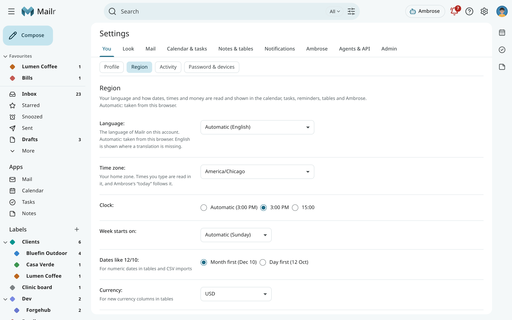
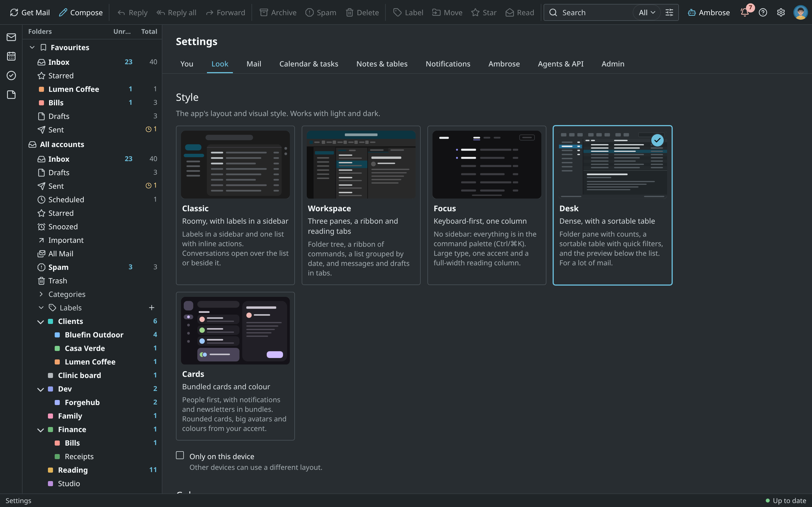
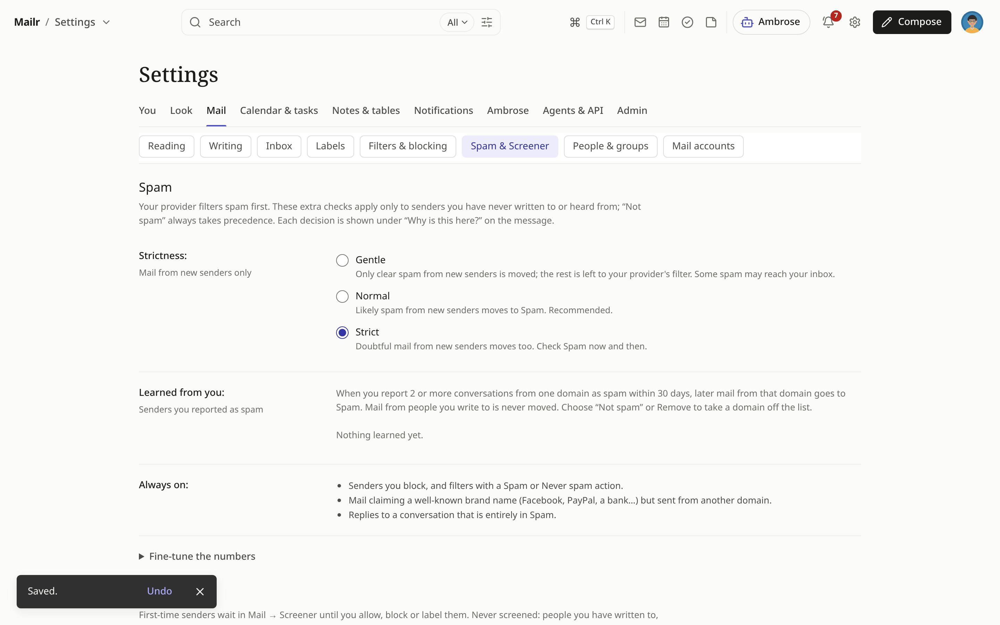
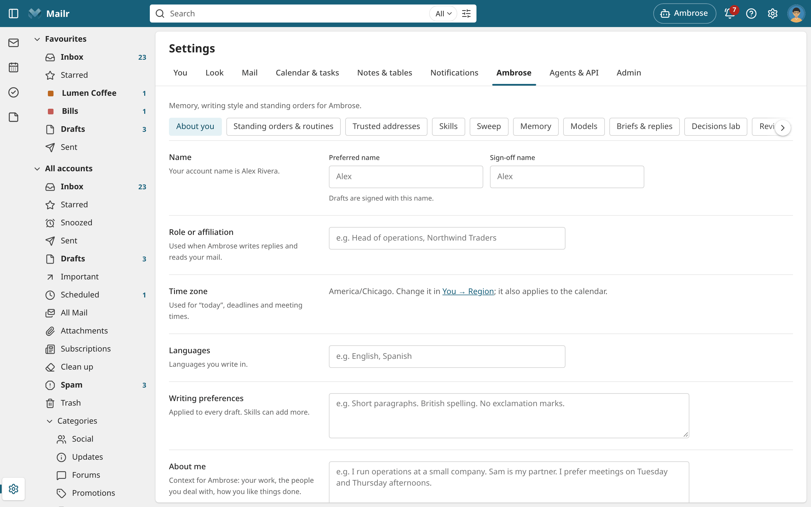
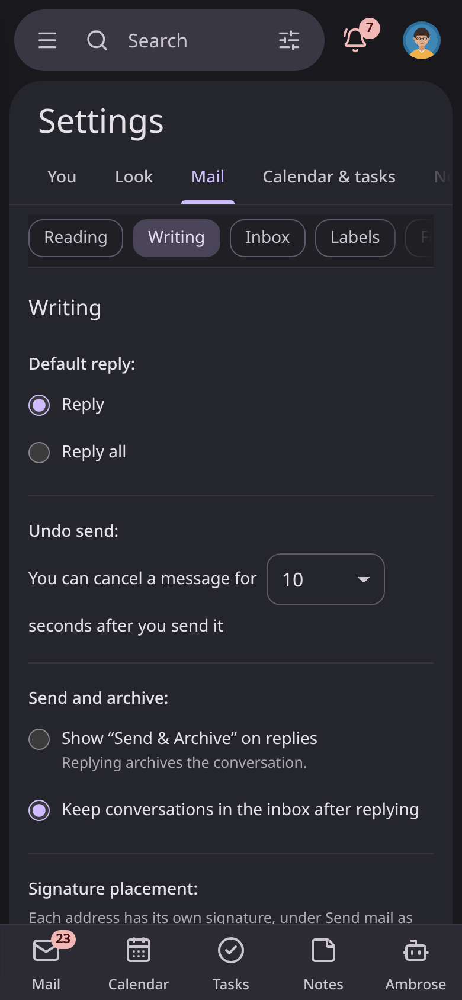

# Settings

Open **Settings** from the gear at the top (**See all settings**) or with `Ctrl + ,`. Settings are grouped by
task. The groups are along the top; the pages of a group with several are shown as
chips under it.

| Group | Contents |
|---|---|
| **You** | Your picture and name, the setup guide, your **Region**, [Activity](activity.md), your password and signed-in devices, and installing the app. |
| **Look** | The **Style** (Classic, Workspace, Focus, Desk or Cards), **Light or dark**, **Text & spacing**, what only the current style has (**This layout**: its reading pane, the Cards bundles) and keyboard shortcuts. |
| **Mail** | **Reading**, **Writing** (reply, undo send, signature, addresses you send from, templates, away message, [email links](email-links.md)), **Inbox** (inbox type, layouts, tabs, sections, markers, VIP senders), **Labels**, **Filters & blocking**, **Spam & Screener**, **People & groups** and **Mail accounts**. |
| **Calendar & tasks** | Calendar & task accounts, working hours, reminder defaults, invitations and repeating tasks, and sharing your free/busy with your groups. |
| **Notes & tables** | Export of all your notes. |
| **Notifications** | Notification sources on every device, this browser's notifications, reminder kinds and sound. |
| **Ambrose** | About you, standing orders and routines, skills, sweep rules and past choices, memory, people, models, briefs and reply suggestions. |
| **Agents & API** | With **Advanced settings** on: approvals, permissions, API tokens, failed messages and the audit log. |
| **Admin** | For admins: users, access policies, models, web search, calendars, phone apps, diagnostics, and data and privacy. See the [Admin guide](../admin/index.md). |

Turn on **Advanced settings** at the top to see the detailed parts: the Agents & API page, the filter rules, the
learning detail and the decisions lab. Admins always see everything.

## Changes are saved at once

<!-- covers: settings.undo_change -->

Every change is saved as soon as you make it. A notice shows **Saved.** with **Undo**, to put the
old value back. A text field (your name, the away message, a section's search) is saved when you
leave the field or stop typing for a moment. No edit is lost when you move to another page. No settings
page has a Save button.

## Region

<!-- covers: settings.region -->

**Settings → You → Region** holds your language and the settings for dates, times and money, for
every part of Mailr:

| Setting | Description |
|---|---|
| Language | The language of Mailr's words: English, Deutsch, Español, Français, Português (Brasil), Русский or 中文（简体）. With **Automatic**, this browser's language is used when Mailr has it, and English otherwise. A language chosen here is required for notifications sent to your phone or computer; with **Automatic** they are in English. After a change, the page is reloaded, so every word changes at once; the notice that follows still has **Undo**. Dates and numbers follow the language, in your browser's variant of it (English with a British browser shows 6 October). |
| Time zone | Your home zone. Times you type are read in it, the calendar is shown in it, and Ambrose's "today" is the day there. With **Automatic**, the zone of the browser or phone you last used Mailr on is used, also for what is done on the server: Ambrose's times, notifications, quiet hours, dates in templates and the away reply. |
| Clock | 12-hour or 24-hour times: in the mail list, the calendar, tasks, reminders and their notifications. Ambrose writes times the same way ("5:08 PM" or "17:08"). With **Automatic**, the clock of the browser or phone you last used Mailr on is followed. |
| Week starts on | The first day of the week. |
| Dates like 12/10 | Month first or day first, for tables and CSV imports. |
| Currency | For new currency columns in tables. |

The time zone is the same everywhere; it is also shown under **Ambrose → About you**, with a link here.

## Find a setting

<!-- covers: settings.find -->

Press `Ctrl + K` and type what you are looking for, such as "time zone", "signature" or "dark".
The palette lists **Settings: …** entries for the pages that hold it. Choose one to open the page
at that setting.

## Password & devices

<!-- covers: settings.password_change settings.sign_out_everywhere -->

**Settings → You → Password & devices** lists every browser and phone signed in to your account.
You can sign any of them out there.

When you change your password (password sign-in only), your other devices are signed out and your
API tokens are revoked. **Also sign out mail and calendar apps** is ticked at first. With it, your
IMAP password and the app passwords of [phone and desktop calendar apps](phone-calendar.md) stop
working too. Make a new IMAP password and new app passwords for the apps you still use. Untick it
only when you change your password as a routine, not because someone else may have had your account.

**Sign out everywhere** does the same without a new password, for example when you sign in with
single sign-on. Every other device is signed out, every API token is revoked, and mail and
calendar apps stop working. The device you use stays signed in.

Both also remove the push notification targets of every other device, so a phone, browser or ntfy
topic that someone else added stops getting your notifications. Signing out of a browser ends its
push notifications as well.

### Review after signing out

Someone who had your account for a while could have set up things that keep working after they are
signed out. A password change, **Sign out everywhere** and an administrator's password reset take
back what was set up since the oldest of the signed-out devices signed in, and at least in the last
14 days:

- **Follow my forwarded notes** set to Allow goes back to Ask me, so a forwarded note waits for your
  approval.
- Permissions that let Ambrose act without asking, added in that time, ask first again.
- [Addresses that speak for you](assistant.md) confirmed in that time need a new code.
- Forwarding addresses confirmed in that time need a new code; no mail is forwarded to them until
  then.

Older choices stay as they are. **Review after signing out** under **Settings → You → Password &
devices** lists what was taken back, with links to each place. Turn back on what you set up
yourself, remove the rest, then choose **Dismiss**. After an administrator's reset, the list is
there at your next sign-in.

## Two-factor sign-in (2FA)

Mailr has no two-factor codes of its own. Two-factor sign-in is available through single sign-on,
set up by the administrator with an identity provider that requires a second factor, such as a
passkey or a one-time code (see [Sign-in and OIDC](../admin/sign-in.md)).

## Delete your account

Only an administrator can delete a Mailr account, under **Settings → Admin → Users** (see
[Users](../admin/users.md)). To remove one of your mail accounts from Mailr, see
[Remove an account](../getting-started/connect-accounts.md#remove-an-account).

## On a phone

The groups and the page chips scroll sideways. The current one stays in view.

The Android app has its own settings for this phone. See [App settings](../android/settings.md).

## Old links

Links to the old settings tabs, such as `/settings/general` or
`/settings/assistant?section=models`, are redirected to the page that now holds those settings.
